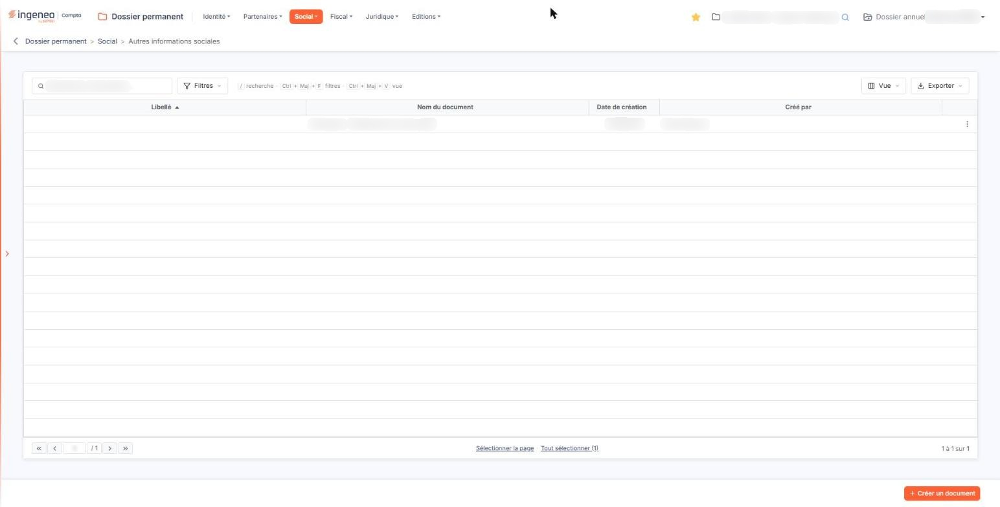
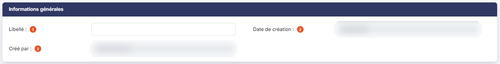
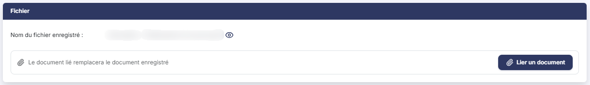

# Autres informations sociales


**Où le trouver :** Menu **Social › Autres informations sociales**



**En bref** — Cet écran conserve les documents sociaux sans option dédiée dans le menu « Social » : chaque élément est un document accompagné d'un libellé.

* Pour ajouter un document : bouton \[Créer un document], saisissez le libellé, bouton \[Lier un document], puis bouton \[Enregistrer].


Cette option vous permet de conserver dans le dossier les documents sociaux qui ne relèvent d'aucune des autres options du menu « Social » : une note d'information au personnel, une circulaire, un courrier d'organisme, un document réglementaire — tout ce qu'il vous paraît utile de retrouver plus tard, sans qu'il existe pour cela un sous-menu dédié.

<figure><figcaption>
Écran « Autres informations sociales » de la nouvelle interface
</figcaption></figure>

C'est donc le fourre-tout organisé du volet social du dossier. Chaque élément que vous y enregistrez est **un document, accompagné d'un libellé**, et rien de plus : il n'y a ni date propre, ni période, ni descriptif, contrairement aux autres options du menu.

L'écran se présente en deux temps : une **liste** des documents déjà enregistrés, puis une **fiche** que vous ouvrez pour en ajouter un ou en modifier un. La liste ne comporte ni onglet, ni rubrique ; au-dessus d'elle, une barre d'outils, décrite plus bas, s'applique à la liste entière.

## Les colonnes de la liste

La liste présente les colonnes suivantes, dans cet ordre. Toutes sont triables : vous cliquez sur l'intitulé d'une colonne pour trier la liste dessus. À l'ouverture, la liste est triée sur **Libellé**, par ordre croissant.

| Champ                | Ce qu'il faut savoir                                                                                                                                                                                                                                                                                 |
| -------------------- | ---------------------------------------------------------------------------------------------------------------------------------------------------------------------------------------------------------------------------------------------------------------------------------------------------- |
| **Libellé**          | Le libellé que vous avez saisi dans la fiche. Il peut être vide, puisque rien ne vous oblige à le renseigner — et une liste où plusieurs libellés sont vides devient difficile à exploiter, alors que c'est justement la colonne sur laquelle elle se trie. Prenez donc l'habitude de le renseigner. |
| **Nom du document**  | Le nom du fichier joint. Bien qu'un nom de fichier s'y affiche, **ce n'est pas un lien** : cliquer dessus ne fait rien. Pour obtenir le document, utilisez le pictogramme « Œil » de la ligne.                                                                                                       |
| **Date de création** | La date à laquelle le document a été enregistré dans le dossier.                                                                                                                                                                                                                                     |
| **Créé par**         | Le nom de l'utilisateur qui l'a enregistré.                                                                                                                                                                                                                                                          |

Le pied de la liste porte la barre de navigation entre les pages, au centre deux liens de sélection — « Sélectionner la page » et « Tout sélectionner », ce dernier rappelant entre parenthèses le nombre total de lignes — et, à droite, le décompte des lignes affichées.

Au-dessus de la liste, une barre d'outils s'applique à la liste entière.

La zone « Rechercher un document… » restreint la liste dès la saisie. Elle ne porte que sur la colonne **Libellé**.

bouton **\[Filtres]** : déroule un volet « Filtrer ». La liste « + Ajouter un critère sur… » propose les colonnes de la liste. Pour chaque critère, vous choisissez un opérateur et une valeur ; le bouton **\[Filtrer]** applique les critères à la liste, le bouton **\[Vider les filtres]** les efface.

bouton **\[Vue]** : rassemble, sous « Mes vues », l'enregistrement de l'état de la liste sous un nom (« Enregistrer la vue actuelle ») et, sous « Colonnes affichées », le choix des colonnes à afficher : quatre colonnes sont affichées sur les quatre proposées. « Rétablir les colonnes d'origine » et « Appliquer » complètent ce menu.

bouton **\[Exporter]** : rappelle l'étendue concernée (« La liste affichée », suivie du décompte des lignes) et propose « Aperçu édition HTML », « Imprimer », « Exporter en Excel », « Exporter en PDF » et « Envoyer la liste par e-mail ».

## Les commandes d'une ligne de la liste

Un clic sur une ligne la sélectionne, pour la supprimer ensuite avec le bouton **\[Supprimer]**.

Au survol d'une ligne apparaissent, à son extrémité droite, trois pictogrammes.

Le pictogramme « Crayon » (« Modifier ») ouvre la fiche en modification.

Le pictogramme « Œil », dont l'infobulle indique « Afficher l'aperçu », **télécharge** le document joint sur votre poste. Son infobulle promet un aperçu à l'écran : ce n'en est pas un.

Le pictogramme à trois points verticaux (« Autres actions ») ouvre un menu qui propose « Supprimer », pour supprimer l'élément de la ligne.

Il n'y a pas de commande de duplication sur cet écran.

## Bouton \[Créer un document]

Placé en bas à droite de l'écran, il ouvre une fiche vide, pour enregistrer un nouveau document.

## Bouton \[Supprimer]

Dès qu'au moins une ligne est sélectionnée, un bandeau apparaît en bas de l'écran ; il indique le nombre de lignes sélectionnées, propose le lien « Tout désélectionner » et porte ce bouton, qui supprime **tous les éléments sélectionnés**. Vérifiez votre sélection avant de le presser. Pour n'en supprimer qu'un seul, la commande « Supprimer » du menu « Autres actions » de sa ligne suffit.

## La fiche

Que vous l'ouvriez en création ou en modification, la fiche présente **deux rubriques**, dans cet ordre : « Informations générales », puis « Fichier ». Il n'y a aucun onglet.

**Cette fiche ne se comporte pas de la même façon selon que vous créez ou que vous modifiez**, et la différence porte précisément sur ce qui est obligatoire. Lisez les deux rubriques ci-dessous en gardant cette distinction en tête : c'est le seul point sur lequel cet écran peut vous surprendre.

## Rubrique « Informations générales »

<figure><figcaption>
Rubrique « Informations générales »
</figcaption></figure>

| Champ                   | Ce qu'il faut savoir                                                                                                                                                                                                                                                                                                                                                                                                                                                                                                                                                                                                                                                                                                                                                                                                            |
| ----------------------- | ------------------------------------------------------------------------------------------------------------------------------------------------------------------------------------------------------------------------------------------------------------------------------------------------------------------------------------------------------------------------------------------------------------------------------------------------------------------------------------------------------------------------------------------------------------------------------------------------------------------------------------------------------------------------------------------------------------------------------------------------------------------------------------------------------------------------------- |
| 1. **Libellé**          | 
Le nom sous lequel vous voulez retrouver ce document, <strong>50 caractères au maximum</strong>. Cette zone <strong>n'est pas obligatoire</strong>, ni à la création, ni en modification, et l'écran ne vous donne aucune indication sur ce qu'il convient d'y mettre. C'est pourtant la seule information que vous maîtrisez sur cet écran, et celle qui sert au tri de la liste. Employez-la comme un titre de classement — « Note d'information prélèvement à la source », « Circulaire mutuelle 2026 » — et non comme un simple rappel du nom du fichier, que la colonne voisine affiche déjà. Les deux zones suivantes n'apparaissent <strong>qu'en modification</strong> : elles ne sont donc pas visibles lorsque vous créez un élément. Ni l'une ni l'autre ne se saisit — le logiciel les renseigne seul.
 |
| 2. **Date de création** | La date à laquelle le document a été enregistré.                                                                                                                                                                                                                                                                                                                                                                                                                                                                                                                                                                                                                                                                                                                                                                                |
| 3. **Créé par**         | Le nom de l'utilisateur qui l'a enregistré.                                                                                                                                                                                                                                                                                                                                                                                                                                                                                                                                                                                                                                                                                                                                                                                     |

Cette rubrique ne conserve **ni date, ni auteur de la dernière modification** : la traçabilité s'arrête à la création. Elle ne comporte non plus **aucune date propre au document** — pas de date de signature, pas de date d'effet, pas de période : si la date du document compte pour vous, faites-la figurer dans le libellé.

## Rubrique « Fichier »

<figure><figcaption>
Rubrique « Fichier »
</figcaption></figure>

C'est ici que se trouve le document, et c'est ici que se joue la particularité de l'écran.

**À la création**, la rubrique comporte une seule zone, **Fichier \* :**, qui affiche « Aucun document lié » tant que vous n'avez rien joint, et le bouton **\[Lier un document]**. Elle porte un **astérisque** : le document est **obligatoire**. Vous ne pouvez donc pas créer un élément sans joindre un fichier — c'est même le **seul renseignement obligatoire de tout l'écran**, le libellé ne l'étant pas.

**En modification**, la même rubrique s'intitule **Nom du fichier enregistré :** et affiche le nom du document déjà joint, suivi du pictogramme « Œil » dont l'infobulle indique « Visualiser » — et qui **télécharge** le document sur votre poste. Elle **ne porte plus d'astérisque**. En dessous, l'écran rappelle que « Le document lié remplacera le document enregistré », et le bouton **\[Lier un document]** reste proposé : il vous sert à joindre un autre fichier à la place de celui qui est enregistré.

bouton **\[Lier un document]** : ouvre, à droite de l'écran, un volet « Lier un document ». Vous y choisissez la source du document, « Depuis mon poste » ou « Depuis la GED », puis, depuis votre poste, vous déposez le fichier dans la zone prévue ou vous parcourez vos fichiers. Le bouton **\[Lier le document]** retient le document, le bouton **\[Annuler]** referme le volet sans rien lier.

Retenez donc la règle en une phrase : **le document est obligatoire pour créer l'élément, il ne l'est plus pour le modifier**. Ne cherchez pas l'astérisque en modification, il n'y est pas — ce qui ne veut pas dire que l'élément peut se passer de document.

Le volet annonce « Tous formats sauf .exe, .bat, .cmd, .sh — nom de 100 caractères maximum ».

## Bouton \[Enregistrer] et retour à la liste

<figure><figcaption>
Bouton [Enregistrer] et retour à la liste
</figcaption></figure>

Le bouton **\[Enregistrer]** conserve la fiche.

Pour quitter la fiche sans enregistrer et revenir à la liste, cliquez sur la flèche « Revenir en arrière » placée à gauche du fil d'Ariane, en haut de l'écran : la fiche ne comporte pas de bouton de retour.
