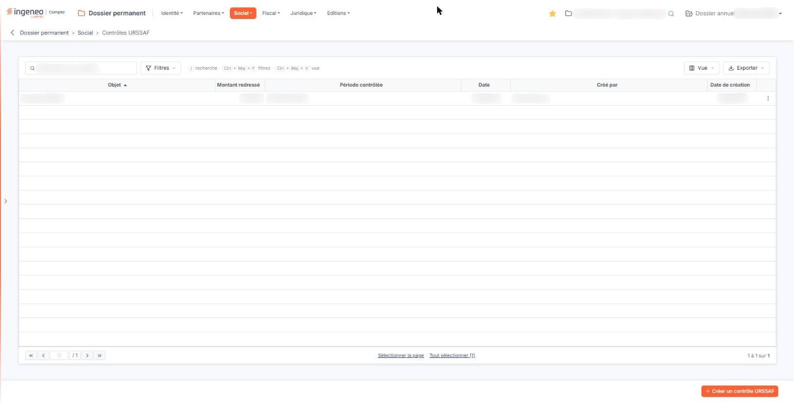
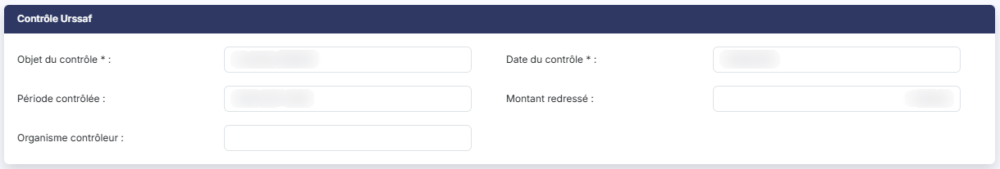
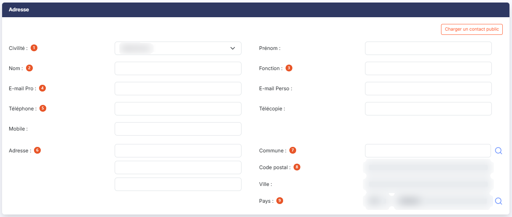
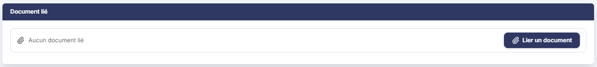

# Contrôles URSSAF


**Où le trouver :** Menu **Social › Contrôles URSSAF**



**En bref** — Cet écran conserve l'historique des contrôles URSSAF de la société : objet, date, période contrôlée, redressement, organisme, contact et pièce justificative.

* Pour enregistrer un contrôle : bouton \[Créer un contrôle URSSAF], renseignez la fiche, puis bouton \[Enregistrer].
* Pour reprendre un contact déjà connu : bouton \[Charger un contact public] ; bouton \[Privatiser ce contact] pour le rendre modifiable.


Cette option vous permet de conserver dans le dossier l'historique des contrôles URSSAF subis par la société : leur objet, leur date, la période contrôlée, le montant du redressement, l'organisme qui a conduit le contrôle, le contact avec lequel vous avez traité, et la pièce qui en rend compte.

<figure><figcaption>
Écran « Contrôles URSSAF » de la nouvelle interface
</figcaption></figure>

C'est une information que l'on ne consulte pas souvent, mais que l'on cherche toujours dans l'urgence : à l'annonce d'un nouveau contrôle, ou lors de la reprise du dossier par un autre collaborateur. Elle mérite donc d'être renseignée au moment où elle est fraîche.

L'écran se présente en deux temps : une **liste** des contrôles déjà enregistrés, puis une **fiche** que vous ouvrez pour en créer un ou en modifier un. La liste ne comporte ni onglet, ni rubrique ; au-dessus d'elle, une barre d'outils, décrite plus bas, s'applique à la liste entière.

La fiche, elle, est **nettement plus longue** que celles des autres options du menu « Social » : sur un écran peu haut, sa dernière rubrique, celle du document, ne se voit qu'après avoir fait défiler la page. N'en concluez pas qu'il n'y a rien à joindre.

## Les colonnes de la liste

La liste présente les colonnes suivantes, dans cet ordre. Toutes sont triables : vous cliquez sur l'intitulé d'une colonne pour trier la liste dessus. À l'ouverture, la liste est triée sur **Objet**, par ordre croissant — et non sur la date du contrôle. Si vous voulez voir les contrôles dans leur ordre chronologique, cliquez sur **Date**.


Notez que les intitulés de la liste sont **plus courts que ceux de la fiche** : la liste dit **Objet** et **Date**, là où la fiche dit **Objet du contrôle** et **Date du contrôle**. Il s'agit bien des mêmes informations.


| Champ                                                                                        | Ce qu'il faut savoir                                                                                                                                                                                                                                                                |
| -------------------------------------------------------------------------------------------- | ----------------------------------------------------------------------------------------------------------------------------------------------------------------------------------------------------------------------------------------------------------------------------------- |
| **Objet**                                                                                    | L'objet du contrôle, tel que vous l'avez saisi.                                                                                                                                                                                                                                     |
| **Montant redressé**                                                                         | Le montant du redressement. Il est aligné à droite et affiché **sans symbole monétaire**. L'intitulé de cette colonne est **coupé en cours de mot** à l'affichage, la colonne étant plus étroite que son titre : vous pouvez l'élargir en tirant la bordure de son en-tête.         |
| **Période contrôlée**                                                                        | La période sur laquelle le contrôle a porté, telle que vous l'avez saisie — c'est un texte libre, pas un couple de dates.                                                                                                                                                           |
| **Date**                                                                                     | La date du contrôle.                                                                                                                                                                                                                                                                |
| **Créé par**                                                                                 | Le nom de l'utilisateur qui a enregistré le contrôle.                                                                                                                                                                                                                               |
| **Date de création**                                                                         | La date à laquelle il l'a enregistré. Ne la confondez pas avec la colonne **Date**, qui est la date du contrôle lui-même.                                                                                                                                                           |
| **Trois informations de la fiche ne figurent pas dans les colonnes affichées à l'ouverture** | L'organisme contrôleur, le contact, et la présence ou non d'un document joint. Les coordonnées du contact peuvent être ajoutées à la liste par le bouton **\[Vue]**, décrit plus bas ; l'organisme contrôleur et le document, non : pour les connaître, vous devez ouvrir la fiche. |

Le pied de la liste porte la barre de navigation entre les pages, au centre deux liens de sélection — « Sélectionner la page » et « Tout sélectionner », ce dernier rappelant entre parenthèses le nombre total de lignes — et, à droite, le décompte des lignes affichées.

Au-dessus de la liste, une barre d'outils s'applique à la liste entière.

La zone « Rechercher un contrôle… » restreint la liste dès la saisie. Elle ne porte que sur la colonne **Objet**.

bouton **\[Filtres]** : déroule un volet « Filtrer ». La liste « + Ajouter un critère sur… » propose les colonnes de la liste, mais aussi les coordonnées du contact de la rubrique « Adresse » (**Civilité**, **Nom**, **Prénom**, **Fonction**, **E-mail Pro**, **E-mail Perso**, **Téléphone**, **Télécopie**, **Mobile**, **Adresse 1**, **Adresse 2**, **Adresse 3**, **Code postal**, **Ville** et **Pays**), ainsi que **Modifié par** et **Date de modification**. Pour chaque critère, vous choisissez un opérateur et une valeur ; le bouton **\[Filtrer]** applique les critères à la liste, le bouton **\[Vider les filtres]** les efface.

bouton **\[Vue]** : rassemble, sous « Mes vues », l'enregistrement de l'état de la liste sous un nom (« Enregistrer la vue actuelle ») et, sous « Colonnes affichées », le choix des colonnes à afficher : six colonnes sont affichées sur les vingt-trois proposées. « Rétablir les colonnes d'origine » et « Appliquer » complètent ce menu.

bouton **\[Exporter]** : rappelle l'étendue concernée (« La liste affichée », suivie du décompte des lignes) et propose « Aperçu édition HTML », « Imprimer », « Exporter en Excel », « Exporter en PDF » et « Envoyer la liste par e-mail ».

## Les commandes d'une ligne de la liste

Un clic sur une ligne la sélectionne, pour la supprimer ensuite avec le bouton **\[Supprimer]**.

Au survol d'une ligne apparaissent, à son extrémité droite, deux pictogrammes : le « Crayon » (« Modifier »), qui ouvre la fiche du contrôle en modification, et trois points verticaux (« Autres actions »), qui ouvrent un menu proposant « Supprimer » : cette commande supprime le contrôle de la ligne.

Il n'y a **ni pictogramme « Œil », ni commande de duplication** : c'est en ouvrant la fiche que vous accédez au document joint.

## Bouton \[Créer un contrôle URSSAF]

<figure><figcaption>
Rubrique « Contrôle Urssaf »
</figcaption></figure>

Placé en bas à droite de l'écran, il ouvre une fiche vide, pour enregistrer un nouveau contrôle.

## Bouton \[Supprimer]

Dès qu'au moins une ligne est sélectionnée, un bandeau apparaît en bas de l'écran ; il indique le nombre de lignes sélectionnées, propose le lien « Tout désélectionner » et porte ce bouton, qui supprime **tous les contrôles sélectionnés**. Vérifiez votre sélection avant de le presser. Pour n'en supprimer qu'un seul, la commande « Supprimer » du menu « Autres actions » de sa ligne suffit.

## La fiche d'un contrôle

Que vous l'ouvriez en création ou en modification, la fiche présente **trois rubriques**, dans cet ordre : « Contrôle Urssaf », « Adresse », puis « Document lié ». Il n'y a aucun onglet.

Ne vous étonnez pas du titre de la première : l'écran s'intitule « Contrôles URSSAF » au menu comme en haut de la page, en capitales, et sa première rubrique s'appelle **« Contrôle Urssaf »**. Il s'agit bien du même objet, avec deux graphies du sigle.

**Seuls deux renseignements sont obligatoires sur toute la fiche** : l'objet du contrôle et sa date. Tout le reste — le contact, l'adresse, le document — peut rester vide, et peut être complété plus tard.

## Rubrique « Contrôle Urssaf »

Les cinq zones de cette rubrique se répartissent sur trois lignes, deux par deux, la dernière étant seule à gauche.

| Champ                                                             | Ce qu'il faut savoir                                                                                                                                                                |
| ----------------------------------------------------------------- | ----------------------------------------------------------------------------------------------------------------------------------------------------------------------------------- |
| 
<strong>Objet du contrôle</strong> <em>Obligatoire</em>
 | Ce sur quoi le contrôle a porté, **50 caractères au maximum**. Obligatoire, et c'est la zone sur laquelle la liste se trie : soignez-la.                                            |
| 
<strong>Date du contrôle</strong> <em>Obligatoire</em>
  | La date du contrôle. Obligatoire. Vous la saisissez au clavier ou vous la choisissez dans le calendrier qui s'ouvre au clic dans la zone.                                           |
| **Période contrôlée**                                             | La période sur laquelle le contrôle a porté. **C'est un texte libre de 50 caractères**, et non un couple de dates : le logiciel n'impose aucune forme et ne vous en suggère aucune. |
| **Montant redressé**                                              | Le montant du redressement notifié. La zone n'accepte que des chiffres et met en forme le montant à mesure que vous le saisissez.                                                   |
| **Organisme contrôleur**                                          | L'organisme qui a conduit le contrôle, **50 caractères au maximum**.                                                                                                                |

Aucune de ces cinq zones ne porte d'infobulle : l'écran ne vous donne aucune indication complémentaire.

## Rubrique « Adresse »

<figure><figcaption>
Rubrique « Adresse »
</figcaption></figure>

Le titre de cette rubrique est trompeur, et il vaut mieux le savoir : elle ne contient pas seulement une adresse, mais **l'identité complète du contact** avec lequel vous avez traité le contrôle — sa civilité, son nom, sa fonction, ses courriels et ses téléphones — puis son adresse, et enfin les informations de traçabilité de la fiche.

**Aucune de ces zones n'est obligatoire.** Si vous n'avez pas de contact à renseigner, laissez la rubrique vide : elle occupera tout de même la moitié de la hauteur de la fiche.

Les zones se présentent dans cet ordre :

| Champ                    | Ce qu'il faut savoir                                                                                                                                                                                                                                                                                                                                                                                                                                                     |
| ------------------------ | ------------------------------------------------------------------------------------------------------------------------------------------------------------------------------------------------------------------------------------------------------------------------------------------------------------------------------------------------------------------------------------------------------------------------------------------------------------------------ |
| 1. **Civilité**          | 
Une liste déroulante proposant « Madame » et « Monsieur ». Elle affiche « Sélectionnez » tant que vous n'avez rien choisi. <strong>Prénom :15 caractères au maximum</strong> — la zone la plus courte de la rubrique, prenez garde aux prénoms composés.
                                                                                                                                                                                                       |
| 2. **Nom**               | 30 caractères au maximum.                                                                                                                                                                                                                                                                                                                                                                                                                                                |
| 3. **Fonction**          | La fonction du contact, 50 caractères au maximum.                                                                                                                                                                                                                                                                                                                                                                                                                        |
| 4. **E-mail Pro**        | **E-mail Perso :** deux adresses de courriel distinctes, 50 caractères chacune.                                                                                                                                                                                                                                                                                                                                                                                          |
| 5. **Téléphone**         | , **Télécopie :** et **Mobile :** trois numéros, 14 caractères chacun.                                                                                                                                                                                                                                                                                                                                                                                                   |
| 6. **Adresse**           | La première ligne de l'adresse, 38 caractères. **Deux autres lignes de 38 caractères la suivent, sans intitulé** : seule la première porte le mot « Adresse ». Servez-vous-en pour le complément d'adresse et la boîte postale.                                                                                                                                                                                                                                          |
| 7. **Commune**           | Saisissez le début de son nom : la zone propose les communes sous la forme « code - nom (département) » ; la loupe placée à droite ouvre un panneau « Sélection d'une commune », dont la liste (Code INSEE, Ville, Département) se filtre par nom ou par code INSEE.                                                                                                                                                                                                     |
| 8. **Code postal**       | **Ville :** sont en lecture seule (« Déduit de la commune »).                                                                                                                                                                                                                                                                                                                                                                                                            |
| 9. **Pays**              | 
Deux zones sur la même ligne. La première, intitulée « Code », affiche le code du pays et <strong>ne se saisit pas</strong> ; la seconde reçoit le nom du pays. Un pictogramme « Loupe » les suit et ouvre un panneau « Sélection d'un pays ». Les quatre dernières zones de la rubrique n'apparaissent <strong>qu'en modification</strong> : elles ne sont pas visibles lorsque vous créez un contrôle. Aucune ne se saisit — le logiciel les renseigne seul.
 |
| **Date de création**     | **Créé par :** quand la fiche a été créée, et par qui.                                                                                                                                                                                                                                                                                                                                                                                                                   |
| **Date de modification** | **Modifié par :** quand elle a été modifiée pour la dernière fois, et par qui.                                                                                                                                                                                                                                                                                                                                                                                           |

Cette fiche est l'une des rares du Dossier permanent à conserver la **dernière modification** et pas seulement la création. Ne vous attendez donc pas à retrouver ces deux dernières informations sur les autres options du menu « Social ».

## Bouton \[Charger un contact public]

Ce bouton est placé en tête de la rubrique « Adresse », à droite de son titre, et il est présent dès la création de la fiche. Il vous évite de ressaisir un contact déjà connu.

Ce bouton fait deux choses que rien à l'écran n'annonce, et qu'il vaut mieux savoir avant de cliquer. D'abord, le logiciel **contrôle votre saisie avant d'ouvrir la fenêtre de choix** : s'il manque une information obligatoire, la fenêtre ne s'ouvre pas et l'écran vous réaffiche ses messages.

Ensuite, lorsque vous retenez un contact dans cette fenêtre et que vous la validez, **le logiciel enregistre aussitôt le contrôle**, puis recharge la fiche. Sur une fiche que vous étiez en train de créer, l'enregistrement a donc lieu à ce moment-là, sans que vous ayez cliqué sur le bouton **\[Enregistrer]**, et revenir à la liste par la flèche du fil d'Ariane ne le défait pas.

Enfin, les coordonnées reprises de cette façon ne sont pas recopiées dans la fiche : elles sont lues dans l'annuaire du cabinet, et les champs de la rubrique « Adresse » s'affichent alors **en lecture seule**, sans que le logiciel vous l'explique par un message. Le bouton **\[Privatiser ce contact]**, qui s'ajoute à côté du premier dans ce cas, détache le contact de l'annuaire en conservant ses coordonnées dans la fiche : elles redeviennent alors modifiables.

## Rubrique « Document lié »

<figure><figcaption>
Rubrique « Document lié »
</figcaption></figure>

Vous joignez ici la pièce qui rend compte du contrôle. Le titre de la rubrique est au **singulier** : un contrôle ne porte **qu'un seul** document.

Lorsque aucun document n'est joint, la rubrique affiche « Aucun document lié » et le bouton **\[Lier un document]**. Rien n'y porte d'astérisque : le document n'est pas obligatoire, et un contrôle URSSAF s'enregistre sans pièce jointe.

bouton **\[Lier un document]** : ouvre, à droite de l'écran, un volet « Lier un document ». Vous y choisissez la source du document, « Depuis mon poste » ou « Depuis la GED », puis, depuis votre poste, vous déposez le fichier dans la zone prévue ou vous parcourez vos fichiers. Le bouton **\[Lier le document]** retient le document, le bouton **\[Annuler]** referme le volet sans rien lier.

Le volet annonce « Tous formats sauf .exe, .bat, .cmd, .sh — nom de 100 caractères maximum ».

C'est cette rubrique qui, sur un écran peu haut, demande de faire défiler la fiche.

## Bouton \[Enregistrer] et retour à la liste

<figure><figcaption>
Bouton [Enregistrer] et retour à la liste
</figcaption></figure>

Le bouton **\[Enregistrer]** conserve la fiche.

Pour quitter la fiche sans enregistrer et revenir à la liste, cliquez sur la flèche « Revenir en arrière » placée à gauche du fil d'Ariane, en haut de l'écran : la fiche ne comporte pas de bouton de retour.
