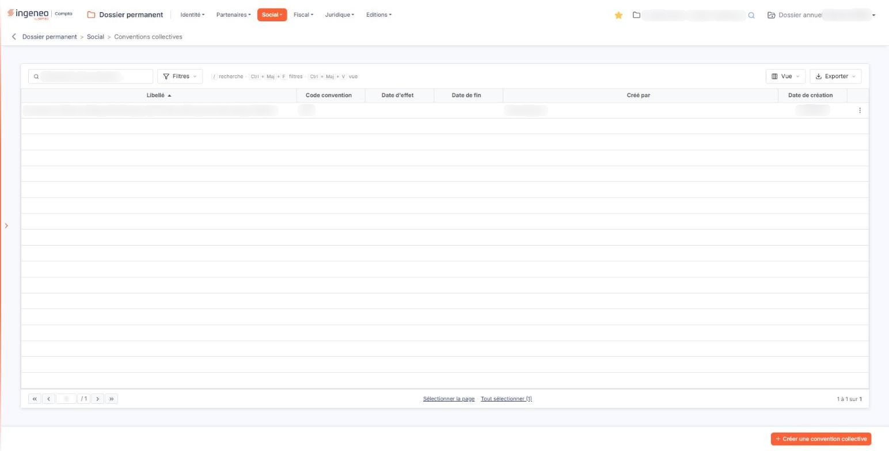
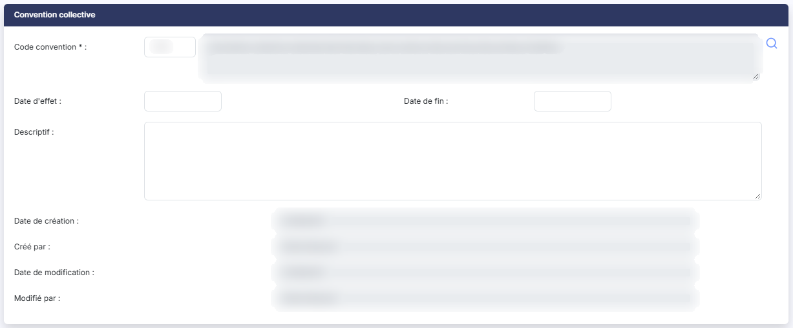
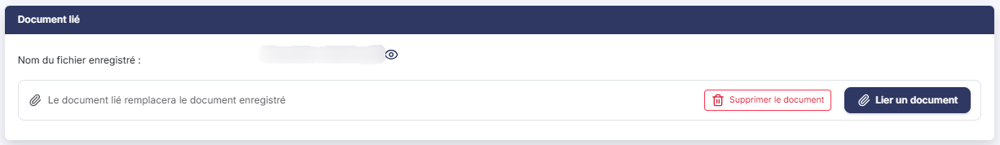

# Conventions collectives


**Où le trouver :** Menu **Social › Conventions collectives**



**En bref** — Cet écran indique la ou les conventions collectives de la société, leur période d'application et leur texte ; vous saisissez le code à quatre caractères, l'intitulé s'affiche seul.

* Pour ajouter une convention : bouton \[Créer une convention collective], cherchez le code avec le pictogramme « Loupe », puis bouton \[Enregistrer].


Cette option vous permet d'indiquer dans le dossier la ou les conventions collectives dont relève la société, la période pendant laquelle chacune s'applique, et de joindre le texte de la convention. Une société peut relever de plusieurs conventions au fil du temps : c'est pourquoi cet écran présente une liste, et non une seule fiche.

<figure><figcaption>
Écran « Conventions collectives » de la nouvelle interface
</figcaption></figure>

**Le point à comprendre avant tout le reste** : ce que vous renseignez, c'est le **code** de la convention — un code de quatre caractères. L'intitulé officiel, lui, ne se saisit pas : il s'affiche à côté du code, en lecture seule. Vous ne taperez donc jamais le nom d'une convention collective dans la fiche — vous pouvez en revanche vous en servir pour la **chercher**, dans la fenêtre que le pictogramme « Loupe » ouvre.

L'écran se présente en deux temps : une **liste** des conventions déjà enregistrées, puis une **fiche** que vous ouvrez pour en ajouter une ou en modifier une. La liste ne comporte ni onglet, ni rubrique ; au-dessus d'elle, une barre d'outils, décrite plus bas, s'applique à la liste entière.

## Les colonnes de la liste

La liste présente les colonnes suivantes, dans cet ordre. Toutes sont triables : vous cliquez sur l'intitulé d'une colonne pour trier la liste dessus. À l'ouverture, la liste est triée sur **Libellé**, par ordre croissant.

| Champ               | Ce qu'il faut savoir                                     |
| ------------------- | -------------------------------------------------------- |
| **Libellé**         | L'intitulé officiel de la convention.                    |
| **Code convention** | Le code de la convention, celui que vous avez renseigné. |


Notez que **la liste et la fiche présentent ces deux informations dans l'ordre inverse** : la liste montre d'abord l'intitulé puis le code, la fiche montre d'abord le code puis l'intitulé à sa droite.


| Champ                                                                                       | Ce qu'il faut savoir                                                                                                                                                                                                                                      |
| ------------------------------------------------------------------------------------------- | --------------------------------------------------------------------------------------------------------------------------------------------------------------------------------------------------------------------------------------------------------- |
| **Date d'effet**                                                                            | La date à partir de laquelle la convention s'applique à la société.                                                                                                                                                                                       |
| **Date de fin**                                                                             | La date à laquelle elle cesse de s'appliquer. Ces deux colonnes restent vides tant que vous n'avez pas renseigné les dates dans la fiche, où elles ne sont pas obligatoires.                                                                              |
| **Créé par**                                                                                | Le nom de l'utilisateur qui a enregistré la convention.                                                                                                                                                                                                   |
| **Date de création**                                                                        | La date à laquelle il l'a enregistrée. Ne la confondez pas avec la **Date d'effet** : celle-ci est la date de la convention, celle-là la date de sa saisie dans le logiciel.                                                                              |
| **Deux informations de la fiche ne figurent pas dans les colonnes affichées à l'ouverture** | Le descriptif, et la présence ou non d'un document joint. Le descriptif peut être ajouté à la liste par le bouton **\[Vue]**, décrit plus bas ; le document, non : pour savoir si le texte de la convention est bien attaché, vous devez ouvrir la fiche. |

Le pied de la liste porte la barre de navigation entre les pages, au centre deux liens de sélection — « Sélectionner la page » et « Tout sélectionner », ce dernier rappelant entre parenthèses le nombre total de lignes — et, à droite, le décompte des lignes affichées.

Au-dessus de la liste, une barre d'outils s'applique à la liste entière.

La zone « Rechercher une convention… » restreint la liste dès la saisie. Elle ne porte que sur la colonne **Libellé**.

bouton **\[Filtres]** : déroule un volet « Filtrer ». La liste « + Ajouter un critère sur… » propose les colonnes de la liste, ainsi que **Descriptif**, **Modifié par** et **Date de modification**. Pour chaque critère, vous choisissez un opérateur et une valeur ; le bouton **\[Filtrer]** applique les critères à la liste, le bouton **\[Vider les filtres]** les efface.

bouton **\[Vue]** : rassemble, sous « Mes vues », l'enregistrement de l'état de la liste sous un nom (« Enregistrer la vue actuelle ») et, sous « Colonnes affichées », le choix des colonnes à afficher : six colonnes sont affichées sur les neuf proposées. « Rétablir les colonnes d'origine » et « Appliquer » complètent ce menu.

bouton **\[Exporter]** : rappelle l'étendue concernée (« La liste affichée », suivie du décompte des lignes) et propose « Aperçu édition HTML », « Imprimer », « Exporter en Excel », « Exporter en PDF » et « Envoyer la liste par e-mail ».

## Les commandes d'une ligne de la liste

Un clic sur une ligne la sélectionne, pour la supprimer ensuite avec le bouton **\[Supprimer]**.

Au survol d'une ligne apparaissent, à son extrémité droite, deux pictogrammes : le « Crayon » (« Modifier »), qui ouvre la fiche de la convention en modification, et trois points verticaux (« Autres actions »), qui ouvrent un menu proposant « Supprimer » : cette commande supprime la convention de la ligne.

Il n'y a **ni pictogramme « Œil », ni commande de duplication** : c'est en ouvrant la fiche que vous accédez au document joint.

## Bouton \[Créer une convention collective]

<figure><figcaption>
Rubrique « Convention collective »
</figcaption></figure>

Placé en bas à droite de l'écran, il ouvre une fiche vide, pour enregistrer une nouvelle convention.

## Bouton \[Supprimer]

Dès qu'au moins une ligne est sélectionnée, un bandeau apparaît en bas de l'écran ; il indique le nombre de lignes sélectionnées, propose le lien « Tout désélectionner » et porte ce bouton, qui supprime **toutes les conventions sélectionnées**. Vérifiez votre sélection avant de le presser. Pour n'en supprimer qu'une seule, la commande « Supprimer » du menu « Autres actions » de sa ligne suffit.

## La fiche d'une convention

Que vous l'ouvriez en création ou en modification, la fiche présente **deux rubriques**, dans cet ordre : « Convention collective », puis « Document lié ». Il n'y a aucun onglet.

**Le code de la convention est le seul renseignement obligatoire de tout l'écran.** Les dates, le descriptif et le document peuvent rester vides et être complétés plus tard.

## Rubrique « Convention collective »

La première ligne de la rubrique porte trois éléments côte à côte : le code, son intitulé, et un pictogramme « Loupe ».

| Champ                                                           | Ce qu'il faut savoir                                                                                                                                                                                                                                                                                                                                                                                                                                                                                                                                                                                                                                                                                                                                                                                                                                                                                                                                                                                                                                                                                                                                                                                                                                                                                                                                                                                                                |
| --------------------------------------------------------------- | ----------------------------------------------------------------------------------------------------------------------------------------------------------------------------------------------------------------------------------------------------------------------------------------------------------------------------------------------------------------------------------------------------------------------------------------------------------------------------------------------------------------------------------------------------------------------------------------------------------------------------------------------------------------------------------------------------------------------------------------------------------------------------------------------------------------------------------------------------------------------------------------------------------------------------------------------------------------------------------------------------------------------------------------------------------------------------------------------------------------------------------------------------------------------------------------------------------------------------------------------------------------------------------------------------------------------------------------------------------------------------------------------------------------------------------- |
| 
<strong>Code convention</strong> <em>Obligatoire</em>
 | 
Le code de la convention collective, <strong>4 caractères au maximum</strong>. C'est le seul renseignement obligatoire de l'écran. À sa droite, sans aucun intitulé, s'affiche l'<strong>intitulé officiel de la convention</strong>. Cette zone est en <strong>lecture seule</strong> : vous ne pouvez ni la saisir, ni la corriger. Un pictogramme « Loupe » suit cette zone. Il est présent dès la création de la fiche, et c'est par lui que vous désignez la convention : il ouvre une fenêtre <strong>« Sélection d'une convention collective »</strong> qui présente la liste des conventions connues du logiciel — plus d'un millier — avec, pour chacune, son code sous l'intitulé <strong>IDCC</strong> et son <strong>Titre de la convention</strong>. Une zone de recherche, d'invite « Rechercher par convention collective… », restreint la liste dès la saisie aux conventions dont le titre contient ce que vous tapez ; un rappel des raccourcis la suit (« / » recherche, ↑ ↓ ligne, Entrée sélectionner). Un clic sur la ligne voulue la retient et fait apparaître le bouton [Sélectionner] à côté du bouton [Annuler] ; la mention « Cliquez pour sélectionner » n'existe plus. Ne vous étonnez pas du mot <strong>IDCC</strong> : c'est le nom officiel du code d'une convention collective, et il désigne bien la même information que la zone <strong>Code convention</strong> de la fiche.
 |
| **Date d'effet**                                                | La date à partir de laquelle la convention s'applique à la société. Vous la saisissez au clavier ou vous la choisissez dans le calendrier qui s'ouvre au clic dans la zone.                                                                                                                                                                                                                                                                                                                                                                                                                                                                                                                                                                                                                                                                                                                                                                                                                                                                                                                                                                                                                                                                                                                                                                                                                                                         |
| **Date de fin**                                                 | 
La date à laquelle elle cesse de s'appliquer, saisie de la même façon. Elle est affichée <strong>sur la même ligne</strong> que la date d'effet, à sa droite. Ces deux dates ne sont <strong>pas obligatoires</strong>. Renseignez-les tout de même dès qu'une société change de convention : c'est ce qui permettra, plus tard, de savoir laquelle s'appliquait à quelle période.
                                                                                                                                                                                                                                                                                                                                                                                                                                                                                                                                                                                                                                                                                                                                                                                                                                                                                                                                                                                                                                        |
| **Descriptif**                                                  | 
Une zone de plusieurs lignes, <strong>1 024 caractères au maximum</strong>, pour ce qu'il faut retenir de la façon dont la convention s'applique dans cette société — les usages particuliers, les avenants, les points de vigilance en paie. Les quatre zones suivantes n'apparaissent <strong>qu'en modification</strong> : elles ne sont pas visibles lorsque vous créez une convention. Aucune ne se saisit — le logiciel les renseigne seul — et elles s'affichent l'une sous l'autre.
                                                                                                                                                                                                                                                                                                                                                                                                                                                                                                                                                                                                                                                                                                                                                                                                                                                                                                                               |
| **Date de création**                                            | **Créé par :** quand la fiche a été créée, et par qui.                                                                                                                                                                                                                                                                                                                                                                                                                                                                                                                                                                                                                                                                                                                                                                                                                                                                                                                                                                                                                                                                                                                                                                                                                                                                                                                                                                              |
| **Date de modification**                                        | **Modifié par :** quand elle a été modifiée pour la dernière fois, et par qui.                                                                                                                                                                                                                                                                                                                                                                                                                                                                                                                                                                                                                                                                                                                                                                                                                                                                                                                                                                                                                                                                                                                                                                                                                                                                                                                                                      |

Cet écran est l'un des rares du Dossier permanent à conserver la **dernière modification** et pas seulement la création. Ne vous attendez donc pas à retrouver ces deux dernières informations sur les autres options du menu « Social ».

## Rubrique « Document lié »

<figure><figcaption>
Rubrique « Document lié »
</figcaption></figure>

Vous joignez ici le texte de la convention. Le titre de la rubrique est au **singulier** : une convention ne porte **qu'un seul** document.

Cette rubrique ne se présente pas de la même façon selon que vous créez la convention ou que vous la modifiez.

**À la création**, elle affiche « Aucun document lié » et le bouton **\[Lier un document]**. Rien n'y porte d'astérisque : le document n'est pas obligatoire, et vous pouvez enregistrer une convention sans son texte.

**En modification**, la zone s'intitule **Nom du fichier enregistré :** et affiche le nom du document déjà joint, suivi du pictogramme « Œil » dont l'infobulle indique « Visualiser » — et qui **télécharge** le document sur votre poste plutôt que de l'afficher à l'écran. En dessous, l'écran rappelle que « Le document lié remplacera le document enregistré » ; le bouton **\[Supprimer le document]** et le bouton **\[Lier un document]** y sont proposés.

bouton **\[Lier un document]** : ouvre, à droite de l'écran, un volet « Lier un document ». Vous y choisissez la source du document, « Depuis mon poste » ou « Depuis la GED », puis, depuis votre poste, vous déposez le fichier dans la zone prévue ou vous parcourez vos fichiers. Le bouton **\[Lier le document]** retient le document, le bouton **\[Annuler]** referme le volet sans rien lier.

Le volet annonce « Tous formats sauf .exe, .bat, .cmd, .sh — nom de 100 caractères maximum ».

## Bouton \[Enregistrer] et retour à la liste

<figure><figcaption>
Bouton [Enregistrer] et retour à la liste
</figcaption></figure>

Le bouton **\[Enregistrer]** conserve la fiche.

Pour quitter la fiche sans enregistrer et revenir à la liste, cliquez sur la flèche « Revenir en arrière » placée à gauche du fil d'Ariane, en haut de l'écran : la fiche ne comporte pas de bouton de retour.

Cet écran ne comporte aucun autre bouton — en particulier, il n'a pas de bouton de chargement d'un contact, contrairement au sous-menu « Contrôles URSSAF ».
