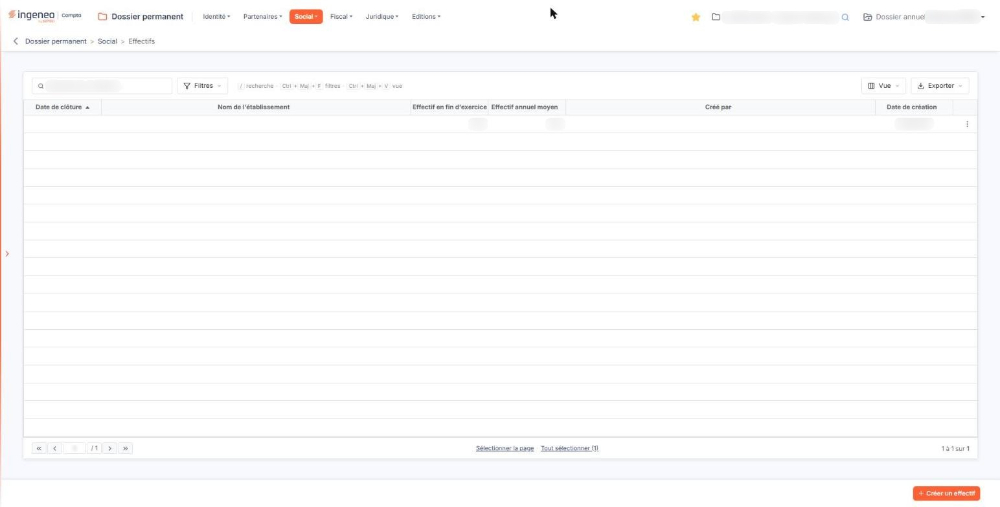
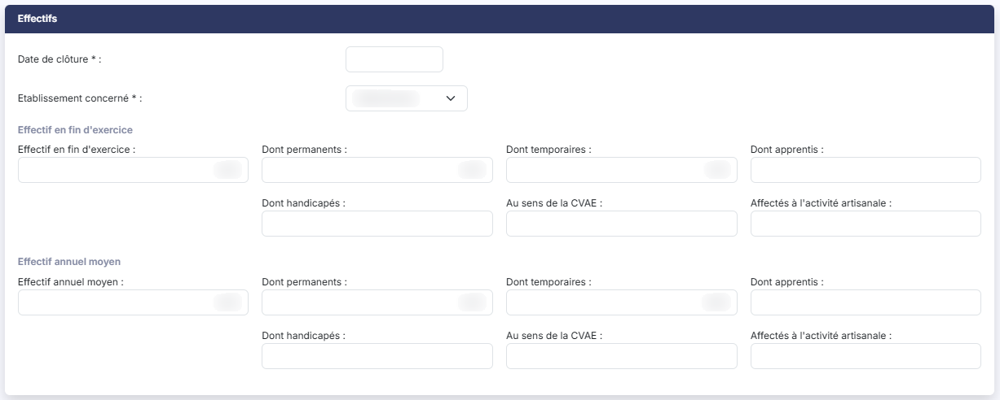

# Effectifs


**Où le trouver :** Menu **Social › Effectifs**



**En bref** — Cet écran enregistre les effectifs de la société par date de clôture et par établissement : effectif de fin d'exercice et effectif annuel moyen, ventilables en six catégories.

* Pour saisir les effectifs d'un exercice : bouton \[Créer un effectif], choisissez la date de clôture et l'établissement, puis bouton \[Enregistrer].


Cette option vous permet d'enregistrer les effectifs de la société, exercice après exercice, en rattachant chaque enregistrement à une date de clôture et à un établissement.

<figure><figcaption>
Écran « Effectifs » de la nouvelle interface
</figcaption></figure>

Vous y saisissez deux effectifs : l'effectif présent en fin d'exercice et l'effectif annuel moyen. Chacun des deux peut être ventilé en six catégories, ce qui vous permet de conserver dans le dossier permanent le détail demandé par les déclarations sociales et fiscales.

Vous créez un enregistrement par date de clôture et par établissement : une société à plusieurs établissements y aura donc plusieurs lignes pour un même exercice.

**a) La liste des effectifs**

La liste présente six colonnes, toutes triables : cliquez sur le titre de l'une d'elles pour trier la liste. À l'ouverture, elle est triée par **Date de clôture** croissante.

| Champ                                | Ce qu'il faut savoir                                                                                                                                                                                                                                                                                                                                                                                                                                                                                                                                                                                                                                                                                                                                                                                                                                                                                                                                                                                                                                                                                                                                                                                                                                                                                                                                                                                                                                                                                                                                                                                                                                                                                                                                                                                                                                                                                                                                                                                                                                                                     |
| ------------------------------------ | ---------------------------------------------------------------------------------------------------------------------------------------------------------------------------------------------------------------------------------------------------------------------------------------------------------------------------------------------------------------------------------------------------------------------------------------------------------------------------------------------------------------------------------------------------------------------------------------------------------------------------------------------------------------------------------------------------------------------------------------------------------------------------------------------------------------------------------------------------------------------------------------------------------------------------------------------------------------------------------------------------------------------------------------------------------------------------------------------------------------------------------------------------------------------------------------------------------------------------------------------------------------------------------------------------------------------------------------------------------------------------------------------------------------------------------------------------------------------------------------------------------------------------------------------------------------------------------------------------------------------------------------------------------------------------------------------------------------------------------------------------------------------------------------------------------------------------------------------------------------------------------------------------------------------------------------------------------------------------------------------------------------------------------------------------------------------------------------- |
| **Date de clôture**                  | La date de clôture de l'exercice auquel se rapportent les effectifs de la ligne.                                                                                                                                                                                                                                                                                                                                                                                                                                                                                                                                                                                                                                                                                                                                                                                                                                                                                                                                                                                                                                                                                                                                                                                                                                                                                                                                                                                                                                                                                                                                                                                                                                                                                                                                                                                                                                                                                                                                                                                                         |
| **Nom de l'établissement**           | L'établissement concerné. Attention, cette colonne porte un intitulé différent de celui du champ de la fiche, qui s'appelle « Etablissement concerné » : il s'agit de la même information.                                                                                                                                                                                                                                                                                                                                                                                                                                                                                                                                                                                                                                                                                                                                                                                                                                                                                                                                                                                                                                                                                                                                                                                                                                                                                                                                                                                                                                                                                                                                                                                                                                                                                                                                                                                                                                                                                               |
| **Effectif en fin d'exercice**       | L'effectif global présent à la clôture. Cette valeur s'affiche avec deux décimales et alignée à droite.                                                                                                                                                                                                                                                                                                                                                                                                                                                                                                                                                                                                                                                                                                                                                                                                                                                                                                                                                                                                                                                                                                                                                                                                                                                                                                                                                                                                                                                                                                                                                                                                                                                                                                                                                                                                                                                                                                                                                                                  |
| **Effectif annuel moyen**            | L'effectif global moyen de l'exercice, également avec deux décimales.                                                                                                                                                                                                                                                                                                                                                                                                                                                                                                                                                                                                                                                                                                                                                                                                                                                                                                                                                                                                                                                                                                                                                                                                                                                                                                                                                                                                                                                                                                                                                                                                                                                                                                                                                                                                                                                                                                                                                                                                                    |
| **Créé par**                         | L'utilisateur qui a créé la ligne. Sur des lignes anciennes, cette colonne peut être vide alors que la date de création est renseignée.                                                                                                                                                                                                                                                                                                                                                                                                                                                                                                                                                                                                                                                                                                                                                                                                                                                                                                                                                                                                                                                                                                                                                                                                                                                                                                                                                                                                                                                                                                                                                                                                                                                                                                                                                                                                                                                                                                                                                  |
| **Date de création**                 | 
La date à laquelle la ligne a été créée. <strong>La liste ne montre que les deux effectifs globaux.</strong> Les douze ventilations que vous pouvez saisir dans la fiche — permanents, temporaires, apprentis, handicapés, effectif au sens de la CVAE, effectif affecté à l'activité artisanale, pour chacun des deux effectifs — n'ont aucune colonne : elles ne se consultent qu'en ouvrant la fiche. Selon la largeur de votre fenêtre, l'intitulé de la colonne <strong>Effectif en fin d'exercice</strong> peut apparaître coupé en fin de mot. Élargissez la colonne en faisant glisser la bordure de son titre pour lire l'intitulé complet. Un clic sur une ligne la sélectionne. Au survol d'une ligne apparaissent, à son extrémité droite, le pictogramme « Crayon » (infobulle « Modifier »), qui ouvre la fiche, un pictogramme à deux feuilles superposées (infobulle « Dupliquer »), décrit ci-dessous, et un pictogramme à trois points verticaux, d'infobulle « Autres actions », dont le menu propose « Supprimer ». Au-dessus de la liste, la zone « Rechercher un effectif… » restreint la liste au fil de la saisie. Elle ne porte que sur la colonne <strong>Nom de l'établissement</strong>. bouton <strong>[Filtres]</strong> : ouvre un volet « Filtrer » où vous ajoutez des critères colonne par colonne. Il propose les six colonnes affichées, ainsi que la date de modification et l'auteur de la modification ; les ventilations d'effectif n'y figurent pas. bouton <strong>[Vue]</strong> : permet de choisir les colonnes affichées — six des huit colonnes disponibles le sont à l'ouverture, les deux autres étant la date et l'auteur de la modification — et d'enregistrer l'état de la liste sous un nom. bouton <strong>[Exporter]</strong> : propose l'aperçu, l'impression, l'export en Excel ou en PDF et l'envoi de la liste par e-mail. <strong>Pictogramme « Dupliquer »</strong> Ce pictogramme, propre à cette option, vous permet de reprendre un enregistrement d'effectifs pour en créer un autre.
 |
| **Il n'enregistre rien de lui-même** | 
Il ouvre une fiche préremplie de toutes les valeurs de la ligne d'origine, y compris la date de clôture et l'établissement, à vous de les ajuster puis de cliquer sur [Enregistrer]. bouton <strong>[Créer un effectif]</strong> Placé en bas à droite de l'écran, il ouvre une fiche vierge pour enregistrer les effectifs d'un exercice. bouton <strong>[Supprimer]</strong> Sélectionnez les enregistrements à supprimer en cliquant sur leurs lignes : un bandeau apparaît en bas de l'écran ; il indique le nombre d'enregistrements sélectionnés et porte ce bouton. <strong>b) Rubrique « Effectifs »</strong> La fiche ne comporte qu'une seule rubrique, et elle se présente de la même façon que vous créiez l'enregistrement ou que vous le modifiiez : les mêmes champs, dans le même ordre, avec les mêmes obligations. <strong>Les deux premiers champs identifient l'enregistrement, et ce sont les deux seuls champs obligatoires de la fiche.</strong>
                                                                                                                                                                                                                                                                                                                                                                                                                                                                                                                                                                                                                                                                                                                                                                                                                                                                                                                                                                                                                                                                                      |
| **Date de clôture**                  | La date de clôture de l'exercice auquel se rapportent les effectifs. Un clic dans le champ ouvre un calendrier qui vous permet de choisir la date.                                                                                                                                                                                                                                                                                                                                                                                                                                                                                                                                                                                                                                                                                                                                                                                                                                                                                                                                                                                                                                                                                                                                                                                                                                                                                                                                                                                                                                                                                                                                                                                                                                                                                                                                                                                                                                                                                                                                       |
| **Etablissement concerné**           | 
Ce n'est pas une zone de saisie mais une liste déroulante, qui propose les établissements que vous avez déclarés dans l'option « Etablissements » du menu « Social », sous les noms que vous leur avez donnés ; « Principal » est le nom que le logiciel donne lui-même à l'établissement principal de la société. Si cette liste vous paraît incomplète, c'est cette option qu'il faut renseigner d'abord : le logiciel n'affiche aucun message pour vous le signaler. Sur une fiche nouvelle, le logiciel positionne la liste sur l'établissement principal ; tant qu'aucun établissement n'est retenu, elle affiche « Sélectionnez ». Viennent ensuite <strong>deux blocs d'effectifs de structure identique</strong> : le premier pour l'effectif en fin d'exercice, le second pour l'effectif annuel moyen. Chaque bloc est annoncé par un intertitre, « Effectif en fin d'exercice » puis « Effectif annuel moyen ». Dans chacun des deux, l'effectif global est seul dans la première colonne, à gauche, et ses six ventilations se rangent à sa droite, sur deux rangées ; leur nombre par rangée varie avec la largeur de votre fenêtre. <strong>Ces six ventilations portent exactement les mêmes intitulés dans les deux blocs</strong>, et rien dans leur libellé ne dit à quel effectif elles se rattachent : c'est l'intitulé du bloc qui le dit. Une ventilation appartient à l'effectif global du bloc sous l'intitulé duquel elle se trouve. Lisez donc toujours ces champs en partant de l'intitulé du bloc et du total placé à sa gauche, et non de l'intitulé du champ seul. Aucune des quatorze valeurs d'effectif n'est obligatoire, et l'écran ne limite pas le nombre de caractères que vous y saisissez. Elles se saisissent avec des décimales, puisqu'un effectif annuel moyen ou un effectif exprimé en équivalent temps plein n'est pas nécessairement un nombre entier. <strong>Premier bloc — l'effectif en fin d'exercice</strong>
                                                                                                    |
| **Effectif en fin d'exercice**       | L'effectif global présent à la date de clôture.                                                                                                                                                                                                                                                                                                                                                                                                                                                                                                                                                                                                                                                                                                                                                                                                                                                                                                                                                                                                                                                                                                                                                                                                                                                                                                                                                                                                                                                                                                                                                                                                                                                                                                                                                                                                                                                                                                                                                                                                                                          |
| **Dont permanents**                  | La part de cet effectif employée de façon permanente.                                                                                                                                                                                                                                                                                                                                                                                                                                                                                                                                                                                                                                                                                                                                                                                                                                                                                                                                                                                                                                                                                                                                                                                                                                                                                                                                                                                                                                                                                                                                                                                                                                                                                                                                                                                                                                                                                                                                                                                                                                    |
| **Dont temporaires**                 | La part employée à titre temporaire.                                                                                                                                                                                                                                                                                                                                                                                                                                                                                                                                                                                                                                                                                                                                                                                                                                                                                                                                                                                                                                                                                                                                                                                                                                                                                                                                                                                                                                                                                                                                                                                                                                                                                                                                                                                                                                                                                                                                                                                                                                                     |
| **Dont apprentis**                   | La part sous contrat d'apprentissage.                                                                                                                                                                                                                                                                                                                                                                                                                                                                                                                                                                                                                                                                                                                                                                                                                                                                                                                                                                                                                                                                                                                                                                                                                                                                                                                                                                                                                                                                                                                                                                                                                                                                                                                                                                                                                                                                                                                                                                                                                                                    |
| **Dont handicapés**                  | La part relevant de l'obligation d'emploi des travailleurs handicapés.                                                                                                                                                                                                                                                                                                                                                                                                                                                                                                                                                                                                                                                                                                                                                                                                                                                                                                                                                                                                                                                                                                                                                                                                                                                                                                                                                                                                                                                                                                                                                                                                                                                                                                                                                                                                                                                                                                                                                                                                                   |
| **Au sens de la CVAE**               | Une des ventilations de l'effectif de fin d'exercice.                                                                                                                                                                                                                                                                                                                                                                                                                                                                                                                                                                                                                                                                                                                                                                                                                                                                                                                                                                                                                                                                                                                                                                                                                                                                                                                                                                                                                                                                                                                                                                                                                                                                                                                                                                                                                                                                                                                                                                                                                                    |
| **Affectés à l'activité artisanale** | 
Une des ventilations de l'effectif de fin d'exercice. <strong>Second bloc — l'effectif annuel moyen</strong>
                                                                                                                                                                                                                                                                                                                                                                                                                                                                                                                                                                                                                                                                                                                                                                                                                                                                                                                                                                                                                                                                                                                                                                                                                                                                                                                                                                                                                                                                                                                                                                                                                                                                                                                                                                                                                                                                                                                                                                   |
| **Effectif annuel moyen**            | L'effectif global moyen de l'exercice.                                                                                                                                                                                                                                                                                                                                                                                                                                                                                                                                                                                                                                                                                                                                                                                                                                                                                                                                                                                                                                                                                                                                                                                                                                                                                                                                                                                                                                                                                                                                                                                                                                                                                                                                                                                                                                                                                                                                                                                                                                                   |

Les six champs qui le ventilent portent les mêmes intitulés que ceux du premier bloc — **Dont permanents :**, **Dont temporaires :**, **Dont apprentis :**, **Dont handicapés :**, **Au sens de la CVAE :** et **Affectés à l'activité artisanale :** — et ont le même sens, appliqué cette fois à l'effectif annuel moyen et non à l'effectif de fin d'exercice.

**La fiche ne présente aucune information de création ni de modification**, alors que la liste en affiche deux colonnes : pour savoir qui a créé un enregistrement et quand, revenez à la liste.

**c) Enregistrement de la fiche**

bouton **\[Enregistrer]** : il valide votre saisie.

Pour revenir à la liste des effectifs sans enregistrer, cliquez sur la flèche « Revenir en arrière » placée à gauche du fil d'Ariane, en haut de l'écran : elle vous y ramène sans vous demander de confirmation, même si vous avez modifié la fiche. La fiche ne comporte pas de bouton **\[Retour]**.

**d) Les contrôles à l'enregistrement**

Le logiciel refuse l'enregistrement dans quatre cas :

* la **date de clôture** n'est pas renseignée, ou n'est pas une date valide ;
* l'**établissement concerné** est resté sur « Sélectionnez » ;
* **un enregistrement existe déjà pour la même date de clôture et le même établissement.** Le logiciel vous en avertit et vous indique qu'il n'est pas possible de saisir deux fois l'effectif pour une date de clôture et un établissement donné. C'est le cas que vous rencontrerez le plus souvent après une duplication, si vous avez oublié de changer la date de clôture ;
* **l'établissement retenu n'existait pas à la date de clôture indiquée.** Le logiciel compare la date de clôture aux dates de création et de fermeture que porte l'établissement dans l'option « Etablissements » du menu « Social » : la date de clôture doit être postérieure à sa date de création et antérieure à sa date de fermeture. Si l'une de ces deux dates n'y est pas renseignée, le contrôle ne porte que sur l'autre, et si aucune ne l'est, il ne s'applique pas.

## Autres vues de l'écran

<figure><figcaption>
Effectifs
</figcaption></figure>
