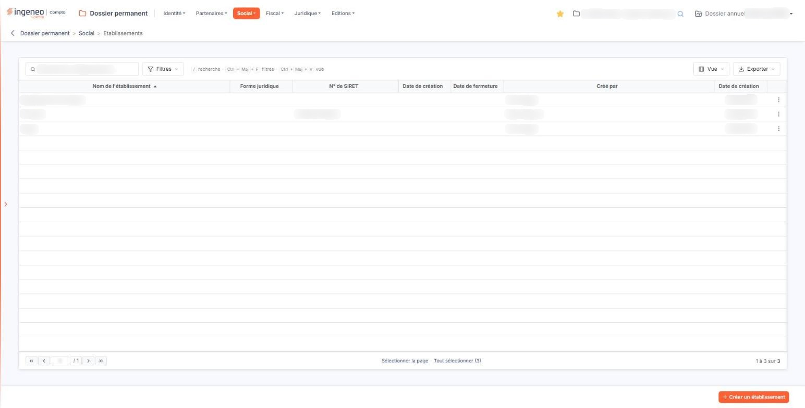
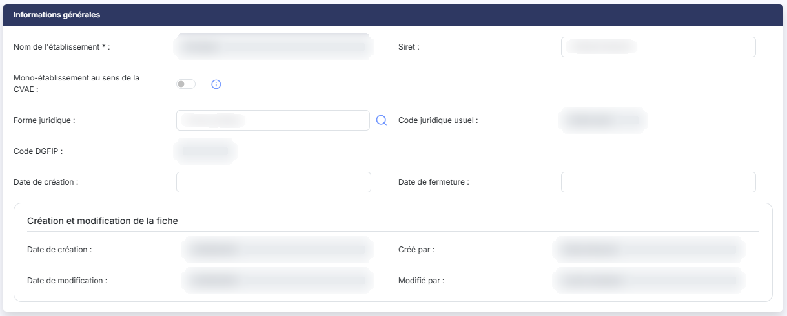
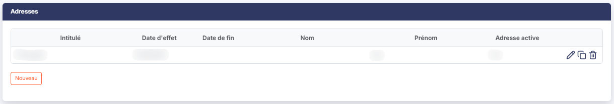

# Etablissements


**Où le trouver :** Menu **Social › Etablissements**



**En bref** — Cet écran recense les établissements de la société et leurs adresses successives ; ils alimentent d'autres options, comme « Effectifs » et « Autres taxes ». L'établissement « Principal » est créé automatiquement.

* Pour ajouter un établissement : bouton \[Créer un établissement], renseignez la fiche, puis bouton \[Enregistrer].


Cette option vous permet de recenser les établissements de la société et, pour chacun d'eux, ses adresses successives.

<figure><figcaption>
Écran « Etablissements » de la nouvelle interface
</figcaption></figure>

C'est une option de référence : les établissements que vous déclarez ici sont ceux que vous retrouverez ensuite dans les listes des autres options du dossier permanent, notamment « Effectifs » du menu « Social » et « Autres taxes » du menu « Fiscal ». Si l'une de ces listes vous paraît incomplète, c'est ici qu'il faut compléter.

| Champ                                                                               | Ce qu'il faut savoir                                                                                                                                                                                                                                                                                                                                                                                                                                                                                                                                                                                                                                                                                                                                                                                                                                                                                                                                                                                                                                                                                                                                                                                                                                                                                                                                                                                                                                                                                                                                                                                                                                                                                                                                                                                                                                                                                                                                                                                                                                                                                                                                                                                                                                                                                                                                                                                                                                                                                                                                                                                                                                                                                                                                                                                                                                                                                                                                                                                                                                                                                                                                                                  |
| ----------------------------------------------------------------------------------- | ------------------------------------------------------------------------------------------------------------------------------------------------------------------------------------------------------------------------------------------------------------------------------------------------------------------------------------------------------------------------------------------------------------------------------------------------------------------------------------------------------------------------------------------------------------------------------------------------------------------------------------------------------------------------------------------------------------------------------------------------------------------------------------------------------------------------------------------------------------------------------------------------------------------------------------------------------------------------------------------------------------------------------------------------------------------------------------------------------------------------------------------------------------------------------------------------------------------------------------------------------------------------------------------------------------------------------------------------------------------------------------------------------------------------------------------------------------------------------------------------------------------------------------------------------------------------------------------------------------------------------------------------------------------------------------------------------------------------------------------------------------------------------------------------------------------------------------------------------------------------------------------------------------------------------------------------------------------------------------------------------------------------------------------------------------------------------------------------------------------------------------------------------------------------------------------------------------------------------------------------------------------------------------------------------------------------------------------------------------------------------------------------------------------------------------------------------------------------------------------------------------------------------------------------------------------------------------------------------------------------------------------------------------------------------------------------------------------------------------------------------------------------------------------------------------------------------------------------------------------------------------------------------------------------------------------------------------------------------------------------------------------------------------------------------------------------------------------------------------------------------------------------------------------------------------- |
| **Toute société possède un établissement principal, et vous n'avez pas à le créer** | 
Le logiciel le crée lui-même, sous le nom « Principal », la première fois que vous ouvrez cette option. C'est ce nom, et lui seul, qui le désigne comme établissement principal — d'où l'importance de ne pas s'en servir pour un autre établissement. <strong>a) La liste des établissements</strong> La liste présente sept colonnes, toutes triables : cliquez sur le titre de l'une d'elles pour trier la liste. À l'ouverture, elle est triée par <strong>Nom de l'établissement</strong> croissant. Ce tri est alphabétique et ne place donc pas l'établissement principal en tête. <strong>Attention : deux colonnes portent le même intitulé « Date de création », et elles ne présentent pas la même information.</strong> La première des deux, placée après le numéro de SIRET, est la date de création <strong>de l'établissement</strong> lui-même, celle que vous saisissez dans la fiche. La seconde, la dernière colonne de la liste, est la date à laquelle <strong>la fiche</strong> a été créée dans le logiciel, à côté de son auteur.
                                                                                                                                                                                                                                                                                                                                                                                                                                                                                                                                                                                                                                                                                                                                                                                                                                                                                                                                                                                                                                                                                                                                                                                                                                                                                                                                                                                                                                                                                                                                                                                                                                                                                                                                                                                                                                                                                                                                                                                                                                                                                                            |
| **Nom de l'établissement**                                                          | Le nom donné à l'établissement lors de sa création.                                                                                                                                                                                                                                                                                                                                                                                                                                                                                                                                                                                                                                                                                                                                                                                                                                                                                                                                                                                                                                                                                                                                                                                                                                                                                                                                                                                                                                                                                                                                                                                                                                                                                                                                                                                                                                                                                                                                                                                                                                                                                                                                                                                                                                                                                                                                                                                                                                                                                                                                                                                                                                                                                                                                                                                                                                                                                                                                                                                                                                                                                                                                   |
| **Forme juridique**                                                                 | La forme juridique de l'établissement.                                                                                                                                                                                                                                                                                                                                                                                                                                                                                                                                                                                                                                                                                                                                                                                                                                                                                                                                                                                                                                                                                                                                                                                                                                                                                                                                                                                                                                                                                                                                                                                                                                                                                                                                                                                                                                                                                                                                                                                                                                                                                                                                                                                                                                                                                                                                                                                                                                                                                                                                                                                                                                                                                                                                                                                                                                                                                                                                                                                                                                                                                                                                                |
| **N° de SIRET**                                                                     | 
Son numéro de SIRET. <strong>Date de création :première colonne de ce nom</strong> — la date de création de l'établissement.
                                                                                                                                                                                                                                                                                                                                                                                                                                                                                                                                                                                                                                                                                                                                                                                                                                                                                                                                                                                                                                                                                                                                                                                                                                                                                                                                                                                                                                                                                                                                                                                                                                                                                                                                                                                                                                                                                                                                                                                                                                                                                                                                                                                                                                                                                                                                                                                                                                                                                                                                                                                                                                                                                                                                                                                                                                                                                                                                                                                                                                                |
| **Date de fermeture**                                                               | La date à laquelle l'établissement a été fermé. Selon la largeur de votre fenêtre, cet intitulé peut apparaître coupé : élargissez alors la colonne en faisant glisser la bordure de son titre.                                                                                                                                                                                                                                                                                                                                                                                                                                                                                                                                                                                                                                                                                                                                                                                                                                                                                                                                                                                                                                                                                                                                                                                                                                                                                                                                                                                                                                                                                                                                                                                                                                                                                                                                                                                                                                                                                                                                                                                                                                                                                                                                                                                                                                                                                                                                                                                                                                                                                                                                                                                                                                                                                                                                                                                                                                                                                                                                                                                       |
| **Créé par**                                                                        | 
L'utilisateur qui a créé la fiche. <strong>Date de création :seconde colonne de ce nom, la dernière de la liste</strong> — la date à laquelle la fiche a été créée. Un clic sur une ligne la sélectionne. Au survol d'une ligne apparaissent, à son extrémité droite, le pictogramme « Crayon » (infobulle « Modifier »), qui ouvre la fiche, et un pictogramme à trois points verticaux, d'infobulle « Autres actions », dont le menu propose « Supprimer ». Au-dessus de la liste, la zone « Rechercher un établissement… » restreint la liste au fil de la saisie. Elle ne porte que sur la colonne <strong>Nom de l'établissement</strong>. bouton <strong>[Filtres]</strong> : ouvre un volet « Filtrer » où vous ajoutez des critères colonne par colonne. Il propose les sept colonnes affichées, ainsi que la raison sociale, l'indicateur « Mono-établissement au sens de la CVAE », la date de modification et l'auteur de la modification. bouton <strong>[Vue]</strong> : permet de choisir les colonnes affichées parmi ces onze colonnes et d'enregistrer l'état de la liste sous un nom. bouton <strong>[Exporter]</strong> : propose l'aperçu, l'impression, l'export en Excel ou en PDF et l'envoi de la liste par e-mail. <strong>Sur la ligne de l'établissement principal, la commande « Supprimer » n'est pas proposée.</strong> Le pictogramme « Autres actions » y est bien affiché, mais un clic dessus n'ouvre aucun menu. C'est normal : cet établissement ne peut pas être supprimé. Ne cherchez donc pas la commande, elle n'existe pas pour cette ligne — et le logiciel ne vous l'explique pas. bouton <strong>[Créer un établissement]</strong> Placé en bas à droite de l'écran, il ouvre une fiche vierge pour déclarer un nouvel établissement. bouton <strong>[Supprimer]</strong> Sélectionnez les établissements à supprimer en cliquant sur leurs lignes : un bandeau apparaît en bas de l'écran ; il indique le nombre d'établissements sélectionnés, propose le lien « Tout désélectionner » et porte ce bouton. <strong>Une suppression peut être refusée.</strong> Le logiciel vérifie d'abord qu'aucune écriture comptable n'utilise l'établissement : si au moins une écriture d'un dossier annuel de la société s'y rapporte, la suppression est impossible et le logiciel vous l'indique par un message qui nomme le dossier annuel et l'établissement concernés. Supprimer un établissement supprime également les documents rattachés à ses adresses. La ligne de l'établissement principal se sélectionne comme les autres et le bandeau propose alors ce bouton, mais l'établissement principal n'est jamais supprimé. <strong>b) Rubrique « Informations générales »</strong> La fiche comporte deux rubriques, dans cet ordre : « Informations générales » puis « Adresses ». <strong>La première rubrique ne présente pas les mêmes champs selon que vous créez l'établissement ou que vous le modifiez</strong>, et la différence porte sur deux points essentiels, détaillés ci-dessous : le nom de l'établissement et les informations de création et de modification.
 |
| **Nom de l'établissement**                                                          | C'est le seul champ obligatoire de la fiche. **Vous ne pouvez le saisir qu'à la création : dès que l'établissement est enregistré, ce champ passe en lecture seule et ne se modifie plus jamais.** Choisissez donc ce nom avec soin, car c'est lui que vous retrouverez dans toutes les autres options du dossier permanent, et c'est lui qui désigne l'établissement principal. En modification, le champ reste marqué d'un astérisque bien qu'il soit grisé : c'est sans conséquence, il est déjà renseigné.                                                                                                                                                                                                                                                                                                                                                                                                                                                                                                                                                                                                                                                                                                                                                                                                                                                                                                                                                                                                                                                                                                                                                                                                                                                                                                                                                                                                                                                                                                                                                                                                                                                                                                                                                                                                                                                                                                                                                                                                                                                                                                                                                                                                                                                                                                                                                                                                                                                                                                                                                                                                                                                                        |
| **Mono-établissement au sens de la CVAE**                                           | Interrupteur, activé ou désactivé, désactivé par défaut. **Cette valeur ne concerne pas seulement l'établissement affiché :** le pictogramme « Information » placé à côté vous le rappelle — la modifier ici entraîne la même modification sur tous les autres établissements de la société. Sur une fiche nouvelle, le logiciel reprend d'ailleurs la valeur déjà en place sur les établissements existants.                                                                                                                                                                                                                                                                                                                                                                                                                                                                                                                                                                                                                                                                                                                                                                                                                                                                                                                                                                                                                                                                                                                                                                                                                                                                                                                                                                                                                                                                                                                                                                                                                                                                                                                                                                                                                                                                                                                                                                                                                                                                                                                                                                                                                                                                                                                                                                                                                                                                                                                                                                                                                                                                                                                                                                         |
| **Siret**                                                                           | Le numéro de SIRET de l'établissement, sur quatorze caractères au plus.                                                                                                                                                                                                                                                                                                                                                                                                                                                                                                                                                                                                                                                                                                                                                                                                                                                                                                                                                                                                                                                                                                                                                                                                                                                                                                                                                                                                                                                                                                                                                                                                                                                                                                                                                                                                                                                                                                                                                                                                                                                                                                                                                                                                                                                                                                                                                                                                                                                                                                                                                                                                                                                                                                                                                                                                                                                                                                                                                                                                                                                                                                               |
| **Forme juridique**                                                                 | La forme juridique de l'établissement, sur deux cents caractères au plus. Ce champ vous propose des valeurs dès la deuxième lettre saisie ; le pictogramme « Loupe » placé à sa droite ouvre par ailleurs une fenêtre de recherche. Retenir une forme juridique par l'un ou l'autre de ces moyens renseigne aussitôt les deux champs suivants.                                                                                                                                                                                                                                                                                                                                                                                                                                                                                                                                                                                                                                                                                                                                                                                                                                                                                                                                                                                                                                                                                                                                                                                                                                                                                                                                                                                                                                                                                                                                                                                                                                                                                                                                                                                                                                                                                                                                                                                                                                                                                                                                                                                                                                                                                                                                                                                                                                                                                                                                                                                                                                                                                                                                                                                                                                        |
| **Code juridique usuel**                                                            | Non modifiable. Le logiciel le renseigne lui-même à partir de la forme juridique retenue ; tant qu'aucune ne l'est, il reste vide.                                                                                                                                                                                                                                                                                                                                                                                                                                                                                                                                                                                                                                                                                                                                                                                                                                                                                                                                                                                                                                                                                                                                                                                                                                                                                                                                                                                                                                                                                                                                                                                                                                                                                                                                                                                                                                                                                                                                                                                                                                                                                                                                                                                                                                                                                                                                                                                                                                                                                                                                                                                                                                                                                                                                                                                                                                                                                                                                                                                                                                                    |
| **Code DGFIP**                                                                      | 
Non modifiable, renseigné de la même façon. <strong>Date de création :premier champ de ce nom</strong> — la date de création de l'établissement. C'est une date que vous saisissez, à la main ou dans le calendrier qui s'ouvre dès que vous cliquez dans le champ. Elle n'est pas obligatoire, mais elle est utilisée par d'autres options : l'option « Effectifs » du menu « Social » refuse par exemple d'enregistrer un effectif à une date de clôture antérieure à cette date.
                                                                                                                                                                                                                                                                                                                                                                                                                                                                                                                                                                                                                                                                                                                                                                                                                                                                                                                                                                                                                                                                                                                                                                                                                                                                                                                                                                                                                                                                                                                                                                                                                                                                                                                                                                                                                                                                                                                                                                                                                                                                                                                                                                                                                                                                                                                                                                                                                                                                                                                                                                                                                                                                                         |
| **Date de fermeture**                                                               | 
La date à laquelle l'établissement a cessé son activité, à saisir de la même façon. Elle n'est pas obligatoire non plus, et elle est utilisée par les mêmes contrôles. <strong>Les champs suivants ne se présentent qu'en modification</strong>, et aucun n'est modifiable. Ils n'existent pas sur une fiche nouvelle. <strong>Date de modification :</strong> et <strong>Modifié par :</strong> ne s'affichent en outre que si la fiche a déjà été modifiée. Ils sont regroupés, sous les champs de l'établissement, dans un encadré intitulé « Création et modification de la fiche ». <strong>Date de création :second champ de ce nom, et c'est ici qu'il faut être attentif</strong> — celui-ci est la date à laquelle la fiche a été créée dans le logiciel, et non la date de création de l'établissement. Les deux champs portent le même intitulé : <strong>celui qui figure parmi les champs de l'établissement, que vous pouvez saisir, est la date de l'établissement ; celui de l'encadré « Création et modification de la fiche », grisé, est celle de la fiche.</strong>
                                                                                                                                                                                                                                                                                                                                                                                                                                                                                                                                                                                                                                                                                                                                                                                                                                                                                                                                                                                                                                                                                                                                                                                                                                                                                                                                                                                                                                                                                                                                                                                                                                                                                                                                                                                                                                                                                                                                                                                                                                                                                  |
| **Créé par**                                                                        | L'utilisateur qui a créé la fiche.                                                                                                                                                                                                                                                                                                                                                                                                                                                                                                                                                                                                                                                                                                                                                                                                                                                                                                                                                                                                                                                                                                                                                                                                                                                                                                                                                                                                                                                                                                                                                                                                                                                                                                                                                                                                                                                                                                                                                                                                                                                                                                                                                                                                                                                                                                                                                                                                                                                                                                                                                                                                                                                                                                                                                                                                                                                                                                                                                                                                                                                                                                                                                    |
| **Date de modification**                                                            | La date de la dernière modification de la fiche.                                                                                                                                                                                                                                                                                                                                                                                                                                                                                                                                                                                                                                                                                                                                                                                                                                                                                                                                                                                                                                                                                                                                                                                                                                                                                                                                                                                                                                                                                                                                                                                                                                                                                                                                                                                                                                                                                                                                                                                                                                                                                                                                                                                                                                                                                                                                                                                                                                                                                                                                                                                                                                                                                                                                                                                                                                                                                                                                                                                                                                                                                                                                      |
| **Modifié par**                                                                     | 
L'utilisateur qui l'a modifiée en dernier. <strong>c) Rubrique « Adresses »</strong> Cette rubrique présente les adresses successives de l'établissement, sous forme d'un tableau. Elle est disponible dès la création, avant même que l'établissement soit enregistré : le tableau porte alors la mention « Liste vide ».
                                                                                                                                                                                                                                                                                                                                                                                                                                                                                                                                                                                                                                                                                                                                                                                                                                                                                                                                                                                                                                                                                                                                                                                                                                                                                                                                                                                                                                                                                                                                                                                                                                                                                                                                                                                                                                                                                                                                                                                                                                                                                                                                                                                                                                                                                                                                                                                                                                                                                                                                                                                                                                                                                                                                                                                                                                               |
| **Ce tableau n'est pas une liste comme les autres**                                 | Ses colonnes ne sont pas triables, il n'offre ni filtre, ni pagination, ni personnalisation des colonnes, et ses lignes ne se sélectionnent pas. Sur un établissement à nombreuses adresses, elles se présentent donc toutes à la suite, dans un ordre que vous ne pouvez pas changer.                                                                                                                                                                                                                                                                                                                                                                                                                                                                                                                                                                                                                                                                                                                                                                                                                                                                                                                                                                                                                                                                                                                                                                                                                                                                                                                                                                                                                                                                                                                                                                                                                                                                                                                                                                                                                                                                                                                                                                                                                                                                                                                                                                                                                                                                                                                                                                                                                                                                                                                                                                                                                                                                                                                                                                                                                                                                                                |
| **Intitulé**                                                                        | Le nom que vous avez donné à l'adresse.                                                                                                                                                                                                                                                                                                                                                                                                                                                                                                                                                                                                                                                                                                                                                                                                                                                                                                                                                                                                                                                                                                                                                                                                                                                                                                                                                                                                                                                                                                                                                                                                                                                                                                                                                                                                                                                                                                                                                                                                                                                                                                                                                                                                                                                                                                                                                                                                                                                                                                                                                                                                                                                                                                                                                                                                                                                                                                                                                                                                                                                                                                                                               |
| **Date d'effet**                                                                    | La date à partir de laquelle l'adresse s'applique.                                                                                                                                                                                                                                                                                                                                                                                                                                                                                                                                                                                                                                                                                                                                                                                                                                                                                                                                                                                                                                                                                                                                                                                                                                                                                                                                                                                                                                                                                                                                                                                                                                                                                                                                                                                                                                                                                                                                                                                                                                                                                                                                                                                                                                                                                                                                                                                                                                                                                                                                                                                                                                                                                                                                                                                                                                                                                                                                                                                                                                                                                                                                    |
| **Date de fin**                                                                     | 
La date au-delà de laquelle elle ne s'applique plus. Une adresse en cours n'en porte pas. <strong>Nom</strong> et <strong>Prénom :</strong> le contact rattaché à l'adresse.
                                                                                                                                                                                                                                                                                                                                                                                                                                                                                                                                                                                                                                                                                                                                                                                                                                                                                                                                                                                                                                                                                                                                                                                                                                                                                                                                                                                                                                                                                                                                                                                                                                                                                                                                                                                                                                                                                                                                                                                                                                                                                                                                                                                                                                                                                                                                                                                                                                                                                                                                                                                                                                                                                                                                                                                                                                                                                                                                                                                                |
| **Adresse active**                                                                  | Oui ou Non. **Vous ne renseignez pas cette colonne, le logiciel la déduit.** Il retient comme adresse active l'adresse la plus récente d'après sa date d'effet, en donnant la priorité à celles qui n'ont pas de date de fin ; s'il n'y a qu'une adresse, c'est elle. Un seul Oui figure donc dans cette colonne.                                                                                                                                                                                                                                                                                                                                                                                                                                                                                                                                                                                                                                                                                                                                                                                                                                                                                                                                                                                                                                                                                                                                                                                                                                                                                                                                                                                                                                                                                                                                                                                                                                                                                                                                                                                                                                                                                                                                                                                                                                                                                                                                                                                                                                                                                                                                                                                                                                                                                                                                                                                                                                                                                                                                                                                                                                                                     |


Notez que ce tableau ne montre **aucune adresse à proprement parler** : ni voie, ni code postal, ni ville n'y figurent. Pour lire l'adresse elle-même, ouvrez la ligne.


À l'extrémité droite de chaque ligne, trois pictogrammes, dans cet ordre : le crayon (infobulle « Modifier ») pour ouvrir l'adresse, deux feuilles superposées (infobulle « Dupliquer ») pour reprendre l'adresse et en créer une autre, et la corbeille (infobulle « Supprimer ») pour la retirer.

Sous le tableau, un bouton **\[+ Nouvelle adresse]**, aligné à droite, vous permet d'ajouter une adresse.

**Vos adresses ne sont enregistrées qu'avec l'établissement.** Ajouter, modifier, dupliquer ou retirer une adresse ne modifie d'abord que l'affichage : rien n'est conservé tant que vous n'avez pas cliqué sur le bouton \[Enregistrer] de la fiche. Si vous quittez la fiche par la flèche « Revenir en arrière » du fil d'Ariane, vos adresses sont perdues sans avertissement.

**Deux adresses ne peuvent pas se chevaucher dans le temps.** Si les dates que vous donnez à une adresse recouvrent celles d'une autre, le logiciel refuse et vous l'indique sur la date en cause : il vous signale notamment qu'il existe déjà une adresse dans cette période, ou déjà une adresse sans date d'effet, ou déjà une adresse sans date de fin.

**d) Enregistrement de la fiche**

bouton **\[Enregistrer]** : il valide votre saisie, y compris les adresses de la seconde rubrique.

Pour revenir à la liste des établissements sans enregistrer, cliquez sur la flèche « Revenir en arrière » placée à gauche du fil d'Ariane, en haut de l'écran : elle vous y ramène sans vous demander de confirmation, même si vous avez modifié la fiche. La fiche ne comporte pas de bouton **\[Retour]**.

**e) Les contrôles à l'enregistrement**

Outre le refus des adresses qui se chevauchent, le logiciel contrôle quatre points :

* le **nom de l'établissement** doit être renseigné et ne pas dépasser cinquante caractères ;
* **ce nom doit être unique dans la société.** Le logiciel vous indique que le nom d'établissement existe déjà si un autre établissement le porte. C'est une raison de plus de le choisir avec soin, puisqu'il ne se modifie plus ensuite ;
* le **numéro de SIRET**, s'il est renseigné, **doit respecter une forme précise :** quatorze caractères, dont les neuf premiers doivent être des chiffres — à l'exception des associés de sociétés d'exercice libéral relevant des bénéfices non commerciaux, pour lesquels le premier caractère peut être une lettre majuscule — et dont les cinq derniers peuvent être des chiffres ou des lettres majuscules ;
* la **date de fermeture** ne peut pas être antérieure à la **date de création** de l'établissement, et chacune des deux doit être une date valide.

## Autres vues de l'écran

<figure><figcaption>
Informations générales
</figcaption></figure>

<figure><figcaption>
Adresses
</figcaption></figure>
