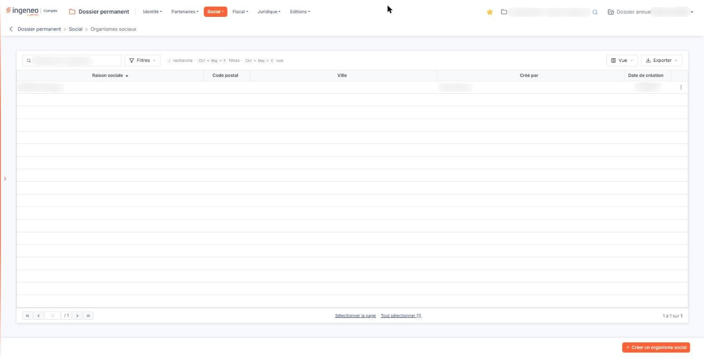
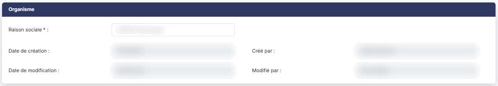
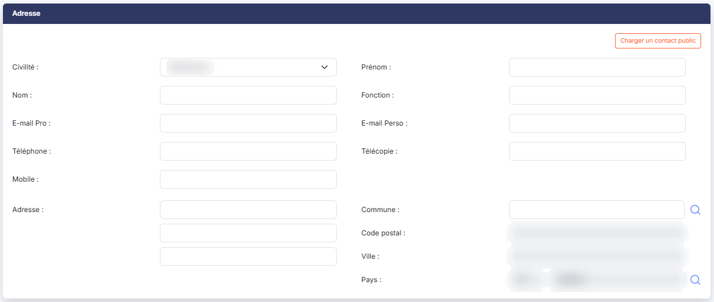
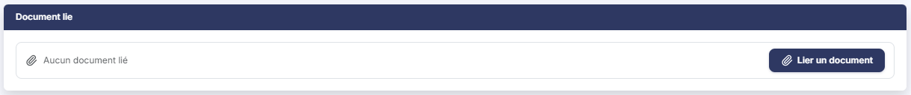

# Organismes sociaux


**Où le trouver :** Menu **Social › Organismes sociaux**



**En bref** — Cet écran recense les organismes sociaux de la société (retraite, prévoyance, recouvrement des cotisations), avec le correspondant, l'adresse et un document justificatif.

* Pour ajouter un organisme : bouton \[Créer un organisme social], renseignez la fiche, puis bouton \[Enregistrer].
* Pour reprendre un correspondant de l'annuaire : bouton \[Charger un contact public].


Cette option vous permet de recenser les organismes sociaux dont relève la société — caisse de retraite, organisme de prévoyance, organisme de recouvrement des cotisations — avec, pour chacun, le correspondant à joindre et l'adresse à utiliser.

<figure><figcaption>
Écran « Organismes sociaux » de la nouvelle interface
</figcaption></figure>

Chaque organisme peut porter un document justificatif, et son correspondant peut être saisi à la main ou repris de l'annuaire du cabinet.

**a) La liste des organismes sociaux**

La liste présente cinq colonnes, toutes triables : cliquez sur le titre de l'une d'elles pour trier la liste. À l'ouverture, elle est triée par **Raison sociale** croissante.

| Champ                                                                   | Ce qu'il faut savoir                                                                                                                                                                                                                                                                                                                                                                                                                                                                                                                                                                                                                                                                                                                                                                                                                                                                                                                                                                                                                                                                                                                                                                                                                                                                                                                                                                                                                                                                                                                                                                                                                                                                                                                                                                                                                                                                                                                                                                                                                                                                              |
| ----------------------------------------------------------------------- | ------------------------------------------------------------------------------------------------------------------------------------------------------------------------------------------------------------------------------------------------------------------------------------------------------------------------------------------------------------------------------------------------------------------------------------------------------------------------------------------------------------------------------------------------------------------------------------------------------------------------------------------------------------------------------------------------------------------------------------------------------------------------------------------------------------------------------------------------------------------------------------------------------------------------------------------------------------------------------------------------------------------------------------------------------------------------------------------------------------------------------------------------------------------------------------------------------------------------------------------------------------------------------------------------------------------------------------------------------------------------------------------------------------------------------------------------------------------------------------------------------------------------------------------------------------------------------------------------------------------------------------------------------------------------------------------------------------------------------------------------------------------------------------------------------------------------------------------------------------------------------------------------------------------------------------------------------------------------------------------------------------------------------------------------------------------------------------------------- |
| **Raison sociale**                                                      | 
Le nom de l'organisme. <strong>Code postal</strong> et <strong>Ville :</strong> les deux seuls éléments d'adresse présentés ici.
                                                                                                                                                                                                                                                                                                                                                                                                                                                                                                                                                                                                                                                                                                                                                                                                                                                                                                                                                                                                                                                                                                                                                                                                                                                                                                                                                                                                                                                                                                                                                                                                                                                                                                                                                                                                                                                                                                                                                        |
| **Créé par**                                                            | L'utilisateur qui a créé la fiche.                                                                                                                                                                                                                                                                                                                                                                                                                                                                                                                                                                                                                                                                                                                                                                                                                                                                                                                                                                                                                                                                                                                                                                                                                                                                                                                                                                                                                                                                                                                                                                                                                                                                                                                                                                                                                                                                                                                                                                                                                                                                |
| **Date de création**                                                    | 
La date à laquelle la fiche a été créée. <strong>À l'ouverture, la liste est beaucoup plus courte que la fiche.</strong> Ni le nom du correspondant, ni sa fonction, ni son téléphone, ni ses adresses de courrier électronique n'y figurent ; le Bouton [Vue], décrit ci-dessous, permet toutefois de les ajouter. Rien n'indique en revanche qu'un document est joint : pour le savoir, ouvrez la fiche de l'organisme. Un clic sur une ligne la sélectionne. Au survol d'une ligne apparaissent, à son extrémité droite, le pictogramme « Crayon » (infobulle « Modifier »), qui ouvre la fiche, et un pictogramme à trois points verticaux, d'infobulle « Autres actions », dont le menu propose « Supprimer ». Au-dessus de la liste, la zone « Rechercher un organisme… » restreint la liste au fil de la saisie. Elle ne porte que sur la colonne <strong>Raison sociale</strong>. bouton <strong>[Filtres]</strong> : ouvre un volet « Filtrer » où vous ajoutez des critères colonne par colonne. Il ne se limite pas aux cinq colonnes affichées : il propose aussi chacun des champs du correspondant et de l'adresse, la date de modification et l'auteur de la modification. bouton <strong>[Vue]</strong> : permet de choisir les colonnes affichées — cinq des vingt colonnes disponibles le sont à l'ouverture — et d'enregistrer l'état de la liste sous un nom. bouton <strong>[Exporter]</strong> : propose l'aperçu, l'impression, l'export en Excel ou en PDF et l'envoi de la liste par e-mail. bouton <strong>[Créer un organisme social]</strong> Placé en bas à droite de l'écran, il ouvre une fiche vierge pour déclarer un nouvel organisme social. bouton <strong>[Supprimer]</strong> Sélectionnez les organismes à supprimer en cliquant sur leurs lignes : un bandeau apparaît en bas de l'écran ; il indique le nombre d'organismes sélectionnés et porte ce bouton. <strong>b) Rubrique « Organisme »</strong> La fiche comporte trois rubriques, dans cet ordre : « Organisme », « Adresse » puis « Document lié ».
 |
| **Raison sociale**                                                      | 
Sur cinquante caractères au plus. C'est le nom de l'organisme, et <strong>le seul champ obligatoire de toute la fiche.</strong> <strong>Les quatre champs suivants ne se présentent qu'en modification</strong>, et aucun n'est modifiable. Ils n'existent pas sur une fiche nouvelle, où cette rubrique se réduit donc à la raison sociale.
                                                                                                                                                                                                                                                                                                                                                                                                                                                                                                                                                                                                                                                                                                                                                                                                                                                                                                                                                                                                                                                                                                                                                                                                                                                                                                                                                                                                                                                                                                                                                                                                                                                                                                                                            |
| **Date de création**                                                    | La date à laquelle la fiche a été créée.                                                                                                                                                                                                                                                                                                                                                                                                                                                                                                                                                                                                                                                                                                                                                                                                                                                                                                                                                                                                                                                                                                                                                                                                                                                                                                                                                                                                                                                                                                                                                                                                                                                                                                                                                                                                                                                                                                                                                                                                                                                          |
| **Créé par**                                                            | L'utilisateur qui l'a créée.                                                                                                                                                                                                                                                                                                                                                                                                                                                                                                                                                                                                                                                                                                                                                                                                                                                                                                                                                                                                                                                                                                                                                                                                                                                                                                                                                                                                                                                                                                                                                                                                                                                                                                                                                                                                                                                                                                                                                                                                                                                                      |
| **Date de modification**                                                | La date de la dernière modification.                                                                                                                                                                                                                                                                                                                                                                                                                                                                                                                                                                                                                                                                                                                                                                                                                                                                                                                                                                                                                                                                                                                                                                                                                                                                                                                                                                                                                                                                                                                                                                                                                                                                                                                                                                                                                                                                                                                                                                                                                                                              |
| **Modifié par**                                                         | 
L'utilisateur qui l'a modifiée en dernier. <strong>c) Rubrique « Adresse »</strong>
                                                                                                                                                                                                                                                                                                                                                                                                                                                                                                                                                                                                                                                                                                                                                                                                                                                                                                                                                                                                                                                                                                                                                                                                                                                                                                                                                                                                                                                                                                                                                                                                                                                                                                                                                                                                                                                                                                                                                                                                     |
| **Malgré son intitulé, cette rubrique décrit surtout un correspondant** | 
Neuf de ses seize champs concernent la personne à joindre — civilité, nom, prénom, fonction, deux adresses de courrier électronique, trois numéros de téléphone — et sept l'adresse postale. Aucun de ces seize champs n'est obligatoire. bouton <strong>[Charger un contact public]</strong> Ce bouton est placé en tête de la rubrique, avant les champs, et il est proposé aussi bien à la création qu'en modification. Il vous permet de reprendre un contact de l'annuaire du cabinet au lieu de saisir le correspondant à la main. Sachez avant de cliquer que <strong>la validation de cette fenêtre enregistre aussitôt l'organisme</strong>, puis recharge la fiche. Sur une fiche que vous étiez en train de créer, l'enregistrement a donc lieu à ce moment-là, sans que vous ayez cliqué sur le bouton <strong>[Enregistrer]</strong>, et revenir à la liste par la flèche du fil d'Ariane ne le défait pas. Sur cette option, le logiciel n'exerce <strong>aucun contrôle de votre saisie</strong> avant d'ouvrir la fenêtre de choix : elle s'ouvre même si la <strong>Raison sociale :</strong>, pourtant obligatoire, est encore vide. <strong>Un correspondant repris de l'annuaire n'est pas recopié, il est lu dans l'annuaire à chaque affichage.</strong> C'est ce qui explique le comportement de la fiche dans ce cas : les seize champs de cette rubrique s'affichent alors <strong>en lecture seule</strong>, puisqu'ils ne vous appartiennent pas — les corriger reviendrait à corriger l'annuaire. Le logiciel ne vous l'explique par aucun message. Pour reprendre la main sur ces champs, utilisez le bouton <strong>[Privatiser ce contact]</strong>, qui apparaît en modification à côté du précédent lorsque le correspondant vient de l'annuaire. Il détache le correspondant de l'annuaire en conservant ses coordonnées dans la fiche, qui redeviennent alors modifiables. Le lien à l'annuaire est rompu : les mises à jour ultérieures de l'annuaire ne se répercuteront plus ici.
                                                  |
| **Civilité**                                                            | Liste déroulante proposant « Madame » et « Monsieur ». Tant que vous n'avez rien retenu, elle affiche « Sélectionnez ».                                                                                                                                                                                                                                                                                                                                                                                                                                                                                                                                                                                                                                                                                                                                                                                                                                                                                                                                                                                                                                                                                                                                                                                                                                                                                                                                                                                                                                                                                                                                                                                                                                                                                                                                                                                                                                                                                                                                                                           |
| **Prénom**                                                              | Le prénom du correspondant, sur **quinze** caractères au plus.                                                                                                                                                                                                                                                                                                                                                                                                                                                                                                                                                                                                                                                                                                                                                                                                                                                                                                                                                                                                                                                                                                                                                                                                                                                                                                                                                                                                                                                                                                                                                                                                                                                                                                                                                                                                                                                                                                                                                                                                                                    |
| **Nom**                                                                 | Son nom, sur **trente** caractères au plus. Ces deux champs sont sensiblement plus courts que les autres — la fonction et la ville en acceptent cinquante — et un prénom composé ou un nom long peuvent donc ne pas y tenir, sans que le logiciel vous en avertisse.                                                                                                                                                                                                                                                                                                                                                                                                                                                                                                                                                                                                                                                                                                                                                                                                                                                                                                                                                                                                                                                                                                                                                                                                                                                                                                                                                                                                                                                                                                                                                                                                                                                                                                                                                                                                                              |
| **Fonction**                                                            | Sa fonction au sein de l'organisme, sur cinquante caractères au plus.                                                                                                                                                                                                                                                                                                                                                                                                                                                                                                                                                                                                                                                                                                                                                                                                                                                                                                                                                                                                                                                                                                                                                                                                                                                                                                                                                                                                                                                                                                                                                                                                                                                                                                                                                                                                                                                                                                                                                                                                                             |
| **E-mail Pro**                                                          | Son adresse de courrier électronique professionnelle, sur cinquante caractères au plus.                                                                                                                                                                                                                                                                                                                                                                                                                                                                                                                                                                                                                                                                                                                                                                                                                                                                                                                                                                                                                                                                                                                                                                                                                                                                                                                                                                                                                                                                                                                                                                                                                                                                                                                                                                                                                                                                                                                                                                                                           |
| **E-mail Perso**                                                        | Son adresse personnelle, sur cinquante caractères au plus.                                                                                                                                                                                                                                                                                                                                                                                                                                                                                                                                                                                                                                                                                                                                                                                                                                                                                                                                                                                                                                                                                                                                                                                                                                                                                                                                                                                                                                                                                                                                                                                                                                                                                                                                                                                                                                                                                                                                                                                                                                        |
| **Téléphone**                                                           | Son numéro de téléphone, sur quatorze caractères au plus.                                                                                                                                                                                                                                                                                                                                                                                                                                                                                                                                                                                                                                                                                                                                                                                                                                                                                                                                                                                                                                                                                                                                                                                                                                                                                                                                                                                                                                                                                                                                                                                                                                                                                                                                                                                                                                                                                                                                                                                                                                         |
| **Télécopie**                                                           | Son numéro de télécopie, sur quatorze caractères au plus.                                                                                                                                                                                                                                                                                                                                                                                                                                                                                                                                                                                                                                                                                                                                                                                                                                                                                                                                                                                                                                                                                                                                                                                                                                                                                                                                                                                                                                                                                                                                                                                                                                                                                                                                                                                                                                                                                                                                                                                                                                         |
| **Mobile**                                                              | Son numéro de téléphone mobile, sur quatorze caractères au plus.                                                                                                                                                                                                                                                                                                                                                                                                                                                                                                                                                                                                                                                                                                                                                                                                                                                                                                                                                                                                                                                                                                                                                                                                                                                                                                                                                                                                                                                                                                                                                                                                                                                                                                                                                                                                                                                                                                                                                                                                                                  |
| **Adresse**                                                             | La première ligne de l'adresse postale, sur trente-huit caractères au plus. **Deux zones sans intitulé** sont proposées juste en dessous, de même longueur, pour les deuxième et troisième lignes.                                                                                                                                                                                                                                                                                                                                                                                                                                                                                                                                                                                                                                                                                                                                                                                                                                                                                                                                                                                                                                                                                                                                                                                                                                                                                                                                                                                                                                                                                                                                                                                                                                                                                                                                                                                                                                                                                                |
| **Commune**                                                             | Saisissez le début de son nom : la zone propose les communes sous la forme « code - nom (département) » ; la loupe placée à droite ouvre un panneau « Sélection d'une commune », dont la liste (Code INSEE, Ville, Département) se filtre par nom ou par code INSEE.                                                                                                                                                                                                                                                                                                                                                                                                                                                                                                                                                                                                                                                                                                                                                                                                                                                                                                                                                                                                                                                                                                                                                                                                                                                                                                                                                                                                                                                                                                                                                                                                                                                                                                                                                                                                                              |
| **Code postal**                                                         | 
<strong>Ville :</strong> sont en lecture seule (« Déduit de la commune »). <strong>Pays :attention, cet intitulé désigne un champ que vous ne pouvez pas remplir.</strong> Il présente le code du pays, sur trois caractères, et c'est le logiciel qui le renseigne. Le pays lui-même se saisit dans la zone placée à sa droite, celle qui n'a pas d'intitulé et qui porte l'indication « Pays ». Le pictogramme « Loupe » placé à droite de cette zone ouvre un panneau intitulé « Sélection d'un pays », où vous pouvez chercher le pays et le retenir.
                                                                                                                                                                                                                                                                                                                                                                                                                                                                                                                                                                                                                                                                                                                                                                                                                                                                                                                                                                                                                                                                                                                                                                                                                                                                                                                                                                                                                                                                                                                               |
| **Servez-vous de cette loupe plutôt que de taper le nom du pays**       | Si le nom saisi ne correspond à aucun pays connu du logiciel, le code reste vide et l'enregistrement de la fiche est refusé.                                                                                                                                                                                                                                                                                                                                                                                                                                                                                                                                                                                                                                                                                                                                                                                                                                                                                                                                                                                                                                                                                                                                                                                                                                                                                                                                                                                                                                                                                                                                                                                                                                                                                                                                                                                                                                                                                                                                                                      |

**d) Rubrique « Document lié »**

Cette rubrique vous permet de joindre un document à l'organisme.

Aucun document n'est obligatoire : un organisme social se crée sans pièce jointe. Tant qu'aucun document n'est joint, la rubrique affiche « Aucun document lié ».

bouton **\[Lier un document]** : ouvre le volet « Lier un document », qui propose deux sources. « Depuis mon poste » vous permet de déposer un document dans la zone prévue ou de parcourir vos fichiers ; tous les formats sont acceptés sauf .exe, .bat, .cmd et .sh, et le nom du fichier ne doit pas dépasser 100 caractères. « Depuis la GED » vous permet de choisir un document de la GED. Le bouton **\[Lier le document]** joint le document choisi ; le bouton **\[Annuler]** referme le volet sans rien joindre.

**e) Enregistrement de la fiche**

bouton **\[Enregistrer]** : il valide votre saisie.

Pour revenir à la liste des organismes sociaux sans enregistrer, cliquez sur la flèche « Revenir en arrière » placée à gauche du fil d'Ariane, en haut de l'écran : elle vous y ramène sans vous demander de confirmation, même si vous avez modifié la fiche. La fiche ne comporte pas de bouton **\[Retour]**.

**f) Les contrôles à l'enregistrement**

Le logiciel refuse l'enregistrement dans deux cas :

* la **raison sociale** n'est pas renseignée, ou dépasse cinquante caractères ;
* **vous avez saisi un pays que le logiciel ne reconnaît pas.** Il vous indique alors que le champ « Pays » n'est pas valide, le code n'ayant pas été trouvé. Reprenez le pays par la loupe.

## Autres vues de l'écran

<figure><figcaption>
Organisme
</figcaption></figure>

<figure><figcaption>
Adresse
</figcaption></figure>

<figure><figcaption>
Document lié
</figcaption></figure>
