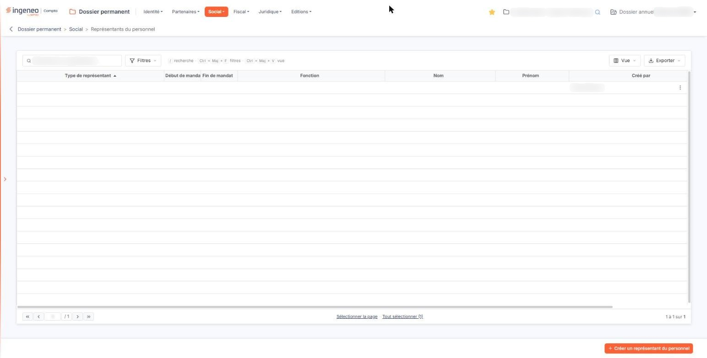
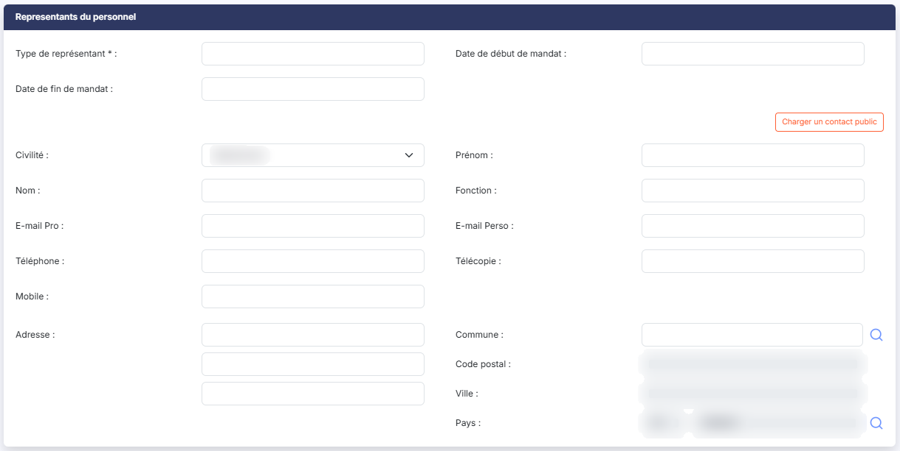
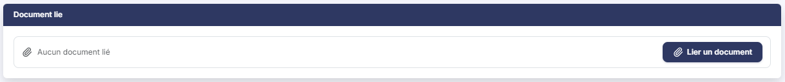

# Représentants du personnel


**Où le trouver :** Menu **Social › Représentants du personnel**



**En bref** — Cet écran recense les représentants du personnel : nature et dates du mandat, coordonnées de la personne. Un représentant repris de l'annuaire ne se modifie plus depuis la fiche.

* Pour ajouter un représentant : bouton \[Créer un représentant du personnel], renseignez la fiche, puis bouton \[Enregistrer].
* Pour modifier les coordonnées d'un représentant repris de l'annuaire : bouton \[Privatiser ce contact].


Cette option vous permet de recenser les représentants du personnel de la société, avec la nature de leur mandat, ses dates, et les coordonnées de la personne concernée.

<figure><figcaption>
Écran « Représentants du personnel » de la nouvelle interface
</figcaption></figure>

| Champ                                                             | Ce qu'il faut savoir                                                                                                                                                                                                                                                                                                                                                                                                                                                                                                                                                                                                                                                                                                                                                                                                                                                                                                                                                                                                                                                                                                                                                                                                                                                                                                                                                                                                                                                                                                                                                                                                                                                                                                                                                                                                                                                                                                                                                                                                                                                                                                                                                                                                                                                                                                                                                                                                                                                                                                                                                                                                                                                                                                                                                                                                |
| ----------------------------------------------------------------- | ------------------------------------------------------------------------------------------------------------------------------------------------------------------------------------------------------------------------------------------------------------------------------------------------------------------------------------------------------------------------------------------------------------------------------------------------------------------------------------------------------------------------------------------------------------------------------------------------------------------------------------------------------------------------------------------------------------------------------------------------------------------------------------------------------------------------------------------------------------------------------------------------------------------------------------------------------------------------------------------------------------------------------------------------------------------------------------------------------------------------------------------------------------------------------------------------------------------------------------------------------------------------------------------------------------------------------------------------------------------------------------------------------------------------------------------------------------------------------------------------------------------------------------------------------------------------------------------------------------------------------------------------------------------------------------------------------------------------------------------------------------------------------------------------------------------------------------------------------------------------------------------------------------------------------------------------------------------------------------------------------------------------------------------------------------------------------------------------------------------------------------------------------------------------------------------------------------------------------------------------------------------------------------------------------------------------------------------------------------------------------------------------------------------------------------------------------------------------------------------------------------------------------------------------------------------------------------------------------------------------------------------------------------------------------------------------------------------------------------------------------------------------------------------------------------------- |
| **Un point est essentiel pour comprendre cet écran**              | 
Un représentant peut être saisi à la main, et vous en maîtrisez alors toutes les informations, ou bien être repris de l'annuaire du cabinet, et ses coordonnées ne se modifient plus depuis cette fiche. Rien à l'écran ne vous l'annonce, et c'est pourtant ce qui décide de tout ce que vous pouvez y faire. Les deux cas sont détaillés à la rubrique b). <strong>a) La liste des représentants du personnel</strong> La liste présente huit colonnes, toutes triables : cliquez sur le titre de l'une d'elles pour trier la liste. À l'ouverture, elle est triée par <strong>Type de représentant</strong> croissant. <strong>Cette liste est plus large que l'écran.</strong> Une barre de défilement horizontale vous permet d'atteindre les dernières colonnes ; tant que vous n'avez pas fait défiler, la colonne <strong>Date de création</strong> reste hors de votre vue. Le compteur qui indique le nombre de lignes, lui, reste affiché en bas à droite de la liste.
                                                                                                                                                                                                                                                                                                                                                                                                                                                                                                                                                                                                                                                                                                                                                                                                                                                                                                                                                                                                                                                                                                                                                                                                                                                                                                                                                                                                                                                                                                                                                                                                                                                                                                                                                                                                                   |
| **Type de représentant**                                          | 
La nature du mandat. <strong>Début de mandat</strong> et <strong>Fin de mandat :</strong> les dates du mandat. Selon la largeur de votre fenêtre, l'intitulé <strong>Début de mandat</strong> peut apparaître coupé : élargissez alors la colonne en faisant glisser la bordure de son titre. Ces deux colonnes portent un intitulé plus court que les champs correspondants de la fiche, qui s'appellent « Date de début de mandat » et « Date de fin de mandat » : il s'agit de la même information.
                                                                                                                                                                                                                                                                                                                                                                                                                                                                                                                                                                                                                                                                                                                                                                                                                                                                                                                                                                                                                                                                                                                                                                                                                                                                                                                                                                                                                                                                                                                                                                                                                                                                                                                                                                                                                                                                                                                                                                                                                                                                                                                                                                                                                                                                                                    |
| **Fonction**                                                      | 
La fonction de la personne. <strong>Nom</strong> et <strong>Prénom :</strong> son nom puis son prénom. Notez que la fiche les présente dans l'ordre inverse : le prénom d'abord, à droite de la civilité, puis le nom, sur la ligne suivante.
                                                                                                                                                                                                                                                                                                                                                                                                                                                                                                                                                                                                                                                                                                                                                                                                                                                                                                                                                                                                                                                                                                                                                                                                                                                                                                                                                                                                                                                                                                                                                                                                                                                                                                                                                                                                                                                                                                                                                                                                                                                                                                                                                                                                                                                                                                                                                                                                                                                                                                                                                             |
| **Créé par**                                                      | L'utilisateur qui a créé la fiche.                                                                                                                                                                                                                                                                                                                                                                                                                                                                                                                                                                                                                                                                                                                                                                                                                                                                                                                                                                                                                                                                                                                                                                                                                                                                                                                                                                                                                                                                                                                                                                                                                                                                                                                                                                                                                                                                                                                                                                                                                                                                                                                                                                                                                                                                                                                                                                                                                                                                                                                                                                                                                                                                                                                                                                                  |
| **Date de création**                                              | 
La date à laquelle la fiche a été créée. <strong>Rien dans cette liste ne vous indique si un représentant est repris de l'annuaire du cabinet</strong>, ni si un document lui est joint. Vous ne le découvrez qu'en ouvrant sa fiche. Un clic sur une ligne la sélectionne. Au survol d'une ligne apparaissent, à son extrémité droite, le pictogramme « Crayon » (infobulle « Modifier »), qui ouvre la fiche, et un pictogramme à trois points verticaux, d'infobulle « Autres actions », dont le menu propose « Supprimer ». Au-dessus de la liste, la zone « Rechercher un représentant… » restreint la liste au fil de la saisie. Elle ne porte que sur la colonne <strong>Nom</strong>. bouton <strong>[Filtres]</strong> : ouvre un volet « Filtrer » où vous ajoutez des critères colonne par colonne. Il ne se limite pas aux huit colonnes affichées : il propose aussi les autres coordonnées de la personne (civilité, adresses de courrier électronique, téléphones, adresse postale, pays), la date de modification et l'auteur de la modification. bouton <strong>[Vue]</strong> : permet de choisir les colonnes affichées — huit des vingt-deux colonnes disponibles le sont à l'ouverture — et d'enregistrer l'état de la liste sous un nom. bouton <strong>[Exporter]</strong> : propose l'aperçu, l'impression, l'export en Excel ou en PDF et l'envoi de la liste par e-mail. Aucun des champs de coordonnées n'étant obligatoire, <strong>une ligne peut se présenter entièrement vide</strong> : ni type de représentant — bien qu'il soit obligatoire —, ni dates, ni nom. Seuls son auteur et sa date de création la distinguent alors, et rien ne vous dit ce que vous allez ouvrir. Complétez de préférence au moins le type de représentant et le nom, pour que la liste reste lisible. bouton <strong>[Créer un représentant du personnel]</strong> Placé en bas à droite de l'écran, il ouvre une fiche vierge pour déclarer un nouveau représentant. bouton <strong>[Supprimer]</strong> Sélectionnez les représentants à supprimer en cliquant sur leurs lignes : un bandeau apparaît en bas de l'écran ; il indique le nombre de représentants sélectionnés et porte ce bouton. <strong>b) Rubrique « Représentants du personnel »</strong> La fiche comporte deux rubriques seulement : « Représentants du personnel » puis « Document lié ». La première réunit le mandat et les coordonnées de la personne, sans que rien ne les sépare : <strong>le bloc de coordonnées n'a pas de titre de rubrique</strong> sur cet écran, contrairement aux options « Organismes sociaux » et « Rescrits sociaux » du même menu, où le même bloc s'intitule « Adresse ». <strong>Le mandat</strong> — trois champs, toujours modifiables :
 |
| **Type de représentant**                                          | Sur quarante caractères au plus. **C'est une zone de saisie libre, et non une liste de valeurs :** vous y écrivez vous-même la nature du mandat — délégué syndical, membre du comité social et économique. Adoptez une formulation constante d'un représentant à l'autre, sans quoi le tri de la colonne du même nom perdra tout intérêt.                                                                                                                                                                                                                                                                                                                                                                                                                                                                                                                                                                                                                                                                                                                                                                                                                                                                                                                                                                                                                                                                                                                                                                                                                                                                                                                                                                                                                                                                                                                                                                                                                                                                                                                                                                                                                                                                                                                                                                                                                                                                                                                                                                                                                                                                                                                                                                                                                                                                           |
| **Date de début de mandat**                                       | La date de prise d'effet du mandat. Un clic dans le champ ouvre un calendrier qui vous permet de la choisir.                                                                                                                                                                                                                                                                                                                                                                                                                                                                                                                                                                                                                                                                                                                                                                                                                                                                                                                                                                                                                                                                                                                                                                                                                                                                                                                                                                                                                                                                                                                                                                                                                                                                                                                                                                                                                                                                                                                                                                                                                                                                                                                                                                                                                                                                                                                                                                                                                                                                                                                                                                                                                                                                                                        |
| **Date de fin de mandat**                                         | 
La date d'expiration du mandat, à choisir de la même façon. Ces deux dates ne sont pas obligatoires. <strong>Les coordonnées de la personne</strong> — seize champs, précédés d'un ou de deux boutons. <strong>Ces seize champs sont saisissables, ou non, selon l'origine du représentant.</strong> Deux cas, et un seul les distingue à l'œil : la présence du bouton [Privatiser ce contact]. <strong>Le représentant a été saisi à la main.</strong> Les seize champs sont saisissables, la loupe du pays est proposée, et le bouton [Privatiser ce contact] n'apparaît pas. C'est le cas de toute fiche nouvelle. <strong>Le représentant a été repris de l'annuaire du cabinet.</strong> Les seize champs s'affichent alors <strong>en lecture seule</strong> — y compris la civilité —, la loupe du pays disparaît, et le bouton [Privatiser ce contact] est présenté. La raison en est que ces coordonnées ne sont pas conservées dans la fiche : elles sont lues dans l'annuaire du cabinet à chaque affichage, et les corriger ici reviendrait à corriger l'annuaire. <strong>Le logiciel ne vous l'explique par aucun message :</strong> vous avez sous les yeux une fiche entièrement grisée, sans un mot pour vous dire pourquoi ni comment en sortir. Dans ce second cas, le mandat (type de représentant et dates de début et de fin) reste modifiable, et vous pouvez joindre un document dans la rubrique suivante : <strong>vous pouvez joindre un justificatif à un représentant dont vous ne pouvez corriger ni le nom ni le téléphone.</strong> bouton <strong>[Charger un contact public]</strong> Ce bouton est proposé aussi bien à la création qu'en modification, en tête du bloc de coordonnées. Il vous permet de reprendre un contact de l'annuaire du cabinet au lieu de saisir la personne à la main — et c'est lui qui fait basculer la fiche dans le second cas décrit ci-dessus.
                                                                                                                                                                                                                                                                                                                                                                                                                                                                                                                                                                                                                                                                                                                                                                                                                                                                      |
| **Renseignez le type de représentant avant de cliquer**           | 
Sur cet écran, le logiciel contrôle d'abord votre saisie, et si le type de représentant manque il n'ouvre pas la fenêtre de choix mais réaffiche la fiche entière avec son message d'erreur. Ensuite, lorsque vous retenez un contact dans cette fenêtre et que vous la validez, <strong>le logiciel enregistre aussitôt le représentant</strong>, puis recharge la fiche. Sur une fiche que vous étiez en train de créer, l'enregistrement a donc lieu à ce moment-là, sans que vous ayez cliqué sur le bouton <strong>[Enregistrer]</strong>, et revenir à la liste par la flèche du fil d'Ariane ne le défait pas. bouton <strong>[Privatiser ce contact]</strong> Ce bouton n'est présenté qu'en modification, et seulement lorsque le représentant a été repris de l'annuaire du cabinet. Il est placé sur la même ligne que le précédent, mais contre le bord gauche de la rubrique, le bouton [Charger un contact public] restant, lui, contre le bord droit.
                                                                                                                                                                                                                                                                                                                                                                                                                                                                                                                                                                                                                                                                                                                                                                                                                                                                                                                                                                                                                                                                                                                                                                                                                                                                                                                                                                                                                                                                                                                                                                                                                                                                                                                                                                                                                                |
| **Prenez garde à ne pas les confondre**                           | 
Les deux boutons ont la même apparence, et l'un comme l'autre modifie la fiche. Seul leur libellé les distingue. [Privatiser ce contact] détache le représentant de l'annuaire en conservant ses coordonnées dans la fiche, qui redeviennent alors modifiables. Le lien à l'annuaire est rompu : les mises à jour ultérieures de l'annuaire ne se répercuteront plus ici.
                                                                                                                                                                                                                                                                                                                                                                                                                                                                                                                                                                                                                                                                                                                                                                                                                                                                                                                                                                                                                                                                                                                                                                                                                                                                                                                                                                                                                                                                                                                                                                                                                                                                                                                                                                                                                                                                                                                                                                                                                                                                                                                                                                                                                                                                                                                                                                                                                                 |
| **Civilité**                                                      | Liste déroulante proposant « Madame » et « Monsieur ». Tant que vous n'avez rien retenu, elle affiche « Sélectionnez ».                                                                                                                                                                                                                                                                                                                                                                                                                                                                                                                                                                                                                                                                                                                                                                                                                                                                                                                                                                                                                                                                                                                                                                                                                                                                                                                                                                                                                                                                                                                                                                                                                                                                                                                                                                                                                                                                                                                                                                                                                                                                                                                                                                                                                                                                                                                                                                                                                                                                                                                                                                                                                                                                                             |
| **Prénom**                                                        | Le prénom de la personne, sur **quinze** caractères au plus.                                                                                                                                                                                                                                                                                                                                                                                                                                                                                                                                                                                                                                                                                                                                                                                                                                                                                                                                                                                                                                                                                                                                                                                                                                                                                                                                                                                                                                                                                                                                                                                                                                                                                                                                                                                                                                                                                                                                                                                                                                                                                                                                                                                                                                                                                                                                                                                                                                                                                                                                                                                                                                                                                                                                                        |
| **Nom**                                                           | Son nom, sur **trente** caractères au plus. Ces deux champs sont sensiblement plus courts que les autres — la fonction et la ville en acceptent cinquante — et un prénom composé ou un nom long peuvent donc ne pas y tenir, sans que le logiciel vous en avertisse.                                                                                                                                                                                                                                                                                                                                                                                                                                                                                                                                                                                                                                                                                                                                                                                                                                                                                                                                                                                                                                                                                                                                                                                                                                                                                                                                                                                                                                                                                                                                                                                                                                                                                                                                                                                                                                                                                                                                                                                                                                                                                                                                                                                                                                                                                                                                                                                                                                                                                                                                                |
| **Fonction**                                                      | Sa fonction dans l'entreprise, sur cinquante caractères au plus.                                                                                                                                                                                                                                                                                                                                                                                                                                                                                                                                                                                                                                                                                                                                                                                                                                                                                                                                                                                                                                                                                                                                                                                                                                                                                                                                                                                                                                                                                                                                                                                                                                                                                                                                                                                                                                                                                                                                                                                                                                                                                                                                                                                                                                                                                                                                                                                                                                                                                                                                                                                                                                                                                                                                                    |
| **E-mail Pro**                                                    | Son adresse de courrier électronique professionnelle, sur cinquante caractères au plus.                                                                                                                                                                                                                                                                                                                                                                                                                                                                                                                                                                                                                                                                                                                                                                                                                                                                                                                                                                                                                                                                                                                                                                                                                                                                                                                                                                                                                                                                                                                                                                                                                                                                                                                                                                                                                                                                                                                                                                                                                                                                                                                                                                                                                                                                                                                                                                                                                                                                                                                                                                                                                                                                                                                             |
| **E-mail Perso**                                                  | Son adresse personnelle, sur cinquante caractères au plus.                                                                                                                                                                                                                                                                                                                                                                                                                                                                                                                                                                                                                                                                                                                                                                                                                                                                                                                                                                                                                                                                                                                                                                                                                                                                                                                                                                                                                                                                                                                                                                                                                                                                                                                                                                                                                                                                                                                                                                                                                                                                                                                                                                                                                                                                                                                                                                                                                                                                                                                                                                                                                                                                                                                                                          |
| **Téléphone**                                                     | Son numéro de téléphone, sur quatorze caractères au plus.                                                                                                                                                                                                                                                                                                                                                                                                                                                                                                                                                                                                                                                                                                                                                                                                                                                                                                                                                                                                                                                                                                                                                                                                                                                                                                                                                                                                                                                                                                                                                                                                                                                                                                                                                                                                                                                                                                                                                                                                                                                                                                                                                                                                                                                                                                                                                                                                                                                                                                                                                                                                                                                                                                                                                           |
| **Télécopie**                                                     | Son numéro de télécopie, sur quatorze caractères au plus.                                                                                                                                                                                                                                                                                                                                                                                                                                                                                                                                                                                                                                                                                                                                                                                                                                                                                                                                                                                                                                                                                                                                                                                                                                                                                                                                                                                                                                                                                                                                                                                                                                                                                                                                                                                                                                                                                                                                                                                                                                                                                                                                                                                                                                                                                                                                                                                                                                                                                                                                                                                                                                                                                                                                                           |
| **Mobile**                                                        | Son numéro de téléphone mobile, sur quatorze caractères au plus.                                                                                                                                                                                                                                                                                                                                                                                                                                                                                                                                                                                                                                                                                                                                                                                                                                                                                                                                                                                                                                                                                                                                                                                                                                                                                                                                                                                                                                                                                                                                                                                                                                                                                                                                                                                                                                                                                                                                                                                                                                                                                                                                                                                                                                                                                                                                                                                                                                                                                                                                                                                                                                                                                                                                                    |
| **Adresse**                                                       | La première ligne de l'adresse postale, sur trente-huit caractères au plus. **Deux zones sans intitulé** sont proposées juste en dessous, de même longueur, pour les deuxième et troisième lignes.                                                                                                                                                                                                                                                                                                                                                                                                                                                                                                                                                                                                                                                                                                                                                                                                                                                                                                                                                                                                                                                                                                                                                                                                                                                                                                                                                                                                                                                                                                                                                                                                                                                                                                                                                                                                                                                                                                                                                                                                                                                                                                                                                                                                                                                                                                                                                                                                                                                                                                                                                                                                                  |
| **Commune**                                                       | Saisissez le début de son nom : la zone propose les communes sous la forme « code - nom (département) » ; la loupe placée à droite ouvre un panneau « Sélection d'une commune », dont la liste (Code INSEE, Ville, Département) se filtre par nom ou par code INSEE.                                                                                                                                                                                                                                                                                                                                                                                                                                                                                                                                                                                                                                                                                                                                                                                                                                                                                                                                                                                                                                                                                                                                                                                                                                                                                                                                                                                                                                                                                                                                                                                                                                                                                                                                                                                                                                                                                                                                                                                                                                                                                                                                                                                                                                                                                                                                                                                                                                                                                                                                                |
| **Code postal**                                                   | 
<strong>Ville :</strong> sont en lecture seule (« Déduit de la commune »). <strong>Pays :attention, cet intitulé désigne un champ que vous ne pouvez pas remplir.</strong> Il présente le code du pays, sur trois caractères, et c'est le logiciel qui le renseigne. Le pays lui-même se saisit dans la zone placée à sa droite, celle qui n'a pas d'intitulé et qui porte l'indication « Pays ». Le pictogramme « Loupe » placé à droite de cette zone ouvre un panneau intitulé « Sélection d'un pays », où vous pouvez chercher le pays et le retenir.
                                                                                                                                                                                                                                                                                                                                                                                                                                                                                                                                                                                                                                                                                                                                                                                                                                                                                                                                                                                                                                                                                                                                                                                                                                                                                                                                                                                                                                                                                                                                                                                                                                                                                                                                                                                                                                                                                                                                                                                                                                                                                                                                                                                                                                                 |
| **Servez-vous de cette loupe plutôt que de taper le nom du pays** | 
Si le nom saisi ne correspond à aucun pays connu du logiciel, le code reste vide et l'enregistrement de la fiche est refusé. Sur un représentant repris de l'annuaire, cette loupe n'est pas proposée. Aucun de ces seize champs n'est obligatoire. <strong>Les deux derniers champs de la rubrique ne se présentent qu'en modification</strong>, et aucun n'est modifiable. Ils n'existent pas sur une fiche nouvelle.
                                                                                                                                                                                                                                                                                                                                                                                                                                                                                                                                                                                                                                                                                                                                                                                                                                                                                                                                                                                                                                                                                                                                                                                                                                                                                                                                                                                                                                                                                                                                                                                                                                                                                                                                                                                                                                                                                                                                                                                                                                                                                                                                                                                                                                                                                                                                                                                |
| **Date de création**                                              | La date à laquelle la fiche a été créée.                                                                                                                                                                                                                                                                                                                                                                                                                                                                                                                                                                                                                                                                                                                                                                                                                                                                                                                                                                                                                                                                                                                                                                                                                                                                                                                                                                                                                                                                                                                                                                                                                                                                                                                                                                                                                                                                                                                                                                                                                                                                                                                                                                                                                                                                                                                                                                                                                                                                                                                                                                                                                                                                                                                                                                            |
| **Créé par**                                                      | L'utilisateur qui l'a créée.                                                                                                                                                                                                                                                                                                                                                                                                                                                                                                                                                                                                                                                                                                                                                                                                                                                                                                                                                                                                                                                                                                                                                                                                                                                                                                                                                                                                                                                                                                                                                                                                                                                                                                                                                                                                                                                                                                                                                                                                                                                                                                                                                                                                                                                                                                                                                                                                                                                                                                                                                                                                                                                                                                                                                                                        |

Cet écran ne conserve pas d'information de modification : ni date, ni auteur de la dernière modification n'y figurent, contrairement aux options « Organismes sociaux » et « Etablissements » du même menu.

**c) Rubrique « Document lié »**

Cette rubrique vous permet de joindre un document au représentant — un procès-verbal d'élection, une lettre de désignation.

Aucun document n'est obligatoire : un représentant se crée sans pièce jointe. Tant qu'aucun document n'est joint, la rubrique affiche « Aucun document lié ».

bouton **\[Lier un document]** : ouvre le volet « Lier un document », qui propose deux sources. « Depuis mon poste » vous permet de déposer un document dans la zone prévue ou de parcourir vos fichiers ; tous les formats sont acceptés sauf .exe, .bat, .cmd et .sh, et le nom du fichier ne doit pas dépasser 100 caractères. « Depuis la GED » vous permet de choisir un document de la GED. Le bouton **\[Lier le document]** joint le document choisi ; le bouton **\[Annuler]** referme le volet sans rien joindre.

**d) Enregistrement de la fiche**

bouton **\[Enregistrer]** : il valide votre saisie.

Pour revenir à la liste des représentants du personnel sans enregistrer, cliquez sur la flèche « Revenir en arrière » placée à gauche du fil d'Ariane, en haut de l'écran : elle vous y ramène sans vous demander de confirmation, même si vous avez modifié la fiche. La fiche ne comporte pas de bouton **\[Retour]**.

**e) Les contrôles à l'enregistrement**

Le logiciel refuse l'enregistrement dans trois cas :

* le **type de représentant** n'est pas renseigné, ou dépasse quarante caractères ;
* la **date de fin de mandat** est antérieure à la **date de début de mandat**, ou l'une des deux n'est pas une date valide ;
* **vous avez saisi un pays que le logiciel ne reconnaît pas.** Il vous indique alors que le champ « Pays » n'est pas valide, le code n'ayant pas été trouvé. Reprenez le pays par la loupe.

## Autres vues de l'écran

<figure><figcaption>
Représentants du personnel
</figcaption></figure>

<figure><figcaption>
Document lié
</figcaption></figure>
