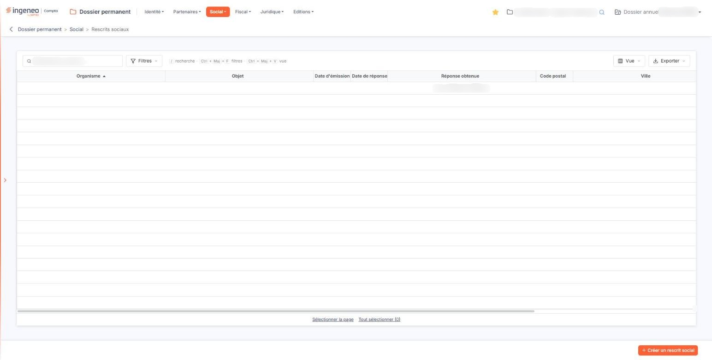
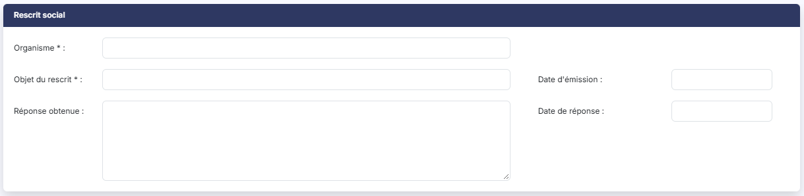
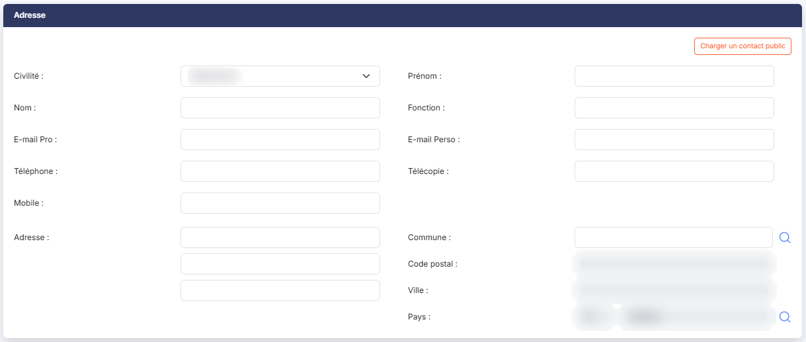
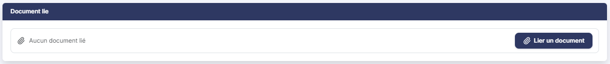

# Rescrits sociaux


**Où le trouver :** Menu **Social › Rescrits sociaux**



**En bref** — Cet écran conserve les rescrits sociaux de la société : organisme saisi, objet, dates, réponse reçue, correspondant et document joint.

* Pour enregistrer un rescrit : bouton \[Créer un rescrit social], renseignez la fiche, puis bouton \[Enregistrer].
* Pour reprendre un correspondant déjà connu : bouton \[Charger un contact public].


Cette option vous permet de conserver dans le dossier permanent les rescrits sociaux de la société — les demandes d'interprétation adressées à un organisme social et les réponses obtenues.

<figure><figcaption>
Écran « Rescrits sociaux » de la nouvelle interface
</figcaption></figure>

Pour chaque rescrit, vous notez l'organisme saisi, l'objet de la demande, ses dates, la réponse reçue, le correspondant à joindre, et vous pouvez y attacher un document.

**a) La liste des rescrits sociaux**

Tant qu'aucun rescrit n'est enregistré, la liste porte la mention « Aucun élément à afficher. », sans pagination ni compteur.

Elle présente neuf colonnes, toutes triables : cliquez sur le titre de l'une d'elles pour trier la liste. À l'ouverture, elle est triée par **Organisme** croissant.

**Cette liste est plus large que l'écran.** Une barre de défilement horizontale vous permet d'atteindre les dernières colonnes ; tant que vous n'avez pas fait défiler, les colonnes **Créé par** et **Date de création** restent hors de votre vue.

| Champ                                                                   | Ce qu'il faut savoir                                                                                                                                                                                                                                                                                                                                                                                                                                                                                                                                                                                                                                                                                                                                                                                                                                                                                                                                                                                                                                                                                                                                                                                                                                                                                                                                                                                                                                                                                                                                                                                                                                                                                                                                                                                                                                                                                                                                                                                                                                                                                                                                                                                                                                                                                                                                                                                                                             |
| ----------------------------------------------------------------------- | ------------------------------------------------------------------------------------------------------------------------------------------------------------------------------------------------------------------------------------------------------------------------------------------------------------------------------------------------------------------------------------------------------------------------------------------------------------------------------------------------------------------------------------------------------------------------------------------------------------------------------------------------------------------------------------------------------------------------------------------------------------------------------------------------------------------------------------------------------------------------------------------------------------------------------------------------------------------------------------------------------------------------------------------------------------------------------------------------------------------------------------------------------------------------------------------------------------------------------------------------------------------------------------------------------------------------------------------------------------------------------------------------------------------------------------------------------------------------------------------------------------------------------------------------------------------------------------------------------------------------------------------------------------------------------------------------------------------------------------------------------------------------------------------------------------------------------------------------------------------------------------------------------------------------------------------------------------------------------------------------------------------------------------------------------------------------------------------------------------------------------------------------------------------------------------------------------------------------------------------------------------------------------------------------------------------------------------------------------------------------------------------------------------------------------------------------ |
| **Organisme**                                                           | L'organisme social auquel la demande a été adressée.                                                                                                                                                                                                                                                                                                                                                                                                                                                                                                                                                                                                                                                                                                                                                                                                                                                                                                                                                                                                                                                                                                                                                                                                                                                                                                                                                                                                                                                                                                                                                                                                                                                                                                                                                                                                                                                                                                                                                                                                                                                                                                                                                                                                                                                                                                                                                                                             |
| **Objet**                                                               | L'objet du rescrit. Cette colonne porte un intitulé plus court que le champ correspondant de la fiche, qui s'appelle « Objet du rescrit » : il s'agit de la même information.                                                                                                                                                                                                                                                                                                                                                                                                                                                                                                                                                                                                                                                                                                                                                                                                                                                                                                                                                                                                                                                                                                                                                                                                                                                                                                                                                                                                                                                                                                                                                                                                                                                                                                                                                                                                                                                                                                                                                                                                                                                                                                                                                                                                                                                                    |
| **Date d'émission**                                                     | La date à laquelle la demande a été adressée.                                                                                                                                                                                                                                                                                                                                                                                                                                                                                                                                                                                                                                                                                                                                                                                                                                                                                                                                                                                                                                                                                                                                                                                                                                                                                                                                                                                                                                                                                                                                                                                                                                                                                                                                                                                                                                                                                                                                                                                                                                                                                                                                                                                                                                                                                                                                                                                                    |
| **Date de réponse**                                                     | La date à laquelle la réponse est parvenue. Selon la largeur de votre fenêtre, ces deux intitulés peuvent apparaître coupés dans leurs en-têtes : élargissez alors les colonnes en faisant glisser la bordure de leur titre.                                                                                                                                                                                                                                                                                                                                                                                                                                                                                                                                                                                                                                                                                                                                                                                                                                                                                                                                                                                                                                                                                                                                                                                                                                                                                                                                                                                                                                                                                                                                                                                                                                                                                                                                                                                                                                                                                                                                                                                                                                                                                                                                                                                                                     |
| **Réponse obtenue**                                                     | 
La réponse de l'organisme. <strong>Malgré son intitulé, qui se lit comme une question fermée, ce n'est pas un oui ou un non</strong> mais un texte, qui peut atteindre mille vingt-quatre caractères : une réponse détaillée sera donc difficile à lire dans cette colonne, et il faut ouvrir la fiche pour en prendre connaissance. <strong>Code postal</strong> et <strong>Ville :</strong> les deux seuls éléments d'adresse présentés ici à l'ouverture. Ni le nom du correspondant, ni sa fonction, ni son téléphone n'y figurent alors ; le Bouton [Vue], décrit ci-dessous, permet toutefois de les ajouter.
                                                                                                                                                                                                                                                                                                                                                                                                                                                                                                                                                                                                                                                                                                                                                                                                                                                                                                                                                                                                                                                                                                                                                                                                                                                                                                                                                                                                                                                                                                                                                                                                                                                                                                                                                                                                                    |
| **Créé par**                                                            | L'utilisateur qui a créé la fiche.                                                                                                                                                                                                                                                                                                                                                                                                                                                                                                                                                                                                                                                                                                                                                                                                                                                                                                                                                                                                                                                                                                                                                                                                                                                                                                                                                                                                                                                                                                                                                                                                                                                                                                                                                                                                                                                                                                                                                                                                                                                                                                                                                                                                                                                                                                                                                                                                               |
| **Date de création**                                                    | 
La date à laquelle la fiche a été créée. <strong>Rien dans cette liste n'indique qu'un document est joint au rescrit</strong>, ni que son correspondant est repris de l'annuaire du cabinet. Au-dessus de la liste, la zone « Rechercher un rescrit… » restreint la liste au fil de la saisie. Elle ne porte que sur la colonne <strong>Objet</strong>, et non sur l'organisme qui sert au tri. bouton <strong>[Filtres]</strong> : ouvre un volet « Filtrer » où vous ajoutez des critères colonne par colonne. Il ne se limite pas aux neuf colonnes affichées : il propose aussi les autres coordonnées du correspondant (civilité, nom, prénom, fonction, adresses de courrier électronique, téléphones, adresse postale, pays), la date de modification et l'auteur de la modification. bouton <strong>[Vue]</strong> : permet de choisir les colonnes affichées — neuf des vingt-quatre colonnes disponibles le sont à l'ouverture — et d'enregistrer l'état de la liste sous un nom. bouton <strong>[Exporter]</strong> : propose l'aperçu, l'impression, l'export en Excel ou en PDF et l'envoi de la liste par e-mail. bouton <strong>[Créer un rescrit social]</strong> Placé en bas à droite de l'écran, il ouvre une fiche vierge pour enregistrer un nouveau rescrit. <strong>b) Rubrique « Rescrit social »</strong> La fiche comporte trois rubriques, dans cet ordre : « Rescrit social », « Adresse » puis « Document lié ». La première est disposée en deux colonnes : à gauche l'organisme, l'objet et la réponse ; à droite, l'une sous l'autre, les deux dates.
                                                                                                                                                                                                                                                                                                                                                                                                                                                                                                                                                                                                                                                                                                                                                                                                                          |
| 
<strong>Organisme</strong> <em>Obligatoire</em>
               | Sur cinquante caractères au plus. **C'est une zone de saisie libre : ni liste, ni loupe, aucun lien avec l'option « Organismes sociaux » du même menu**, alors que celle-ci recense précisément les organismes de la société. Vous retapez donc le nom ici, et il vous appartient de l'écrire de la même façon d'un rescrit à l'autre, sans quoi le tri de la liste dispersera les rescrits d'un même organisme.                                                                                                                                                                                                                                                                                                                                                                                                                                                                                                                                                                                                                                                                                                                                                                                                                                                                                                                                                                                                                                                                                                                                                                                                                                                                                                                                                                                                                                                                                                                                                                                                                                                                                                                                                                                                                                                                                                                                                                                                                                 |
| 
<strong>Objet du rescrit</strong> <em>Obligatoire</em>
        | Sur cinquante caractères au plus. L'objet de la demande adressée à l'organisme.                                                                                                                                                                                                                                                                                                                                                                                                                                                                                                                                                                                                                                                                                                                                                                                                                                                                                                                                                                                                                                                                                                                                                                                                                                                                                                                                                                                                                                                                                                                                                                                                                                                                                                                                                                                                                                                                                                                                                                                                                                                                                                                                                                                                                                                                                                                                                                  |
| **Date d'émission**                                                     | La date d'envoi de la demande. Un clic dans le champ ouvre un calendrier qui vous permet de la choisir.                                                                                                                                                                                                                                                                                                                                                                                                                                                                                                                                                                                                                                                                                                                                                                                                                                                                                                                                                                                                                                                                                                                                                                                                                                                                                                                                                                                                                                                                                                                                                                                                                                                                                                                                                                                                                                                                                                                                                                                                                                                                                                                                                                                                                                                                                                                                          |
| **Réponse obtenue**                                                     | La réponse de l'organisme. **C'est une zone de texte de plusieurs lignes**, qui accepte jusqu'à mille vingt-quatre caractères : vous pouvez y reprendre la réponse elle-même, et non un simple oui ou non, malgré ce que suggère son intitulé.                                                                                                                                                                                                                                                                                                                                                                                                                                                                                                                                                                                                                                                                                                                                                                                                                                                                                                                                                                                                                                                                                                                                                                                                                                                                                                                                                                                                                                                                                                                                                                                                                                                                                                                                                                                                                                                                                                                                                                                                                                                                                                                                                                                                   |
| **Date de réponse**                                                     | 
La date à laquelle la réponse est parvenue, à choisir de la même façon. Elle est placée dans la colonne de droite, sous la date d'émission, à hauteur du début de la zone de réponse. Ces deux dates ne sont pas obligatoires. <strong>Ce sont les deux seuls champs obligatoires de la fiche</strong> — l'organisme et l'objet du rescrit ; aucun autre ne l'est. <strong>c) Rubrique « Adresse »</strong>
                                                                                                                                                                                                                                                                                                                                                                                                                                                                                                                                                                                                                                                                                                                                                                                                                                                                                                                                                                                                                                                                                                                                                                                                                                                                                                                                                                                                                                                                                                                                                                                                                                                                                                                                                                                                                                                                                                                                                                                                                         |
| **Malgré son intitulé, cette rubrique décrit surtout un correspondant** | 
Neuf de ses seize champs concernent la personne à joindre — civilité, nom, prénom, fonction, deux adresses de courrier électronique, trois numéros de téléphone — et sept l'adresse postale. Aucun de ces seize champs n'est obligatoire. bouton <strong>[Charger un contact public]</strong> Ce bouton est placé en tête de la rubrique, avant les champs, et il est proposé aussi bien à la création qu'en modification. Il vous permet de reprendre un contact de l'annuaire du cabinet au lieu de saisir le correspondant à la main. Ce bouton fait deux choses que rien à l'écran n'annonce, et qu'il vaut mieux savoir avant de cliquer. D'abord, le logiciel <strong>contrôle votre saisie avant d'ouvrir la fenêtre de choix</strong> : s'il manque une information obligatoire, la fenêtre ne s'ouvre pas et l'écran vous réaffiche ses messages. Ensuite, lorsque vous retenez un contact dans cette fenêtre et que vous la validez, <strong>le logiciel enregistre aussitôt le rescrit</strong>, puis recharge la fiche. Sur une fiche que vous étiez en train de créer, l'enregistrement a donc lieu à ce moment-là, sans que vous ayez cliqué sur le bouton <strong>[Enregistrer]</strong>, et revenir à la liste par la flèche du fil d'Ariane ne le défait pas. <strong>Un correspondant repris de l'annuaire n'est pas recopié, il est lu dans l'annuaire à chaque affichage.</strong> C'est ce qui explique le comportement de la fiche dans ce cas : les seize champs de cette rubrique s'affichent alors <strong>en lecture seule</strong>, puisqu'ils ne vous appartiennent pas — les corriger reviendrait à corriger l'annuaire. Le logiciel ne vous l'explique par aucun message. <strong>Sur cet écran, le champ Organisme de la première rubrique est verrouillé lui aussi dans ce cas</strong>, car c'est alors le nom du contact repris de l'annuaire. L'objet du rescrit, la réponse obtenue et les deux dates, en revanche, restent modifiables. Pour reprendre la main sur ces champs, utilisez le bouton <strong>[Privatiser ce contact]</strong>, qui apparaît en modification à côté du précédent lorsque le correspondant vient de l'annuaire. Il détache le correspondant de l'annuaire en conservant ses coordonnées dans la fiche, qui redeviennent alors modifiables. Le lien à l'annuaire est rompu : les mises à jour ultérieures de l'annuaire ne se répercuteront plus ici.
 |
| **Civilité**                                                            | Liste déroulante proposant « Madame » et « Monsieur ». Tant que vous n'avez rien retenu, elle affiche « Sélectionnez ».                                                                                                                                                                                                                                                                                                                                                                                                                                                                                                                                                                                                                                                                                                                                                                                                                                                                                                                                                                                                                                                                                                                                                                                                                                                                                                                                                                                                                                                                                                                                                                                                                                                                                                                                                                                                                                                                                                                                                                                                                                                                                                                                                                                                                                                                                                                          |
| **Prénom**                                                              | Le prénom du correspondant, sur **quinze** caractères au plus.                                                                                                                                                                                                                                                                                                                                                                                                                                                                                                                                                                                                                                                                                                                                                                                                                                                                                                                                                                                                                                                                                                                                                                                                                                                                                                                                                                                                                                                                                                                                                                                                                                                                                                                                                                                                                                                                                                                                                                                                                                                                                                                                                                                                                                                                                                                                                                                   |
| **Nom**                                                                 | Son nom, sur **trente** caractères au plus. Ces deux champs sont sensiblement plus courts que les autres — la fonction et la ville en acceptent cinquante — et un prénom composé ou un nom long peuvent donc ne pas y tenir, sans que le logiciel vous en avertisse.                                                                                                                                                                                                                                                                                                                                                                                                                                                                                                                                                                                                                                                                                                                                                                                                                                                                                                                                                                                                                                                                                                                                                                                                                                                                                                                                                                                                                                                                                                                                                                                                                                                                                                                                                                                                                                                                                                                                                                                                                                                                                                                                                                             |
| **Fonction**                                                            | Sa fonction au sein de l'organisme, sur cinquante caractères au plus.                                                                                                                                                                                                                                                                                                                                                                                                                                                                                                                                                                                                                                                                                                                                                                                                                                                                                                                                                                                                                                                                                                                                                                                                                                                                                                                                                                                                                                                                                                                                                                                                                                                                                                                                                                                                                                                                                                                                                                                                                                                                                                                                                                                                                                                                                                                                                                            |
| **E-mail Pro**                                                          | Son adresse de courrier électronique professionnelle, sur cinquante caractères au plus.                                                                                                                                                                                                                                                                                                                                                                                                                                                                                                                                                                                                                                                                                                                                                                                                                                                                                                                                                                                                                                                                                                                                                                                                                                                                                                                                                                                                                                                                                                                                                                                                                                                                                                                                                                                                                                                                                                                                                                                                                                                                                                                                                                                                                                                                                                                                                          |
| **E-mail Perso**                                                        | Son adresse personnelle, sur cinquante caractères au plus.                                                                                                                                                                                                                                                                                                                                                                                                                                                                                                                                                                                                                                                                                                                                                                                                                                                                                                                                                                                                                                                                                                                                                                                                                                                                                                                                                                                                                                                                                                                                                                                                                                                                                                                                                                                                                                                                                                                                                                                                                                                                                                                                                                                                                                                                                                                                                                                       |
| **Téléphone**                                                           | Son numéro de téléphone, sur quatorze caractères au plus.                                                                                                                                                                                                                                                                                                                                                                                                                                                                                                                                                                                                                                                                                                                                                                                                                                                                                                                                                                                                                                                                                                                                                                                                                                                                                                                                                                                                                                                                                                                                                                                                                                                                                                                                                                                                                                                                                                                                                                                                                                                                                                                                                                                                                                                                                                                                                                                        |
| **Télécopie**                                                           | Son numéro de télécopie, sur quatorze caractères au plus.                                                                                                                                                                                                                                                                                                                                                                                                                                                                                                                                                                                                                                                                                                                                                                                                                                                                                                                                                                                                                                                                                                                                                                                                                                                                                                                                                                                                                                                                                                                                                                                                                                                                                                                                                                                                                                                                                                                                                                                                                                                                                                                                                                                                                                                                                                                                                                                        |
| **Mobile**                                                              | Son numéro de téléphone mobile, sur quatorze caractères au plus.                                                                                                                                                                                                                                                                                                                                                                                                                                                                                                                                                                                                                                                                                                                                                                                                                                                                                                                                                                                                                                                                                                                                                                                                                                                                                                                                                                                                                                                                                                                                                                                                                                                                                                                                                                                                                                                                                                                                                                                                                                                                                                                                                                                                                                                                                                                                                                                 |
| **Adresse**                                                             | La première ligne de l'adresse postale, sur trente-huit caractères au plus. **Deux zones sans intitulé** sont proposées juste en dessous, de même longueur, pour les deuxième et troisième lignes.                                                                                                                                                                                                                                                                                                                                                                                                                                                                                                                                                                                                                                                                                                                                                                                                                                                                                                                                                                                                                                                                                                                                                                                                                                                                                                                                                                                                                                                                                                                                                                                                                                                                                                                                                                                                                                                                                                                                                                                                                                                                                                                                                                                                                                               |
| **Commune**                                                             | Saisissez le début de son nom : la zone propose les communes sous la forme « code - nom (département) » ; la loupe placée à droite ouvre un panneau « Sélection d'une commune », dont la liste (Code INSEE, Ville, Département) se filtre par nom ou par code INSEE.                                                                                                                                                                                                                                                                                                                                                                                                                                                                                                                                                                                                                                                                                                                                                                                                                                                                                                                                                                                                                                                                                                                                                                                                                                                                                                                                                                                                                                                                                                                                                                                                                                                                                                                                                                                                                                                                                                                                                                                                                                                                                                                                                                             |
| **Code postal**                                                         | 
<strong>Ville :</strong> sont en lecture seule (« Déduit de la commune »). <strong>Pays :attention, cet intitulé désigne un champ que vous ne pouvez pas remplir.</strong> Il présente le code du pays, sur trois caractères, et c'est le logiciel qui le renseigne. Le pays lui-même se saisit dans la zone placée à sa droite, celle qui n'a pas d'intitulé et qui porte l'indication « Pays ». Le pictogramme « Loupe » placé à droite de cette zone ouvre un panneau intitulé « Sélection d'un pays », où vous pouvez chercher le pays et le retenir.
                                                                                                                                                                                                                                                                                                                                                                                                                                                                                                                                                                                                                                                                                                                                                                                                                                                                                                                                                                                                                                                                                                                                                                                                                                                                                                                                                                                                                                                                                                                                                                                                                                                                                                                                                                                                                                                                              |
| **Servez-vous de cette loupe plutôt que de taper le nom du pays**       | Si le nom saisi ne correspond à aucun pays connu du logiciel, le code reste vide et l'enregistrement de la fiche est refusé.                                                                                                                                                                                                                                                                                                                                                                                                                                                                                                                                                                                                                                                                                                                                                                                                                                                                                                                                                                                                                                                                                                                                                                                                                                                                                                                                                                                                                                                                                                                                                                                                                                                                                                                                                                                                                                                                                                                                                                                                                                                                                                                                                                                                                                                                                                                     |

**En modification, la rubrique présente en outre les informations de suivi de la fiche**, non modifiables : la **Date de création** et son auteur, sous **Créé par**. La **Date de modification** et **Modifié par** ne s'y ajoutent que si la fiche a déjà été modifiée au moins une fois : sur un rescrit jamais retouché, ces deux informations ne sont pas présentées. Aucune de ces informations n'existe sur une fiche nouvelle.

**d) Rubrique « Document lié »**

Cette rubrique vous permet de joindre un document au rescrit.

Aucun document n'est obligatoire : un rescrit se crée sans pièce jointe. Tant qu'aucun document n'est joint, la rubrique affiche « Aucun document lié ».

bouton **\[Lier un document]** : ouvre le volet « Lier un document », qui propose deux sources. « Depuis mon poste » vous permet de déposer un document dans la zone prévue ou de parcourir vos fichiers ; tous les formats sont acceptés sauf .exe, .bat, .cmd et .sh, et le nom du fichier ne doit pas dépasser 100 caractères. « Depuis la GED » vous permet de choisir un document de la GED. Le bouton **\[Lier le document]** joint le document choisi ; le bouton **\[Annuler]** referme le volet sans rien joindre.

**e) Enregistrement de la fiche**

bouton **\[Enregistrer]** : il valide votre saisie.

Pour revenir à la liste des rescrits sociaux sans enregistrer, cliquez sur la flèche « Revenir en arrière » placée à gauche du fil d'Ariane, en haut de l'écran : elle vous y ramène sans vous demander de confirmation, même si vous avez modifié la fiche. La fiche ne comporte pas de bouton **\[Retour]**.

**f) Les contrôles à l'enregistrement**

Le logiciel refuse l'enregistrement dans quatre cas :

* l'**organisme** n'est pas renseigné, ou dépasse cinquante caractères ;
* l'**objet du rescrit** n'est pas renseigné, ou dépasse cinquante caractères ;
* l'une des deux dates n'est pas une date valide. **Notez que le logiciel ne vérifie pas que la date de réponse soit postérieure à la date d'émission :** la cohérence des deux dates reste à votre charge ;
* **vous avez saisi un pays que le logiciel ne reconnaît pas.** Il vous indique alors que le champ « Pays » n'est pas valide, le code n'ayant pas été trouvé. Reprenez le pays par la loupe.

## Autres vues de l'écran

<figure><figcaption>
Rescrit social
</figcaption></figure>

<figure><figcaption>
Adresse
</figcaption></figure>

<figure><figcaption>
Document lié
</figcaption></figure>
