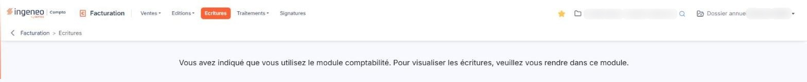

# Ecritures


**Où le trouver :** Menu **Ecritures**



**En bref** — Lorsque votre dossier utilise la comptabilité Ingeneo Compta, cet écran n'affiche qu'un message : les écritures générées par la facturation se consultent dans le module de comptabilité.

* Pour voir vos écritures : choisissez le module de comptabilité dans la barre latérale, à gauche de l'écran.


« Vous avez indiqué que vous utilisez le module comptabilité. Pour visualiser les écritures, veuillez vous rendre dans ce module. »

<figure><figcaption>
Écran « Ecritures » de la nouvelle interface
</figcaption></figure>

Ce n'est pas une anomalie : c'est le fonctionnement normal d'un dossier relié à la comptabilité, et vos écritures ne sont pas perdues — elles sont dans le module de comptabilité, consultables par ses propres options de consultation des écritures.

Ce message est un simple texte : il ne comporte aucun lien, aucun bouton et aucun renvoi cliquable vers le module qu'il vous désigne. Pour vous y rendre, choisissez le module de comptabilité dans la liste des modules de la barre latérale, à gauche de l'écran.
