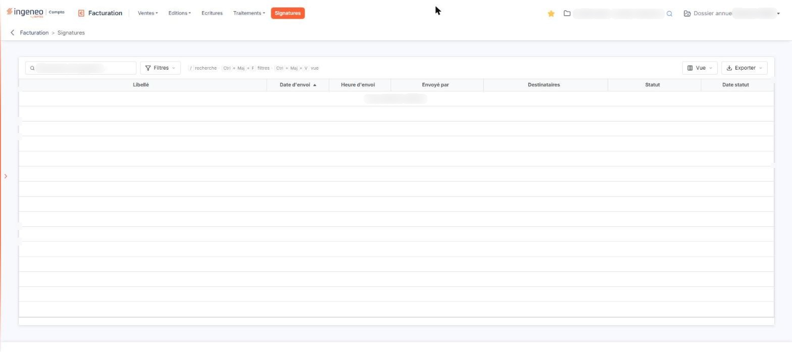

# Signatures


**Où le trouver :** Menu **Signatures**



**En bref** — Cet écran de consultation récapitule les pièces envoyées en signature électronique et l'état de chaque demande.

* Pour suivre une demande : repérez la pièce dans la colonne « Libellé », puis lisez sa colonne « Statut ».
* Pour lancer une signature : ouvrez le devis concerné, depuis le menu « Ventes », option « Devis ».


## Le tableau des demandes

<figure><figcaption>
Écran « Signatures » de la nouvelle interface
</figcaption></figure>

Le tableau présente sept colonnes, toutes triables :

| Champ             | Ce qu'il faut savoir                                                                                                                                       |
| ----------------- | ---------------------------------------------------------------------------------------------------------------------------------------------------------- |
| **Libellé**       | 
Désigne la pièce envoyée en signature. <strong>Date d'envoi</strong> et <strong>Heure d'envoi :</strong> le moment où la demande a été adressée.
 |
| **Envoyé par**    | L'utilisateur qui a lancé la demande.                                                                                                                      |
| **Destinataires** | Les signataires à qui la demande a été adressée.                                                                                                           |
| **Statut**        | Où en est la demande. Son libellé est celui que renvoie le service de signature électronique : le logiciel n'en fixe pas la liste.                         |
| **Date statut**   | La date à laquelle ce statut a été constaté.                                                                                                               |

Le tableau ne comporte aucune case à cocher.

Lorsqu'aucune demande n'a été envoyée, le tableau affiche « Aucun élément à afficher. » et son pied de page reste vide.

## Les outils au-dessus du tableau

Au-dessus du tableau figurent un champ de recherche, « Rechercher une signature… », puis trois boutons : bouton **\[Filtres]**, bouton **\[Vue]** et bouton **\[Exporter]**. Une ligne d'indications placée à côté du champ rappelle les raccourcis du clavier : « / » pour la recherche, « Ctrl+Maj+F » pour les filtres et « Ctrl+Maj+V » pour la vue.

bouton **\[Filtres]** ouvre un volet intitulé « Filtrer ». Tant qu'aucun critère n'est posé, il indique « Aucun critère. Choisissez une colonne pour commencer. » et propose « + Ajouter un critère sur… », qui donne la liste des sept colonnes du tableau. Le volet se termine par bouton **\[Vider les filtres]** et bouton **\[Filtrer]**.

bouton **\[Vue]** ouvre un volet qui présente d'abord « Mes vues » — « Aucune vue enregistrée. » tant que vous n'en avez pas enregistré — avec « Enregistrer la vue actuelle », puis « Colonnes affichées » : une ligne par colonne du tableau, et l'indication « 7 colonnes affichées sur 7 ». Il se termine par bouton **\[Rétablir les colonnes d'origine]** et bouton **\[Appliquer]**.

bouton **\[Exporter]** ouvre un volet qui rappelle ce qui est exporté — « La liste affichée - 0 signature » lorsque le tableau est vide — et propose « Aperçu édition HTML », « Imprimer Ctrl+P », « Exporter en Excel », « Exporter en PDF » et « Envoyer la liste par e-mail ».
