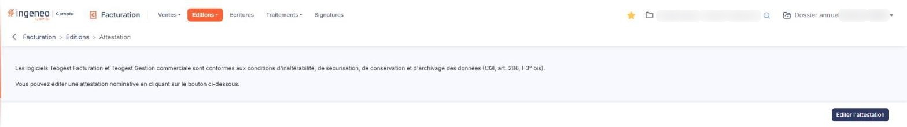

# Attestation


**Où le trouver :** Menu **Editions › Attestation**



**En bref** — Cet écran édite, au format PDF, l'attestation individuelle de conformité de vos logiciels de facturation aux conditions d'inaltérabilité, de sécurisation, de conservation et d'archivage des données.

* Pour obtenir l'attestation : bouton \[Editer l'attestation].


Cette option vous permet d'éditer l'attestation individuelle de conformité prévue par la réglementation de lutte contre la fraude à la TVA (CGI, art. 286, I-3° bis). Elle certifie que le logiciel de facturation que vous utilisez satisfait aux conditions d'inaltérabilité, de sécurisation, de conservation et d'archivage des données.

<figure><figcaption>
Écran « Attestation » de la nouvelle interface
</figcaption></figure>

L'écran ne comporte aucun critère : ni date, ni période, ni intervalle, ni format de sortie. Il ne présente que deux phrases et un seul bouton. La première vous indique que « Les logiciels Teogest Facturation et Teogest Gestion commerciale sont conformes aux conditions d'inaltérabilité, de sécurisation, de conservation et d'archivage des données (CGI, art. 286, I-3° bis). » ; la seconde vous invite à éditer une attestation nominative avec le bouton placé en bas de l'écran.

bouton **\[Editer l'attestation]**

C'est le seul bouton de l'écran et il est actif dès l'ouverture.
