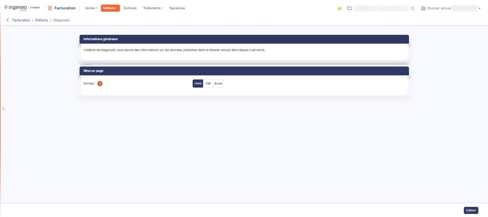

# Diagnostic


**Où le trouver :** Menu **Editions › Diagnostic**



**En bref** — Le diagnostic dresse l'état des lieux chiffré du dossier annuel ouvert et recherche les trous de numérotation des factures et des avoirs. Il recalcule aussi les quantités des articles gérés en stock.

* Pour lancer le diagnostic : choisissez le « Format », puis bouton \[Edition].


Le diagnostic est une édition lancée sur le dossier annuel dans lequel vous êtes.

<figure><figcaption>
Écran « Diagnostic » de la nouvelle interface
</figcaption></figure>

L'écran n'a qu'un critère, la mise en page : il n'y a ni période, ni date, ni sélection de client ou d'article à indiquer. Le périmètre est le dossier annuel ouvert, celui que désigne le sélecteur du bandeau.

## Rubrique « Informations générales »

Cette rubrique ne comporte aucun champ : elle porte seulement la phrase « L'édition de diagnostic vous donne des informations sur les données présentes dans le dossier annuel dans lequel il est lancé. »

## Rubrique « Mise en page »

**Format** : « Html », qui est proposé, « Pdf » ou « Excel ». Le choix « Pdf » fait apparaître deux champs supplémentaires :

* **Orientation** : « Portrait » ou « Paysage ».
* **Largeur** : « Fixe » ou « Ajustée ». Le passage au format « Pdf » place **systématiquement** ce choix sur « Ajustée » : si vous avez demandé « Fixe », puis changé de format, votre choix est perdu et vous retrouvez « Ajustée » en revenant au « Pdf ». Reprenez-le à chaque édition.

bouton **\[Edition]**

Produit le rapport de diagnostic sur le dossier annuel ouvert, au format choisi. C'est le seul bouton de l'écran, et il est actif dès l'ouverture.
