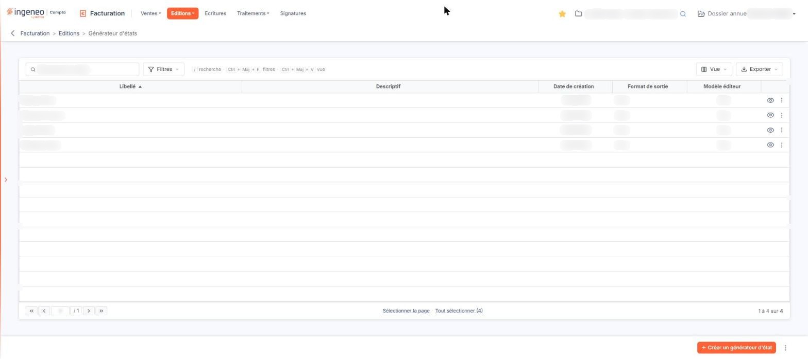

# Générateur d'états


**Où le trouver :** Menu **Editions › Générateur d'états**



**En bref** — Le générateur d'états fonctionne comme dans les autres modules, mais propose les fichiers de la Facturation ; un état créé ici n'est visible que depuis la Facturation.

* Pour apprendre à l'utiliser : consultez le chapitre « Généralités », en tête de l'aide.


<figure><figcaption>
Écran « Générateur d'états » de la nouvelle interface
</figcaption></figure>

L'aide en ligne concernant le générateur d'états, commune à tous les modules du logiciel où il est présent, se trouve dans le chapitre « Généralités » en tête de la présente aide.
