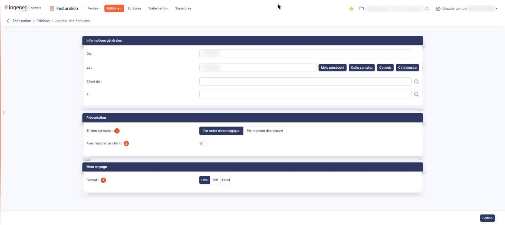

# Journal des écritures


**Où le trouver :** Menu **Editions › Journal des écritures**



**En bref** — Cet écran édite le journal des écritures de ventes correspondant aux factures et avoirs validés d'une période. C'est un document de contrôle, non un export comptable.

* Pour éditer le journal du mois en cours : bouton \[Ce mois], puis bouton \[Edition].
* Pour le limiter à quelques clients : renseignez « Client de » et « à », puis bouton \[Edition].


Le journal des écritures présente les écritures comptables correspondant aux factures et aux avoirs dont la date est comprise dans la période indiquée. Le document porte le titre « Journal des écritures de ventes », alors que l'option de menu s'intitule seulement « Journal des écritures » : c'est bien le même document, et il ne concerne que les ventes.

<figure><figcaption>
Écran « Journal des écritures » de la nouvelle interface
</figcaption></figure>

Ce journal n'est pas destiné à exporter vos écritures comptables : celles-ci sont générées et enregistrées soit dans le logiciel de comptabilité Ingeneo Compta, soit dans le fichier d'écritures en vue de leur export ultérieur, selon ce que vous avez paramétré dans l'option « Connexion comptabilité ». Le journal est un document de contrôle et de consultation.

L'écran est un formulaire de critères, en trois rubriques.

## Rubrique « Informations générales »

**Du** et **au** : la période éditée.

**Client de** et **à** : limite l'édition à une fourchette de codes clients. Les deux champs proposent les clients au fil de votre saisie, et un pictogramme de recherche les accompagne, qui ouvre une fenêtre « Sélection d'un client » : elle liste dès son ouverture les clients du dossier par code et par raison sociale, avec une zone de recherche « Client » en tête et une pagination en pied ; vous cliquez la ligne voulue pour la retenir. Il n'y a plus de bouton \[Afficher].

Cet écran ne propose pas d'autre critère de sélection : ni famille de client, ni inclusion des pièces non validées. **Seules les pièces validées sont éditées**, et aucune option ne permet d'y ajouter les pièces non validées — c'est une différence avec le journal des ventes, qui, lui, offre cette option.

**La période proposée à l'ouverture de l'écran est le mois en cours, calculé sur la date du jour et non sur les dates de votre dossier annuel.** Si le dossier ouvert n'est pas l'exercice en cours, cette période ne contient aucune pièce : l'édition est produite malgré tout, et indique seulement qu'aucune écriture n'a été trouvée. Renseignez la période vous-même avant de lancer l'édition.

Quatre boutons, à droite des dates, renseignent la période pour vous : bouton **\[Mois précédent]**, bouton **\[Cette semaine]**, bouton **\[Ce mois]** et bouton **\[Ce trimestre]**. Ils calculent eux aussi à partir de la date du jour, et non des dates de votre dossier ; « Ce trimestre » retient les trois derniers mois glissants, et non le trimestre civil.

## Rubrique « Présentation »

| Champ                          | Ce qu'il faut savoir                                                                                                                                                                 |
| ------------------------------ | ------------------------------------------------------------------------------------------------------------------------------------------------------------------------------------ |
| 1. **Tri des écritures**       | Par ordre chronologique, qui est le choix proposé, ou par montant décroissant.                                                                                                       |
| 2. **Avec rupture par client** | Interrupteur sans texte, désactivé par défaut. Activé, le document présente un tableau par client, titré du code et de la raison sociale, suivi d'une ligne de total pour ce client. |

Ces deux critères ne changent rien à l'écran : ils n'agissent que sur le document produit.

## Rubrique « Mise en page »

**Format** : « Html », proposé par défaut, « Pdf » ou « Excel ». Le document en Html s'affiche dans un nouvel onglet de votre navigateur.

Le choix « Pdf » fait apparaître deux critères supplémentaires :

* **Orientation** : « Portrait », proposé par défaut, ou « Paysage » ;
* **Largeur** : « Fixe » ou « Ajustée », cette dernière étant celle que le logiciel retient dès que vous choisissez le format Pdf. Son infobulle précise qu'elle ajuste la taille si la largeur des colonnes dépasse la largeur de la page.

## Le document produit

Selon ce que vous avez indiqué dans l'option « Connexion comptabilité », ce document n'est pas construit de la même façon. Lorsque vous utilisez la comptabilité Ingeneo Compta **et** que vous générez les écritures de vente, il présente les écritures réellement enregistrées en comptabilité : une pièce qui n'y a pas donné lieu à une écriture n'y figure donc pas, et rien ne vous le signale. Dans tous les autres cas, le journal calcule les écritures au moment de l'édition, à partir des pièces : les numéros d'écriture qu'il affiche ne servent alors qu'à regrouper les lignes et ne correspondent à aucune écriture enregistrée.

bouton **\[Edition]**

Produit le document dans le format choisi. C'est le seul bouton d'action de l'écran : les critères que vous avez saisis ne sont pas mémorisés, vous les renseignez à chaque édition.
