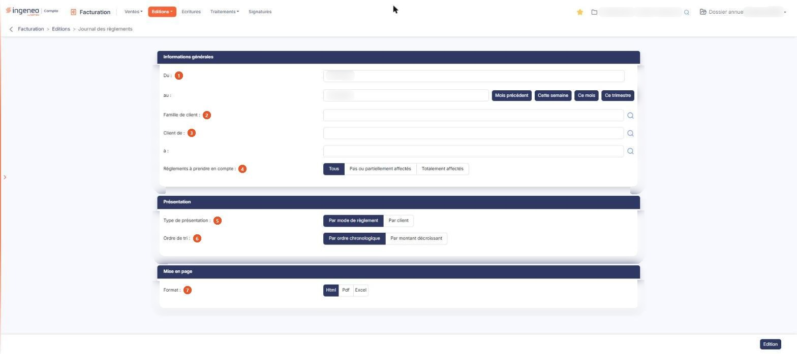

# Journal des règlements


**Où le trouver :** Menu **Editions › Journal des règlements**



**En bref** — Cette édition récapitule les règlements enregistrés sur une période, qu'ils viennent d'une facture ou de l'option « Règlements », sans écarter aucune donnée.

* Pour éditer les règlements du mois : bouton \[Ce mois], puis bouton \[Edition].
* Sur un dossier qui n'est pas l'exercice en cours : saisissez vous-même les dates « Du » et « au », puis bouton \[Edition].


Le journal des règlements récapitule les règlements enregistrés sur la période demandée, qu'ils l'aient été depuis une facture ou depuis l'option « Règlements » du menu « Ventes ». L'écran est un formulaire de critères en trois rubriques ; le document est produit par le bouton **\[Edition]**.

<figure><figcaption>
Écran « Journal des règlements » de la nouvelle interface
</figcaption></figure>

C'est le seul des journaux du module qui n'écarte aucune donnée : contrairement au journal des ventes et au journal des écritures, il ne réserve pas l'édition aux pièces validées et n'applique aucun filtre que l'écran ne montre pas.

## Rubrique « Informations générales »

| Champ                                 | Ce qu'il faut savoir                                                                                                                                                                                                                                                                                                                                                                                                                                                                                                                                                                                                                                                                                                  |
| ------------------------------------- | --------------------------------------------------------------------------------------------------------------------------------------------------------------------------------------------------------------------------------------------------------------------------------------------------------------------------------------------------------------------------------------------------------------------------------------------------------------------------------------------------------------------------------------------------------------------------------------------------------------------------------------------------------------------------------------------------------------------- |
| 1. **Du**                             | 
Et** au : **la période à éditer, avec un calendrier pour chacune des deux dates. Le logiciel propose le mois civil en cours, calculé sur la date du jour. Cette période ne tient pas compte du dossier annuel ouvert. Si vous travaillez sur un dossier qui n'est pas l'exercice en cours, la période proposée ne contient aucun règlement et l'édition sort vide sans autre explication : indiquez vous-même vos dates. Quatre boutons de raccourci vous positionnent la période : bouton <strong>[Mois précédent]</strong>, bouton <strong>[Cette semaine]</strong>, bouton <strong>[Ce mois]</strong> et bouton <strong>[Ce trimestre]</strong>. Ils calculent eux aussi à partir de la date du jour.
 |
| 2. **Famille de client**              | Si vous utilisez les familles de clients, vous pouvez restreindre l'édition à une famille. Le pictogramme de recherche placé à sa droite ouvre la fenêtre « Sélection d'une famille de clients » : la liste des familles s'affiche dès l'ouverture ; la saisie de tout ou partie du libellé cherché dans le champ **Famille** la filtre, puis vous cliquez sur la ligne voulue pour la retenir (« Cliquez pour sélectionner »). La croix de l'en-tête referme la fenêtre sans rien retenir. La fenêtre ne présente que les familles définies dans votre dossier                                                                                                                                                       |
| 3. **Client de**                      | Et\*\* à : \*\*l'édition porte par défaut sur tous les clients ; vous pouvez la restreindre à un intervalle en indiquant le code du premier et celui du dernier client. Chaque champ propose une aide à la saisie et un pictogramme de recherche.                                                                                                                                                                                                                                                                                                                                                                                                                                                                     |
| 4. **Règlements à prendre en compte** | Trois choix, « Tous » étant proposé. Les règlements saisis depuis l'option « Règlements » du menu « Ventes » ne sont pas toujours affectés à une facture, et un règlement saisi depuis une facture peut dépasser le montant de celle-ci. Vous pouvez donc n'éditer que les règlements « Pas ou partiellement affectés », ou seulement les « Totalement affectés », ou « Tous ».                                                                                                                                                                                                                                                                                                                                       |

## Rubrique « Présentation »

| Champ                       | Ce qu'il faut savoir                                                                                                                                           |
| --------------------------- | -------------------------------------------------------------------------------------------------------------------------------------------------------------- |
| 5. **Type de présentation** | « Par mode de règlement », qui est proposé, ou « Par client ».                                                                                                 |
| 6. **Ordre de tri**         | « Par ordre chronologique », qui est proposé, ou « Par montant décroissant ». Le tri s'applique à l'intérieur de chaque mode de règlement ou de chaque client. |

## Rubrique « Mise en page »

**Format** : « Html », qui est proposé, « Pdf » ou « Excel ». Le choix « Pdf » fait apparaître deux champs supplémentaires :

* **Orientation** : « Portrait » ou « Paysage ».
* **Largeur** : « Fixe » ou « Ajustée ». Une infobulle vous précise : « Ajuste la taille si la largeur des colonnes dépasse la largeur de la page ». Le passage au format « Pdf » place systématiquement ce choix sur « Ajustée » : si vous avez demandé « Fixe », puis changé de format, votre choix est perdu et vous retrouvez « Ajustée » en revenant au « Pdf ». Reprenez-le à chaque édition.

bouton **\[Edition]**

Produit le journal selon les critères saisis. Le logiciel contrôle vos dates et vous signale une date incorrecte ou une date de début postérieure à la date de fin.
