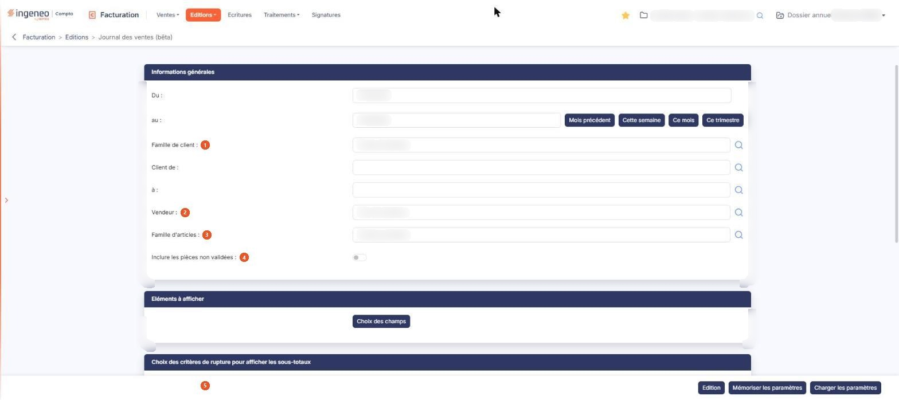
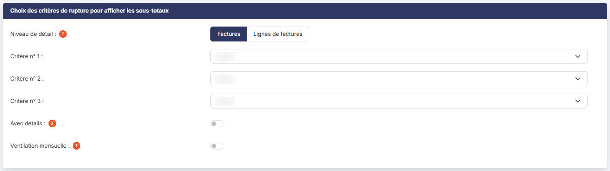
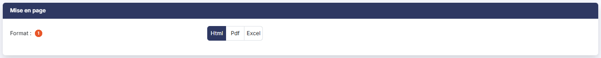

# Journal des ventes (bêta)


**Où le trouver :** Menu **Editions › Journal des ventes (bêta)**



**En bref** — Cette version du journal des ventes ajoute les critères vendeur et famille d'articles, un tableau dont vous choisissez les colonnes et ruptures, et la mémorisation de vos paramètres.

* Pour éditer le journal : choisissez la période (par exemple bouton \[Mois précédent]), puis bouton \[Edition].
* Pour réutiliser vos réglages : bouton \[Mémoriser les paramètres], puis bouton \[Charger les paramètres] lors d'une prochaine édition.


Cette option produit un journal des ventes à partir des factures, dont les montants sont affichés en positif, et des avoirs, dont les montants sont affichés en négatif. L'écran est un formulaire de critères, en quatre rubriques ; tous les critères que vous indiquez s'appliquent simultanément à l'édition.

<figure><figcaption>
Écran « Journal des ventes (bêta) » de la nouvelle interface
</figcaption></figure>

Deux options du menu « Editions » produisent un journal des ventes : « Journal des ventes » et « Journal des ventes (bêta) », décrite ici. Les deux reposent sur les mêmes données. Pour ce qui leur est commun — la période, la fourchette de clients, l'inclusion des pièces non validées, les formats de sortie —, reportez-vous à l'option « Journal des ventes ». Cette version vous apporte trois choses de plus :

* **deux critères supplémentaires** : le vendeur et la famille d'articles ;
* **un tableau unique dont vous choisissez les colonnes**, avec jusqu'à trois niveaux de rupture, là où l'autre option impose trois présentations figées ;
* **la mémorisation de vos paramètres**, que vous rechargez d'une édition à l'autre.

## Rubrique « Informations générales »

**Du** et **au** : la période éditée. Les pièces dont la date est comprise dans cet intervalle sont retenues, la journée de fin incluse. Vous saisissez les dates directement ou vous les choisissez dans le calendrier, qui s'ouvre au clic dans la zone de date.

| Champ                                  | Ce qu'il faut savoir                                                                                                                                                                                                                                                                                                                                               |
| -------------------------------------- | ------------------------------------------------------------------------------------------------------------------------------------------------------------------------------------------------------------------------------------------------------------------------------------------------------------------------------------------------------------------ |
| 1. **Famille de client**               | 
Limite l'édition aux clients d'une famille. Le champ propose « Toutes les familles » tant que vous ne renseignez rien, et un pictogramme de recherche l'accompagne. Les cinq champs de recherche de cette rubrique disposent du même pictogramme. <strong>Client de</strong> et <strong>à</strong> : limite l'édition à une fourchette de codes clients.
 |
| 2. **Vendeur**                         | Limite l'édition aux pièces d'un vendeur. Le champ propose « Tous les vendeurs » tant que vous ne renseignez rien. Ce critère n'existe pas sur l'option « Journal des ventes ».                                                                                                                                                                                    |
| 3. **Famille d'articles**              | Limite l'édition aux lignes portant un article de cette famille. Le champ propose « Toutes les familles » tant que vous ne renseignez rien. Ce critère non plus n'existe pas sur l'option « Journal des ventes ».                                                                                                                                                  |
| 4. **Inclure les pièces non validées** | Interrupteur, désactivé à l'ouverture. Tant qu'il reste désactivé, **seules les pièces validées entrent dans l'édition** : une facture saisie mais non validée n'y figure pas.                                                                                                                                                                                     |

**La période proposée à l'ouverture de l'écran est le mois en cours, calculé sur la date du jour et non sur les dates de votre dossier annuel.** Si le dossier ouvert n'est pas l'exercice en cours, cette période ne contient donc aucune pièce et l'édition ne rapporte rien, sans autre explication. Renseignez la période vous-même avant de lancer l'édition. Notez que si vous rechargez un paramétrage mémorisé, les dates qu'il contient remplacent celles que l'écran propose.

Quatre boutons, à droite des dates, renseignent la période pour vous : bouton **\[Mois précédent]**, bouton **\[Cette semaine]**, bouton **\[Ce mois]** et bouton **\[Ce trimestre]**. Ils calculent eux aussi à partir de la date du jour, et non des dates de votre dossier ; « Ce trimestre » retient les trois derniers mois glissants, et non le trimestre civil. Notez que « Cette semaine » retient la semaine du lundi au samedi : une pièce datée d'un dimanche n'entre pas dans la période ainsi calculée.

## Rubrique « Eléments à afficher »

bouton **\[Choix des champs]**

La rubrique ne contient que ce bouton. Il ouvre une fenêtre intitulée « Eléments à afficher », où vous choisissez les colonnes du document. La fenêtre présente une ligne par colonne possible, avec son libellé dans la colonne « Champ » et un interrupteur dans la colonne « Sélection ». Quelques lignes affichent « Oui » sans interrupteur : ce sont les montants hors taxes, de TVA et toutes taxes comprises, de la pièce comme de l'article, qui figurent toujours au document.

Un premier ensemble de colonnes décrit la pièce et son client — par exemple la date de la pièce ou le nom du client —, un second décrit la ligne d'article — par exemple le code de l'article ou la quantité. Une partie d'entre elles est retenue à l'ouverture, les autres sont désactivées.

bouton **\[Enregistrer]** retient vos choix pour l'édition et bouton **\[Fermer]** referme la fenêtre. La croix de l'en-tête de la fenêtre la referme également.

**Une colonne retenue ici n'apparaît pas toujours au document, et la fenêtre ne le signale pas.** Le niveau de détail et l'option de détail de la rubrique suivante retirent d'office certaines colonnes : au niveau « Factures », les colonnes qui décrivent l'article ne sont pas éditées ; au niveau « Lignes de factures », ce sont les montants de la pièce ; et si l'interrupteur **Avec détails** reste désactivé, une dizaine de colonnes de plus sont retirées. C'est l'explication d'une colonne que vous cochez et que vous ne retrouvez pas.

Notez également que les libellés de cette fenêtre ne sont pas ceux des en-têtes du document : « Date de la pièce » y devient « Date », « Montant HT de la pièce » devient « Montant HT ».

## Rubrique « Choix des critères de rupture pour afficher les sous-totaux »

<figure><figcaption>
Rubrique « Choix des critères de rupture pour afficher les sous-totaux »
</figcaption></figure>

| Champ                        | Ce qu'il faut savoir                                                                                                                                                                                                                                                                                                                                                                                                                                                                                                                                                                                                                                                                                                                                                                                                                                                                                                                                                                                                                                                                                                                                                                                                                                                                                                         |
| ---------------------------- | ---------------------------------------------------------------------------------------------------------------------------------------------------------------------------------------------------------------------------------------------------------------------------------------------------------------------------------------------------------------------------------------------------------------------------------------------------------------------------------------------------------------------------------------------------------------------------------------------------------------------------------------------------------------------------------------------------------------------------------------------------------------------------------------------------------------------------------------------------------------------------------------------------------------------------------------------------------------------------------------------------------------------------------------------------------------------------------------------------------------------------------------------------------------------------------------------------------------------------------------------------------------------------------------------------------------------------- |
| 1. **Niveau de détail**      | 
Deux choix, « Factures » — retenu par défaut — ou « Lignes de factures ». C'est le choix qui commande le reste de la rubrique : il détermine à la fois les critères de rupture qui vous sont proposés et, comme indiqué ci-dessus, les colonnes que le document retiendra. <strong>Critère n° 1</strong>, <strong>Critère n° 2</strong> et <strong>Critère n° 3</strong> : trois listes déroulantes, toutes trois sur « Aucun » à l'ouverture. Elles définissent les niveaux de regroupement du document et les sous-totaux qui les accompagnent. Les critères proposés sont ceux qui ont un sens au niveau de détail retenu : au niveau « Factures », le regroupement se fait sur le client ou le vendeur — familles de clients, clients, vendeurs ; le niveau « Lignes de factures » y ajoute les regroupements par article. Choisissez le niveau de détail avant les critères : le critère déjà retenu est remis à « Aucun » lorsque vous changez de niveau. Les trois listes se remplissent en cascade : le critère n° 2 ne propose que « Aucun » tant que le critère n° 1 vaut « Aucun », et le critère n° 3 tant que le critère n° 2 vaut « Aucun ». Rien n'empêche en revanche de retenir deux fois le même critère : la liste du critère n° 2 propose aussi celui que vous avez retenu au critère n° 1.
 |
| 2. **Avec détails**          | Interrupteur, désactivé à l'ouverture. Activé, le document présente, sous chaque regroupement, les pièces ou les lignes qui le composent.                                                                                                                                                                                                                                                                                                                                                                                                                                                                                                                                                                                                                                                                                                                                                                                                                                                                                                                                                                                                                                                                                                                                                                                    |
| 3. **Ventilation mensuelle** | Interrupteur, désactivé à l'ouverture. Activé, le document présente un couple de colonnes quantité et montant par mois de la période éditée.                                                                                                                                                                                                                                                                                                                                                                                                                                                                                                                                                                                                                                                                                                                                                                                                                                                                                                                                                                                                                                                                                                                                                                                 |

La **ligne de total générale** du document n'est éditée que si vous avez retenu au moins un critère de rupture. Sans aucun critère, le document présente les lignes sans total d'ensemble.

## Rubrique « Mise en page »

<figure><figcaption>
Rubrique « Mise en page »
</figcaption></figure>

**Format** : « Html », proposé par défaut, « Pdf » ou « Excel ». Le document en Html s'affiche dans un nouvel onglet de votre navigateur.

Le choix « Pdf » fait apparaître deux critères supplémentaires :

* **Orientation** : « Portrait », proposé par défaut, ou « Paysage » ;
* **Largeur** : « Fixe » ou « Ajustée », cette dernière étant celle que le logiciel retient dès que vous choisissez le format Pdf. Son infobulle précise qu'elle ajuste la taille si la largeur des colonnes dépasse la largeur de la page.

## Ce que l'édition retient, et que l'écran ne montre pas

Seules les **lignes d'article** des pièces sont prises en compte : les commentaires et les sous-totaux saisis dans une pièce n'apparaissent pas dans le journal et n'entrent dans aucun cumul.

Les **avoirs sont toujours inclus**, leurs montants en négatif : aucun critère de l'écran ne permet de les exclure, et c'est à garder en tête pour lire les totaux du document.

Les regroupements sont présentés par ordre alphabétique de leur libellé, et les lignes par date puis par numéro de pièce. Cette version ne propose pas de choix d'ordre de tri.

Deux intitulés du cadre qui rappelle vos critères, en tête du document — « Trié par » et « Avec détail » —, **restent vides quels que soient vos choix**. C'est le cas sur toutes les éditions produites par cette option, et cela ne traduit pas une erreur de votre paramétrage.

## Les boutons de l'écran

bouton **\[Edition]**

Lance l'édition dans le format retenu à la rubrique « Mise en page ».

bouton **\[Mémoriser les paramètres]**

Conserve les critères de l'écran, de façon à les retrouver lors d'une prochaine édition. Cette possibilité n'existe que sur cette option du menu.

bouton **\[Charger les paramètres]**

Reprend des critères mémorisés et remplace ceux de l'écran, dates comprises.
