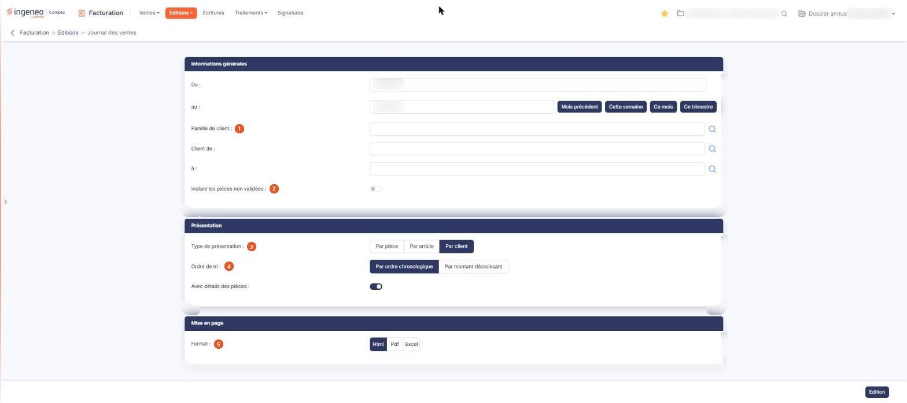

# Journal des ventes


**Où le trouver :** Menu **Editions › Journal des ventes**



**En bref** — Cet écran édite le journal des ventes d'une période : les factures en positif et les avoirs en négatif, selon les critères que vous indiquez.

* Pour éditer le journal du mois écoulé : bouton \[Mois précédent], complétez au besoin les autres critères, puis bouton \[Edition].
* Pour une autre période : saisissez les dates « Du » et « au », puis bouton \[Edition].


L'édition du journal des ventes intègre les éléments provenant des factures, dont les montants sont affichés en positif, et des avoirs, dont les montants sont affichés en négatif. Les avoirs sont toujours inclus : aucune option ne permet de les exclure, et c'est à garder en tête pour lire les totaux du document.

<figure><figcaption>
Écran « Journal des ventes » de la nouvelle interface
</figcaption></figure>

L'écran est un formulaire de critères, en trois rubriques. Tous les critères que vous indiquez s'appliquent simultanément à l'édition.

Deux entrées de menu voisines produisent un journal des ventes : « Journal des ventes », décrit ici, et « Journal des ventes (bêta) », qui présente les mêmes données autrement — il ajoute deux critères, le vendeur et la famille d'articles, il remplace les trois présentations figées décrites ci-dessous par un tableau unique dont vous cochez les colonnes et choisissez les ruptures, et il permet de mémoriser vos paramètres d'une édition à l'autre.

## Rubrique « Informations générales »

**Du** et **au** : la période éditée. Les pièces dont la date est comprise dans cet intervalle sont retenues, la journée de fin incluse.

| Champ                                  | Ce qu'il faut savoir                                                                                                                                                                                                                                                                                                                                                                                                                                                                                                                                                                                                                                                       |
| -------------------------------------- | -------------------------------------------------------------------------------------------------------------------------------------------------------------------------------------------------------------------------------------------------------------------------------------------------------------------------------------------------------------------------------------------------------------------------------------------------------------------------------------------------------------------------------------------------------------------------------------------------------------------------------------------------------------------------- |
| 1. **Famille de client**               | 
Limite l'édition aux clients d'une famille. Le champ propose les familles au fil de votre saisie, et un pictogramme de recherche l'accompagne, qui ouvre une fenêtre « Sélection d'une famille de clients » : la liste des familles s'affiche dès l'ouverture de la fenêtre, avec un champ « Famille » qui la filtre à la saisie, et il n'y a plus de bouton [Afficher] ; vous cliquez la ligne voulue pour la retenir (« Cliquez pour sélectionner »), ou la croix de l'en-tête pour fermer la fenêtre sans rien retenir. <strong>Client de</strong> et <strong>à</strong> : limite l'édition à une fourchette de codes clients, avec la même aide à la saisie.
 |
| 2. **Inclure les pièces non validées** | Interrupteur sans texte, désactivé à l'ouverture. Tant qu'il reste désactivé, **seules les pièces validées entrent dans l'édition** : une facture saisie mais non validée n'y figure pas.                                                                                                                                                                                                                                                                                                                                                                                                                                                                                  |

**La période proposée à l'ouverture de l'écran est le mois en cours, calculé sur la date du jour et non sur les dates de votre dossier annuel.** Si le dossier ouvert n'est pas l'exercice en cours, cette période ne contient donc aucune pièce : l'édition est produite malgré tout, et indique seulement qu'aucune pièce n'a été trouvée. Renseignez la période vous-même avant de lancer l'édition.

Quatre boutons, à droite des dates, renseignent la période pour vous : bouton **\[Mois précédent]**, bouton **\[Cette semaine]**, bouton **\[Ce mois]** et bouton **\[Ce trimestre]**. Ils calculent eux aussi à partir de la date du jour, et non des dates de votre dossier ; « Ce trimestre » retient les trois derniers mois glissants, et non le trimestre civil.

## Rubrique « Présentation »

| Champ                       | Ce qu'il faut savoir                                                                                                                                                                                                                                                                                                                                                                                                                                                                                                                                                                                                                                                                                                                                                                                                                                                               |
| --------------------------- | ---------------------------------------------------------------------------------------------------------------------------------------------------------------------------------------------------------------------------------------------------------------------------------------------------------------------------------------------------------------------------------------------------------------------------------------------------------------------------------------------------------------------------------------------------------------------------------------------------------------------------------------------------------------------------------------------------------------------------------------------------------------------------------------------------------------------------------------------------------------------------------- |
| 3. **Type de présentation** | C'est le choix qui commande toute la rubrique et la forme du document. Trois valeurs, « Par pièce », « Par article » et « Par client », cette dernière étant proposée par défaut. Choisissez la présentation : le logiciel affiche alors les seuls critères qui s'y appliquent.                                                                                                                                                                                                                                                                                                                                                                                                                                                                                                                                                                                                    |
| 4. **Ordre de tri**         | 
Dans les trois cas, vous triez par ordre chronologique — par ordre alphabétique en présentation par article — ou par montant décroissant. <strong>Avec détails des articles</strong>, <strong>Avec détails par client</strong>, <strong>Avec détails des pièces</strong> : selon la présentation retenue, un interrupteur sans texte ajoute au document, sous chaque groupe, le détail des éléments qui le composent. L'appariement n'est pas celui qu'on attendrait, retenez-le : la présentation <strong>Par pièce</strong> propose <strong>Avec détails des articles</strong>, la présentation <strong>Par article</strong> propose <strong>Avec détails par client</strong>, et la présentation <strong>Par client</strong> propose <strong>Avec détails des pièces</strong>. En présentation par client, cet interrupteur est le seul de l'écran activé par défaut.
 |
| **Ventilation mensuelle**   | Interrupteur sans texte proposé en présentation par article. Activé, le document présente, pour chaque article, un couple de colonnes quantité et montant par mois de la période.                                                                                                                                                                                                                                                                                                                                                                                                                                                                                                                                                                                                                                                                                                  |

## Rubrique « Mise en page »

**Format** : « Html », proposé par défaut, « Pdf » ou « Excel ». Le document en Html s'affiche dans un nouvel onglet de votre navigateur.

Le choix « Pdf » fait apparaître deux critères supplémentaires :

* **Orientation** : « Portrait », proposé par défaut, ou « Paysage » ;
* **Largeur** : « Fixe » ou « Ajustée », cette dernière étant celle que le logiciel retient dès que vous choisissez le format Pdf. Son infobulle précise qu'elle ajuste la taille si la largeur des colonnes dépasse la largeur de la page.

bouton **\[Edition]**

Produit le document dans le format choisi. Il se trouve en bas à droite de l'écran et c'est le seul bouton d'action : les critères que vous avez saisis ne sont pas mémorisés, vous les renseignez à chaque édition.
