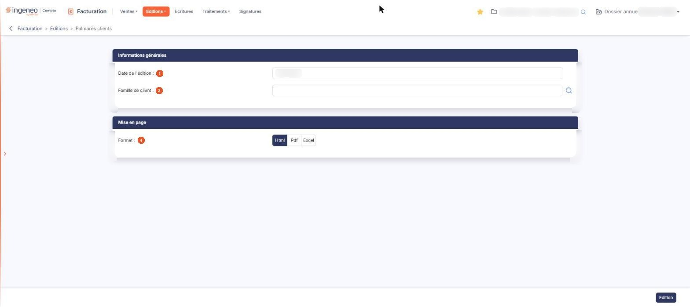

# Palmarès clients


**Où le trouver :** Menu **Editions › Palmarès clients**



**En bref** — Cette édition classe vos dix premiers clients selon le chiffre d'affaires cumulé jusqu'à la date indiquée.

* Pour éditer le palmarès : indiquez la « Date de l'édition », au besoin une « Famille de client », puis bouton \[Edition].


Cette édition classe vos clients selon le chiffre d'affaires que vous avez réalisé avec eux, du plus important au moins important. L'écran comporte deux rubriques, et le document est produit par le bouton **\[Edition]**.

<figure><figcaption>
Écran « Palmarès clients » de la nouvelle interface
</figcaption></figure>

## Rubrique « Informations générales »

| Champ                    | Ce qu'il faut savoir                                                                                                                                                                                                                                                                                                                                                                                                                                                                                                                                                                                                                                                                                                                    |
| ------------------------ | --------------------------------------------------------------------------------------------------------------------------------------------------------------------------------------------------------------------------------------------------------------------------------------------------------------------------------------------------------------------------------------------------------------------------------------------------------------------------------------------------------------------------------------------------------------------------------------------------------------------------------------------------------------------------------------------------------------------------------------- |
| 1. **Date de l'édition** | Qui se saisit directement ou se choisit dans le calendrier, s'ouvrant au clic dans la zone. Le logiciel propose la date du jour.                                                                                                                                                                                                                                                                                                                                                                                                                                                                                                                                                                                                        |
| 2. **Famille de client** | L'édition porte par défaut sur tout le fichier clients. Si vous utilisez les familles de clients, vous pouvez la restreindre à une famille pour obtenir un palmarès propre à ce sous-groupe. Le champ propose une aide à la saisie, et le pictogramme de recherche placé à sa droite ouvre la fenêtre « Sélection d'une famille de clients » : la liste des familles s'affiche dès l'ouverture, sous un champ de recherche **Famille** qui filtre la liste à mesure que vous saisissez tout ou partie du libellé cherché ; vous cliquez sur la ligne voulue pour la retenir (« Cliquez pour sélectionner »), ou vous fermez la fenêtre par la croix de son en-tête. La fenêtre ne présente que les familles définies dans votre dossier |

## Rubrique « Mise en page »

**Format** : « Html », qui est proposé, « Pdf » ou « Excel ». Le choix « Pdf » fait apparaître deux champs supplémentaires :

* **Orientation** : « Portrait » ou « Paysage ».
* **Largeur** : « Fixe » ou « Ajustée ». Une infobulle vous précise : « Ajuste la taille si la largeur des colonnes dépasse la largeur de la page ». Le passage au format « Pdf » place systématiquement ce choix sur « Ajustée » : si vous avez demandé « Fixe », puis changé de format, votre choix est perdu et vous retrouvez « Ajustée » en revenant au « Pdf ». Reprenez-le à chaque édition.

bouton **\[Edition]**

Produit le palmarès selon les critères saisis. Si aucune pièce ne répond aux critères, le document est tout de même produit, avec ses colonnes et un total à zéro.
