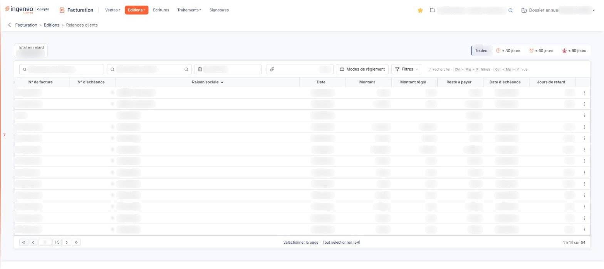
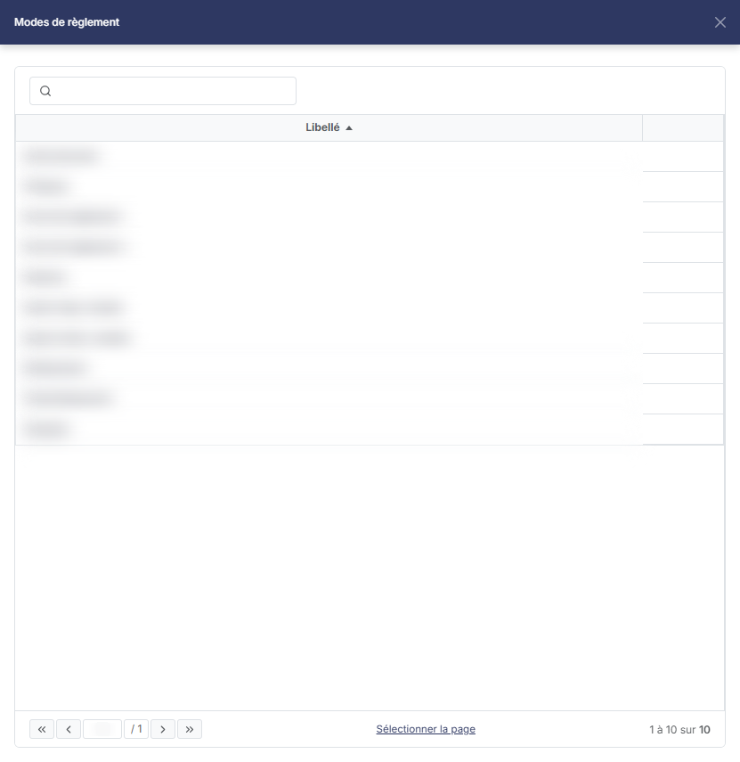
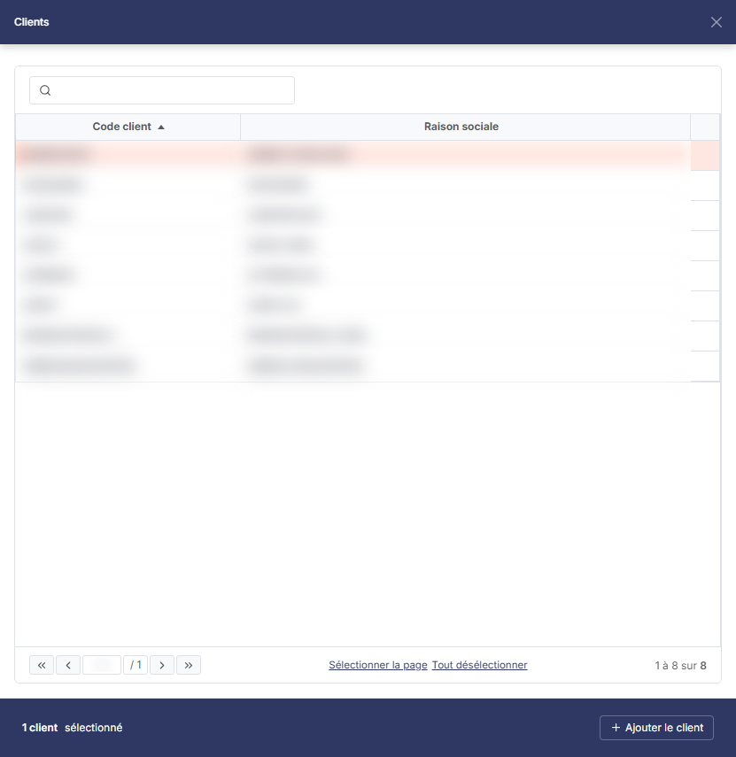
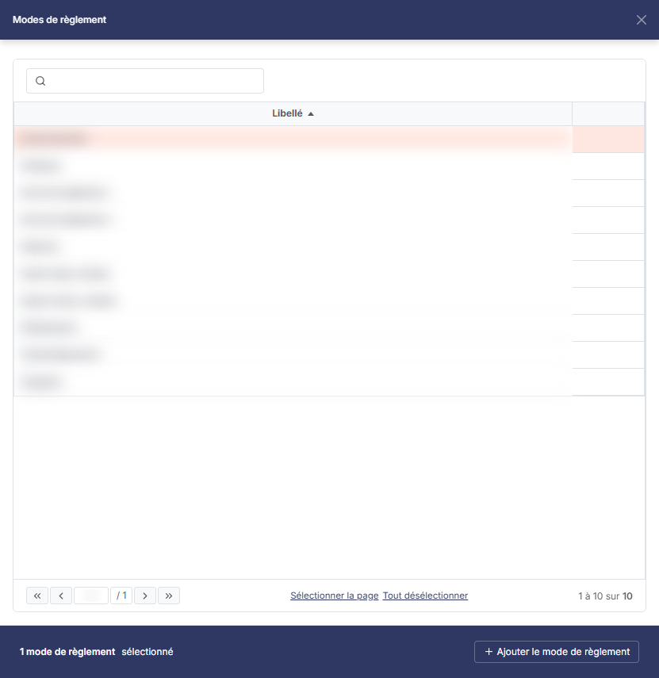

# Relances clients


**Où le trouver :** Menu **Editions › Relances clients**



**En bref** — Cet écran liste les échéances en retard de vos clients pour les relancer en une fois, par courrier ou par e-mail.

* Pour relancer : sélectionnez les échéances, bouton \[Générer les relances], choisissez la modalité d'envoi et les modèles, puis lancez l'envoi.
* Pour rétablir les filtres d'origine : lien « Tout effacer », qui s'affiche à droite de la barre dès qu'un critère n'est plus à son état initial.


Cette option relance vos clients sur la totalité du fichier, là où la fonction de relance de la fiche client ne traite qu'un client. Il s'agit de relances dites « manuelles », déclenchées au moment où vous le décidez, par opposition aux relances automatiques paramétrées dans les fiches clients.

<figure><figcaption>
Écran « Relances clients » de la nouvelle interface
</figcaption></figure>

L'écran n'est pas un formulaire de critères d'édition mais une **liste** : il présente les échéances en retard, vous en retirez celles que vous ne voulez pas relancer, puis vous générez les relances dans une fenêtre. Sous la barre d'outils habituelle des listes (les zones « Rechercher une facture… » et « Rechercher un client… », puis les champs propres à cet écran — la date, le seuil et le bouton \[Modes de règlement] —, et les boutons \[Filtres], \[Vue] et \[Exporter]), un compteur « Total en retard » affiche, dans une case encadrée en haut à gauche de l'écran, le montant total des échéances présentées. À droite du même bandeau, quatre segments choisissent le retard minimal.

Seules figurent dans la liste les échéances des clients dont la fiche autorise les relances manuelles. Cette restriction n'apparaît pas comme un critère que vous pourriez modifier ici : elle se règle client par client, dans sa fiche.

## Les filtres de la liste

<figure><figcaption>
Bouton [Modes de règlement]
</figcaption></figure>

<figure><figcaption>
Bouton [+ Ajouter le client]
</figcaption></figure>

<figure><figcaption>
Bouton [+ Ajouter le mode de règlement]
</figcaption></figure>

Il n'y a plus de menu « Filtres spéciaux » : les critères propres à cet écran sont visibles directement, dans la barre à droite des deux zones de recherche (date, seuil, \[Modes de règlement]) et dans le bandeau au-dessus (retard). Ils s'appliquent sans bouton d'application. Le bouton \[Réinitialiser] n'existe plus : le lien « Tout effacer », qui s'affiche à droite de la barre dès qu'un critère n'est plus à son état initial, remet les critères à l'état initial. Le bouton \[Filtres] propose en plus le filtre commun des listes (« + Ajouter un critère sur… », avec les boutons \[Vider les filtres] et \[Filtrer]).

| Champ                      | Ce qu'il faut savoir                                                                                                                                                                                                                                                                                                                                                                                                                                                                                                                                                                                                                                                                                                                                                                                                                                                                                                                                                                                                                                                                                                                                                                         |
| -------------------------- | -------------------------------------------------------------------------------------------------------------------------------------------------------------------------------------------------------------------------------------------------------------------------------------------------------------------------------------------------------------------------------------------------------------------------------------------------------------------------------------------------------------------------------------------------------------------------------------------------------------------------------------------------------------------------------------------------------------------------------------------------------------------------------------------------------------------------------------------------------------------------------------------------------------------------------------------------------------------------------------------------------------------------------------------------------------------------------------------------------------------------------------------------------------------------------------------- |
| **Seuil de déclenchement** | La zone, vide à l'ouverture, ne porte que le repère « Seuil » ; son explication est donnée par une infobulle. Il s'agit d'un **montant**, et non d'un nombre de jours : c'est le montant du retard de règlement à partir duquel un client doit être relancé. Le nombre de jours de retard, lui, est porté par les étapes des scénarios de relance.                                                                                                                                                                                                                                                                                                                                                                                                                                                                                                                                                                                                                                                                                                                                                                                                                                           |
| **Clients**                | Vous pouvez limiter la liste à un ou plusieurs clients. Ce critère n'est plus dans le menu des filtres : il se choisit par le pictogramme « Loupe » placé à droite de la zone « Rechercher un client… », qui ouvre le panneau « Clients », à droite de l'écran. Il présente les clients par leur **Code client** et leur **Raison sociale**, sous une zone de recherche « Rechercher par client… » qui restreint la liste à la saisie (il n'y a plus de bouton **\[Afficher]**). Il n'y a pas de case à cocher : un clic sur une ligne la retient, un second clic l'écarte. Le pied du panneau indique alors le nombre de clients sélectionnés (« 1 client sélectionné », « 2 clients sélectionnés ») et propose le bouton **\[+ Ajouter le client]** (« + Ajouter les clients » au pluriel), tandis que les liens « Sélectionner la page » et « Tout désélectionner » étendent ou annulent la sélection. Le panneau n'a ni bouton **\[Valider]** ni bouton **\[Annuler]** : la croix de son en-tête le ferme sans rien retenir. Comme le rappelle l'infobulle du pictogramme, seuls les clients pour lesquels les relances manuelles ont été autorisées dans leur fiche vous sont proposés. |
| **Échéances en retard au** | Le logiciel propose la date du jour, puisqu'il s'agit d'apprécier le retard à ce jour ; vous pouvez indiquer une autre date de référence, directement ou par le calendrier, qui s'ouvre au clic dans la zone.                                                                                                                                                                                                                                                                                                                                                                                                                                                                                                                                                                                                                                                                                                                                                                                                                                                                                                                                                                                |
| **Retard**                 | Ce n'est plus une liste déroulante mais quatre segments, placés à droite du bandeau qui surmonte la barre d'outils : « Toutes » (retenu à l'ouverture, toutes les factures en retard), « + 30 jours », « + 60 jours » et « + 90 jours », qui restreignent la liste aux factures en retard de plus de 30, de plus de 60 ou de plus de 90 jours. Les segments n'affichent pas de nombre.                                                                                                                                                                                                                                                                                                                                                                                                                                                                                                                                                                                                                                                                                                                                                                                                       |
| **Total en retard**        | Ce n'est plus un champ des filtres mais un compteur, dans une case encadrée en haut à gauche de l'écran, au-dessus de la barre d'outils, non saisissable. Le logiciel y reporte le total des échéances présentées par la liste, tel qu'il résulte des filtres appliqués.                                                                                                                                                                                                                                                                                                                                                                                                                                                                                                                                                                                                                                                                                                                                                                                                                                                                                                                     |

bouton **\[Modes de règlement]**

Il se trouve directement dans la barre d'outils, à droite de la zone du seuil ; son libellé est « Modes de règlement », suivi d'un nombre (« Modes de règlement : 2 ») lorsque des modes sont retenus. Il ouvre le panneau « Modes de règlement », à droite de l'écran, qui présente par leur **Libellé** les modes de règlement de votre dossier, sous une zone de recherche « Rechercher par mode de règlement… » (il n'y a plus de bouton **\[Afficher]**). Il n'y a pas de case à cocher : un clic sur une ligne la retient. Le pied du panneau indique alors « 1 mode de règlement sélectionné » et propose le bouton **\[+ Ajouter le mode de règlement]**, avec les liens « Sélectionner la page » et « Tout désélectionner » ; le panneau n'a ni bouton **\[Valider]** ni bouton **\[Annuler]**, la croix de son en-tête le referme sans rien retenir. Cela vous permet de choisir les clients à relancer en fonction de leur mode de règlement, et donc d'exclure par exemple les clients en prélèvement automatique.

**Lien « Tout effacer » et bouton \[Vider les filtres]**

Le bouton \[Filtrer les échéances] n'existe plus, pas plus que le bouton \[Réinitialiser]. Le lien « Tout effacer » remet ces filtres dans leur état initial (retard « Toutes ») ; le bouton \[Vider les filtres] du volet \[Filtres] retire les critères du filtre commun.

## La liste des échéances

La liste présente neuf colonnes : **N° de facture**, **N° d'échéance**, **Raison sociale**, **Date**, **Montant**, **Montant réglé**, **Reste à payer**, **Date d'échéance** et **Jours de retard**. Les neuf colonnes sont triables.

Il n'y a plus de case à cocher : un clic sur une ligne la sélectionne. Sous la liste, « Sélectionner la page » sélectionne les lignes de la page affichée et « Tout sélectionner (n) » les échéances de toutes les pages, n étant leur nombre. Au survol d'une ligne apparaît un seul pictogramme, « Autres actions » (trois points), dont le menu ne porte que « Supprimer ». La personnalisation des colonnes se fait par le bouton \[Vue], et l'impression ou l'export de la liste par le bouton \[Exporter].

La commande « Supprimer » du menu « Autres actions » d'une ligne et le bouton **\[Supprimer]** du bandeau de sélection retirent les échéances concernées de la **liste affichée**. Vous vous en servez pour écarter du traitement les échéances que vous ne souhaitez pas relancer. Le bandeau de sélection, qui contient ce bouton, n'apparaît qu'à partir d'une ligne sélectionnée.

## Bouton \[Générer les relances]

<figure><figcaption>
Bouton [Générer les relances]
</figcaption></figure>

Il se trouve dans le bandeau de sélection qui s'affiche en bas de l'écran dès qu'une échéance est sélectionnée (« 1 échéance sélectionnée », avec « Tout désélectionner », ce bouton et le bouton **\[Supprimer]**) ; il n'est pas affiché tant qu'aucune ligne n'est sélectionnée. Il ouvre la fenêtre qui produit les relances. Vous y choisissez d'abord la **modalité d'envoi**, et ce choix change entièrement la nature du traitement :

* **Envoi papier** : le logiciel n'envoie rien. Il produit un **seul document** rassemblant toutes les lettres de relance, que vous imprimez et postez vous-même. Aucun suivi n'est enregistré et aucune date de relance n'est portée sur les fiches clients.
* **Envoi par e-mail** : le logiciel adresse **un e-mail par client**, sa lettre de relance en pièce jointe, les éventuelles adresses de copie étant mises en copie cachée. Lorsque l'envoi a réussi, il enregistre un suivi de relance **pour chaque échéance** relancée et met à jour la **date de dernière relance** sur la fiche du client.

La fenêtre vous demande ensuite le modèle de lettre de relance et, pour un envoi par e-mail, le modèle d'e-mail, l'objet et le corps du message, l'adresse de l'expéditeur et les adresses des copies. Vous pouvez aussi demander un envoi d'essai, qui vous adresse à vous seul ce que recevraient les clients, et choisir d'ignorer les scénarios de relance.

Vous personnalisez ou créez les modèles de lettres dans « Paramètres > Modèles > Documents > Pages de document », et les modèles d'e-mails dans « Paramètres > Modèles > E-mails ».

## Ce que le scénario de relance impose, et ce qu'il vous laisse choisir

Par défaut, le scénario de relance manuelle affecté à la fiche du client est **prioritaire** : c'est lui qui fournit le modèle de lettre, le modèle d'e-mail, mais aussi **l'expéditeur et les adresses de copie** — vos choix de la fenêtre ne s'appliquent alors pas. Ils ne s'appliquent qu'aux clients dépourvus de scénario, ou à tous les clients si vous demandez d'ignorer les scénarios.

Le logiciel ne conserve **aucun niveau de relance** : rien n'indique qu'un client a été relancé une première, puis une deuxième fois. L'étape du scénario à appliquer est **recalculée à chaque génération** : c'est celle dont le nombre de jours de retard exigé est le plus élevé tout en restant inférieur au retard le plus important constaté parmi les échéances relancées. Une relance ne fait donc pas « passer au niveau suivant » : c'est le retard des échéances retenues qui détermine, seul, la lettre envoyée.

## Ce que porte la lettre de relance

La lettre est composée à partir d'un modèle d'impression, donc paramétrable : sa présentation dépend du modèle que vous employez. Les informations qu'elle peut reprendre sont celles de l'émetteur, celles du client, la liste des échéances relancées avec leurs jours de retard, et les totaux.
