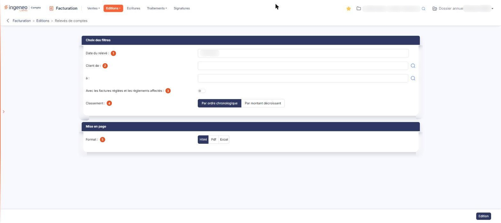

# Relevés de comptes


**Où le trouver :** Menu **Editions › Relevés de comptes**



**En bref** — Cette édition présente, client par client, ce qui reste dû à une date : échéances, avoirs, règlements et remboursements. Elle importe d'abord les règlements saisis en comptabilité.

* Pour éditer les relevés : indiquez la « Date du relevé », au besoin les codes clients « de » et « à », puis bouton \[Edition].


Le relevé de comptes est une édition. Il s'édite pour un client, pour un intervalle de clients ou pour l'ensemble du fichier.

<figure><figcaption>
Écran « Relevés de comptes » de la nouvelle interface
</figcaption></figure>

## Rubrique « Choix des filtres »

| Champ                                                       | Ce qu'il faut savoir                                                                                                                                                                                                                                                                                                         |
| ----------------------------------------------------------- | ---------------------------------------------------------------------------------------------------------------------------------------------------------------------------------------------------------------------------------------------------------------------------------------------------------------------------- |
| 1. **Date du relevé**                                       | Le logiciel propose la date du jour : c'est la date d'arrêté du relevé. Elle se saisit directement ou se choisit dans le calendrier, qui s'ouvre au clic dans la zone. Seules les pièces dont la date est antérieure ou égale à cette date figurent dans le document.                                                        |
| 2. **Client de**                                            | Et\*\* à : \*\*l'édition porte par défaut sur tous les clients. Pour la restreindre, indiquez le code du premier et celui du dernier client de l'intervalle ; pour n'obtenir le relevé que d'un seul client, portez son code dans les deux champs. Chaque champ propose une aide à la saisie et un pictogramme de recherche. |
| 3. **Avec les factures réglées et les règlements affectés** | Interrupteur sans texte, désactivé par défaut, c'est-à-dire un relevé limité à ce qui n'est pas soldé. Activez l'interrupteur pour obtenir également les factures entièrement réglées et les règlements déjà affectés.                                                                                                       |


Attention, ce filtre porte sur l'état des pièces **aujourd'hui**, non sur leur état à la date du relevé : l'édition d'un relevé de comptes ne se comporte pas comme celle d'un grand livre comptable dont vous auriez exclu les écritures lettrées avec des éléments hors période. Si, le 15 juin, vous demandez un relevé arrêté au 31 mars, les factures payées entre le 31 mars et le 15 juin n'y figureront pas. Activez l'interrupteur précédent pour les retrouver.


**Classement** : « Par ordre chronologique », qui est proposé, ou « Par montant décroissant ».

## Rubrique « Mise en page »

**Format** : « Html », qui est proposé, « Pdf » ou « Excel ». Le choix « Pdf » fait apparaître deux champs supplémentaires :

* **Orientation** : « Portrait » ou « Paysage ».
* **Largeur** : « Fixe » ou « Ajustée ». Une infobulle vous précise : « Ajuste la taille si la largeur des colonnes dépasse la largeur de la page ». Le passage au format « Pdf » place systématiquement ce choix sur « Ajustée » : si vous avez demandé « Fixe », puis changé de format, votre choix est perdu et vous retrouvez « Ajustée » en revenant au « Pdf ». Reprenez-le à chaque édition.

bouton **\[Edition]**

Il se trouve en bas à droite de l'écran, hors du contenu, et c'est le seul bouton de la barre du bas.
