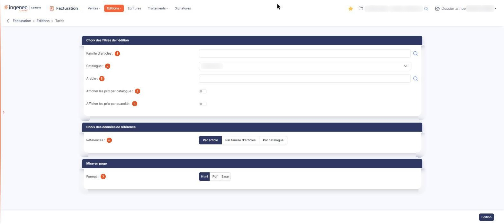

# Tarifs


**Où le trouver :** Menu **Editions › Tarifs**



**En bref** — Cette édition donne les tarifs actuels de vos articles : prix par défaut et, si vous le demandez, prix de catalogue et prix par quantité.

* Pour éditer les tarifs : choisissez au besoin une famille d'articles ou un catalogue, puis bouton \[Edition].


Cette édition porte sur les tarifs de vos articles. L'écran est un formulaire de critères en trois rubriques ; le document est produit par le bouton **\[Edition]**.

<figure><figcaption>
Écran « Tarifs » de la nouvelle interface
</figcaption></figure>

Cette édition ne comporte **aucun critère de date**.

La composition de cet écran dépend du paramétrage de vos articles (panneau « Paramètres », rubrique « Facturation », onglet « Articles »). Selon que votre dossier gère ou non les familles d'articles, les catalogues et les prix par quantité, certains critères ci-dessous sont présents ou **absents de votre écran** : ils ne sont pas grisés, ils ne sont pas affichés du tout. Si vous ne trouvez pas un critère décrit ici, c'est de ce paramétrage qu'il dépend.

## Rubrique « Choix des filtres de l'édition »

| Champ                                  | Ce qu'il faut savoir                                                                                                                                                                                                                                                                                                                                                                                                                                                                                                                                                                                                                                                                                                                                                                                                                                                         |
| -------------------------------------- | ---------------------------------------------------------------------------------------------------------------------------------------------------------------------------------------------------------------------------------------------------------------------------------------------------------------------------------------------------------------------------------------------------------------------------------------------------------------------------------------------------------------------------------------------------------------------------------------------------------------------------------------------------------------------------------------------------------------------------------------------------------------------------------------------------------------------------------------------------------------------------- |
| 1. **Famille d'articles**              | Ce critère n'est présent que si votre dossier gère les familles d'articles. Par défaut l'édition porte sur toutes les familles ; vous pouvez la restreindre à une seule.                                                                                                                                                                                                                                                                                                                                                                                                                                                                                                                                                                                                                                                                                                     |
| 2. **Catalogue**                       | Ce critère n'est présent que si votre dossier gère les catalogues. La liste vous propose les catalogues de votre dossier. Le logiciel ne présélectionne aucun catalogue, la liste s'ouvre sur « Sélectionnez ».                                                                                                                                                                                                                                                                                                                                                                                                                                                                                                                                                                                                                                                              |
| 3. **Article**                         | 
L'édition porte par défaut sur tout le fichier des articles ; vous pouvez la restreindre à un seul article en indiquant son code. Un pictogramme « Loupe » est accolé au champ pour vous aider à retrouver un article, et son infobulle vous indique le raccourci clavier correspondant : <strong>Ctrl + Alt + R</strong>. Ce pictogramme ouvre la fenêtre « Recherche ». Elle comporte un champ <strong>Contenu recherché</strong> : la liste se filtre à mesure que vous saisissez, il n'y a pas de bouton de recherche. Sous ce champ figure la liste de vos articles en quatre colonnes : <strong>Code Article</strong>, <strong>Libellé</strong>, <strong>Prix unitaire HT</strong> et <strong>Famille</strong>. Cliquez sur une ligne pour reporter son code dans le champ « Article » ; la croix de la barre de titre referme la fenêtre sans rien choisir.
 |
| 4. **Afficher les prix par catalogue** | Interrupteur sans texte, désactivé par défaut, lui aussi présent seulement si votre dossier gère les catalogues.                                                                                                                                                                                                                                                                                                                                                                                                                                                                                                                                                                                                                                                                                                                                                             |
| 5. **Afficher les prix par quantité**  | Interrupteur sans texte, désactivé par défaut, présent seulement si votre dossier gère les prix par quantité.                                                                                                                                                                                                                                                                                                                                                                                                                                                                                                                                                                                                                                                                                                                                                                |

## Rubrique « Choix des données de référence »

**Références** : trois choix : « Par article », qui est proposé, « Par catalogue » et « Par famille d'articles » ; ce troisième choix n'est présent que si votre dossier gère les familles.

## Rubrique « Mise en page »

**Format** : « Html », qui est proposé, « Pdf » ou « Excel ». Le choix « Pdf » fait apparaître deux champs supplémentaires :

* **Orientation** : « Portrait » ou « Paysage ».
* **Largeur** : « Fixe » ou « Ajustée ». Le passage au format « Pdf » place **systématiquement** ce choix sur « Ajustée » : si vous avez demandé « Fixe », puis changé de format, votre choix est perdu et vous retrouvez « Ajustée » en revenant au « Pdf ». Reprenez-le à chaque édition.

bouton **\[Edition]**

Produit l'édition des tarifs selon les critères saisis. C'est le seul bouton de l'écran, et il est actif dès l'ouverture.
