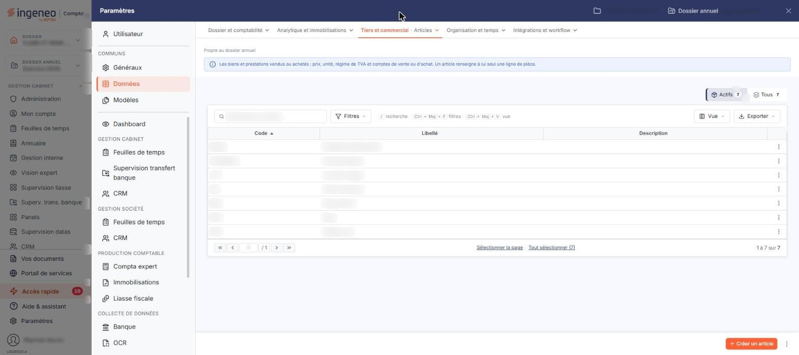
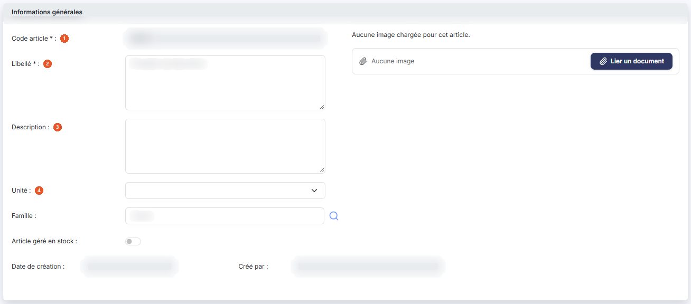
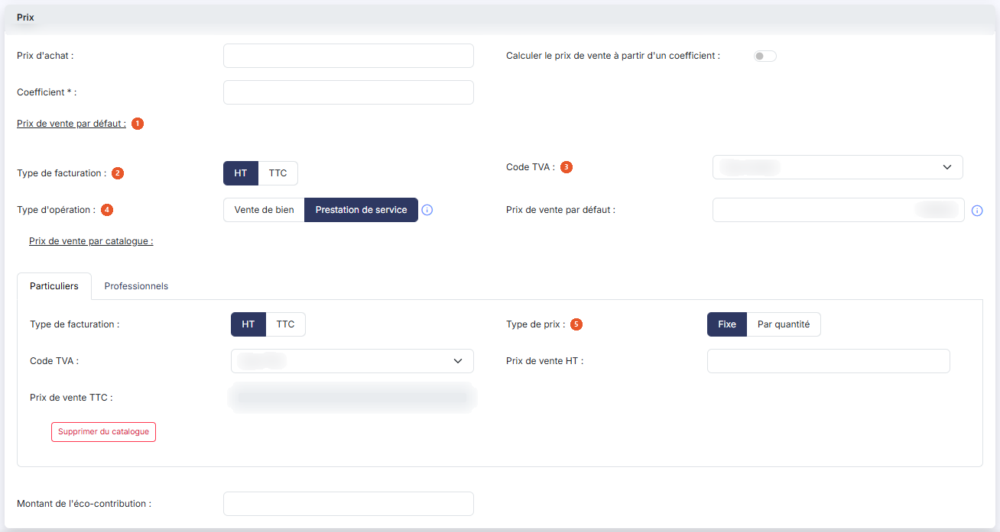
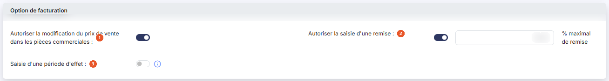
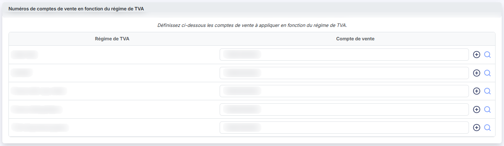
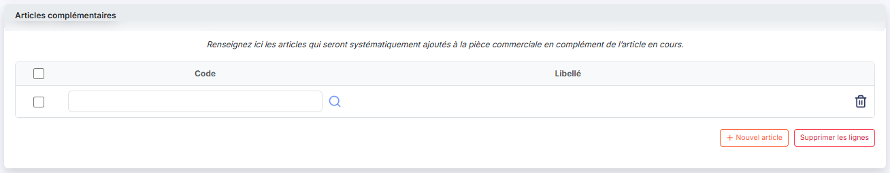

# Articles — fichier des articles


**Où le trouver :** Panneau **Paramètres** › **Facturation** › **Articles**



**En bref** — Cet écran tient le fichier des articles et prestations que vous facturez, avec leur prix de vente, leur code TVA et leurs comptes de vente.

* Pour créer un article : bouton \[Créer un article], renseignez sa fiche, puis bouton \[Enregistrer].
* Pour en saisir plusieurs à la suite : bouton \[Enregistrer et créer un nouvel article].
* Pour retrouver un article archivé : bouton \[Filtres spéciaux], puis activez l'interrupteur « Articles archivés ».


Cet écran s'ouvre depuis le panneau « Paramètres » : « Paramètres > Données > Tiers et commercial > Articles ».

<figure><figcaption>
Écran « Articles » de la nouvelle interface
</figcaption></figure>

Le fichier « Articles » recense les articles et les prestations que vous facturez. Chaque article y porte son prix de vente, son code TVA et les comptes de vente à utiliser lors de la génération des écritures comptables.

L'import d'un fichier d'articles provenant d'un autre logiciel ne se fait pas depuis cet écran : il s'effectue depuis le menu « Traitements », option « Import ». Reportez-vous à cette section de l'aide en ligne.

## La liste des articles

La liste présente trois colonnes : **Code**, **Libellé** et **Description**. Elle est triée par défaut sur le code, dans l'ordre croissant, et chacune des trois colonnes peut servir de critère de tri.

Trois dispositifs permettent de restreindre la liste :

| Champ                      | Ce qu'il faut savoir                                                                                                                                                                                                                                                                                                                                                                                                                                                                                    |
| -------------------------- | ------------------------------------------------------------------------------------------------------------------------------------------------------------------------------------------------------------------------------------------------------------------------------------------------------------------------------------------------------------------------------------------------------------------------------------------------------------------------------------------------------- |
| **Actifs / Tous**          | Deux segments comptés, au-dessus de la barre d'outils (il n'y a plus de menu \[Filtres spéciaux]) ; « Actifs » est retenu au chargement de l'écran. Le nombre d'éléments annoncé en pied de liste (« 1 à 7 sur 7 » sur le dossier relevé) ne compte donc que les articles **non archivés** : ce n'est pas le nombre total d'articles du dossier. Choisissez « Tous » pour faire apparaître les articles archivés ; le nombre affiché sur chaque segment indique d'avance combien d'articles il retient. |
| **Rechercher un article…** | Barre de recherche placée en tête de la liste ; le raccourci « / » y place le curseur.                                                                                                                                                                                                                                                                                                                                                                                                                  |
| **Le bouton \[Filtres]**   | Il ouvre un volet « Filtrer » qui indique « Aucun critère. Choisissez une colonne pour commencer. », propose « + Ajouter un critère sur… », le lien « Vider les filtres » et le bouton \[Filtrer], qui applique les critères choisis.                                                                                                                                                                                                                                                                   |

Un clic sur une ligne la sélectionne. Au survol d'une ligne, le pictogramme « Autres actions » (trois points) apparaît à son extrémité droite et ouvre un menu à trois entrées : « Modifier », qui ouvre la fiche de l'article, « Dupliquer » et « Supprimer ».

Au-dessus de la liste, le bouton \[Vue] permet de choisir les colonnes affichées et d'enregistrer des vues, et le bouton \[Exporter] donne accès à l'aperçu, à l'impression et aux exports de la liste. Sous la liste, « Sélectionner la page » et « Tout sélectionner (N) » étendent la sélection à la page affichée ou à tous les articles.

En bas à droite, hors du tableau, le bouton **\[Créer un article]** ouvre une fiche vierge ; à sa droite, le pictogramme « Autres actions » (trois points) ouvre un menu qui porte l'entrée « Champs dynamiques ». Dès qu'une ligne est sélectionnée, un bandeau de sélection (« 1 article sélectionnée », avec le lien « Tout désélectionner ») remplace cette barre et porte les boutons qui agissent sur les articles sélectionnés : bouton **\[Supprimer]** et bouton **\[Archiver]**, auxquels s'ajoute bouton **\[Modification groupée]** lorsque plusieurs articles sont sélectionnés.

## Rubrique « Informations générales »

<figure><figcaption>
Rubrique « Informations générales »
</figcaption></figure>

| Champ                  | Ce qu'il faut savoir                                                                                                                                                                                                                                                                                                                                                                     |
| ---------------------- | ---------------------------------------------------------------------------------------------------------------------------------------------------------------------------------------------------------------------------------------------------------------------------------------------------------------------------------------------------------------------------------------- |
| 1. **Code article**    | Vous ne le saisissez qu'à la création : lorsque vous ouvrez la fiche d'un article existant, ce champ n'est plus modifiable.                                                                                                                                                                                                                                                              |
| 2. **Libellé**         | Zone de texte. C'est ce libellé qui sera repris dans les pièces commerciales.                                                                                                                                                                                                                                                                                                            |
| 3. **Description**     | Zone de texte. Ce champ n'est pas repris dans les pièces commerciales.                                                                                                                                                                                                                                                                                                                   |
| 4. **Unité**           | 
C'est l'unité indicative de mesure des quantités de l'article ; la liste est alimentée par « Paramètres > Données > Tiers et commercial > Unités ». **Date de création <strong>et</strong> Créé par : **renseignés automatiquement et non modifiables. Ces deux champs ne sont présents que lorsque vous ouvrez la fiche d'un article existant : ils sont absents en création.
 |
| **Image de l'article** | À droite de la rubrique, le logiciel affiche « Aucune image chargée pour cet article. » tant qu'aucune image n'est associée. Une zone affiche un trombone et « Aucune image » ; son bouton **\[Lier un document]** vous permet de charger l'image de votre choix.                                                                                                                        |

## Rubrique « Prix »

<figure><figcaption>
Rubrique « Prix »
</figcaption></figure>

La rubrique se divise en deux zones : le prix de vente par défaut, puis les prix par catalogue.

### Prix de vente par défaut

| Champ                           | Ce qu'il faut savoir                                                                                                                                                                                                                                                                                                                                                                                                                                                   |
| ------------------------------- | ---------------------------------------------------------------------------------------------------------------------------------------------------------------------------------------------------------------------------------------------------------------------------------------------------------------------------------------------------------------------------------------------------------------------------------------------------------------------- |
| 1. **Prix de vente par défaut** | Ce tarif sera appliqué par défaut lors de l'édition d'une facture en cas de tarification non définie. Le champ porte la marque d'obligation à la création comme sur la fiche d'un article existant.                                                                                                                                                                                                                                                                    |
| 2. **Type de facturation**      | Deux boutons, **HT** et **TTC** ; **HT** est sélectionné par défaut. Ce choix définit si le prix est indiqué en HT ou en TTC. Si vous choisissez HT, le prix TTC est calculé en appliquant le taux de TVA, et éventuellement arrondi ; si vous choisissez TTC, c'est le prix HT qui est calculé et éventuellement arrondi. De cette manière, le prix que vous saisissez ne risque jamais d'être arrondi par un calcul fait en sens inverse dans une pièce commerciale. |
| 3. **Code TVA**                 | La liste propose les codes TVA créés dans « Paramètres > Données > Dossier et comptabilité > Codes TVA », et se positionne sur le code par défaut, que vous pouvez modifier.                                                                                                                                                                                                                                                                                           |
| 4. **Type d'opération**         | Deux boutons, **Vente de bien** et **Prestation de service** ; **Vente de bien** est sélectionné par défaut. Ce choix permet de définir si la TVA s'appliquera sur les débits ou sur les encaissements, et il commande donc le compte de TVA utilisé lors de la génération des écritures comptables.                                                                                                                                                                   |

### Prix de vente par catalogue

Si vous avez activé la gestion des catalogues dans « Paramètres > Facturation > Articles », cette zone présente un onglet par catalogue créé dans « Paramètres > Données > Tiers et commercial > Catalogues ». Vous renseignez les prix catalogue par catalogue en naviguant dans les onglets ; chaque onglet porte le même jeu de champs, et les valeurs y sont propres à son catalogue.

| Champ                                | Ce qu'il faut savoir                                                                                                                                                                                                                        |
| ------------------------------------ | ------------------------------------------------------------------------------------------------------------------------------------------------------------------------------------------------------------------------------------------- |
| 2. **Type de facturation**           | Deux boutons, **HT** et **TTC**, qui déterminent lequel des deux prix ci-dessous est saisissable : le prix de vente HT est saisissable et le prix de vente TTC grisé lorsque le type de facturation est HT, et l'inverse lorsqu'il est TTC. |
| 3. **Code TVA**                      | 
Même liste que pour le prix de vente par défaut. **Prix de vente HT <strong>et</strong> Prix de vente TTC : **un seul des deux est saisissable, selon le type de facturation retenu pour l'onglet.
                                |
| 5. **Type de prix**                  | Deux boutons, **Fixe** et **Par quantité** ; **Fixe** est sélectionné par défaut. Ce choix n'est proposé que si vous avez activé les prix par quantités dans « Paramètres > Facturation > Articles ».                                       |
| **Bouton \[Supprimer du catalogue]** | Il figure dans chaque onglet.                                                                                                                                                                                                               |


Attention, vous devez également renseigner le **Prix de vente par défaut** de la zone précédente, pour le cas où une pièce commerciale ne se verrait affecter aucun catalogue : c'est alors ce prix par défaut qui serait retenu.


Lorsque vous choisissez le type de prix **Par quantité**, les champs **Prix de vente HT** et **Prix de vente TTC** passent tous deux en grisé et le logiciel affiche à leur place une grille de tranches, à quatre colonnes : **Qté mini**, **Qté maxi**, **Prix vente HT** et **Prix vente TTC**, cette dernière n'étant pas saisissable. Une première tranche, vide, apparaît en même temps que la grille. Le bouton **\[Nouvelle ligne]** ajoute une tranche et la corbeille de chaque ligne la retire. Avec le type de prix **Fixe**, cette grille est absente de l'écran.

La rubrique se termine par le champ **Montant de l'éco-contribution**, hors des onglets de catalogue.

## Rubrique « Option de facturation »

<figure><figcaption>
Rubrique « Option de facturation »
</figcaption></figure>

| Champ                                                                          | Ce qu'il faut savoir                                                                                                                                                                                                                                                                                                                                                                                                                                                                                                                                                                                                                                                        |
| ------------------------------------------------------------------------------ | --------------------------------------------------------------------------------------------------------------------------------------------------------------------------------------------------------------------------------------------------------------------------------------------------------------------------------------------------------------------------------------------------------------------------------------------------------------------------------------------------------------------------------------------------------------------------------------------------------------------------------------------------------------------------- |
| 1. **Autoriser la modification du prix de vente dans les pièces commerciales** | 
Lors de la création d'une ligne d'article dans une pièce commerciale, le prix de vente affecté peut avoir plusieurs origines : le prix de vente par défaut de la fiche article, le prix du catalogue retenu, ou le prix de la tranche de quantité. Si cette option n'est pas activée, le prix proposé par le logiciel n'est pas modifiable ; dans le cas contraire, il est modifiable sur toutes les pièces commerciales par tous les utilisateurs qui y ont accès. Cette option n'est visible que si vous avez indiqué, dans « Paramètres > Facturation > Pièces commerciales », que les prix des articles pouvaient être modifiés dans les pièces commerciales.
 |
| 2. **Autoriser la saisie d'une remise**                                        | 
Si cette option est activée pour l'article, vous pourrez saisir une remise sur chaque ligne d'article, dans le mode de saisie en détail, jusqu'à concurrence du taux indiqué à côté par le champ <strong>% maximal de remise</strong>. Cette option n'est visible que si vous avez indiqué, dans « Paramètres > Facturation > Pièces commerciales », que vous autorisiez la saisie d'une remise par ligne d'article.
                                                                                                                                                                                                                                              |
| 3. **Saisie d'une période d'effet**                                            | Si vous activez l'interrupteur, vous pourrez saisir une date de début d'effet et une date de fin d'effet pour chaque ligne d'article dans les pièces commerciales ; ces dates seront reprises dans les écritures. Elles permettent notamment de réaliser les cut-off lors de l'élaboration du dossier de révision. Activer l'interrupteur ne modifie en rien la fiche de l'article : l'effet ne se voit que dans les pièces commerciales.                                                                                                                                                                                                                                   |

## Rubrique « Numéros de comptes de vente en fonction du régime de TVA »

<figure><figcaption>
Rubrique « Numéros de comptes de vente en fonction du régime de TVA »
</figcaption></figure>

« Définissez ci-dessous les comptes de vente à appliquer en fonction du régime de TVA. »

La rubrique présente une table à deux colonnes, **Régime de TVA** et **Compte de vente**, avec une ligne par régime de TVA créé dans « Paramètres > Données > Dossier et comptabilité > Régimes de TVA ». Pour chaque régime, vous indiquez le numéro de compte de vente associé à l'article ; chaque ligne dispose d'un pictogramme « Créer » (un « + » cerclé) pour créer un compte et d'une loupe de recherche pour retrouver un compte existant.

## Rubrique « Articles complémentaires »

<figure><figcaption>
Rubrique « Articles complémentaires »
</figcaption></figure>

« Renseignez ici les articles qui seront systématiquement ajoutés à la pièce commerciale en complément de l'article en cours. »

La grille présente deux colonnes, **Code** et **Libellé**, précédées d'une case à cocher par ligne et d'une case de sélection globale en en-tête. Chaque ligne propose une zone de saisie du code, une loupe de recherche et une corbeille « Supprimer » qui retire la ligne. Une première ligne, vide, est déjà présente à l'ouverture de la fiche. Le bouton **\[Nouvel article]** ajoute une ligne, le bouton **\[Supprimer les lignes]** retire celles que vous avez cochées.

## Les boutons de la fiche

Les boutons proposés ne sont pas les mêmes selon que vous créez un article ou que vous en modifiez un.

| Champ                                    | Ce qu'il faut savoir                                                                                                                                                                                                                                                                                    |
| ---------------------------------------- | ------------------------------------------------------------------------------------------------------------------------------------------------------------------------------------------------------------------------------------------------------------------------------------------------------- |
| **À la création**                        | Bouton **\[Enregistrer]**, bouton **\[Enregistrer et créer un nouvel article]** — qui enregistre l'article et vous laisse sur une fiche vierge pour enchaîner une nouvelle création. Le retour à la liste se fait par le chevron « Retour » de la barre d'onglets du panneau.                           |
| **En modification**                      | Bouton **\[Enregistrer]** reste seul affiché en bas à droite ; bouton **\[Archiver]**, bouton **\[Consulter l'historique]** et bouton **\[Consulter les statistiques]** sont dans le menu « Autres actions » (trois points) placé à sa droite ; le retour à la liste se fait par le chevron « Retour ». |
| **Bouton \[Consulter l'historique]**     | Il permet de visualiser toutes les lignes de pièces commerciales dans lesquelles apparaît l'article.                                                                                                                                                                                                    |
| **Bouton \[Consulter les statistiques]** | Il permet de visualiser plusieurs valeurs concernant l'article : la quantité vendue, le chiffre d'affaires global et le prix de vente moyen.                                                                                                                                                            |
| **Chevron « Retour »**                   | Placé à gauche de la barre d'onglets du panneau, il quitte la fiche sans enregistrer votre saisie et vous ramène à la liste des articles.                                                                                                                                                               |

## Bouton \[Champs dynamiques]

L'entrée « Champs dynamiques » se trouve dans le menu « Autres actions » (trois points) de la barre du bas, à droite de \[Créer un article]. Les champs dynamiques sont présents dans plusieurs fichiers du logiciel. Leur fonctionnement est décrit en détail dans l'aide en ligne du module Vision : rendez-vous sur votre page d'accueil, cliquez sur le pictogramme d'aide « ? » et reportez-vous au chapitre « Fonctionnement général », « Champs dynamiques ».

Tous les champs dynamiques créés dans le fichier des articles sont accessibles dans toutes les pièces commerciales, au niveau des lignes de détail. Ils peuvent être imprimés dans les pièces commerciales si les modèles d'impression ont été modifiés en conséquence.
