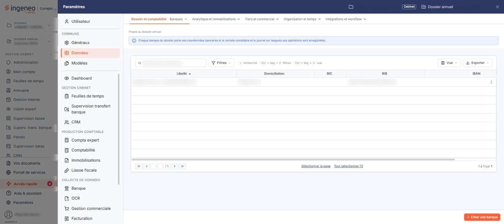
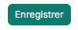
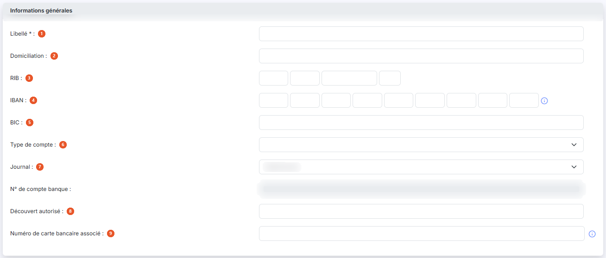
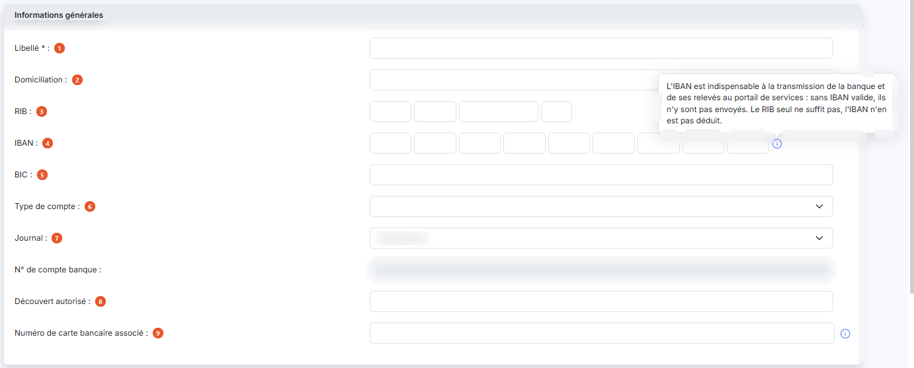
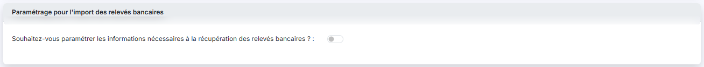
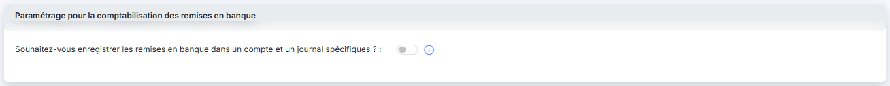

# Banques


**Où le trouver :** Panneau **Paramètres** › **Données** › **Dossier et comptabilité** › **Banques**



**En bref** — Cet écran tient les banques du dossier, dont les coordonnées figurent sur vos pièces commerciales et vos remises de chèques.

* Pour créer une banque : bouton \[Créer une banque], renseignez ses coordonnées, puis bouton \[Enregistrer].


Le fichier des banques est utilisé par plusieurs modules Ingeneo Compta. Pour ce qui concerne la facturation, il permet de faire figurer les coordonnées bancaires de votre société sur les pièces commerciales ainsi que sur les remises de chèques.

<figure><figcaption>
Écran « Banques » de la nouvelle interface
</figcaption></figure>

Cet écran s'ouvre par le panneau « Paramètres » : rubrique « Données », groupe « Dossier et comptabilité », entrée « Banques ». Un bandeau bleu en haut de l'écran rappelle que chaque banque du dossier porte ses coordonnées bancaires, ainsi que le compte comptable et le journal sur lesquels ses opérations sont enregistrées.

## La liste des banques

La liste présente cinq colonnes, toutes triables : **Libellé**, **Domiciliation**, **BIC**, **RIB** et **IBAN**. Le compteur du pied de liste porte sur l'ensemble des banques du dossier : aucun filtre ne le restreint au chargement de l'écran. Une banque peut figurer dans la liste sans coordonnées complètes : la domiciliation et le BIC ne sont pas obligatoires.

Il n'y a pas de case à cocher : un clic sur une ligne la sélectionne, un second clic la désélectionne. Tant qu'une ligne est sélectionnée, un bandeau « 1 banque sélectionnée » avec le lien « Tout désélectionner » et le bouton \[Supprimer] remplace le bouton de création. Au survol d'une ligne, le pictogramme « Autres actions » (trois points verticaux) apparaît à droite de la ligne : il ouvre deux entrées, « Modifier », qui ouvre la fiche de la banque, et « Supprimer », qui la supprime.

Au-dessus de la liste, la barre « Rechercher une banque… » et les boutons \[Filtres], \[Vue] et \[Exporter] permettent de chercher une banque, de filtrer la liste, de personnaliser les colonnes et de l'imprimer ou de l'exporter : \[Exporter] ouvre le menu d'édition de la liste (aperçu, impression, export Excel ou PDF, envoi par e-mail). Sous la liste, le lien « Sélectionner la page » sélectionne toutes les lignes affichées et le lien « Tout sélectionner (10) » étend la sélection à toutes les pages (le nombre entre parenthèses est celui des banques de la liste).

Le bouton \[Vue] ouvre un menu en deux parties : « Mes vues » (« Enregistrer la vue actuelle ») et « Colonnes affichées », où vous cochez les colonnes à afficher (« 5 colonnes affichées sur 20 » par défaut), avec le bouton **\[Rétablir les colonnes d'origine]** et le bouton **\[Appliquer]**. Seules les cinq colonnes ci-dessus sont visibles par défaut, mais la liste peut également présenter quinze colonnes masquées par défaut, dans cet ordre : **Compte banque**, **Journal**, **Import des relevés bancaires**, **Compte d'attente**, **Référence par défaut des écritures**, **Import des remises en banque**, **Compte de remise en banque**, **Journal de remise en banque**, **Type de compte**, **Date de création**, **Créée par**, **Date de modification**, **Modifiée par**, **Découvert autorisé** et **Carte bancaire**. Le bouton \[Filtres] ouvre un menu « Filtrer » : « + Ajouter un critère sur… » propose ces vingt mêmes colonnes, dans le même ordre ; vous pouvez donc rechercher une banque sur une information qui n'est pas affichée dans la liste. Ses boutons sont le bouton **\[Filtrer]**, qui lance la recherche, et le bouton **\[Vider les filtres]**. Les boutons \[Mémoriser les paramètres] et \[Charger les paramètres] ne sont plus proposés.

bouton **\[Créer une banque]**

Placé en bas à droite de l'écran, hors de la liste, il ouvre une fiche vierge pour créer une banque.

bouton **\[Supprimer]**

Il se trouve dans le bandeau de sélection, qui remplace le bouton de création tant qu'une ligne est sélectionnée, et supprime les banques sélectionnées dans la liste.

## La fiche d'une banque

<figure><figcaption>
Bouton [Enregistrer]
</figcaption></figure>

La fiche comporte trois rubriques, présentées dans cet ordre et affichées en création comme en modification. La fiche se termine par le bouton **\[Enregistrer]**, en bas à droite ; le bouton \[Retour] n'y est plus affiché : le chevron « Retour », à gauche de la barre d'onglets du panneau, revient à la liste sans enregistrer les modifications en cours.

## Rubrique « Informations générales »

<figure><figcaption>
Rubrique « Informations générales »
</figcaption></figure>

<figure><figcaption>
Rubrique « Informations générales »
</figcaption></figure>

| Champ                                   | Ce qu'il faut savoir                                                                                                                                                                                                                                                                                                                                                                                                                                                                                              |
| --------------------------------------- | ----------------------------------------------------------------------------------------------------------------------------------------------------------------------------------------------------------------------------------------------------------------------------------------------------------------------------------------------------------------------------------------------------------------------------------------------------------------------------------------------------------------- |
| 1. **Libellé**                          | 50 caractères au maximum. Il permet de différencier les banques entre elles dans les sélecteurs et dans la liste.                                                                                                                                                                                                                                                                                                                                                                                                 |
| 2. **Domiciliation**                    | Facultative, 24 caractères au maximum.                                                                                                                                                                                                                                                                                                                                                                                                                                                                            |
| 3. **RIB**                              | Il se saisit en quatre zones successives : code banque, code guichet, numéro de compte et clé.                                                                                                                                                                                                                                                                                                                                                                                                                    |
| 4. **IBAN**                             | Il se saisit en neuf zones successives. Un pictogramme d'information, à droite des cases de l'IBAN, rappelle par son infobulle que l'IBAN est indispensable à la transmission de la banque et de ses relevés au portail de services : sans IBAN valide, ils n'y sont pas envoyés, et le RIB seul ne suffit pas, l'IBAN n'en étant pas déduit.                                                                                                                                                                     |
| 5. **BIC**                              | 11 caractères au maximum.                                                                                                                                                                                                                                                                                                                                                                                                                                                                                         |
| 6. **Type de compte**                   | Choisissez dans la liste la nature du compte (compte chèque, compte de dépôt, compte épargne, emprunt, etc.).                                                                                                                                                                                                                                                                                                                                                                                                     |
| 7. **Journal**                          | 
La liste ne propose que les journaux de banque du dossier. <strong>N° de compte banque :ce champ ne se saisit pas</strong>, ni à la création ni en modification : il s'affiche désactivé dans les deux cas. C'est le logiciel qui le renseigne d'après le <strong>Journal</strong> que vous choisissez — dès que vous sélectionnez un journal, le compte de banque associé à ce journal apparaît. Pour changer ce numéro, c'est donc le journal qu'il faut changer, ou le compte rattaché à ce journal.
 |
| 8. **Découvert autorisé**               | —                                                                                                                                                                                                                                                                                                                                                                                                                                                                                                                 |
| 9. **Numéro de carte bancaire associé** | 16 caractères au maximum. Le pictogramme d'information rappelle que ce numéro est notamment utile en cas d'import de fichier OFX.                                                                                                                                                                                                                                                                                                                                                                                 |

En modification, la rubrique affiche enfin les dates et les auteurs de création et de modification de la fiche, non modifiables. Ces informations n'existent pas en création.

## Rubrique « Paramétrage pour l'import des relevés bancaires »

<figure><figcaption>
Rubrique « Paramétrage pour l'import des relevés bancaires »
</figcaption></figure>

La rubrique ne présente d'abord qu'une question : **Souhaitez-vous paramétrer les informations nécessaires à la récupération des relevés bancaires ? :**, que commande un interrupteur.

## Rubrique « Paramétrage pour la comptabilisation des remises en banque »

<figure><figcaption>
Rubrique « Paramétrage pour la comptabilisation des remises en banque »
</figcaption></figure>

La rubrique ne présente d'abord qu'une question : **Souhaitez-vous enregistrer les remises en banque dans un compte et un journal spécifiques ? :**, que commande un interrupteur.
