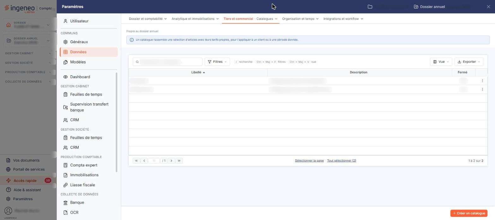

# Catalogues


**Où le trouver :** Panneau **Paramètres** › **Données** › **Tiers et commercial** › **Catalogues**



**En bref** — Les catalogues permettent d'appliquer des prix de vente différents selon le contexte (nature du client, promotions…). Ils ne sont utilisables que si l'option « Gérer les catalogues » est activée.

* Pour créer un catalogue : bouton \[Créer un catalogue], saisissez son libellé, puis bouton \[Enregistrer].
* Si l'écran affiche « Vous n'avez pas activé l'option de gestion des catalogues. » : activez « Gérer les catalogues » dans « Paramètres » > « Facturation » > « Articles ».


Cet écran s'ouvre depuis le panneau « Paramètres » : « Paramètres > Données > Tiers et commercial > Catalogues ».

<figure><figcaption>
Écran « Catalogues » de la nouvelle interface
</figcaption></figure>

Les catalogues permettent d'affecter des prix de vente différents aux articles en fonction du contexte de la vente : nature du client, promotions, etc. Dans chaque fiche article, vous pouvez définir un prix pour chaque catalogue créé ; dans chaque fiche client, vous pouvez affecter un catalogue de prix par défaut.

Cette option n'est utilisable que si les catalogues sont activés pour le dossier, par l'interrupteur **Gérer les catalogues** du panneau « Paramètres » : « Paramètres > Facturation > Articles », rubrique « Options de gestion des articles ».

## La liste des catalogues

La liste présente trois colonnes : **Libellé**, **Description** et **Fermé**, cette dernière indiquant par « Oui » ou « Non » si le catalogue est fermé. La liste est triée par défaut sur le libellé, par ordre croissant, et les trois colonnes peuvent servir au tri. Les catalogues affichés sont ceux du dossier ; aucun filtre n'est appliqué au chargement de l'écran, de sorte que le compteur du pied de liste porte sur l'ensemble des catalogues, fermés compris.

Un clic sur une ligne la sélectionne. Au survol d'une ligne, un pictogramme « Autres actions » (trois points) apparaît à son extrémité droite et ouvre un menu à trois entrées : « Modifier », qui ouvre la fiche du catalogue en modification, « Dupliquer », qui permet de créer un catalogue à partir de celui de la ligne, et « Supprimer ».

Au-dessus de la liste, la barre « Rechercher un catalogue… » et le bouton **\[Filtres]** permettent de restreindre l'affichage ; le bouton **\[Vue]** permet de choisir les colonnes affichées et d'enregistrer des vues, et le bouton **\[Exporter]** donne accès à l'aperçu, à l'impression et aux exports de la liste. Sous la liste, bouton **\[Sélectionner la page]** et bouton **\[Tout sélectionner (n)]** étendent la sélection à la page affichée ou à tous les catalogues.

Le bouton **\[Filtres]** ouvre un volet où « + Ajouter un critère sur… » vous fait choisir l'une des trois colonnes de la liste — **Libellé**, **Description** ou **Fermé** ; le bouton **\[Filtrer]** applique vos critères et le bouton **\[Vider les filtres]** les retire. Dès qu'un critère est posé, le lien « Tout effacer » apparaît à côté du bouton **\[Filtres]**.

bouton **\[Créer un catalogue]**

Situé dans la barre du bas, à droite, hors du tableau, il ouvre une fiche vierge pour créer un catalogue.

bouton **\[Supprimer]**

Il apparaît dans le bandeau de sélection, qui s'affiche au bas de l'écran dès qu'une ligne est sélectionnée (avec le lien « Tout désélectionner ») et remplace alors la barre où figure \[Créer un catalogue]. Il supprime les catalogues sélectionnés : vérifiez votre sélection avant de l'utiliser.

## La fiche d'un catalogue

La fiche comporte une seule rubrique, « Informations générales », et ses champs ne sont pas les mêmes en création et en modification. La fiche se termine par le bouton **\[Enregistrer]** ; le bouton \[Retour] n'est plus affiché, et le chevron « Retour » de la barre d'onglets du panneau revient à la liste.

## À la création

| Champ           | Ce qu'il faut savoir                                                                                       |
| --------------- | ---------------------------------------------------------------------------------------------------------- |
| **Libellé**     | C'est ce libellé qui figure dans les fiches articles et dans le sélecteur de catalogue des fiches clients. |
| **Description** | Facultative.                                                                                               |

## En modification

| Champ               | Ce qu'il faut savoir                                                                                                                                                                            |
| ------------------- | ----------------------------------------------------------------------------------------------------------------------------------------------------------------------------------------------- |
| **Libellé**         | Le libellé s'affiche grisé et ne peut plus être modifié. Il perd également l'astérisque qui signale les champs obligatoires : un catalogue ne peut donc pas être renommé après sa création.     |
| **Description**     | Facultative, et modifiable.                                                                                                                                                                     |
| **Catalogue fermé** | Interrupteur, désactivé pour un catalogue ouvert, qui n'apparaît qu'en modification. Il porte l'état, fermé ou non, du catalogue ; c'est cet état que reprend la colonne **Fermé** de la liste. |
