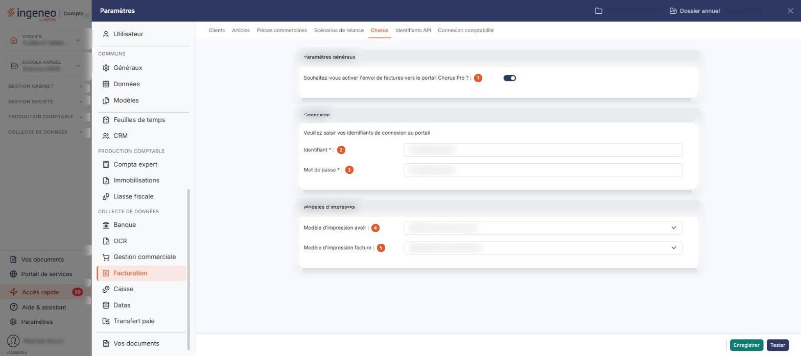

# Chorus


**Où le trouver :** Panneau **Paramètres** › **Facturation** › **Chorus**



**En bref** — Cet écran indique si vous adressez vos factures au portail Chorus Pro et porte les informations de connexion nécessaires.

* Pour activer l'envoi : activez l'interrupteur de la rubrique « Paramètres généraux », complétez la connexion, puis bouton \[Enregistrer].
* Pour vérifier vos identifiants : bouton \[Tester].


Cette option vous permet d'indiquer si vous souhaitez adresser vos factures au portail Chorus Pro, la plateforme par laquelle passent les factures destinées aux acheteurs publics, et de saisir les informations dont le logiciel a besoin pour s'y connecter. Le paramétrage est propre au dossier sur lequel vous travaillez. Cet écran se trouve dans le panneau « Paramètres » : rubrique « Facturation », puis onglet « Chorus ».

<figure><figcaption>
Écran « Chorus » de la nouvelle interface
</figcaption></figure>

L'écran se présente sous la forme d'un formulaire unique : il ne comporte ni liste, ni onglet. Tant que l'envoi n'est pas activé, le logiciel n'affiche que la première rubrique ; les rubriques « Connexion » et « Modèles d'impression » n'apparaissent qu'une fois l'envoi activé (l'interrupteur de la rubrique « Paramètres généraux »).

## Rubrique « Paramètres généraux »

Cette rubrique est toujours affichée. Elle ne comporte qu'une seule option :

**Souhaitez-vous activer l'envoi de factures vers le portail Chorus Pro ?** : interrupteur sans texte, activé ou désactivé. Activez-le pour ouvrir le paramétrage de la connexion et des modèles d'impression, désactivez-le pour le refermer ; il est activé à l'ouverture lorsque l'envoi est déjà actif pour le dossier.

Cette réponse ne commande pas seulement le contenu de cet écran. Lorsque vous l'activez, le logiciel ajoute à la fiche de chaque client une rubrique « Chorus Pro », dans laquelle vous indiquez si les factures et avoirs de ce client peuvent être adressés par le portail. Tant que l'envoi n'est pas activé ici, cette rubrique n'apparaît pas dans les fiches clients.

## Rubrique « Connexion »

Cette rubrique n'est affichée que lorsque l'envoi est activé. Elle est introduite par la phrase « Veuillez saisir vos identifiants de connexion au portail » et comporte deux champs, tous deux marqués d'un astérisque :

| Champ               | Ce qu'il faut savoir                                                         |
| ------------------- | ---------------------------------------------------------------------------- |
| 2. **Identifiant**  | L'identifiant de connexion au portail Chorus Pro, sur 80 caractères au plus. |
| 3. **Mot de passe** | Le mot de passe associé à cet identifiant, sur 50 caractères au plus.        |

Ces identifiants sont ceux du **compte technique** que vous devez avoir créé au préalable sur le portail Chorus Pro, et non ceux de votre compte utilisateur. La création de ce compte technique et l'ouverture préalable du lien vers le portail par le cabinet sont décrites dans le chapitre « Chorus Pro », option « Activation de Chorus Pro ».

## Rubrique « Modèles d'impression »

Cette rubrique n'est affichée que lorsque l'envoi est activé. Elle comporte deux listes déroulantes, qui vous permettent de choisir la présentation des pièces adressées au portail :

| Champ                              | Ce qu'il faut savoir             |
| ---------------------------------- | -------------------------------- |
| 4. **Modèle d'impression avoir**   | Le modèle appliqué aux avoirs.   |
| 5. **Modèle d'impression facture** | Le modèle appliqué aux factures. |

Chacune des deux listes propose les modèles d'impression de la société, du type correspondant à la pièce : la liste des avoirs ne propose que des modèles d'avoir, celle des factures que des modèles de facture. Le contenu de ces listes dépend donc des modèles créés pour votre société, dans l'option « Paramètres > Modèles d'impression ». Tant que vous n'avez rien choisi, la liste affiche l'entrée « Sélectionnez ».

Ces modèles peuvent être ceux que vous employez habituellement, à une réserve près : ils ne doivent pas contenir d'image — un logo, par exemple —, le portail Chorus Pro n'acceptant pas les pièces qui en comportent.

## Bouton \[Enregistrer]

Il enregistre le paramétrage. Ce bouton est affiché que l'envoi soit activé ou non.

## Bouton \[Tester]

Il vérifie que l'identifiant et le mot de passe saisis permettent bien au logiciel de se connecter au portail Chorus Pro. Ce bouton est lui aussi affiché que l'envoi soit activé ou non.
