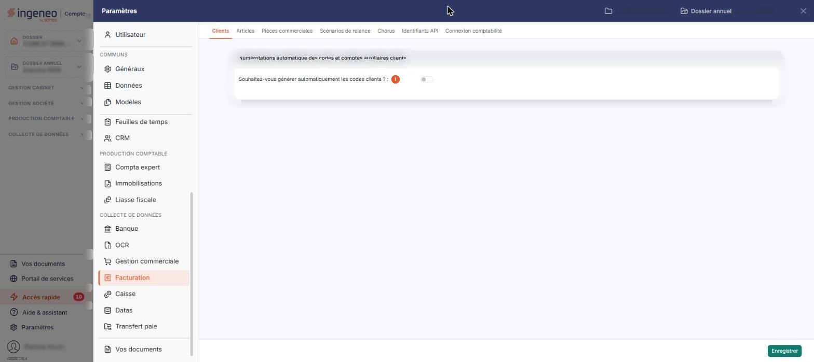

# Clients — codification automatique


**Où le trouver :** Panneau **Paramètres** › **Facturation** › **Clients**



**En bref** — Cet écran permet de faire attribuer automatiquement le code des nouveaux clients, en choisissant les éléments qui le composent, leur ordre et leur séparateur.

* Pour automatiser les codes clients : activez « Souhaitez-vous générer automatiquement les codes clients ? », composez le code, puis bouton \[Enregistrer].


Cette option vous permet de faire attribuer automatiquement par le logiciel le code de vos clients, et de composer vous-même ce code : vous choisissez les éléments qui le constituent, leur ordre et le caractère qui les sépare. Cet écran se trouve dans le panneau « Paramètres » : rubrique « Facturation », puis onglet « Clients ».

<figure><figcaption>
Écran « Clients » de la nouvelle interface
</figcaption></figure>

L'écran se présente sous la forme d'un formulaire unique : il ne comporte ni liste, ni onglet. Tant que la génération automatique n'est pas activée, le logiciel n'affiche que la question d'activation ; tout le paramétrage de composition du code n'apparaît qu'une fois l'interrupteur d'activation activé.

## L'activation de la numérotation automatique

**Souhaitez-vous générer automatiquement les codes clients ?** : interrupteur sans texte, activé ou désactivé. Activez-le pour que le logiciel calcule lui-même le code de chaque nouveau client selon les règles définies ci-dessous ; laissez-le désactivé pour saisir vous-même ce code dans chaque fiche client. Tant qu'il est désactivé, l'écran n'affiche rien d'autre que cette question.

## La composition du code client

Cette partie de l'écran porte le titre **Numérotations automatique des codes et comptes auxiliaires clients** : c'est le libellé du logiciel, et il annonce des comptes auxiliaires alors que l'écran n'en porte aucun champ — ne les y cherchez pas.

Sous le libellé **Codes clients :**, le code client se compose de trois éléments, présentés côte à côte, chacun dans une colonne. Vous cochez ceux que vous souhaitez retenir.

| Champ                      | Ce qu'il faut savoir                                                                                                                                                                                                                                                                                                                                     |
| -------------------------- | -------------------------------------------------------------------------------------------------------------------------------------------------------------------------------------------------------------------------------------------------------------------------------------------------------------------------------------------------------- |
| **Avec élément fixe**      | Cochez cette case pour faire figurer dans le code une suite de caractères de votre choix, identique pour tous vos clients. Vous la saisissez dans le champ **Elément fixe :** situé en dessous, sur 18 caractères au plus. Lorsque la case n'est pas cochée, ce champ est vidé et grisé.                                                                 |
| **Avec numéro séquentiel** | Cette case apparaît cochée et désactivée : le numéro séquentiel fait partie du code client et ne peut pas en être retiré. Le champ **Numéro séquentiel :** situé en dessous, sur 6 caractères, porte le prochain numéro que le logiciel attribuera ; vous pouvez le modifier pour démarrer la numérotation où vous le souhaitez. Il doit être renseigné. |
| **Avec raison sociale**    | Cochez cette case pour faire figurer dans le code le début de la raison sociale du client. La liste déroulante située en dessous vous permet de choisir combien de caractères sont repris, de deux à quinze — par exemple « 6 premiers car. ».                                                                                                           |

## Les autres réglages

À droite de la composition du code, trois éléments complètent le paramétrage :

| Champ                         | Ce qu'il faut savoir                                                                                                                                                                                                                                                                                           |
| ----------------------------- | -------------------------------------------------------------------------------------------------------------------------------------------------------------------------------------------------------------------------------------------------------------------------------------------------------------- |
| **Numéro modifiable**         | Si vous indiquez Oui, la numérotation définie ici s'appliquera par défaut.                                                                                                                                                                                                                                     |
| **Caractère de séparation**   | Il est inséré entre les éléments du code. La liste vous propose « Aucun », « Espace », « Tiret (-) », « Point », « + », « Souligné (\_) » et « Slash (/) ».                                                                                                                                                    |
| **Aperçu du prochain numéro** | Ce n'est pas un champ de saisie, mais le résultat de vos choix : le logiciel affiche le code qu'il attribuerait au prochain client, et le recalcule immédiatement à chaque modification. La place de la raison sociale y est figurée par des X, celle-ci n'étant connue qu'au moment de la création du client. |

## Bouton \[Enregistrer]

Il enregistre le paramétrage. C'est le seul bouton de cet écran, et il est affiché que la génération automatique soit activée ou non.
