# Clients — fichier des clients


**Où le trouver :** Panneau **Paramètres** › **Facturation** › **Clients**



**En bref** — Cet écran tient le fichier des clients, commun à plusieurs modules d'Ingeneo Compta : liste, recherche, création et mise à jour des fiches clients.

* Pour créer un client : bouton \[Créer un client], renseignez sa fiche (bouton \[Lire Siren] pour reprendre ses informations légales), puis bouton \[Enregistrer].
* Pour retrouver un client archivé : bouton \[Filtres spéciaux], puis activez l'interrupteur « Clients archivés ».


Cet écran s'ouvre depuis le panneau « Paramètres » : « Paramètres > Données > Tiers et commercial > Clients » (la rubrique « Données » du panneau, puis le groupe « Tiers et commercial », un onglet du haut à menu déroulant).

<figure>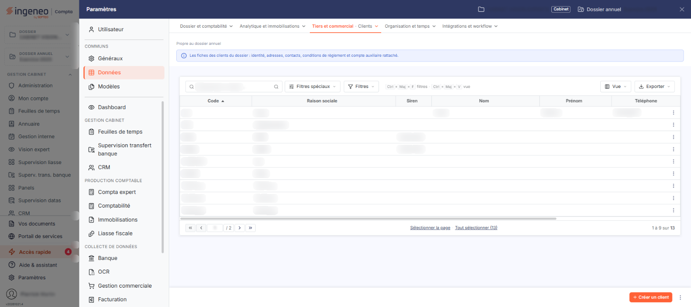<figcaption>
Écran « Clients » de la nouvelle interface
</figcaption></figure>

Le fichier « Clients » est commun à plusieurs modules d'Ingeneo Compta. Ainsi, où que vous ayez créé ou modifié un client, il sera visible de la même manière dans tous les modules.

Un client ne peut être supprimé s'il est lié à une pièce commerciale, à un règlement, à un projet, à une action ou à une opportunité ; le logiciel refuse alors la suppression et vous l'indique.

## La liste des clients

<figure>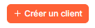<figcaption>
Rubrique « La liste des clients »
</figcaption></figure>

La liste présente sept colonnes : **Code**, **Raison sociale**, **Siren**, **Nom**, **Prénom**, **Téléphone** et **E-mail pro.** Elle est triée par défaut sur le code, dans l'ordre croissant, et chacune des sept colonnes peut servir de critère de tri.

Au-dessus de la liste, la barre « Rechercher un client… » permet de retrouver un client. bouton **\[Filtres spéciaux]** ouvre un menu qui ne porte que l'interrupteur « Clients archivés », désactivé à l'ouverture de l'écran : le nombre d'éléments annoncé en pied de liste ne compte donc que les clients **non archivés**, et ce n'est pas le nombre total de clients du dossier. Activez l'interrupteur pour faire apparaître les clients archivés. bouton **\[Filtres]** ouvre le volet « Filtrer », qui annonce « Aucun critère. Choisissez une colonne pour commencer. » tant qu'aucun critère n'est posé ; la liste déroulante « + Ajouter un critère sur… » propose les colonnes de la liste. Il n'y a plus de bouton \[Afficher] : la liste se recharge dès que vous modifiez un critère. bouton **\[Vue]** et bouton **\[Exporter]**, à droite, ouvrent respectivement le menu des vues et des colonnes affichées, et le menu d'aperçu, d'impression et d'export de la liste.

Un clic sur une ligne la sélectionne. Il n'y a plus de case à cocher. Au survol, la ligne porte en fin de ligne un pictogramme « Envoi d'un courrier au client » (une enveloppe) et un pictogramme « Autres actions » (trois points), dont le menu propose « Modifier » pour ouvrir la fiche du client, « Dupliquer » pour en créer un nouveau reprenant ses caractéristiques, et « Supprimer ». Sous la liste, « Sélectionner la page » retient les lignes de la page affichée et « Tout sélectionner (n) » celles de toutes les pages.

Dès qu'un client est sélectionné, un bandeau s'affiche en bas de l'écran, avec le nombre de clients sélectionnés, le lien « Tout désélectionner », bouton **\[Envois groupés de courriers]**, bouton **\[Archiver]** et bouton **\[Supprimer]** ; à partir de deux clients sélectionnés, bouton **\[Modification groupée]** s'y ajoute. Ces boutons portent sur les clients sélectionnés.

En bas à droite de l'écran, bouton **\[Créer un client]** ouvre une fiche vierge ; un menu à trois points, à côté, propose « Champs dynamiques » et « Valeurs par défaut ».

## Rubrique « Identification »

<figure>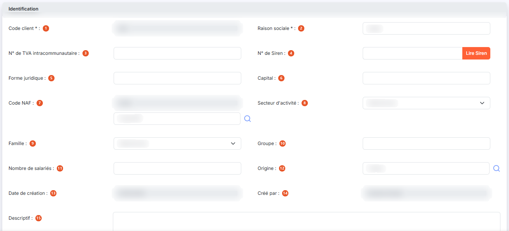<figcaption>
Rubrique « Identification »
</figcaption></figure>

<figure>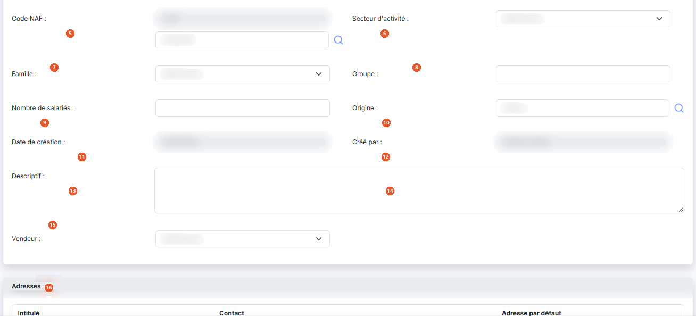<figcaption>
Rubrique « Identification »
</figcaption></figure>

| Champ                               | Ce qu'il faut savoir                                                                                                                                                                             |
| ----------------------------------- | ------------------------------------------------------------------------------------------------------------------------------------------------------------------------------------------------ |
| 1. **Code client**                  | Vous ne le saisissez qu'à la création : lorsque vous ouvrez la fiche d'un client existant, ce champ n'est plus modifiable. Les caractères autorisés sont les lettres majuscules et les chiffres. |
| 2. **Raison sociale**               | —                                                                                                                                                                                                |
| 3. **N° de TVA intracommunautaire** | —                                                                                                                                                                                                |
| 4. **N° de Siren**                  | —                                                                                                                                                                                                |
| 5. **Forme juridique**              | —                                                                                                                                                                                                |
| 6. **Capital**                      | —                                                                                                                                                                                                |
| 7. **Code NAF**                     | Ce champ est double : le code, qui n'est pas saisissable directement, et le libellé, accompagné d'une loupe de recherche.                                                                        |
| 8. **Secteur d'activité**           | La liste est alimentée par « Paramètres > Données > Tiers et commercial > Secteurs d'activité ».                                                                                                 |
| 9. **Famille**                      | La liste est alimentée par « Paramètres > Données > Tiers et commercial > Familles de clients ».                                                                                                 |
| 10. **Groupe**                      | Zone de saisie libre.                                                                                                                                                                            |
| 11. **Nombre de salariés**          | —                                                                                                                                                                                                |
| 12. **Origine**                     | Zone de saisie accompagnée d'une loupe de recherche.                                                                                                                                             |
| 13. **Date de création**            | Renseignée automatiquement. C'est la date de création de la fiche client, et elle n'est pas modifiable.                                                                                          |
| 14. **Créé par**                    | Renseigné automatiquement. C'est le nom de l'utilisateur ayant créé la fiche client, et il n'est pas modifiable.                                                                                 |
| 15. **Descriptif**                  | Zone de texte.                                                                                                                                                                                   |
| 16. **Vendeur**                     | S'il est renseigné, il sera proposé par défaut dans les pièces commerciales où il restera modifiable.                                                                                            |
| **Bouton \[Lire Siren]**            | Accolé au numéro de Siren.                                                                                                                                                                       |

## Rubrique « Adresses »

<figure>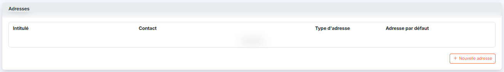<figcaption>
Rubrique « Adresses »
</figcaption></figure>

<figure>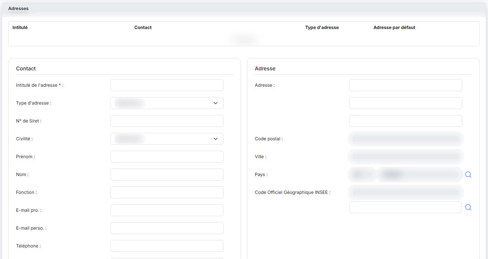<figcaption>
Rubrique « Adresses »
</figcaption></figure>

<figure>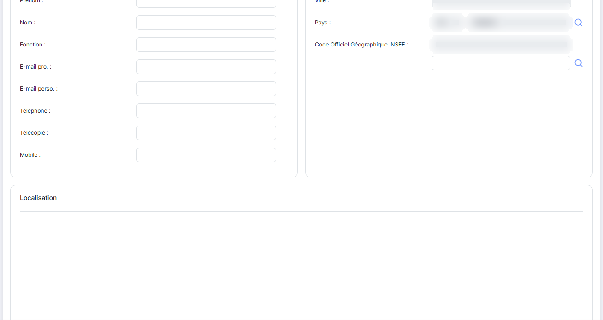<figcaption>
Rubrique « Adresses »
</figcaption></figure>

<figure>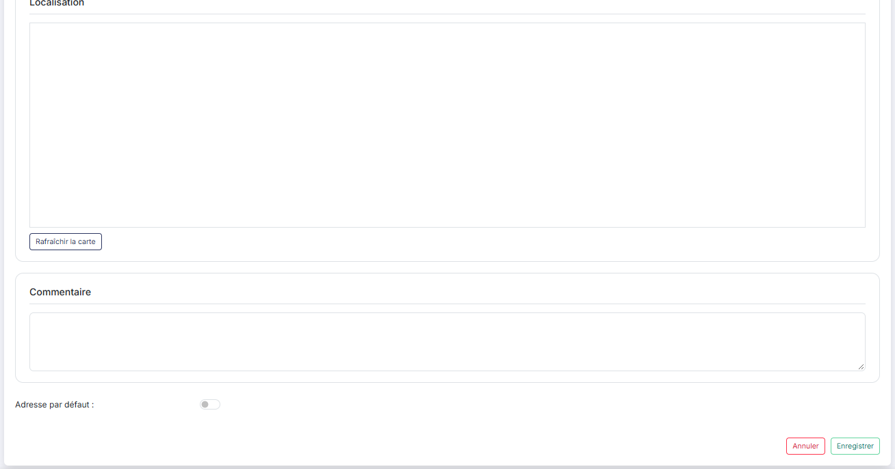<figcaption>
Rubrique « Adresses »
</figcaption></figure>

La rubrique présente une liste à quatre colonnes — **Intitulé**, **Contact**, **Type d'adresse** et **Adresse par défaut** — et un bouton **\[Nouvelle adresse]** (son libellé est précédé d'un « + »). Tant qu'aucune adresse n'a été saisie, la liste affiche « Liste vide ».

Le bouton \[Nouvelle adresse] déplie la saisie d'une adresse **sous la liste** : ce n'est pas une fenêtre. Seul l'intitulé de l'adresse y est obligatoire ; vous disposez ensuite du type d'adresse (facturation, livraison, ou les deux), d'un commentaire, du numéro de Siret, des coordonnées du contact (civilité, prénom, nom, fonction, adresses de messagerie professionnelle et personnelle, téléphone, télécopie, mobile), de l'adresse postale (trois lignes de saisie, puis le code postal et la ville, grisés et affichant « Déduit de la commune » lorsque le pays est la France), du pays (la loupe ouvre le panneau « Sélection d'un pays ») et du code officiel géographique de l'INSEE, grisé lui aussi, qui se renseigne par le champ **Commune** placé juste dessous : sa loupe ouvre le panneau « Sélection d'un code COG Insee », où vous retenez une ligne puis cliquez sur le bouton **\[Sélectionner]**. Si la commune choisie est absente du référentiel postal, un message s'affiche en haut de l'écran (« Commune absente du référentiel postal (ancienne commune fusionnée ?) : saisissez le code postal et la ville. ») et le code postal et la ville deviennent saisissables. Le champ **Adresse par défaut** est positionné sur Non.

Lorsque vous indiquez qu'une adresse est l'adresse par défaut, c'est elle qui sera affectée lors de la création de toute nouvelle pièce commerciale.

La saisie se termine par le bouton **\[Enregistrer]** ou par le bouton **\[Annuler]** ; le bouton **\[Rafraîchir la carte]** met à jour la carte affichée à partir de l'adresse saisie. Notez que le bouton \[Nouvelle adresse] de la rubrique disparaît pendant que la saisie d'une adresse est dépliée.

Les adresses sont communes aux fichiers clients et comptes auxiliaires.

## Rubrique « Informations comptables »

| Champ                       | Ce qu'il faut savoir                                                                                                                                                                                                                                                                                                                                                                                                                                                                                                                                                                                                                                                                                                     |
| --------------------------- | ------------------------------------------------------------------------------------------------------------------------------------------------------------------------------------------------------------------------------------------------------------------------------------------------------------------------------------------------------------------------------------------------------------------------------------------------------------------------------------------------------------------------------------------------------------------------------------------------------------------------------------------------------------------------------------------------------------------------ |
| **N° de compte auxiliaire** | C'est ce numéro de compte qui sera repris lors de la création des écritures de vente. Le logiciel vous propose comme numéro de compte les n premiers caractères du code client (n étant le nombre de caractères que doit contenir un numéro de compte, tel que défini dans « Paramètres > Facturation > Connexion comptabilité »). Une loupe de recherche vous permet de choisir un compte existant, et l'intitulé du compte est affiché à côté, sans être saisissable. Cette loupe n'est proposée qu'à la création : lorsque vous ouvrez la fiche d'un client existant, le numéro de compte auxiliaire et son intitulé ne sont plus saisissables. Les caractères autorisés sont les lettres majuscules et les chiffres. |
| **Compte collectif**        | C'est le compte général auquel doit être rattaché le compte auxiliaire. Le logiciel vous propose le numéro de compte que vous avez indiqué dans « Paramètres > Facturation > Pièces commerciales » ; ce numéro par défaut reste modifiable, à la saisie, par le bouton \[+] ou par la loupe de recherche. Comme le compte auxiliaire, il n'est modifiable qu'à la création ; sur la fiche d'un client existant, le numéro et son intitulé sont en lecture seule.                                                                                                                                                                                                                                                         |
| **Établissement**           | Cette liste n'est présente que si la gestion multi-établissements est activée dans « Paramètres > Généraux > Configuration ». Elle propose les établissements ouverts de la société. À la création, elle ne comporte pas l'entrée « Sélectionnez » et le premier établissement y est présélectionné : une valeur est donc toujours retenue. Lorsque vous ouvrez la fiche d'un client existant, l'entrée « Sélectionnez » figure en tête de liste.                                                                                                                                                                                                                                                                        |

## Rubrique « Informations générales »

<figure>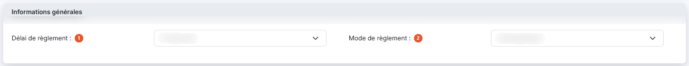<figcaption>
Rubrique « Informations générales »
</figcaption></figure>

| Champ                     | Ce qu'il faut savoir                                                                                                                                                                                                                                                                                                |
| ------------------------- | ------------------------------------------------------------------------------------------------------------------------------------------------------------------------------------------------------------------------------------------------------------------------------------------------------------------- |
| 1. **Délai de règlement** | Au niveau de la fiche client, le délai de règlement est obligatoire dans toutes les pièces commerciales et permet de calculer l'échéance à partir de la date d'une pièce. S'il est renseigné ici, il sera affecté par défaut lors de la création de toute pièce commerciale pour ce client mais restera modifiable. |
| 2. **Mode de règlement**  | S'il est renseigné, il sera affecté par défaut lors de la création de toute pièce commerciale pour ce client mais restera modifiable.                                                                                                                                                                               |

## Rubrique « Facturation »

<figure>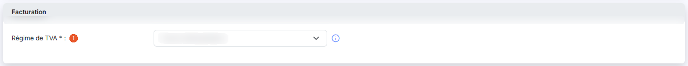<figcaption>
Rubrique « Facturation »
</figcaption></figure>

| Champ                    | Ce qu'il faut savoir                                                                                                                                                                                                                                                    |
| ------------------------ | ----------------------------------------------------------------------------------------------------------------------------------------------------------------------------------------------------------------------------------------------------------------------- |
| 1. **Régime de TVA**     | Il permet de gérer tous les cas de facturation en local ou à l'export, que l'entreprise soit domiciliée en France métropolitaine ou en France d'outre-mer. Il est appliqué par défaut et reste modifiable lors de l'édition d'une pièce commerciale.                    |
| **Catalogue par défaut** | Cette liste n'est présente que si la gestion des catalogues a été activée dans « Paramètres > Facturation > Articles ». S'il est renseigné, le catalogue sera affecté par défaut lors de la création de toute pièce commerciale pour ce client mais restera modifiable. |
| **Remise systématique**  | Interrupteur sans texte, désactivé à l'ouverture. Tant qu'il reste désactivé, le champ **Taux de remise** est grisé et non saisissable. Activez-le pour rendre le champ **Taux de remise** saisissable ; il reste vide, aucune valeur ne vous est proposée.             |
| **Taux de remise**       | Saisissable seulement lorsque la remise systématique est activée.                                                                                                                                                                                                       |

Sous le taux, un groupe de deux boutons détermine le niveau auquel la remise est appliquée : **Ligne** pour l'appliquer sur toutes les lignes d'article, **Pièce** pour l'appliquer en pied de pièce. **Pièce** est sélectionné par défaut. Ce groupe n'est accompagné d'aucun libellé à l'écran : c'est bien le mode d'application de la remise que vous choisissez ici.

## Rubrique « Gestion analytique »

Cette rubrique n'est présente que si l'utilisation de l'analytique est activée dans les paramètres du dossier.

**Gérer les comptes de contrepartie analytiquement** : interrupteur sans texte, désactivé à l'ouverture. Si vous l'activez, la répartition saisie sous le champ est appliquée automatiquement, à la validation des factures, aux comptes de produit gérés analytiquement ; cela n'active pas l'analytique sur le compte auxiliaire du client.

Activer l'interrupteur fait apparaître un tableau de répartition qui présente une colonne par axe analytique du dossier. Pour chaque axe, vous cochez l'axe à utiliser et choisissez la ventilation à appliquer dans la liste **Ventilation Type**, alimentée par les ventilations créées sur cet axe.

## Rubrique « Relances »

<figure>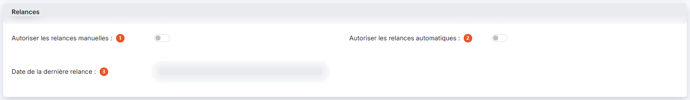<figcaption>
Rubrique « Relances »
</figcaption></figure>

| Champ                                      | Ce qu'il faut savoir                                                                                                                                                                                                                                                                                                                                                                                                                                                                                                                                                                                   |
| ------------------------------------------ | ------------------------------------------------------------------------------------------------------------------------------------------------------------------------------------------------------------------------------------------------------------------------------------------------------------------------------------------------------------------------------------------------------------------------------------------------------------------------------------------------------------------------------------------------------------------------------------------------------ |
| 1. **Autoriser les relances manuelles**    | Interrupteur sans texte, désactivé à l'ouverture. Si vous l'activez, une liste **Scénario** apparaît à droite du champ. Sur la fiche d'un client existant, le bouton \[Relancer] apparaît en même temps en bas de la fiche ; il n'est pas proposé à la création. Cette liste n'affiche que les scénarios dont la périodicité a été définie comme « Manuelle ». Les scénarios sont gérés dans « Paramètres > Facturation > Scénarios de relance » ; reportez-vous à l'aide en ligne traitant de cette section pour plus de détails.                                                                     |
| 2. **Autoriser les relances automatiques** | 
Interrupteur sans texte, désactivé à l'ouverture. Si vous l'activez, une liste <strong>Scénario</strong> apparaît à droite du champ, et le choix d'un scénario y est <strong>obligatoire</strong>. Le fait de choisir un scénario automatique n'empêche pas l'activation des relances manuelles. Les deux champs peuvent être activés en même temps ; les deux listes cohabitent alors, chacune en regard de son champ. Notez qu'elles portent le même libellé <strong>Scénario</strong> et que seule leur position les distingue : la première est facultative, la seconde est obligatoire.
 |
| 3. **Date de la dernière relance**         | Non saisissable. Ce champ n'est présent que lorsque vous ouvrez la fiche d'un client existant : il est absent en création.                                                                                                                                                                                                                                                                                                                                                                                                                                                                             |

## Rubrique « Coordonnées bancaires »

<figure>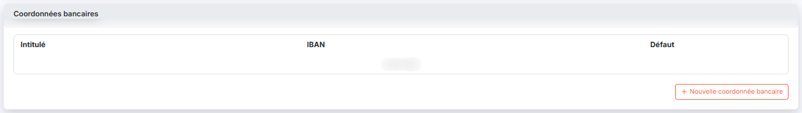<figcaption>
Rubrique « Coordonnées bancaires »
</figcaption></figure>

<figure>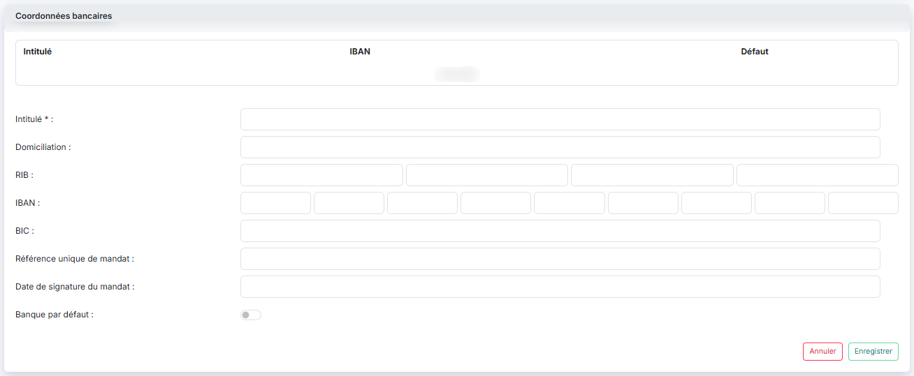<figcaption>
Rubrique « Coordonnées bancaires »
</figcaption></figure>

La rubrique présente une liste à trois colonnes — **Intitulé**, **IBAN** et **Défaut** — et un bouton \[Nouvelle coordonnée bancaire] (précédé d'un « + ») qui ouvre la saisie d'une coordonnée bancaire. Tant qu'aucune coordonnée n'a été saisie, la liste affiche « Liste vide ».

Un client peut disposer de plusieurs banques. Pour chaque banque, seul l'intitulé permettant la différenciation est obligatoire.

Le bouton \[Nouvelle coordonnée bancaire] déplie la saisie **sous la liste**. Vous y disposez de l'**Intitulé**, seul champ obligatoire, de la **Domiciliation**, du **RIB**, de l'**IBAN**, du **BIC**, de la **Référence unique de mandat**, de la **Date de signature du mandat** et du champ **Banque par défaut**. La saisie se termine par le bouton **\[Enregistrer]** ou par le bouton **\[Annuler]**.

## Rubrique « Documents »

<figure>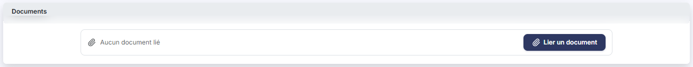<figcaption>
Rubrique « Documents »
</figcaption></figure>

La rubrique présente une liste à quatre colonnes — **Description**, **Nom du fichier**, **Date** et **Créé par** — et affiche « Aucun document lié » tant qu'aucun document n'est rattaché au client.

bouton **\[Lier un document]** permet de rattacher un document au client ; il remplace les trois anciens boutons de dépôt selon la provenance du document.

## Rubrique « Editions »

<figure>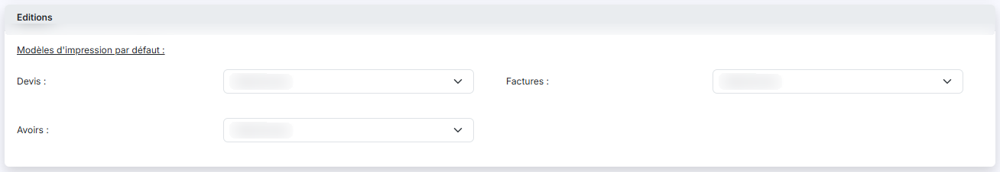<figcaption>
Rubrique « Editions »
</figcaption></figure>

Sous l'intitulé « Modèles d'impression par défaut », vous pouvez paramétrer, pour les **Devis**, les **Factures** et les **Avoirs**, le modèle qui sera affecté par défaut pour le client. Ce modèle restera modifiable dans chaque pièce commerciale créée pour le client.

Chaque liste propose les modèles créés dans « Paramètres > Modèles > Documents > Pages de document », pour le type de pièce correspondant.

## Rubrique « Chorus Pro »

Cette rubrique n'est présente que si l'envoi vers le portail Chorus Pro a été autorisé dans « Paramètres > Facturation > Chorus ». Tant que ce paramètre n'est pas activé, la fiche client ne comporte pas cette rubrique.

Elle contient un seul champ, **Indiquez si les factures et avoirs de ce client peuvent être adressés via le portail Chorus Pro ?**.

## Les boutons de la fiche

<figure>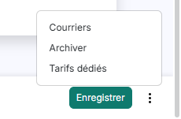<figcaption>
Rubrique « Les boutons de la fiche »
</figcaption></figure>

| Champ                               | Ce qu'il faut savoir                                                                                                                                                                                                                                                                                                                                                           |
| ----------------------------------- | ------------------------------------------------------------------------------------------------------------------------------------------------------------------------------------------------------------------------------------------------------------------------------------------------------------------------------------------------------------------------------ |
| **Bouton \[Enregistrer]**           | Il enregistre la fiche du client.                                                                                                                                                                                                                                                                                                                                              |
| **« Courriers »**                   | Cette entrée du menu « Autres actions » (trois points, en bas de la fiche) donne accès aux courriers du client, bâtis sur les modèles paramétrés dans « Paramètres > Modèles > Documents > Pages de document », avec la catégorie « Courrier client ».                                                                                                                         |
| **« Editer le relevé de comptes »** | Cette entrée du menu « Autres actions » n'apparaît que lorsque vous ouvrez la fiche d'un client existant. Il lance l'édition du relevé de compte du client de la même manière que si vous l'aviez lancée depuis le menu « Editions », option « Relevés de comptes », avec le code du client prérempli. Reportez-vous à cette section de l'aide pour plus de détails.           |
| **« Relancer »**                    | Cette entrée du menu « Autres actions » n'apparaît que si vous avez autorisé les relances manuelles pour ce client. Il fonctionne de la même manière que l'option « Relances clients » du menu « Editions », sauf que la relance ne concerne que le client sur lequel vous êtes positionné. Reportez-vous à cette section de l'aide en ligne pour des informations détaillées. |
| **« Archiver »**                    | Cette entrée du menu « Autres actions » n'apparaît que lorsque vous ouvrez la fiche d'un client existant.                                                                                                                                                                                                                                                                      |
| **« Tarifs dédiés »**               | Cette entrée du menu « Autres actions » donne accès aux tarifs propres à ce client, dans un panneau latéral affiché à droite de l'écran.                                                                                                                                                                                                                                       |
| **Retour**                          | Le bouton \[Retour] n'est plus affiché ; le chevron « Retour » de la barre d'onglets du panneau Paramètres quitte la fiche sans enregistrer votre saisie et vous ramène à la liste des clients.                                                                                                                                                                                |
