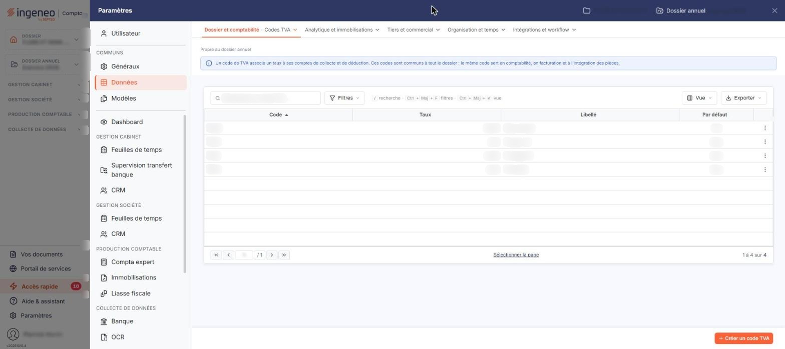

# Codes TVA


**Où le trouver :** Panneau **Paramètres** › **Données** › **Dossier et comptabilité** › **Codes TVA**



**En bref** — Cet écran tient la liste des codes TVA du dossier, avec leurs taux et les comptes utilisés pour générer les écritures. Ces codes sont communs à tous les modules.

* Pour créer un code TVA : bouton \[Créer un code TVA], renseignez la fiche, puis bouton \[Enregistrer].
* Pour retrouver un code : saisissez-le dans « Rechercher un code TVA… » ou posez un critère par le bouton \[Filtres].


Les codes TVA portent les taux de TVA et les numéros de comptes utilisés lors de la génération des écritures. Ils sont communs aux modules qui les utilisent : la fiche d'un code TVA est le même écran quel que soit le module depuis lequel vous l'ouvrez, et toute modification y est donc immédiatement visible depuis les autres modules.

<figure><figcaption>
Écran « Codes TVA » de la nouvelle interface
</figcaption></figure>

Cet écran s'ouvre par le panneau « Paramètres » : rubrique « Données », groupe « Dossier et comptabilité », entrée « Codes TVA ». Un bandeau d'information en haut de l'écran rappelle que ces codes sont communs à tout le dossier : le même code sert en comptabilité, en facturation et à l'intégration des pièces.

L'écran présente la liste des codes TVA du dossier, une ligne par code. Les colonnes affichées sont, dans l'ordre : **Code**, **Taux**, **Libellé** et **Par défaut**, cette dernière indiquant « Oui » pour le code TVA retenu comme code par défaut et « Non » pour les autres. Les quatre colonnes sont triables ; la liste est triée par défaut sur le code, par ordre croissant.

Au-dessus de la liste, la barre « Rechercher un code TVA… » et les boutons \[Filtres], \[Vue] et \[Exporter] permettent de chercher un code, de filtrer la liste, de personnaliser les colonnes et de l'imprimer ou de l'exporter.

Il n'y a pas de case à cocher : un clic sur une ligne la sélectionne, un second clic la désélectionne, et le lien « Sélectionner la page », sous la liste, sélectionne toutes les lignes affichées. Au survol d'une ligne, le pictogramme « Autres actions » (trois points verticaux) apparaît à droite de la ligne. Il ouvre trois entrées : « Modifier » ouvre la fiche du code TVA, « Dupliquer » le duplique et « Supprimer » le supprime. Ce menu est proposé sur toutes les lignes, y compris sur celle du code TVA par défaut.

Il n'existe pas d'action groupée sur cet écran : tant qu'une ligne est sélectionnée, un bandeau « 1 code TVA sélectionnée » avec le lien « Tout désélectionner » remplace le bouton de création, mais il ne porte aucun bouton d'action.

bouton **\[Créer un code TVA]**

Il est en bas à droite de l'écran, hors de la liste, et ouvre une fiche vierge pour créer un nouveau code TVA. C'est le seul bouton de bas d'écran de cette liste.

La fiche d'un code TVA comporte trois rubriques, dans cet ordre, et présente les mêmes champs en création et en modification.

## Rubrique « Informations générales »

| Champ                                  | Ce qu'il faut savoir                                                                                                                                                                             |
| -------------------------------------- | ------------------------------------------------------------------------------------------------------------------------------------------------------------------------------------------------ |
| **Code**                               | Unique. Il est saisissable à la création, puis n'est plus modifiable ensuite.                                                                                                                    |
| **Taux**                               | Le symbole « % » est rappelé à droite de la zone de saisie.                                                                                                                                      |
| **Libellé**                            | C'est ce libellé qui est proposé dans les listes de choix des autres écrans, la fiche d'un article par exemple.                                                                                  |
| **Est-ce le taux de TVA par défaut ?** | Interrupteur sans texte, désactivé à la création. Activé, le code TVA en cours est proposé automatiquement chaque fois qu'un code TVA est demandé, lors de la création d'un article par exemple. |

## Rubrique « TVA déductible »

Cette rubrique porte une ligne par nature d'opération déductible : les trois premières concernent la TVA déductible sur débits, sur décaissements et sur immobilisations, les six suivantes les opérations relevant d'une ligne particulière de la déclaration de TVA, dont l'intitulé est rappelé en tête du libellé — « B2 - Acquisitions intra », « A4 - Importation », etc.

Chaque ligne fonctionne de la même façon : vous saisissez le numéro de compte à utiliser lors de la génération des écritures liées à ce code TVA ; le logiciel affiche à droite l'intitulé du compte, que vous ne pouvez pas saisir. Le pictogramme « Loupe », dont l'infobulle rappelle le raccourci clavier « Ctrl + Alt + R », est placé sur chaque ligne. Le pictogramme « + » de la ligne (infobulle « Créer ») permet de créer le compte.

Les six dernières lignes portent en plus, à droite, un champ **Contrepartie** destiné au compte de contrepartie de l'opération, accompagné de sa loupe et de l'intitulé du compte en lecture seule ; ce champ n'a pas de pictogramme « + ».

## Rubrique « TVA collectée »

Cette rubrique porte deux lignes de comptes, **Sur débits** et **Sur encaissements**, composées comme celles de la rubrique précédente, sans champ de contrepartie.

Le libellé « Sur débits » figure à la fois dans la rubrique « TVA déductible » et dans la rubrique « TVA collectée » : c'est la rubrique qui les distingue, prenez garde à saisir le compte dans la bonne.

bouton **\[Enregistrer]**

Enregistre le code TVA.

**Retour à la liste**

Le bouton \[Retour] est masqué dans la fiche : le chevron « Retour », à gauche de la barre d'onglets du panneau, revient à la liste sans enregistrer les modifications en cours.
