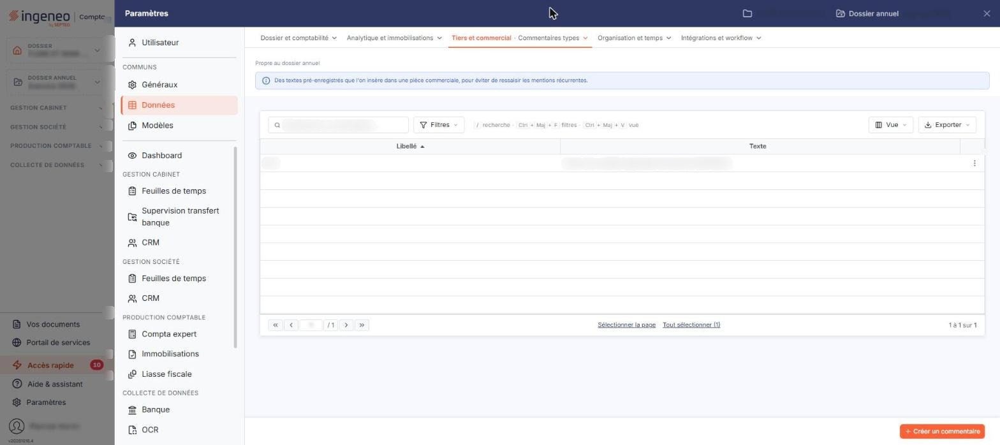

# Commentaires types


**Où le trouver :** Panneau **Paramètres** › **Données** › **Tiers et commercial** › **Commentaires types**



**En bref** — Ce fichier facultatif tient des blocs de texte préparés une fois pour toutes, à insérer ensuite comme lignes dans vos pièces commerciales.

* Pour créer un commentaire type : bouton \[Créer un commentaire], saisissez son libellé et son texte, puis bouton \[Enregistrer].


La gestion du fichier des « Commentaires types » est facultative. Les commentaires types sont des blocs de texte que vous préparez une fois pour toutes, et qui peuvent ensuite être insérés comme des lignes dans les pièces commerciales.

<figure><figcaption>
Écran « Commentaires types » de la nouvelle interface
</figcaption></figure>

Cet écran s'ouvre depuis le panneau « Paramètres » : « Paramètres > Données > Tiers et commercial > Commentaires types ».

## La liste des commentaires types

La liste présente deux colonnes : **Libellé** et **Texte**. Elle est triée par défaut sur le libellé, par ordre croissant, et les deux colonnes peuvent servir au tri.

Au-dessus de la liste, la barre « Rechercher un commentaire… » permet de retrouver un commentaire type par saisie, et le bouton \[Filtres] de poser des critères sur les colonnes ; à l'extrémité droite, le bouton \[Vue] permet de gérer vos vues et de choisir les colonnes affichées, et le bouton \[Exporter] ouvre le menu d'édition de la liste. Le bouton \[Filtres] ouvre un menu « Filtrer » : vous y ajoutez un critère sur une colonne par « + Ajouter un critère sur… », puis le bouton \[Filtrer] applique les critères et le bouton \[Vider les filtres] les retire.

Un clic sur une ligne la sélectionne. Sous la liste, « Sélectionner la page » et « Tout sélectionner (N) » sélectionnent d'un coup les commentaires de la page ou tous les commentaires. Dès qu'une ligne est sélectionnée, un bandeau apparaît au bas de l'écran, à la place du bouton de création : il indique le nombre de commentaires sélectionnés et porte le bouton \[Supprimer].

En dernière colonne de chaque ligne, un pictogramme « Autres actions » (trois points) ouvre un menu à trois entrées : « Modifier », « Dupliquer » et « Supprimer ».

bouton **\[Créer un commentaire]**

Situé en bas à droite de l'écran, il ouvre une fiche vierge pour créer un commentaire type.

bouton **\[Supprimer]**

Il s'affiche dans le bandeau de sélection, en bas de l'écran, dès qu'une ligne au moins est sélectionnée, et supprime les commentaires types sélectionnés.

## La fiche d'un commentaire type

La fiche comporte une seule rubrique, « Informations générales », et deux champs, tous deux obligatoires. La fiche se termine par le bouton **\[Enregistrer]**, en bas à droite. Le bouton \[Retour] n'est plus affiché : pour revenir à la liste sans enregistrer, utilisez le chevron « Retour » à gauche de la barre d'onglets du panneau Paramètres.

| Champ       | Ce qu'il faut savoir                                                                                               |
| ----------- | ------------------------------------------------------------------------------------------------------------------ |
| **Libellé** | Limité à 50 caractères. C'est le libellé qui vous permettra de retrouver le commentaire type dans la liste.        |
| **Texte**   | Limité à 1 000 caractères. Cette zone de saisie accepte plusieurs lignes : c'est le texte du commentaire lui-même. |
