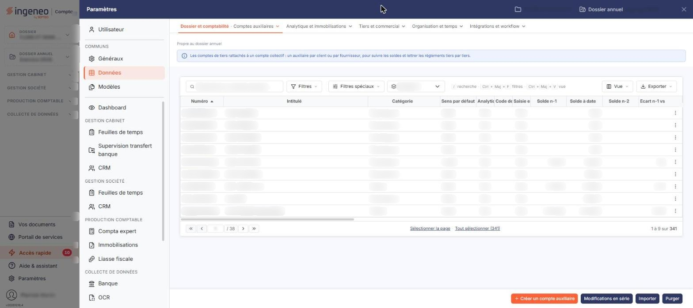

# Comptes auxiliaires


**Où le trouver :** Panneau **Paramètres** › **Données** › **Dossier et comptabilité** › **Comptes auxiliaires**



**En bref** — Cet écran administre les comptes auxiliaires (clients, fournisseurs, salariés, divers) du dossier annuel ouvert, chacun rattaché à un compte collectif.

* Pour créer un compte auxiliaire : bouton \[Créer un compte auxiliaire], renseignez la fiche, puis bouton \[Enregistrer].
* Pour n'afficher qu'une catégorie : choisissez-la dans le sélecteur « Catégorie ».


Cette option permet d'administrer les comptes auxiliaires du dossier annuel ouvert. Un compte auxiliaire est rattaché à un seul compte collectif, et le logiciel gère quatre catégories de comptes auxiliaires : clients, fournisseurs, salariés et divers. Cet écran s'ouvre par le panneau « Paramètres » : rubrique « Données », puis onglet « Dossier et comptabilité » et, dans son menu déroulant, entrée « Comptes auxiliaires ». Un bandeau bleu en haut de l'écran, sous la mention « Propre au dossier annuel », rappelle qu'il s'agit des comptes de tiers rattachés à un compte collectif.

<figure><figcaption>
Écran « Comptes auxiliaires » de la nouvelle interface
</figcaption></figure>

## La liste des comptes auxiliaires

Au-dessus de la liste, la barre « Rechercher un compte auxiliaire… » (qui remplace la zone **N° de compte**), les boutons \[Filtres] et \[Filtres spéciaux] et un sélecteur « Catégorie » permettent de restreindre l'affichage. Le sélecteur « Catégorie » porte, comme choix neutre, le nom de la colonne, « Catégorie », retenu à l'ouverture, puis « Divers », « Clients », « Fournisseurs » et « Salariés ». Le bouton \[Filtres spéciaux] ouvre un menu « Comptes » à deux choix : « Tous », proposé au chargement, et « Mouvementés ». Le bouton \[Filtres] ouvre un menu « Filtrer » : le lien « + Ajouter un critère sur… » permet de choisir une colonne, puis le bouton **\[Vider les filtres]** retire les critères et le bouton **\[Filtrer]** les applique. Tant que vous n'avez rien filtré, le compteur du pied de liste (« 1 à 9 sur 341 » et « Tout sélectionner (341) » sur ce dossier) porte sur l'ensemble des comptes auxiliaires du dossier, toutes catégories confondues, mouvementés ou non.

La liste présente vingt-quatre colonnes : le numéro et l'intitulé du compte, sa catégorie, ses propriétés comptables, ses soldes, puis les informations d'identification du tiers — numéro de TVA intracommunautaire, numéro de Siren, capital, code NAF, mode de règlement, etc. Elle s'ouvre triée par numéro croissant. La grille est plus large que l'écran : utilisez le défilement horizontal pour atteindre les dernières colonnes. Le bouton \[Vue] permet de choisir les colonnes affichées : 24 colonnes sont affichées d'origine sur les 47 proposées.

Un clic sur une ligne la sélectionne ; sous la liste, les boutons \[Sélectionner la page] et \[Tout sélectionner (n)] sélectionnent les lignes. Au survol, le pictogramme « Autres actions » (trois points), en fin de ligne, ouvre un menu de trois entrées : « Modifier », « Dupliquer » et « Supprimer ». Dès qu'une ligne est sélectionnée, un bandeau de sélection (« 1 compte auxiliaire sélectionné », « Tout désélectionner ») remplace la barre du bas et porte les boutons \[Supprimer], \[Modifications en série] et \[Réaffectation]. Le bouton \[Vue] ouvre un menu « Mes vues » et « Colonnes affichées », avec les boutons \[Rétablir les colonnes d'origine] et \[Appliquer] ; le bouton \[Exporter] ouvre le menu d'aperçu, d'impression et d'export de la liste.

Le menu \[Filtres] propose une vingtaine de critères de plus que la liste n'a de colonnes : les coordonnées bancaires du tiers, ses caractéristiques de prestataire, son circuit d'approbation, les dates et les auteurs de création et de modification, les observations. Vous pouvez donc rechercher un compte sur une information qui n'est pas affichée dans la liste. Un seul en-tête de colonne n'a pas de critère correspondant : **Ecart n-1 vs n-2**, qui est calculé.

bouton **\[Créer un compte auxiliaire]**

Placé en bas à droite de l'écran, hors de la liste, il ouvre une fiche vierge pour créer un compte auxiliaire.

bouton **\[Supprimer]**

Il se trouve dans le bandeau de sélection et porte sur les comptes sélectionnés dans la liste.

**Les traitements du bas de la liste**

Trois autres boutons complètent le bas de l'écran : le bouton **\[Modifications en série]**, le bouton **\[Importer]** et le bouton **\[Purger]**. Le bouton **\[Réaffectation]** se trouve, lui, dans le bandeau de sélection, avec \[Supprimer] et \[Modifications en série]. Ce sont des traitements de masse : ils portent sur le fichier des comptes auxiliaires du dossier, et non sur les seuls comptes cochés.

## La fiche d'un compte auxiliaire

La fiche se présente en cartes, l'une sous l'autre ; deux boutons fléchés au-dessus de la première, « Compte précédent » (Ctrl + ↑) et « Compte suivant » (Ctrl + ↓), passent au compte voisin dans la liste. Elle se termine par le bouton **\[Enregistrer]**. Pour revenir à la liste, utilisez le chevron « Retour » à gauche de la barre d'onglets du panneau Paramètres. Toutes les rubriques ne sont pas présentées à tous les comptes : deux d'entre elles, « Prestataire » et « Approbation », n'existent que sur un compte de catégorie « Fournisseurs », et la rubrique « Multi établissement » n'apparaît que si le dossier gère plusieurs établissements. Les rubriques « Échéances » et « Quantités » s'affichent entre « Accélérateur de saisie » et « Multi établissement ». Enfin, la fiche de **création** est plus courte que celle de modification : elle ne présente que les rubriques « Informations générales », « Propriétés », « Accélérateur de saisie », « Échéances », « Quantités », « Multi établissement », « Gestion analytique » et « Devises », et sa rubrique « Informations générales » se limite au compte collectif, au numéro, à l'intitulé, à la catégorie et aux observations : les informations d'identification du tiers et le mode de règlement ne se saisissent qu'après enregistrement. Le **Numéro** y reste d'ailleurs grisé jusqu'à ce que vous ayez renseigné le compte collectif.

## Rubrique « Informations générales »

| Champ                            | Ce qu'il faut savoir                                                                                                                                                                                                                                                                                                          |
| -------------------------------- | ----------------------------------------------------------------------------------------------------------------------------------------------------------------------------------------------------------------------------------------------------------------------------------------------------------------------------- |
| **Compte collectif**             | 12 caractères au maximum. Un compte auxiliaire est rattaché à un seul compte collectif.                                                                                                                                                                                                                                       |
| **Intitulé compte collectif**    | Non modifiable. Le logiciel l'affiche pour contrôle.                                                                                                                                                                                                                                                                          |
| **Numéro**                       | Non modifiable après création du compte, 12 caractères au maximum. Le pictogramme d'information rappelle que les caractères autorisés sont les lettres majuscules et les chiffres.                                                                                                                                            |
| **Intitulé**                     | 80 caractères au maximum. Il reste modifiable à tout moment.                                                                                                                                                                                                                                                                  |
| **Catégorie**                    | Non modifiable. Elle découle du compte collectif auquel vous avez rattaché le compte.                                                                                                                                                                                                                                         |
| **Observations**                 | 
Zone de texte libre, 1 024 caractères au maximum. Viennent ensuite les dates et les auteurs de création et de modification, non modifiables. Le logiciel n'affiche la ligne de modification que si le compte a effectivement été modifié depuis sa création.
                                                        |
| **N° de TVA intracommunautaire** | 15 caractères au maximum.                                                                                                                                                                                                                                                                                                     |
| **N° de Siren**                  | 9 caractères au maximum. Le champ est accompagné du bouton **\[Lire Siren]**.                                                                                                                                                                                                                                                 |
| **Forme juridique**              | Non saisissable directement. Le pictogramme « Loupe » qui l'accompagne vous permet de la rechercher.                                                                                                                                                                                                                          |
| **Code DGFIP**                   | —                                                                                                                                                                                                                                                                                                                             |
| **Code juridique usuel**         | Non modifiable.                                                                                                                                                                                                                                                                                                               |
| **Capital**                      | —                                                                                                                                                                                                                                                                                                                             |
| **Code NAF**                     | Il se compose d'un code, non modifiable, et d'un libellé ; un pictogramme « Loupe » vous permet de rechercher le code.                                                                                                                                                                                                        |
| **Mode de règlement**            | Choisissez-le dans la liste (virement, prélèvement, chèque, etc.).                                                                                                                                                                                                                                                            |
| **Soumis à TVA autoliquidée**    | Ce choix n'est présenté que sur un compte de catégorie « Fournisseurs ». Il vaut « Non soumis » par défaut, et vous pouvez désigner la nature des opérations concernées : « Acquisitions intracommunautaires de biens », « Prestations de services intracommunautaires », « Importations hors EU » ou « Sous-traitance BTP ». |

## Rubrique « Adresses »

La rubrique présente la liste des adresses du tiers, en trois colonnes : **Intitulé**, **Contact** et **Adresse par défaut**. Le bouton **\[Nouveau]** vous permet d'en ajouter une. Un compte peut ne porter aucune adresse : la rubrique affiche alors « Liste vide ».

## Rubrique « Propriétés »

**Sens par défaut** : vous choisissez entre « Débit » et « Crédit ». Ce choix est obligatoire.

## Rubrique « Accélérateur de saisie »

Cette rubrique prépare la saisie des écritures sur ce compte.

* **Contrepartie** : 12 caractères au maximum, suivie de son **Intitulé** en lecture seule. Le pictogramme d'information précise que ce compte permettra, lors de la saisie d'écritures, de positionner directement le curseur sur la cellule définie.
* **Code TVA** : choisi dans la liste des codes de TVA du dossier. Le pictogramme d'information indique d'en renseigner un si vous souhaitez générer automatiquement une ligne de TVA.
* **Taux de TVA** : il reste désactivé tant que vous n'avez pas choisi de code TVA. Le pictogramme d'information précise que le taux restera modifiable.
* **N° de compte** : le compte de TVA à mouvementer, choisi dans une liste. Cette liste est alimentée par les comptes de TVA de votre plan comptable, et elle peut ne vous proposer aucun compte. Son **Intitulé** s'affiche à côté, en lecture seule.

## 4 bis. Rubrique « Échéances »

La rubrique présente l'interrupteur **Gérer les échéances pour ce compte :**.

## 4 ter. Rubrique « Quantités »

La rubrique présente l'interrupteur **Gérer les quantités pour ce compte :** ; à la création, elle présente directement deux sélecteurs, **Unité 1 :** et **Unité 2 :**.

## Rubrique « Multi établissement »

Cette rubrique n'apparaît que si le dossier gère plusieurs établissements. Elle vous permet de rattacher le compte à un **Établissement**, choisi dans la liste des établissements de la société.

## Rubrique « Gestion analytique »

**Gérer ce compte analytiquement** : interrupteur. Tant qu'il est désactivé, la rubrique ne présente que cet interrupteur. L'activer fait apparaître une grille à deux colonnes, **Axe** et **Ventilation Type**, où vous désignez, pour chaque axe analytique du dossier, la ventilation à proposer par défaut sur ce compte.

## Rubrique « Prestataire »

Cette rubrique n'est présentée que sur un compte de catégorie « Fournisseurs ». Elle porte deux interrupteurs :

* **Prestataire de services au sens de la DAS2** : activer l'interrupteur fait apparaître deux champs, **Profession :** — obligatoire — et **Type :**, où vous choisissez entre « Personne morale » et « Personne physique ». Le pictogramme d'information, qui accompagne la profession et n'est donc visible qu'après cette activation, précise de renseigner obligatoirement cette zone si le bénéficiaire réside dans un État de l'Union européenne autre que la France et s'il a perçu au cours de l'année des droits d'auteur ou des droits d'inventeur.
* **Prestataire de services au sens de la TVA** : le pictogramme d'information précise de n'activer cette option que pour les prestataires de services qui n'ont pas opté pour la TVA sur les débits.

## Rubrique « Coordonnées bancaires »

La rubrique présente la liste des banques du tiers, en trois colonnes : **Intitulé**, **Iban** et **Défaut**. Vous pouvez créer autant de banques que nécessaire pour un même tiers à l'aide du bouton **\[Nouveau]**. Une seule d'entre elles est la banque par défaut, celle qui vous sera proposée pour ce tiers chaque fois que ce sera nécessaire.

## Rubrique « Devises »

**Autoriser la saisie en devises** : interrupteur. L'activer vous permet de désigner la devise du compte.

## Rubrique « Approbation »

Cette rubrique n'est présentée que sur un compte de catégorie « Fournisseurs ». Elle porte des interrupteurs qui s'enchaînent :

* la première vous demande si les factures de ce fournisseur doivent être approuvées automatiquement. Son pictogramme d'information précise qu'activer cet interrupteur attribue automatiquement le statut électronique « Approuvée » aux factures prises en charge, et donne l'exemple d'un fournisseur tel qu'un distributeur d'énergie. L'activer fait disparaître l'interrupteur suivant ;
* la seconde vous demande si vous souhaitez attribuer à ce fournisseur un circuit d'approbation particulier. Son pictogramme d'information précise qu'à « Non », tous les utilisateurs disposant du droit d'approbation pourront approuver les factures de ce fournisseur ;
* activer le second interrupteur fait apparaître un troisième interrupteur, **Souhaitez-vous mettre en place un circuit de validation personnalisé ? :**, et la liste **Libellé du circuit d'approbation :**. L'écran vous y indique qu'à « Non » vous choisissez un circuit parmi les modèles déjà paramétrés, et qu'à « Oui » vous le définissez spécifiquement pour ce fournisseur.

## Rubrique « Soldes »

Cette rubrique est en lecture seule : elle vous présente le solde à date du compte, ses soldes des deux exercices précédents, les écarts entre ces soldes, et vous indique si le compte a été mouvementé sur l'exercice précédent.

## Rubrique « Documents »

La rubrique présente les documents attachés au compte, en quatre colonnes : **Description**, **Nom du fichier**, **Date** et **Créé par**. Tant qu'aucun document n'est lié, elle affiche « Aucun document lié ». Un bouton unique, le bouton **\[Lier un document]**, permet d'en ajouter.
