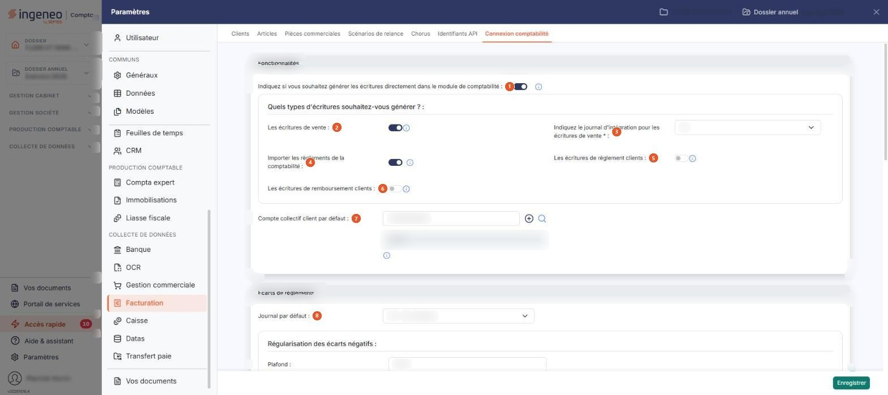
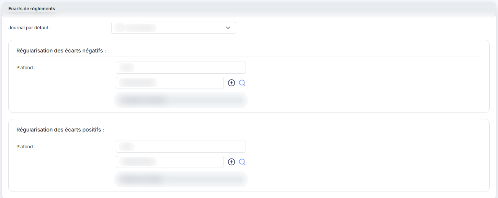
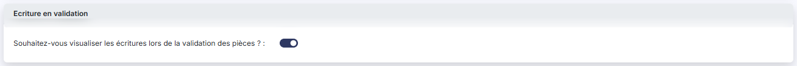
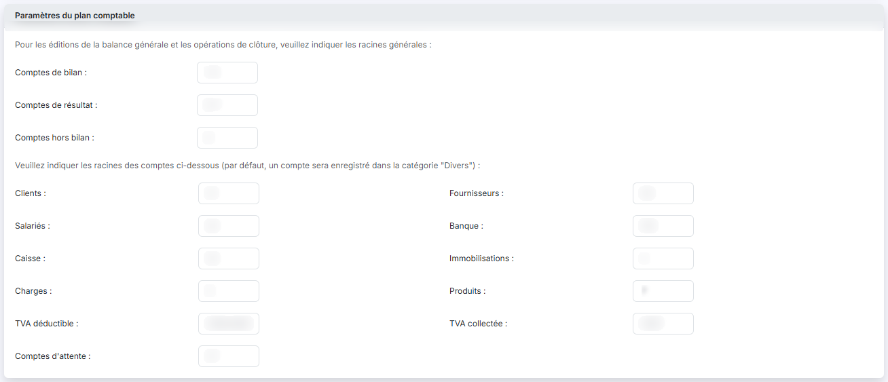
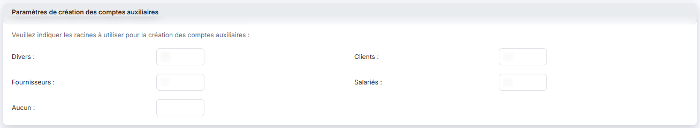

# Connexion comptabilité


**Où le trouver :** Panneau **Paramètres** › **Facturation** › **Connexion comptabilité**



**En bref** — Cet écran règle le lien entre la facturation et la comptabilité : écritures générées et journaux, comptes proposés, traitement des écarts de règlement.

* Pour générer les écritures directement en comptabilité : activez l'interrupteur de la rubrique « Fonctionnalités », puis bouton \[Enregistrer].
* Pour créer un compte manquant : bouton \[+] à droite de la zone, ou pictogramme « Loupe » pour le rechercher dans le plan comptable.


Cette page règle le lien entre la facturation et la comptabilité : quelles écritures le logiciel génère et dans quel journal, quels comptes il propose, et comment il traite les écarts de règlement. C'est un formulaire, en six rubriques, sans liste ni onglet. Dans le panneau Paramètres, il se trouve dans la rubrique « Facturation », où « Connexion comptabilité » est le dernier onglet de la barre (après Clients, Articles, Pièces commerciales, Scénarios de relance, Chorus et Identifiants API).

<figure><figcaption>
Écran « Connexion comptabilité » de la nouvelle interface
</figcaption></figure>

Plusieurs champs de numéro de compte sont accompagnés d'un bouton \[+], qui crée le compte, et d'un pictogramme « Loupe », qui ouvre une recherche dans le plan comptable — l'infobulle de la loupe rappelle son raccourci clavier, Ctrl + Alt + R. L'intitulé du compte est affiché sous la zone de saisie et n'est pas saisissable : c'est le logiciel qui le renseigne à partir du numéro.

## Rubrique « Fonctionnalités »

| Champ                                                                                              | Ce qu'il faut savoir                                                                                                                                                                                                                                                                                                                                                                                                  |
| -------------------------------------------------------------------------------------------------- | --------------------------------------------------------------------------------------------------------------------------------------------------------------------------------------------------------------------------------------------------------------------------------------------------------------------------------------------------------------------------------------------------------------------- |
| 1. **Indiquez si vous souhaitez générer les écritures directement dans le module de comptabilité** | Interrupteur. Activé, dès qu'une pièce est validée et qu'une écriture est générée depuis la facturation, elle est enregistrée dans le journal idoine du logiciel de comptabilité. Désactivé, les écritures sont générées dans un fichier distinct, consultable dans le menu « Ecritures », d'où vous pouvez les exporter vers le module Comptabilité ou vers un autre logiciel de comptabilité.                       |
| 2. **Les écritures de vente**                                                                      | L'écriture de vente est générée à la validation d'une facture ou d'un avoir, dans le journal indiqué juste en dessous. Si vous le désactivez, la pièce n'est connue que de la facturation : le rapprochement automatique des règlements avec les factures perd alors son repère le plus fiable.                                                                                                                       |
| 3. **Indiquez le journal d'intégration pour les écritures de vente**                               | Demandé uniquement si les écritures de vente sont générées. Vous le choisissez parmi les journaux de votre dossier.                                                                                                                                                                                                                                                                                                   |
| 4. **Importer les règlements de la comptabilité**                                                  | À l'ouverture de la fiche de pointage d'un client, les écritures de son compte en comptabilité sont relues : les encaissements y deviennent des règlements, les décaissements des remboursements. Si l'écriture est lettrée en comptabilité avec une facture, le règlement est automatiquement affecté à cette facture. Les règlements déjà saisis en facturation sont reconnus et ne remontent pas une seconde fois. |
| 5. **Les écritures de règlement clients**                                                          | L'écriture d'encaissement est générée dès la création d'un règlement — débit de la trésorerie, crédit du compte client. Le journal et le compte viennent du mode de règlement, et non de cet écran. C'est aussi cette option qui autorise le lettrage du règlement avec sa facture.                                                                                                                                   |
| 6. **Les écritures de remboursement clients**                                                      | L'écriture de décaissement est générée dès la création d'un remboursement — débit du compte client, crédit de la trésorerie. Le journal et le compte viennent également du mode de règlement ; en revanche le lettrage dépend de l'option « Les écritures de règlement clients ».                                                                                                                                     |
| 7. **Compte collectif client par défaut**                                                          | Le compte collectif défini ici est proposé pour créer le compte auxiliaire correspondant en comptabilité, à la création de vos clients.                                                                                                                                                                                                                                                                               |
| **Quels types d'écritures souhaitez-vous générer ?**                                               | Ce libellé n'est pas un champ, il intitule l'encadré qui regroupe les interrupteurs suivants, rangés sur deux colonnes : à gauche « Les écritures de vente », « Importer les règlements de la comptabilité » et « Les écritures de remboursement clients » ; à droite le journal d'intégration des ventes et « Les écritures de règlement clients ».                                                                  |

Vous pouvez décider que le logiciel ne génère pas toutes les écritures. C'est utile, par exemple, si vous préférez que les écritures de banque proviennent de l'import de vos relevés bancaires plutôt que de la saisie des règlements : en demandant la génération des écritures de règlement, chaque règlement validé produirait une écriture de banque, en doublon de celle de l'import. Pour l'éviter, activez l'interrupteur des écritures de vente et désactivez ceux des écritures de règlement et de remboursement clients : vous saisissez vos règlements en facturation, vous suivez vos paiements facture par facture et vous utilisez les relances, sans générer d'écriture de banque.

Si les écritures de vente ne sont pas générées alors que l'import des règlements de la comptabilité est actif, la rubrique affiche un avertissement encadré : le contrôle anti-doublon ne peut plus reconnaître les factures par leur écriture et se rabat sur le numéro de facture saisi en référence de l'écriture comptable ; si cette référence est absente ou d'un autre format, des règlements déjà saisis en facturation seront importés en double. L'avertissement disparaît dès que l'une des deux options est remise dans l'autre position.

**Désactiver l'interrupteur Importer les règlements de la comptabilité ouvre immédiatement une fenêtre « Purger les règlements importés de la comptabilité »**, avant même que vous ayez enregistré. Elle explique que les règlements et remboursements déjà importés restent présents dans l'écran de pointage même après la désactivation de l'import, et qu'une purge les supprime sur la période choisie en rétablissant les soldes des factures concernées ; les écritures comptables, elles, ne sont jamais supprimées et aucun lettrage n'est défait, la comptabilité restant la source. Vous y indiquez une période, **Du** et **Au**, et la fenêtre annonce ce qu'elle a trouvé sur cette période. Deux boutons la referment : bouton **\[Purger la période]**, dont l'effet est immédiat, et bouton **\[Fermer]**.

**Prenez garde : fermer cette fenêtre enregistre l'écran, que vous ayez purgé ou non.** La fenêtre le dit elle-même : la désactivation de l'import est conservée dans les deux cas, ainsi que toutes les autres modifications en cours sur l'écran. Il n'y a donc pas de moyen de renoncer depuis cette fenêtre : ne désactivez cet interrupteur que si vous avez décidé de l'enregistrer.

## Rubrique « Ecarts de règlements »

<figure><figcaption>
Rubrique « Ecarts de règlements »
</figcaption></figure>

| Champ                                  | Ce qu'il faut savoir                                                                                                                                                                                                                                                                                                                                                                                                                                                                        |
| -------------------------------------- | ------------------------------------------------------------------------------------------------------------------------------------------------------------------------------------------------------------------------------------------------------------------------------------------------------------------------------------------------------------------------------------------------------------------------------------------------------------------------------------------- |
| 8. **Journal par défaut**              | 
Le journal dans lequel les écritures de régularisation seront passées, à choisir parmi les journaux de votre dossier. La rubrique porte ensuite deux sous-titres, <strong>Régularisation des écarts négatifs</strong> puis <strong>Régularisation des écarts positifs</strong>, chacun avec son <strong>Plafond</strong> et son numéro de compte. Le libellé « Plafond » apparaît donc deux fois : seul le sous-titre les distingue, prenez garde à saisir la valeur sous le bon.
 |
| **Régularisation des écarts négatifs** | Lors de l'affectation d'un règlement à une facture, si le solde de la facture est inférieur au plafond indiqué, le logiciel vous propose de passer une écriture de régularisation pour solder la facture, qui n'apparaît alors plus dans la liste. Renseignez le plafond en dessous duquel l'opération vous sera proposée, et le numéro de compte à employer — 658 pour « Charges diverses de gestion courante », par exemple.                                                              |
| **Régularisation des écarts positifs** | De la même façon, si le montant restant à affecter du règlement est inférieur au plafond indiqué, le logiciel vous propose une écriture de régularisation pour solder le règlement, qui n'apparaît alors plus dans la liste. Renseignez le plafond et le numéro de compte — 758 pour « Produits divers de gestion courante », par exemple.                                                                                                                                                  |

**Les deux zones de saisie du plafond n'acceptent que quatre caractères**, alors que la valeur qui y est affichée en compte davantage dès qu'elle comporte des décimales : un plafond de 500,00 déjà enregistré ne peut donc pas être ressaisi tel quel. Pire, la virgule est refusée et les chiffres qui la suivent se collent aux précédents : ressaisir « 500,00 » laisse « 5000 » dans la zone, soit un plafond dix fois trop grand, et aucun message ne le signale. Si vous devez modifier un plafond, saisissez-le sans décimales, et relisez la valeur obtenue avant d'enregistrer.

## Rubrique « Ecriture en validation »

<figure><figcaption>
Rubrique « Ecriture en validation »
</figcaption></figure>

**Souhaitez-vous visualiser les écritures lors de la validation des pièces ?** : interrupteur. C'est le seul champ de la rubrique.

## Rubrique « Paramètres du plan comptable »

<figure><figcaption>
Rubrique « Paramètres du plan comptable »
</figcaption></figure>

La rubrique demande d'abord les **racines générales**, utilisées pour les éditions de la balance générale et pour les opérations de clôture : **Comptes de bilan**, **Comptes de résultat** et **Comptes hors bilan**.

Elle demande ensuite les **racines des comptes par nature** : clients, fournisseurs, salariés, banque, caisse, immobilisations, charges, produits, TVA déductible, TVA collectée et comptes d'attente. Le paramétrage de ces racines facilite les recherches, ainsi que les propositions que le logiciel peut vous faire chaque fois qu'un compte comptable est demandé. Par défaut, un compte qui ne correspond à aucune racine est rangé dans la catégorie « Divers » — la rubrique le rappelle.

Une même nature peut porter plusieurs racines, séparées par un point-virgule, et une racine peut être écrite sous la forme d'un intervalle, deux valeurs séparées par un tiret. Aucune indication à l'écran ne rappelle ces deux formes : reprenez celle qui est déjà en place plutôt que de la deviner.

## Rubrique « Paramètres de création des comptes auxiliaires »

<figure><figcaption>
Rubrique « Paramètres de création des comptes auxiliaires »
</figcaption></figure>

Vous indiquez ici la racine à utiliser pour la création des comptes auxiliaires, une ligne par catégorie de compte auxiliaire : **Divers**, **Clients**, **Fournisseurs**, **Salariés** et **Aucun**. Chaque racine est limitée à quatre caractères et accepte des lettres, un S pour les comptes auxiliaires de salariés par exemple.

Les libellés « Clients », « Fournisseurs » et « Salariés » figurent aussi dans la rubrique précédente, mais ils n'y ont pas le même objet : la rubrique précédente porte les racines des comptes **généraux**, celle-ci les racines des comptes **auxiliaires**. Une valeur saisie dans la mauvaise rubrique n'a pas l'effet attendu.

## Rubrique « Eco-contribution »

<figure><figcaption>
Rubrique « Eco-contribution »
</figcaption></figure>

**Numéro de compte de l'éco-contribution** : si certains des articles vendus sont soumis à l'éco-contribution, indiquez ici le numéro de compte de comptabilisation de la taxe. Si vous ne le renseignez pas, elle est comptabilisée dans le compte de vente de chaque article.

bouton **\[Enregistrer]**

Enregistre les paramètres de la page. C'est le seul bouton de l'écran : il n'y a ni bouton de retour, ni bouton d'essai de la connexion à la comptabilité.
