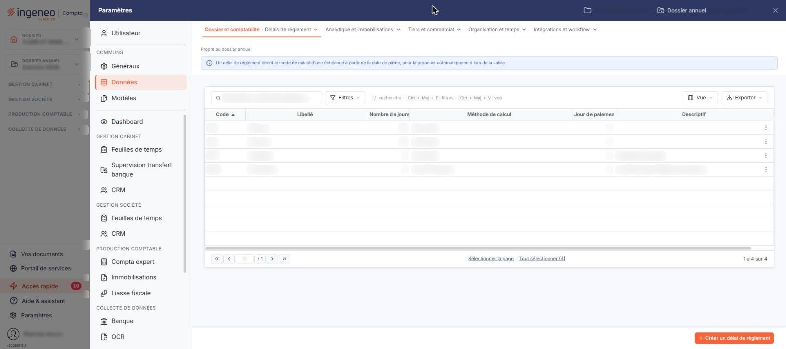

# Délais de règlement


**Où le trouver :** Panneau **Paramètres** › **Données** › **Dossier et comptabilité** › **Délais de règlement**



**En bref** — Cet écran définit les délais de règlement qui servent à calculer les échéances à partir de la date d'une pièce, pour les proposer automatiquement en saisie.

* Pour créer un délai : bouton \[Créer un délai de règlement], renseignez la fiche, puis bouton \[Enregistrer].
* Pour contrôler l'échéance obtenue : dans la fiche, bouton \[Calcul].


Cette option permet de définir les délais de règlement qui seront utilisés pour calculer les échéances à partir de la date d'une pièce comptable.

<figure><figcaption>
Écran « Délais de règlement » de la nouvelle interface
</figcaption></figure>

Cet écran s'ouvre par le panneau « Paramètres » : rubrique « Données », groupe « Dossier et comptabilité », entrée « Délais de règlement ». Un bandeau d'information en haut de l'écran rappelle qu'un délai de règlement décrit le mode de calcul d'une échéance à partir de la date de pièce, pour la proposer automatiquement lors de la saisie.

Un délai de règlement ne peut pas être supprimé s'il est utilisé par un tiers, par un compte général ou auxiliaire, ou par une pièce commerciale. Le logiciel affiche alors le message « Il n'est pas possible de supprimer ce délai de règlement car il est utilisé par des tiers, des pièces commerciales, des comptes généraux ou des comptes auxiliaires. »

L'écran présente la liste des délais de règlement du dossier, une ligne par délai. Les colonnes affichées sont, dans l'ordre : **Code**, **Libellé**, **Nombre de jours**, **Méthode de calcul**, **Jour de paiement** et **Descriptif** ; elles reprennent les informations saisies dans la fiche du délai. Les six colonnes sont triables ; la liste est triée par défaut sur le code, par ordre croissant.

Au-dessus de la liste, la barre « Rechercher un délai de règlement… » et les boutons \[Filtres], \[Vue] et \[Exporter] permettent de chercher un délai, de filtrer la liste, de personnaliser les colonnes et de l'imprimer ou de l'exporter (voir plus bas le bouton \[Exporter] de la barre d'outils).

Il n'y a pas de case à cocher : un clic sur une ligne la sélectionne, un second clic la désélectionne. Sous la liste, le lien « Sélectionner la page » sélectionne toutes les lignes affichées et le lien « Tout sélectionner (4) » étend la sélection à toutes les pages (le nombre entre parenthèses est celui des délais de la liste). Tant qu'une ligne est sélectionnée, un bandeau « 1 délai de règlement sélectionnée » avec le lien « Tout désélectionner » et les boutons \[Exporter] et \[Supprimer] remplace le bouton de création. Au survol d'une ligne, le pictogramme « Autres actions » (trois points verticaux) apparaît à droite de la ligne. Il ouvre deux entrées : « Modifier », qui ouvre la fiche du délai, et « Supprimer », qui le supprime.

bouton **\[Créer un délai de règlement]**

Il est en bas à droite de l'écran, hors de la liste, et ouvre une fiche vierge pour créer un nouveau délai de règlement.

bouton **\[Exporter]** (deux emplacements)

Le bouton \[Exporter] de la barre d'outils, au-dessus de la liste, ouvre un menu qui porte l'en-tête « La liste affichée » suivi du nombre de délais, puis les entrées « Aperçu édition HTML », « Imprimer », « Exporter en Excel », « Exporter en PDF » et « Envoyer la liste par e-mail » : il sert à éditer la liste, pas à copier des données.

Le bouton \[Exporter] du bandeau de sélection, lui, permet de copier les délais de règlement sélectionnés dans la liste vers d'autres sociétés que vous gérez ; il n'apparaît qu'une fois au moins une ligne sélectionnée. La fenêtre « Exporter » rappelle le nombre d'enregistrements sélectionnés, puis vous demande d'indiquer les sociétés vers lesquelles les données seront copiées : **Toutes les sociétés**, **Liées à ce modèle** ou **Autres**, ces dernières se choisissant dans la liste présentée en dessous, dont les colonnes sont **Code client**, **Raison sociale** et **Accès autorisé**. La copie des données se fera lors de la prochaine utilisation de la société gérée concernée, par exemple en la sélectionnant dans le menu ou lors de la connexion d'un utilisateur. Le bouton « Valider » lance l'export ; la croix en haut à droite de la fenêtre la referme sans rien exporter.

bouton **\[Supprimer]**

Il se trouve dans le bandeau de sélection et supprime les délais de règlement sélectionnés dans la liste.

## Rubrique « Informations générales »

La fiche d'un délai de règlement ne comporte que cette rubrique.

| Champ                | Ce qu'il faut savoir                                                                                                                                                                                                                                                                                                                                                                                                                                                                                                                                                                                                                                                                                                                                                                                                                                                                                          |
| -------------------- | ------------------------------------------------------------------------------------------------------------------------------------------------------------------------------------------------------------------------------------------------------------------------------------------------------------------------------------------------------------------------------------------------------------------------------------------------------------------------------------------------------------------------------------------------------------------------------------------------------------------------------------------------------------------------------------------------------------------------------------------------------------------------------------------------------------------------------------------------------------------------------------------------------------- |
| **Code**             | Il est saisissable à la création, puis n'est plus modifiable ensuite — il reste présenté avec son astérisque, mais vous ne pouvez plus le saisir.                                                                                                                                                                                                                                                                                                                                                                                                                                                                                                                                                                                                                                                                                                                                                             |
| **Libellé**          | 
 Les trois champs suivants définissent la manière dont l'échéance est calculée, et ils se combinent entre eux.
                                                                                                                                                                                                                                                                                                                                                                                                                                                                                                                                                                                                                                                                                                                                                                                      |
| **Nombre de jours**  | 
Nombre de jours pris en compte par la méthode de calcul. La zone est vide à la création. Le pictogramme « Information » placé à côté du champ rappelle que, pour une période d'un mois fixe, il faut saisir « 30 » jours. <strong>Méthode de calcul</strong> : liste de choix. Elle ne comporte pas de valeur vide et vaut « Jours nets » à la création : une méthode est donc toujours retenue, même si le champ n'est marqué d'aucun astérisque. Six méthodes vous sont proposées, dans cet ordre : • <strong>Jours nets</strong> • <strong>Jours fin de mois</strong> • <strong>Fin de décade</strong> • <strong>Fin de mois + N jours</strong> • <strong>Fin de trimestre</strong> • <strong>Fin de trimestre + N jours</strong> Le choix de la méthode ne change pas la liste des champs de la fiche : les mêmes champs restent affichés quelle que soit la méthode retenue.
 |
| **Jour de paiement** | Rang du jour dans le mois auquel l'échéance doit tomber. La zone est vide à la création, et le pictogramme « Information » placé à côté du champ rappelle qu'elle définit un jour fixe dans le mois.                                                                                                                                                                                                                                                                                                                                                                                                                                                                                                                                                                                                                                                                                                          |
| **Descriptif**       | Il est repris dans la colonne « Descriptif » de la liste.                                                                                                                                                                                                                                                                                                                                                                                                                                                                                                                                                                                                                                                                                                                                                                                                                                                     |

## Vérifier votre méthode de calcul

Le bas de la rubrique vous propose de contrôler les critères saisis sur un exemple : « Pour vérifier votre méthode de calcul, saisissez une date de facture et calculez la date d'échéance prévue ».

| Champ               | Ce qu'il faut savoir                                                                                   |
| ------------------- | ------------------------------------------------------------------------------------------------------ |
| **Date de facture** | Préremplie avec la date du jour, modifiable directement ; le calendrier s'ouvre au clic dans le champ. |
| **Date d'échéance** | Vide à l'ouverture de la fiche. Cette zone n'est pas saisissable : c'est le logiciel qui l'alimente.   |

bouton **\[Calcul]**

Applique à la date de facture les critères que vous venez de saisir et affiche le résultat dans le champ « Date d'échéance ». Si le premier clic ne produit aucun résultat, cliquez une seconde fois. Par exemple, pour une facture du 15/06/2026 avec 30 jours et la méthode « Jours nets », le logiciel calcule une échéance au 15/07/2026.

Ce bouton n'est utilisable que sur une fiche déjà renseignée : sur une fiche vierge, il ne calcule rien et le logiciel affiche « Le champ "Code" est obligatoire. » et « Le champ "Libellé" est obligatoire. » Renseignez donc le code et le libellé du délai avant de simuler un calcul, même si ces deux informations n'entrent pas dans le calcul.

bouton **\[Enregistrer]**

Enregistre le délai de règlement.

**Retour à la liste**

Le bouton \[Retour] est masqué dans la fiche : le chevron « Retour », à gauche de la barre d'onglets du panneau, revient à la liste sans enregistrer les modifications en cours.
