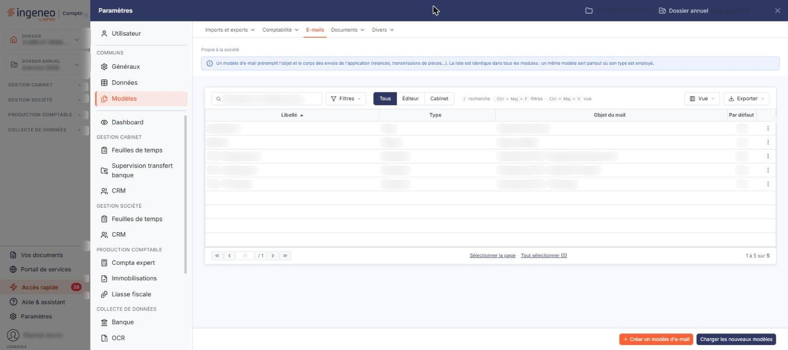

# E-mails


**Où le trouver :** Panneau **Paramètres** › **Modèles** › **E-mails**



**En bref** — Cet écran définit l'objet et le texte des e-mails d'envoi de pièces et de relance, avec des champs dynamiques remplacés à l'envoi. La liste est commune à plusieurs modules.

* Pour créer un modèle : bouton \[Créer un modèle d'e-mail], renseignez libellé, type, objet et corps, puis bouton \[Enregistrer].
* Pour récupérer les modèles de l'éditeur : bouton \[Charger les nouveaux modèles].


Cette option vous permet de définir les objets et les textes des e-mails qui seront utilisés dans les envois de pièces commerciales ou dans les relances des clients. Pour les relances, vous pouvez donc moduler le texte de vos e-mails en fonction du type de client ou du nombre de fois que vous les relancez.

<figure><figcaption>
Écran « E-mails » de la nouvelle interface
</figcaption></figure>

Dans le panneau Paramètres, cet écran se trouve dans la rubrique « Modèles », onglet « E-mails » (chemin « Paramètres > Modèles > E-mails »). Il est commun à plusieurs modules : un bandeau d'information en tête d'écran précise que la liste est identique dans tous les modules.

Un modèle d'e-mail se compose d'un libellé, d'un type, d'un objet et d'un corps de texte. L'objet et le corps peuvent contenir des **champs dynamiques** : des codes que le logiciel remplace, au moment de l'envoi, par la valeur correspondante de l'émetteur, du client ou des pièces envoyées.

## La liste des modèles d'e-mails

La liste présente quatre colonnes, toutes triables : **Libellé**, **Type**, **Objet du mail** et **Par défaut**. Elle est triée par défaut sur le libellé, dans l'ordre croissant.

Au-dessus de la liste, la barre « Rechercher un modèle d'e-mail… » et le bouton \[Filtres] permettent de retrouver un modèle ; viennent ensuite trois boutons « Tous », « Éditeur » et « Cabinet », puis, à l'extrémité droite, les boutons \[Vue] et \[Exporter]. Tant qu'aucun critère n'est posé, la totalité des modèles du dossier est présentée, et le pied de liste indique « 1 à n sur n ».

La colonne **Par défaut** signale le modèle qui sera proposé d'emblée lors d'un envoi.

Deux points de vocabulaire à connaître pour ne pas chercher en vain :

* la colonne **Type** affiche le code interne du type, par exemple « Piece », alors que la fiche et la fenêtre de filtres emploient pour la même valeur le libellé rédigé, par exemple « Envoi de pièces » ;
* cette même donnée s'intitule **Objet du mail** dans la liste et **Objet de l'e-mail** dans la fiche.

Le bouton \[Vue] permet de gérer vos vues et de choisir les colonnes affichées, et le bouton \[Exporter] de la barre d'outils ouvre le menu d'édition de la liste.

Un clic sur une ligne la sélectionne ; il n'y a plus de case à cocher. Au survol d'une ligne, un pictogramme « Autres actions » (trois points) apparaît en dernière colonne et ouvre un menu dont les entrées sont « Modifier », qui ouvre la fiche du modèle, « Dupliquer » et « Supprimer ». « Modifier » n'est pas proposé pour tous les modèles : il manque sur les trois modèles de déclaration de TVA.

Sous la liste, « Sélectionner la page » et « Tout sélectionner (n) » sélectionnent d'un coup les modèles de la page ou tous les modèles. En bas à droite de l'écran se trouvent le bouton **\[Créer un modèle d'e-mail]** et le bouton **\[Charger les nouveaux modèles]**. Dès qu'une ligne est sélectionnée, un bandeau apparaît au bas de l'écran : il propose « Tout désélectionner », un bouton **\[Exporter]** et le bouton **\[Supprimer]**, qui portent sur les modèles sélectionnés.

**Bouton \[Exporter]** : il existe en deux endroits. Celui de la barre d'outils ouvre le menu d'édition de la liste (aperçu, impression, export en Excel ou en PDF, envoi de la liste par e-mail). Celui du bandeau de sélection recopie vers **d'autres sociétés** les modèles sélectionnés ; il n'est proposé que lorsqu'une ligne est sélectionnée.

## Menu \[Filtres]

Le bouton \[Filtres] de la barre d'outils ouvre un menu « Filtrer » dont la ligne « + Ajouter un critère sur… » propose sept colonnes : **Libellé**, **Type**, **Objet du mail**, **Par défaut**, **Message**, **Modèle éditeur** et **Texte modifiable lors de l’utilisation**. Chaque critère accepte deux conditions, que vous combinez par « Et » ou « Ou ».

Les critères proposés ne recouvrent donc pas exactement les colonnes affichées : trois d'entre eux portent sur des données absentes de la liste, et le critère **Modèle éditeur** ne correspond à aucun champ de la fiche.

Le menu se termine par les boutons bouton **\[Vider les filtres]** et bouton **\[Filtrer]** ; les boutons \[Mémoriser les paramètres] et \[Charger les paramètres] n'y figurent plus.

## Bouton \[Créer un modèle d'e-mail]

Situé en bas à droite de l'écran, il ouvre une fiche vierge pour créer un nouveau modèle d'e-mail. La fiche comporte deux rubriques, « Informations générales » à gauche et « Documents » à droite.

## Rubrique « Informations générales »

| Champ                                      | Ce qu'il faut savoir                                                                                                                                                                                                                                                                                                                                                                                                                                  |
| ------------------------------------------ | ----------------------------------------------------------------------------------------------------------------------------------------------------------------------------------------------------------------------------------------------------------------------------------------------------------------------------------------------------------------------------------------------------------------------------------------------------- |
| **Libellé**                                | 20 caractères au maximum. C'est le nom sous lequel le modèle est proposé dans les écrans d'envoi. Il se saisit à la création du modèle et n'est plus modifiable ensuite : lorsque vous ouvrez un modèle existant, la zone est grisée, bien que le libellé porte l'astérisque des champs obligatoires. Un modèle d'e-mail ne se renomme donc pas.                                                                                                      |
| **Type**                                   | Liste déroulante, sans invite de choix : le logiciel propose d'emblée « Envoi de pièces ». Le type désigne la circonstance dans laquelle le modèle sera proposé — « Envoi de pièces » pour l'envoi d'une pièce commerciale, « Relance » pour les relances clients. La liste n'est pas restreinte au module : elle contient aussi des types qui relèvent d'autres domaines du logiciel, comme la création d'un utilisateur ou l'envoi de déclarations. |
| **Texte modifiable lors de l’utilisation** | Interrupteur sans texte, désactivé à la création. Ce libellé porte un astérisque d'obligation.                                                                                                                                                                                                                                                                                                                                                        |
| **E-mail par défaut**                      | Interrupteur sans texte, désactivé à la création. Le modèle ainsi désigné est celui que signale la colonne **Par défaut** de la liste.                                                                                                                                                                                                                                                                                                                |
| **Objet de l'e-mail**                      | 50 caractères au maximum. C'est l'objet que portera le message envoyé. Un pictogramme placé à droite du champ, d'infobulle « Insérer un champ dynamique », ouvre la fenêtre « Champs » décrite ci-dessous.                                                                                                                                                                                                                                            |
| **Corps de l'e-mail**                      | 10 000 caractères au maximum. Le logiciel remplace la zone de saisie par un éditeur de texte enrichi, dont la barre d'outils offre les commandes habituelles de mise en forme — gras, listes, alignements, couleurs, tableau, insertion d'un lien, annulation — ainsi que le bouton « Insérer un champ » et l'icône « Code source HTML ».                                                                                                             |

Le changement du type ne modifie pas la composition de la fiche : les mêmes rubriques et les mêmes champs sont présentés quel que soit le type retenu.

## Fenêtre « Champs » : les champs dynamiques

Un champ dynamique est un code que vous placez dans l'objet ou dans le corps du modèle et que le logiciel remplace par la valeur correspondante au moment de l'envoi. Les codes s'écrivent en majuscules, encadrés de crochets : par exemple le code **EMAILPSINOMEMETTEUR** pour le nom de l'émetteur, ou **EMAILPSIRSSTE** pour la raison sociale de la société. Un même modèle sert ainsi tous vos clients.

La liste des codes disponibles s'obtient de deux façons, qui ne la présentent pas de la même manière :

* pour l'objet, par le pictogramme situé à droite du champ, d'infobulle « Insérer un champ dynamique », qui ouvre la fenêtre « Champs » ;
* pour le corps, par le bouton « Insérer un champ » de la barre d'outils de l'éditeur, qui déroule la liste sous la barre d'outils.

La fenêtre ouverte par le pictogramme de l'objet s'intitule « Champs ». Elle présente trois tableaux, d'en-têtes « Code » et « Libellé » :

* **Emetteur** : la personne qui envoie l'e-mail — civilité, nom, prénom et fonction ;
* **Société gérée** : le contact et l'identité de la société — adresse, coordonnées, TVA intracommunautaire, SIREN, SIRET, forme juridique, capital, activité… ;
* **Cabinet** : le contact du cabinet, avec des codes de même nature.

La liste déroulée par le bouton « Insérer un champ » de l'éditeur du corps présente des bandeaux nommés « Emetteur », « Société gérée », « Cabinet » et « Déclaration », le bandeau « Emetteur » étant déroulé à l'ouverture. Chaque tableau présente deux colonnes : à gauche le code à employer, entre crochets, à droite ce que ce code désigne.

La colonne des codes est étroite : un code long peut s'y afficher tronqué, par exemple « \[EMAILPSIPRENOMEMETTE… ». Vérifiez le code que vous reportez dans votre texte, faute de quoi le logiciel ne le remplacera pas.

Les listes lues depuis le panneau Paramètres ne comportent ni bandeau « Client », ni bandeau « Pièces commerciales », ni les codes « Champ dynamique 1 » à « Champ dynamique 10 » : ils n'ont pas été retrouvés.

La liste des codes est la même quel que soit le type du modèle.

La fenêtre « Champs » se referme par bouton **\[Annuler]**.

## Rubrique « Documents »

Cette rubrique, placée à droite de la rubrique « Informations générales », présente les documents attachés au modèle. Tant qu'aucun document n'est lié, elle affiche « Aucun document lié ». Le bouton **\[Lier un document]**, à droite de ce message, permet d'ajouter un document.

## Bouton \[Enregistrer]

Il enregistre le modèle d'e-mail.

## Retour à la liste

Le bouton \[Retour] n'est plus affiché dans la fiche : pour quitter la fiche sans enregistrer votre saisie et revenir à la liste des modèles, utilisez le chevron « Retour » à gauche de la barre d'onglets du panneau Paramètres.
