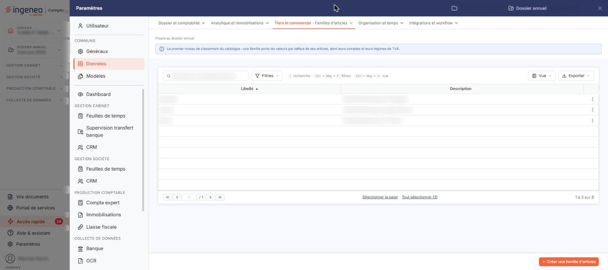

# Familles d'articles


**Où le trouver :** Panneau **Paramètres** › **Données** › **Tiers et commercial** › **Familles d'articles**



**En bref** — Les familles d'articles regroupent vos articles selon leur nature. Ce fichier n'est accessible que si l'option « Utiliser les familles d'articles » est activée.

* Si l'écran affiche « Vous n'avez pas activé la gestion des familles. » : activez « Utiliser les familles d'articles » dans « Paramètres » > « Facturation » > « Articles ».


Les familles d'articles permettent de regrouper vos articles en fonction de leur nature.

<figure><figcaption>
Écran « Familles d'articles » de la nouvelle interface
</figcaption></figure>

Ce fichier n'est accessible que si vous avez activé l'option « Utiliser les familles d'articles » par « Paramètres » > « Facturation » > « Articles », rubrique « Options de gestion des articles ». Tant que cette option est à Non, l'entrée « Familles d'articles » reste présente et cliquable dans l'onglet « Tiers et commercial » de la rubrique « Données » du panneau « Paramètres » (« Paramètres » > « Données » > « Tiers et commercial » > « Familles d'articles »), mais l'écran ne présente ni liste, ni fiche, ni bouton : il affiche uniquement le message « Vous n'avez pas activé la gestion des familles. »

C'est également cette option qui commande la présence du champ « Famille » dans la fiche d'un article, et qui autorise l'activation des sous-familles d'articles.
