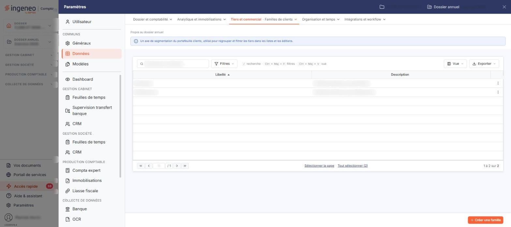

# Familles de clients


**Où le trouver :** Panneau **Paramètres** › **Données** › **Tiers et commercial** › **Familles de clients**



**En bref** — Les familles de clients vous permettent de classer vos clients selon votre propre classification ; elles sont ensuite proposées dans la fiche de chaque client.

* Pour créer une famille : bouton \[Créer une famille], saisissez son libellé, puis bouton \[Enregistrer].


Les familles de clients vous permettent de classer vos clients selon votre propre classification. Une fois créée, une famille est proposée dans la liste déroulante **Famille** de la rubrique « Identification » de chaque fiche client.

<figure><figcaption>
Écran « Familles de clients » de la nouvelle interface
</figcaption></figure>

Pour chaque famille, vous devez saisir un libellé et vous avez la possibilité d'y associer une description. Deux familles ne peuvent avoir le même libellé.

Cet écran ne comporte pas de code : une famille est identifiée par son seul libellé.

Dans le panneau Paramètres, cet écran se trouve dans la rubrique « Données », onglet « Tiers et commercial », entrée « Familles de clients ».

## La liste des familles de clients

La liste présente deux colonnes : **Libellé** et **Description**. Elle est triée par défaut sur le libellé, dans l'ordre croissant, et chacune des deux colonnes peut servir de critère de tri.

Au-dessus de la liste, la barre « Rechercher une famille… » permet de retrouver une famille par saisie, et le bouton \[Filtres] de poser des critères sur les colonnes ; à l'extrémité droite, le bouton \[Vue] permet de gérer vos vues et de choisir les colonnes affichées, et le bouton \[Exporter] ouvre le menu d'édition de la liste. Tant qu'aucun critère n'est posé, la totalité des familles créées pour la société est affichée.

Lorsqu'aucune famille n'a encore été créée, le logiciel affiche le message « Aucun élément à afficher. ».

Un clic sur une ligne la sélectionne. Au survol d'une ligne, un pictogramme « Autres actions » (trois points) apparaît en dernière colonne : il ouvre un menu à deux entrées, « Modifier », qui ouvre la fiche, et « Supprimer ». Sous la liste, « Sélectionner la page » et « Tout sélectionner (N) » sélectionnent d'un coup les lignes de la page ou toutes les lignes. Dès qu'une ligne est sélectionnée, un bandeau apparaît au bas de l'écran, à la place de la barre du bas : il indique « 1 famille sélectionnée » et propose « Tout désélectionner » et le bouton \[Supprimer].

## Bouton \[Créer une famille]

Situé en bas à droite de l'écran, il ouvre une fiche vierge pour créer une nouvelle famille de clients.

## Bouton \[Supprimer]

Il s'affiche dans le bandeau de sélection, en bas de l'écran, dès qu'une ligne au moins est sélectionnée, et supprime toutes les lignes sélectionnées. Une ligne peut aussi être supprimée seule par l'entrée « Supprimer » du menu « Autres actions » de la ligne.

## Rubrique « Informations générales »

La fiche d'une famille de clients ne comporte que cette seule rubrique, avec deux champs :

| Champ           | Ce qu'il faut savoir                                                             |
| --------------- | -------------------------------------------------------------------------------- |
| **Libellé**     | C'est le nom sous lequel la famille est proposée dans les fiches clients.        |
| **Description** | Zone de texte libre dans laquelle vous précisez à quoi cette famille correspond. |

## Bouton \[Enregistrer]

Il enregistre la famille de clients.

## Retour à la liste

Le bouton \[Retour] n'est plus affiché dans la fiche : pour revenir à la liste sans enregistrer la fiche en cours, utilisez le chevron « Retour » à gauche de la barre d'onglets du panneau Paramètres.
