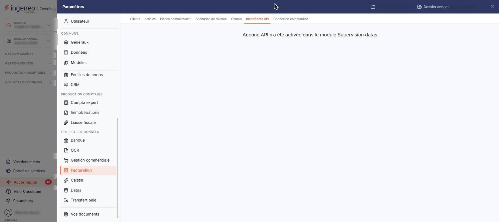

# Identifiants API


**Où le trouver :** Panneau **Paramètres** › **Facturation** › **Identifiants API**



**En bref** — Cet écran porte les identifiants de connexion aux API qui relient le logiciel à des services extérieurs ; ces interfaces s'activent dans le module « Supervision datas ».

* Si l'écran affiche « Aucune API n’a été activée dans le module Supervision datas. » : activez d'abord l'interface dans le module « Supervision datas ».


Cette option est destinée à porter les identifiants de connexion aux interfaces — les API — qui relient le logiciel à des services extérieurs.

<figure><figcaption>
Écran « Identifiants API » de la nouvelle interface
</figcaption></figure>

On y accède par le panneau « Paramètres » : rubrique « Facturation », puis onglet « Identifiants API ». C'est un écran commun à plusieurs modules : il se présente de la même façon depuis la rubrique « Gestion commerciale » du panneau.

Ces interfaces ne s'activent pas ici. Elles s'activent dans le module « Supervision datas ». Tant qu'aucune ne l'a été, cet écran ne propose aucune saisie : il affiche le seul message suivant, centré en haut de la page, et ne comporte ni champ, ni liste, ni bouton — pas même un bouton d'enregistrement.

« Aucune API n’a été activée dans le module Supervision datas. »

L'activation d'une interface est donc un préalable à l'emploi de cette option. Elle relève du module « Supervision datas », et non du module de facturation.
