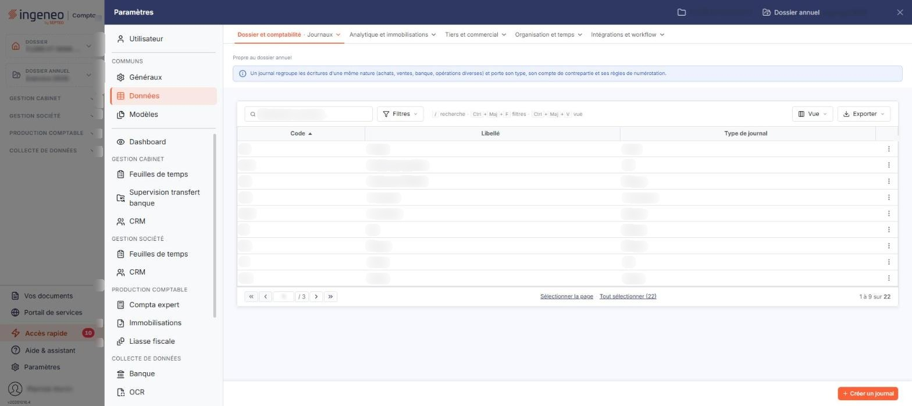

# Journaux


**Où le trouver :** Panneau **Paramètres** › **Données** › **Dossier et comptabilité** › **Journaux**



**En bref** — Cet écran administre les journaux du dossier annuel ouvert ; vous pouvez en créer autant que nécessaire.

* Pour créer un journal : bouton \[Créer un journal], renseignez son code, son libellé et son type, puis bouton \[Enregistrer].


Cette option vous permet d'administrer les journaux du dossier annuel ouvert. Vous pouvez en créer autant que nécessaire. Cet écran s'ouvre par le panneau « Paramètres » : rubrique « Données », puis onglet « Dossier et comptabilité » et, dans son menu déroulant, entrée « Journaux ». Un bandeau bleu en haut de l'écran, sous la mention « Propre au dossier annuel », rappelle ce qu'est un journal.

<figure><figcaption>
Écran « Journaux » de la nouvelle interface
</figcaption></figure>

Les journaux sont communs à plusieurs modules, et la fiche d'un journal ne présente pas les mêmes paramètres partout : depuis la Facturation, le logiciel n'affiche que les deux rubriques décrites ci-dessous. Les autres paramètres du même journal, qui gouvernent la saisie comptable, se règlent depuis les modules de comptabilité.

## La liste des journaux

La liste présente trois colonnes, toutes triables : **Code**, **Libellé** et **Type de journal**. Elle s'ouvre triée par code croissant. Au-dessus de la liste se trouvent la barre « Rechercher un journal… » et les boutons \[Filtres], \[Vue] et \[Exporter] ; il n'y a pas de bouton \[Filtres spéciaux]. Aucun critère n'est actif à l'ouverture : le compteur du pied de liste (« 1 à 9 sur 22 » et « Tout sélectionner (22) » sur ce dossier) porte donc sur tous les journaux du dossier.

Un clic sur une ligne la sélectionne ; sous la liste, les boutons \[Sélectionner la page] et \[Tout sélectionner (n)] sélectionnent les lignes. Au survol, le pictogramme « Autres actions » (trois points), en fin de ligne, ouvre un menu de trois entrées : « Modifier », « Dupliquer » et « Supprimer ». Dès qu'une ligne est sélectionnée, un bandeau de sélection (« 1 journal sélectionné », « Tout désélectionner ») remplace la barre du bas et porte le bouton \[Supprimer]. Le bouton \[Exporter] ouvre le menu d'aperçu, d'impression et d'export de la liste.

Le bouton \[Vue] ouvre un menu « Mes vues » et « Colonnes affichées », avec les boutons \[Rétablir les colonnes d'origine] et \[Appliquer]. Seules les trois colonnes ci-dessus sont visibles par défaut (« 3 colonnes affichées sur 18 »), mais la liste peut également présenter tous les autres paramètres du journal — le compte de contrepartie, le mode de saisie, la gestion des échéances, celle des quantités, celle des devises, etc. Le menu \[Filtres], qui s'ouvre sur « Filtrer » et sur le lien « + Ajouter un critère sur… », propose les mêmes colonnes, dans le même ordre ; ses boutons sont le bouton **\[Vider les filtres]** et le bouton **\[Filtrer]**. Vous pouvez donc rechercher un journal sur un paramètre qui n'est pas affiché dans la liste, et même sur un paramètre que la fiche ne vous montre pas depuis la Facturation.

bouton **\[Créer un journal]**

Placé en bas à droite de l'écran, hors de la liste, il ouvre une fiche vierge pour créer un journal.

bouton **\[Supprimer]**

Il se trouve dans le bandeau de sélection et porte sur les journaux sélectionnés dans la liste.

## La fiche d'un journal

La fiche comporte deux rubriques, présentées dans cet ordre : « Informations générales » puis « Propriétés ». Elle se termine par le bouton **\[Enregistrer]**. Pour revenir à la liste, utilisez le chevron « Retour » à gauche de la barre d'onglets du panneau Paramètres. La création et la modification présentent les mêmes champs ; seuls deux d'entre eux se comportent différemment, comme indiqué ci-dessous.

## Rubrique « Informations générales »

| Champ                  | Ce qu'il faut savoir                                                                                                                                                                                                                                                                                                                                                                                                                                                                                       |
| ---------------------- | ---------------------------------------------------------------------------------------------------------------------------------------------------------------------------------------------------------------------------------------------------------------------------------------------------------------------------------------------------------------------------------------------------------------------------------------------------------------------------------------------------------- |
| **Code**               | 4 caractères au maximum. Il ne se saisit qu'à la création : en modification, il s'affiche grisé et n'est plus modifiable.                                                                                                                                                                                                                                                                                                                                                                                  |
| **Libellé du journal** | 25 caractères au maximum. Ce champ est signalé par un astérisque à la création ; en modification, l'astérisque n'est plus affiché.**Compte de contrepartie :** facultatif, 12 caractères au maximum. C'est le compte qui sera utilisé pour solder une écriture saisie dans ce journal, ce que rappelle le pictogramme d'information : « Compte utilisé pour solder l'écriture en saisie ». Le champ est accompagné d'un bouton \[+] et d'un pictogramme « Loupe » qui vous permet de rechercher un compte. |
| **Intitulé**           | Non modifiable. Il présente l'intitulé du compte de contrepartie, pour contrôle.                                                                                                                                                                                                                                                                                                                                                                                                                           |
| **Type de journal**    | Il indique la nature des opérations qui seront saisies dans ce journal — achat, vente, banque, caisse, opérations diverses, etc. En création, la liste s'ouvre sur une entrée vide : vous devez donc choisir le type.                                                                                                                                                                                                                                                                                      |

## Rubrique « Propriétés »

Depuis la Facturation, la rubrique ne présente qu'un paramètre, l'interrupteur **Gérer les quantités :**, désactivé sur le journal ouvert.
