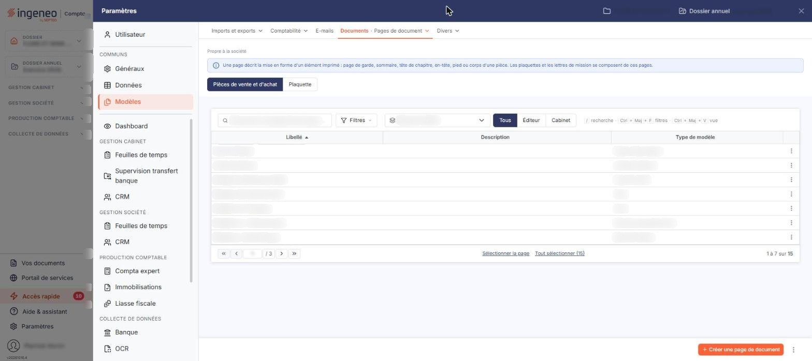

# Modèles d'impression


**Où le trouver :** Panneau **Paramètres**



**En bref** — Cet écran gère les modèles d'impression de vos pièces de vente, courriers clients et lettres de relance, et permet d'en composer la présentation en détail.

* Pour créer votre modèle : dans le menu « Autres actions » d'un modèle existant, choisissez « Dupliquer », puis adaptez la copie et bouton \[Enregistrer].
* Pour contrôler le rendu d'un modèle : bouton \[Visualiser].


Les modèles d'impression déterminent la présentation de vos éditions : factures, avoirs, devis, bons de commande, bons de livraison, courriers clients et lettres de relance. Le logiciel en contient déjà plusieurs ; si vous souhaitez créer le vôtre, il est préférable de dupliquer un modèle existant puis de le modifier, plutôt que de le construire à partir d'une page vierge.

<figure><figcaption>
Écran « Modèles d'impression » de la nouvelle interface
</figcaption></figure>

L'outil de composition est puissant, car il permet de régler le détail de chaque élément imprimé ; il demande donc un temps d'apprentissage.

L'écran se présente en deux parties : la liste des modèles existants, puis la fiche de composition d'un modèle.

Dans le panneau « Paramètres », cet écran se trouve dans la rubrique « Modèles », onglet « Documents », entrée « Pages de document » : c'est sous ce nom que l'écran est présenté, et il s'ouvre sur la pastille « Pièces de vente et d'achat », celle que décrit cette page. La pastille « Plaquette », à côté, concerne les pages des plaquettes et n'est pas décrite ici.

## La liste des modèles

Au-dessus de la liste, la barre « Rechercher une page de document… » et le bouton **\[Filtres]** permettent de retrouver un modèle. La liste déroulante **Type de modèle** vous permet de n'afficher que les modèles d'un type donné ; elle est posée à l'ouverture sur son choix neutre « Type de modèle » et propose : « Avoir », « Avoir fournisseur », « Bon de commande client », « Bon de commande fournisseur », « Bon de livraison », « Bon de réception », « Courrier client », « Demandes infos client », « Devis », « Facture », « Facture fournisseur » et « Lettre de relance ». Les trois boutons « Tous », « Éditeur » et « Cabinet » qui la suivent limitent l'affichage selon l'origine des modèles ; « Tous » est actif à l'ouverture.

La liste présente trois colonnes, toutes triables : **Libellé**, **Description** et **Type de modèle** ; elle est triée par défaut sur le libellé, par ordre croissant. À l'extrémité droite de la barre, le bouton **\[Vue]** permet de choisir les colonnes affichées et d'enregistrer des vues, et le bouton **\[Exporter]** donne accès à l'aperçu, à l'impression et aux exports de la liste. Sous la liste, bouton **\[Sélectionner la page]** et bouton **\[Tout sélectionner (n)]** étendent la sélection à la page affichée ou à tous les modèles.

Tous les types n'ont pas nécessairement de modèle : selon votre dossier, un type peut n'en avoir aucun et un autre en compter plusieurs. Le pied porte aussi les commandes de pagination : première, précédente, suivante et dernière page, et une zone où saisir un numéro de page.

Un clic sur une ligne la sélectionne. Au survol d'une ligne, un pictogramme « Autres actions » (trois points) apparaît en dernière colonne et ouvre un menu à trois entrées : « Modifier », qui ouvre la fiche du modèle, « Dupliquer » et « Supprimer ».

Dans la barre du bas, bouton **\[Créer une page de document]** ouvre une fiche vierge, et le menu « Autres actions » (trois points), à sa droite, porte l'entrée « Imprimer la liste des champs ». Dès qu'un modèle est sélectionné, un bandeau de sélection prend la place de cette barre : il porte « Tout désélectionner », bouton **\[Exporter]** et bouton **\[Supprimer]**, qui portent sur les modèles sélectionnés.

| Champ                                          | Ce qu'il faut savoir                                                                                                                                                                                                                                                                                                                                                             |
| ---------------------------------------------- | -------------------------------------------------------------------------------------------------------------------------------------------------------------------------------------------------------------------------------------------------------------------------------------------------------------------------------------------------------------------------------- |
| **Bouton \[Exporter] du bandeau de sélection** | Il ne produit pas de fichier ; il recopie vers **d'autres sociétés** les modèles que vous avez sélectionnés dans la liste. Ne le confondez pas avec le bouton \[Exporter] de la barre située au-dessus de la liste, qui édite la liste elle-même.                                                                                                                                |
| **Entrée « Imprimer la liste des champs »**    | Cette entrée du menu « Autres actions » de la barre du bas édite la liste des champs disponibles pour un type de modèle et l'affiche dans un **nouvel onglet** de votre navigateur. Choisissez d'abord un type dans le sélecteur placé au-dessus de la liste : tant qu'aucun type n'est retenu, le logiciel répond « Veuillez sélectionner un type de modèle, s'il vous plait. » |

## Rubrique « Informations générales »

| Champ                           | Ce qu'il faut savoir                                                                                                                                                                                                                                                                                                                                                                                         |
| ------------------------------- | ------------------------------------------------------------------------------------------------------------------------------------------------------------------------------------------------------------------------------------------------------------------------------------------------------------------------------------------------------------------------------------------------------------ |
| **Type**                        | Liste déroulante. Le type commande la composition de la fenêtre de choix des champs, donc les éléments que vous pourrez poser sur le modèle. Il propose les mêmes valeurs que le sélecteur de la liste, sans le choix neutre « Type de modèle ». Une fois le dessin du modèle commencé par le positionnement d'un premier élément propre au type, la liste devient inactive : le type n'est plus modifiable. |
| **Libellé**                     | 30 caractères au maximum.                                                                                                                                                                                                                                                                                                                                                                                    |
| **Description**                 | Facultative, 1 024 caractères au maximum. Zone de texte libre, reprise dans la colonne **Description** de la liste.                                                                                                                                                                                                                                                                                          |
| **Modèle facture électronique** | Interrupteur, désactivé par défaut, accompagné d'un pictogramme d'information. Activé, un fichier XML au format Factur-X, répondant à la norme de la facture électronique, sera joint au PDF produit. Ce réglage n'est pas proposé pour tous les types de modèle : il n'apparaît pas, par exemple, sur un modèle de type « Lettre de relance ».                                                              |

## Rubrique « Constitution du modèle »

Cette rubrique porte les réglages d'ensemble et la zone de conception, c'est-à-dire le cadre qui représente la page et dans lequel vous posez les éléments à imprimer. C'est aussi dans cette zone que vous sélectionnez un élément déjà posé pour le modifier.

| Champ           | Ce qu'il faut savoir                                                                                                                 |
| --------------- | ------------------------------------------------------------------------------------------------------------------------------------ |
| **Orientation** | Deux choix, « Portrait » ou « Paysage ».                                                                                             |
| **Zoom**        | Dix choix, de « 20% » à « 200% » par pas de 20. Le zoom ne change que l'échelle d'affichage de la zone de conception, pas le modèle. |

Lorsque vous ouvrez un modèle déjà composé, la zone de conception affiche son contenu : les blocs de champs, désignés par leur code, et les libellés fixes que le modèle porte. Sur un modèle qui n'a pas encore été composé, elle est vide.

## Encadré « Choix des champs »

Cet encadré, affiché en panneau flottant à côté de la zone de conception, liste les éléments que vous pouvez poser sur le modèle. Ils sont classés par rubriques dépliables, repliées à l'ouverture : cliquez sur le libellé d'une rubrique pour voir les éléments qu'elle contient. Chaque élément est présenté par son libellé en clair suivi de son code, plus court, qui est ce que la zone de conception affiche.

La rubrique **Champs génériques** rassemble les éléments qui ne dépendent pas du type de pièce et sont donc disponibles sur tous les modèles : le numéro de page, le nombre de pages, la date et l'heure système, une image, ou une saisie libre de votre cru.

Les autres rubriques dépendent du type du modèle, et pas seulement par leur nom : leur composition change entièrement d'un type à l'autre, certaines rubriques n'existant que pour certains types. Un modèle de facture donne ainsi accès aux rubriques de l'émetteur, des données générales, du client, des articles et des totaux ; un modèle de lettre de relance n'offre pas de rubrique d'articles, mais une rubrique des échéances en retard, où vous trouvez le numéro et la date d'une facture, le montant d'une échéance, le montant déjà réglé, le montant restant à régler et le nombre de jours de retard.

Ne vous étonnez donc pas de ne pas retrouver, sur un modèle, un élément que vous avez utilisé sur un modèle d'un autre type : la liste n'est pas la même.

## Les boutons de la fiche

La fiche porte trois boutons dans la barre du bas, à droite : bouton **\[Enregistrer]**, bouton **\[Visualiser]** et bouton **\[Annuler la dernière action]**.

bouton **\[Enregistrer]** enregistre le modèle et sa composition.

bouton **\[Annuler la dernière action]** est inactif tant que vous n'avez rien fait sur le modèle ; il s'active dès votre première intervention dans la zone de conception.

Le bouton \[Retour] n'est plus affiché : le chevron « Retour », à gauche de la barre d'onglets du panneau, vous ramène à la liste des modèles.
