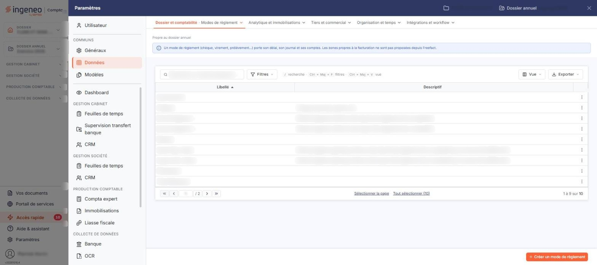

# Modes de règlement


**Où le trouver :** Panneau **Paramètres** › **Données** › **Dossier et comptabilité** › **Modes de règlement**



**En bref** — Cet écran définit les modes de règlement (chèque, virement, prélèvement…), avec leur délai, leur journal et leurs comptes, à associer ensuite aux clients et aux pièces.

* Pour créer un mode de règlement : bouton \[Créer un mode de règlement], renseignez ses rubriques, puis bouton \[Enregistrer].
* Pour supprimer un mode inutilisé : sélectionnez sa ligne, puis bouton \[Supprimer].


Cette option permet de définir les modes de règlement (chèque, virement, prélèvement, etc.), qui pourront ensuite être associés aux fiches clients et aux pièces commerciales.

<figure><figcaption>
Écran « Modes de règlement » de la nouvelle interface
</figcaption></figure>

Cet écran s'ouvre par le panneau « Paramètres » : rubrique « Données », groupe « Dossier et comptabilité », entrée « Modes de règlement ». Un bandeau d'information en haut de l'écran rappelle qu'un mode de règlement (chèque, virement, prélèvement…) porte son délai, son journal et ses comptes, et précise que les zones propres à la facturation ne sont pas proposées depuis Freefact ; depuis la Facturation, la fiche affiche ses quatre rubriques.

La liste présente deux colonnes : **Libellé** et **Descriptif**. Elle est triée par défaut sur le libellé, par ordre croissant, et vous pouvez trier sur l'une ou l'autre colonne en cliquant sur son en-tête. Le pied de liste indique la plage affichée et le nombre total de modes de règlement du dossier (par exemple « 1 à 9 sur 10 ») ; aucun filtre n'est appliqué au chargement de l'écran.

## Les modes de règlement techniques

Le fichier ne contient pas seulement les modes que vous saisissez : selon le paramétrage du dossier, il comporte aussi des modes de règlement **techniques**, employés par l'import des règlements de la comptabilité — par exemple « Import règl. compta » ou « Ecart de règlement + ». Leur descriptif l'indique, mais rien d'autre ne les distingue à l'écran des modes que vous avez créés : ni statut, ni couleur, ni libellé particulier. Avant de supprimer un mode de règlement, lisez donc son descriptif : supprimer un mode technique prive l'import des règlements de la comptabilité du mode qu'il utilise.

## Les commandes de la liste

Il n'y a pas de case à cocher : un clic sur une ligne la sélectionne, un second clic la désélectionne. Sous la liste, le lien « Sélectionner la page » sélectionne toutes les lignes affichées et le lien « Tout sélectionner (10) » étend la sélection à toutes les pages (le nombre entre parenthèses est celui des modes de la liste). Tant qu'une ligne est sélectionnée, un bandeau « 1 mode de règlement sélectionnée » avec le lien « Tout désélectionner » et les boutons \[Supprimer] et \[Exporter] remplace le bouton de création. Au survol d'une ligne, le pictogramme « Autres actions » (trois points verticaux) apparaît à droite de la ligne. Il ouvre deux entrées : « Modifier », qui ouvre la fiche du mode de règlement, et « Supprimer », qui le supprime ; ce menu est proposé sur toutes les lignes, y compris sur « Espèces » et sur les modes techniques.

Au-dessus de la liste, la barre « Rechercher un mode de règlement… » et les boutons \[Filtres], \[Vue] et \[Exporter] permettent de chercher un mode, de filtrer la liste, de personnaliser les colonnes et de l'imprimer ou de l'exporter.

Le menu \[Vue] vous permet de choisir les colonnes affichées : sous « Colonnes affichées », une case par colonne, le menu indiquant « 2 colonnes affichées sur 8 ». Outre les deux colonnes ci-dessus, la liste peut présenter six colonnes masquées par défaut — **Compte de règlement**, **Journal d'intégration**, **Modèle d'impression**, **Code « Facture élec. »**, **Libellé « Facture élec. »** et **Suite libellé «Facture élec. »**. Ses boutons sont le bouton **\[Rétablir les colonnes d'origine]** et le bouton **\[Appliquer]** ; la rubrique « Mes vues » porte le bouton \[Enregistrer la vue actuelle] et indique « Aucune vue enregistrée » tant que vous n'en avez pas enregistré.

Le menu \[Filtres], intitulé « Filtrer », permet de rechercher un mode de règlement sur les deux colonnes affichées, mais aussi sur des données qui ne figurent pas dans la liste : le compte de règlement, le journal d'intégration, le modèle d'impression et les informations de facture électronique. Il indique « Aucun critère. Choisissez une colonne pour commencer. » ; le lien « + Ajouter un critère sur… » propose les huit colonnes, et le menu se termine par les boutons \[Vider les filtres] et \[Filtrer].

bouton **\[Créer un mode de règlement]**

Il est en bas à droite de l'écran, hors de la liste, et ouvre une fiche vierge pour créer un mode de règlement.

bouton **\[Exporter]** (deux emplacements)

Le bouton \[Exporter] de la barre d'outils, au-dessus de la liste, ouvre un menu qui porte l'en-tête « La liste affichée » suivi du nombre de modes de règlement, puis les entrées « Aperçu édition HTML », « Imprimer », « Exporter en Excel », « Exporter en PDF » et « Envoyer la liste par e-mail » : il sert à éditer la liste, pas à copier des données.

bouton **\[Supprimer]**

Il se trouve dans le bandeau de sélection et supprime les modes de règlement sélectionnés dans la liste : vérifiez votre sélection avant de l'utiliser.

## La fiche d'un mode de règlement

La fiche comporte quatre rubriques, toutes affichées d'emblée, aussi bien en création qu'en modification. Aucun champ n'en fait apparaître ni disparaître un autre. La fiche se termine par le bouton **\[Enregistrer]**. Le bouton \[Retour] est masqué dans la fiche : le chevron « Retour », à gauche de la barre d'onglets du panneau, revient à la liste sans enregistrer les modifications en cours.

## Rubrique « Informations générales »

| Champ          | Ce qu'il faut savoir                                                                                               |
| -------------- | ------------------------------------------------------------------------------------------------------------------ |
| **Libellé**    | C'est le libellé qui apparaît dans la liste et dans les sélecteurs de mode de règlement.                           |
| **Descriptif** | Cette zone de texte accepte plusieurs lignes ; c'est elle qui vous permet d'indiquer l'usage du mode de règlement. |

## Rubrique « Facturation »

| Champ                                        | Ce qu'il faut savoir                                                                                                                                                                                                                                                     |
| -------------------------------------------- | ------------------------------------------------------------------------------------------------------------------------------------------------------------------------------------------------------------------------------------------------------------------------ |
| **Compte utilisé pour ce mode de règlement** | Saisissez le numéro du compte dans lequel les écritures de règlement seront générées pour ce mode de règlement, ou recherchez-le avec le pictogramme « Loupe ». L'intitulé du compte s'affiche à côté du numéro et n'est pas modifiable.                                 |
| **Journal d'intégration**                    | Choisissez dans la liste le journal dans lequel les écritures de règlement seront générées. Les journaux proposés sont ceux du dossier. Le pictogramme d'information rappelle qu'il s'agit du journal utilisé pour comptabiliser les règlements issus de la facturation. |

## Rubrique « Modèle d'impression »

**Indiquez le modèle d'impression de facture à appliquer pour ce mode de règlement** : facultatif. Les modèles proposés sont ceux paramétrés dans le dossier. Le modèle choisi ici sera proposé par défaut lors de la création d'une facture portant ce mode de règlement : pour les clients en prélèvement automatique, par exemple, vous pouvez ainsi affecter un modèle qui contient les informations spécifiques à ce type de paiement. Si un modèle d'impression de facture par défaut est également indiqué par ailleurs, c'est celui du mode de règlement qui s'applique en priorité.

## Rubrique « Facture électronique »

Le logiciel affiche en tête de cette rubrique le texte suivant : « Cette rubrique est présente pour une période de transition le temps de la généralisation de la facture électronique. La norme exige l'utilisation d'un fichier normé, il est donc nécessaire de mettre en relation les moyens de paiement actuels avec ce fichier. »

| Champ                                                 | Ce qu'il faut savoir                                                                                                               |
| ----------------------------------------------------- | ---------------------------------------------------------------------------------------------------------------------------------- |
| **Code mode de paiement « Facture électronique »**    | Saisissez le code du moyen de paiement normé correspondant à ce mode de règlement, ou recherchez-le avec le pictogramme « Loupe ». |
| **Libellé mode de paiement « Facture électronique »** | Ce libellé n'est pas modifiable.                                                                                                   |

La rubrique comporte enfin une troisième zone, multiligne et non modifiable elle aussi, qui complète le libellé du moyen de paiement. Elle n'a aucun libellé affiché à l'écran ; seuls les critères de la fenêtre des filtres et la personnalisation de colonnes la nomment, sous la forme « Suite libellé «Facture élec. » ».
