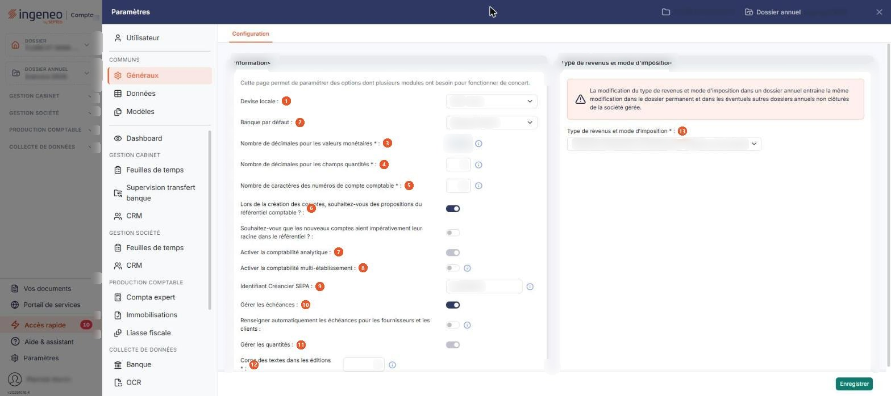

# Multimodules


**Où le trouver :** Panneau **Paramètres** › **Généraux** › **Configuration**



**En bref** — Cet écran règle les paramètres partagés par plusieurs modules (devise, décimales, longueur des comptes, analytique, échéances…) ; toute modification vaut aussi pour les autres modules.

* Pour modifier un paramètre commun : changez sa valeur dans la rubrique « Informations », puis bouton \[Enregistrer].


Cette page permet de paramétrer des options dont plusieurs modules ont besoin pour fonctionner de concert..

<figure><figcaption>
Écran « Multimodules » de la nouvelle interface
</figcaption></figure>

Cet écran s'ouvre par le panneau « Paramètres » : rubrique « Généraux », onglet « Configuration », seul onglet de la rubrique.

L'écran ne comporte ni liste ni bouton de retour : c'est un formulaire, en deux rubriques présentées sous forme de cartes côte à côte, « Informations » à gauche et « Type de revenus et mode d'imposition » à droite.

## Rubrique « Informations »

La carte s'ouvre sur la phrase « Cette page permet de paramétrer des options dont plusieurs modules ont besoin pour fonctionner de concert. » À l'écran, les champs se présentent dans cet ordre : Devise locale, Banque par défaut, Nombre de décimales pour les valeurs monétaires, Nombre de décimales pour les champs quantités, Nombre de caractères des numéros de compte comptable, les deux questions sur le référentiel comptable, Activer la comptabilité analytique, Activer la comptabilité multi-établissement, Identifiant Créancier SEPA, Gérer les échéances, Renseigner automatiquement les échéances pour les fournisseurs et les clients, Gérer les quantités et Corps des textes dans les éditions. Les paragraphes ci-dessous gardent l'ordre de la version précédente de la page.

| Champ                                                                                              | Ce qu'il faut savoir                                                                                                                                                                                                                                                                                                                                                                                                                                                                                                                                                                                                                                                                                                                                                                                          |
| -------------------------------------------------------------------------------------------------- | ------------------------------------------------------------------------------------------------------------------------------------------------------------------------------------------------------------------------------------------------------------------------------------------------------------------------------------------------------------------------------------------------------------------------------------------------------------------------------------------------------------------------------------------------------------------------------------------------------------------------------------------------------------------------------------------------------------------------------------------------------------------------------------------------------------- |
| 1. **Devise locale**                                                                               | La devise dans laquelle le dossier est tenu, à choisir dans la liste des devises.                                                                                                                                                                                                                                                                                                                                                                                                                                                                                                                                                                                                                                                                                                                             |
| 2. **Banque par défaut**                                                                           | La banque proposée par défaut, à choisir parmi les banques déclarées dans votre dossier.                                                                                                                                                                                                                                                                                                                                                                                                                                                                                                                                                                                                                                                                                                                      |
| 3. **Nombre de décimales pour les valeurs monétaires**                                             | Ce paramètre détermine avec combien de décimales sont saisies et affichées toutes les valeurs monétaires de tous vos modules. Il peut prendre les valeurs 0 à 4, mais **il n'est pas modifiable depuis cet écran** : pour le changer, prenez contact avec le service technique, comme l'indique l'infobulle du champ.                                                                                                                                                                                                                                                                                                                                                                                                                                                                                         |
| 4. **Nombre de décimales pour les champs quantités**                                               | Même principe pour tous les champs de quantité des pièces commerciales et des écritures comptables, de 0 à 4. Augmenter ce nombre ne demande aucun contrôle, les valeurs déjà saisies recevant simplement une décimale de plus ; en revanche vous ne pouvez pas le réduire si des données ont déjà été saisies en comptabilité ou en facturation. Comme le précédent, ce champ peut, selon le dossier, être présenté en teinte pâle : la frappe y reste alors sans effet.                                                                                                                                                                                                                                                                                                                                     |
| 5. **Nombre de caractères des numéros de compte comptable**                                        | C'est le nombre de caractères que comportent tous les comptes de votre plan comptable, et donc tous ceux utilisés en facturation pour le lien avec la comptabilité. Il doit être compris entre 6 et 12. Si vous l'augmentez, les numéros de comptes existants sont complétés par des zéros jusqu'à la longueur indiquée ; si vous le réduisez, le logiciel vérifie que les caractères qui seront retirés ne sont que des zéros, et refuse la modification dans le cas contraire. L'infobulle du champ précise que la modification est effectuée sur le dossier annuel en cours et sur les deux dossiers annuels précédents, afin de conserver les possibilités de comparaison. Comme les deux précédents, ce champ peut, selon le dossier, être présenté en teinte pâle : la frappe y reste alors sans effet. |
| 6. **Lors de la création des comptes, souhaitez-vous des propositions du référentiel comptable ?** | Interrupteur sans texte. Activé, un second interrupteur apparaît, **Souhaitez-vous que les nouveaux comptes aient impérativement leur racine dans le référentiel ?**, par lequel vous choisissez si la racine du référentiel est une proposition ou une obligation.                                                                                                                                                                                                                                                                                                                                                                                                                                                                                                                                           |
| 7. **Activer la comptabilité analytique**                                                          | Interrupteur sans texte. **Ce champ n'est pas toujours modifiable** : selon le dossier, l'interrupteur est présenté en teinte pâle et le cliquer reste sans effet, sans qu'aucun message ne l'explique. Si vous devez changer cette option et que l'interrupteur ne réagit pas, prenez contact avec le service technique.                                                                                                                                                                                                                                                                                                                                                                                                                                                                                     |
| 8. **Activer la comptabilité multi-établissement**                                                 | Interrupteur sans texte. En activant cette option, vous devrez affecter les écritures à un établissement. Les établissements se créent dans le module « Dossier permanent », menu « Social », option « Etablissements ».                                                                                                                                                                                                                                                                                                                                                                                                                                                                                                                                                                                      |
| 9. **Identifiant Créancier SEPA**                                                                  | Ce numéro est obligatoire pour générer des ordres de prélèvement SEPA pour les paiements de vos clients. Il est propre à chaque entreprise qui réalise des prélèvements ; si vous n'en avez pas encore, demandez-le à votre banque.                                                                                                                                                                                                                                                                                                                                                                                                                                                                                                                                                                           |
| 10. **Gérer les échéances**                                                                        | Interrupteur sans texte. Activé, un second interrupteur apparaît, **Renseigner automatiquement les échéances pour les fournisseurs et les clients**, qui renseigne l'échéance pour les comptes dont les échéances sont gérées. Activé à son tour, celui-ci fait apparaître deux listes, **Délai de règlement par défaut des fournisseurs** et **Délai de règlement par défaut des clients** : une phrase affichée au-dessus des deux listes en rappelle l'objet, « Pour les comptes dont les paramètres d'échéances ne sont pas définis, les paramètres ci-dessous s'appliquent ». Les deux listes proposent les délais de règlement déclarés dans votre dossier.                                                                                                                                             |
| 11. **Gérer les quantités**                                                                        | Interrupteur sans texte.                                                                                                                                                                                                                                                                                                                                                                                                                                                                                                                                                                                                                                                                                                                                                                                      |
| 12. **Corps des textes dans les éditions**                                                         | Ce paramètre détermine la taille d'affichage des textes standards dans les éditions ; sa valeur doit être comprise entre 8 et 18.                                                                                                                                                                                                                                                                                                                                                                                                                                                                                                                                                                                                                                                                             |

## Rubrique « Type de revenus et mode d'imposition »

La rubrique affiche d'abord un avertissement : la modification du type de revenus et mode d'imposition dans un dossier annuel entraîne la même modification dans le dossier permanent et dans les éventuels autres dossiers annuels non clôturés de la société gérée.

**Type de revenus et mode d'imposition** : obligatoire. Vous choisissez dans la liste le régime de la société gérée — bénéfices industriels et commerciaux à l'impôt sur le revenu ou à l'impôt sur les sociétés, bénéfices agricoles, bénéfices non commerciaux, revenus fonciers, non imposable, et ainsi de suite.

bouton **\[Enregistrer]**

Placé en bas à droite, il enregistre les paramètres de la page. C'est le seul bouton de l'écran : il n'y a pas de bouton de retour, fermez le panneau « Paramètres » (croix en haut à droite) ou choisissez un autre onglet si vous ne voulez rien enregistrer.
