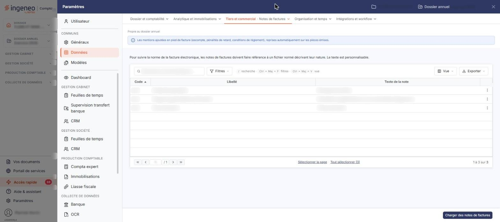

# Notes de factures


**Où le trouver :** Panneau **Paramètres** › **Données** › **Tiers et commercial** › **Notes de factures**



**En bref** — Cet écran tient la liste des notes de factures, commentaires portant sur une facture entière et rattachés au fichier normé de la facture électronique.

* Pour ajouter des notes au dossier : bouton \[Charger des notes de factures].
* Pour retirer une note : sélectionnez sa ligne, puis bouton \[Supprimer].


Cet écran s'ouvre depuis le panneau « Paramètres » : « Paramètres > Données > Tiers et commercial > Notes de factures ».

<figure><figcaption>
Écran « Notes de factures » de la nouvelle interface
</figcaption></figure>

Une note de facture est un commentaire qui porte sur la facture entière, et non sur l'une de ses lignes. Cette option vous permet de tenir la liste des notes dont vous disposez : vous les reprenez ensuite dans la rubrique « Notes de factures » d'une facture, où le logiciel les propose dès les premières lettres de leur code.

Le logiciel affiche au-dessus de la liste le rappel suivant : « Pour suivre la norme de la facture électronique, les notes de factures doivent faire référence à un fichier normé décrivant leur nature. Le texte est personnalisable. » Autrement dit, la nature d'une note est imposée par la norme, mais le texte que vous en donnez vous appartient.

## La liste des notes de factures

La liste présente trois colonnes : **Code**, **Libellé** et **Texte de la note**. Chacune des trois peut servir de critère de tri.

Au-dessus de la liste figurent une barre « Rechercher une note de facture… » et les boutons \[Filtres], \[Vue] et \[Exporter]. Tant que vous ne posez aucun critère, la totalité des notes de factures du dossier est affichée.

Tant qu'aucune note n'a été reprise dans le dossier, le logiciel affiche le message « Aucun élément à afficher. ». Le pied de la liste reste alors vide, sans pagination ni compteur du nombre d'éléments. Les notes de factures ne sont pas livrées d'office : un dossier peut n'en comporter aucune.

Sous la liste, les liens « Sélectionner la page » et « Tout sélectionner (n) » permettent de sélectionner toutes les lignes de la page ou de toutes les pages ; un clic sur une ligne la sélectionne, il n'y a plus de case à cocher. Le bouton \[Vue] personnalise les colonnes affichées et le bouton \[Exporter] donne accès à l'impression de la liste et à son envoi par e-mail.

Le menu « Autres actions » (trois points) de chaque ligne propose « Modifier », « Dupliquer » et « Supprimer ».

## Bouton \[Charger des notes de factures]

Cet écran ne comporte aucun bouton de création : vous ne créez pas une note de toutes pièces, puisque sa nature doit être celle du fichier normé de la facture électronique.

## Bouton \[Supprimer]

Il apparaît dans le bandeau de sélection, au bas de l'écran, dès qu'une note est sélectionnée par un clic sur sa ligne : le bandeau indique le nombre de notes sélectionnées (« 1 note de facture sélectionnée »), propose « Tout désélectionner » et remplace alors le bouton \[Charger des notes de factures].
