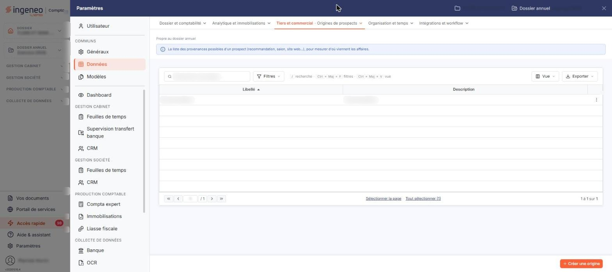

# Origines de prospects


**Où le trouver :** Panneau **Paramètres** › **Données** › **Tiers et commercial** › **Origines de prospects**



**En bref** — Cet écran tient la liste des origines de prospects, c'est-à-dire les moyens par lesquels un prospect vous a connu, proposés ensuite dans la fiche et la liste des prospects.

* Pour créer une origine : bouton \[Créer une origine], saisissez son libellé, puis bouton \[Enregistrer].


Cet écran s'ouvre depuis le panneau « Paramètres » : « Paramètres > Données > Tiers et commercial > Origines de prospects ».

<figure><figcaption>
Écran « Origines de prospects » de la nouvelle interface
</figcaption></figure>

Une origine de prospect indique par quel moyen un prospect vous a connu. Cette option vous permet de tenir la liste de ces moyens, afin de les retrouver partout où le logiciel vous parle de l'origine d'un prospect : le champ **Origine :** de la fiche du prospect, la colonne **Origine** de la liste des prospects, et le filtre **Origine** de cette même liste.

Une origine se résume à un libellé, éventuellement accompagné d'une description. Cet écran ne comporte pas de code : une origine est identifiée par son seul libellé.

## La liste des origines de prospects

La liste présente deux colonnes : **Libellé** et **Description**. Elle est triée par défaut sur le libellé, dans l'ordre croissant, et chacune des deux colonnes peut servir de critère de tri.

Au-dessus de la liste figurent une barre « Rechercher une origine… » et les boutons \[Filtres], \[Vue] et \[Exporter]. Tant que vous ne posez aucun critère, la totalité des origines dont vous disposez est affichée. Le pied de la liste indique le nombre d'origines affichées et le nombre total ; il porte également les commandes qui vous font passer à la première ou à la dernière page, à la page précédente ou suivante, ainsi qu'une zone où saisir directement un numéro de page.

Sous la liste, les liens « Sélectionner la page » et « Tout sélectionner (n) » permettent de sélectionner toutes les lignes de la page ou de toutes les pages ; un clic sur une ligne la sélectionne, il n'y a plus de case à cocher. Le bouton \[Vue] personnalise les colonnes affichées et le bouton \[Exporter] donne accès à l'impression de la liste.

En fin de ligne, le pictogramme « Autres actions » (trois points) ouvre un menu de deux commandes :

| Champ             | Ce qu'il faut savoir                 |
| ----------------- | ------------------------------------ |
| **« Modifier »**  | Elle ouvre la fiche de l'origine.    |
| **« Supprimer »** | Elle supprime l'origine de la ligne. |

## Bouton \[Créer une origine]

Placé en bas à droite de l'écran, il ouvre une fiche vierge pour créer une nouvelle origine de prospect.

## Bouton \[Supprimer]

Il apparaît dans le bandeau de sélection, au bas de l'écran, dès qu'une ligne est sélectionnée par un clic ; le bandeau remplace alors le bouton \[Créer une origine] et propose « Tout désélectionner ». Le bouton porte sur les origines sélectionnées.

## Rubrique « Informations générales »

La fiche d'une origine de prospect ne comporte que cette seule rubrique, avec deux champs :

| Champ           | Ce qu'il faut savoir                                                                                                                                                                           |
| --------------- | ---------------------------------------------------------------------------------------------------------------------------------------------------------------------------------------------- |
| **Libellé**     | C'est le nom sous lequel l'origine est proposée dans les fiches et les filtres des prospects. Si vous le laissez vide, le logiciel affiche le message « Le champ "Libellé" est obligatoire. ». |
| **Description** | Zone de texte libre sur plusieurs lignes, dans laquelle vous précisez à quoi cette origine correspond.                                                                                         |

## Bouton \[Enregistrer]

Il enregistre l'origine de prospect.

## Retour à la liste

Pour quitter la fiche sans enregistrer votre saisie et revenir à la liste des origines de prospects, utilisez le chevron « Retour », à gauche de la barre d'onglets du panneau « Paramètres ».
