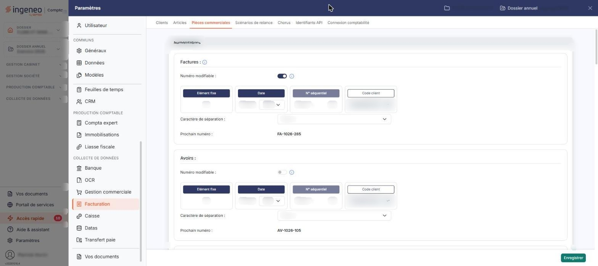
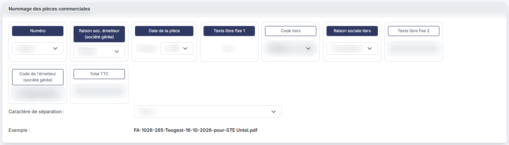
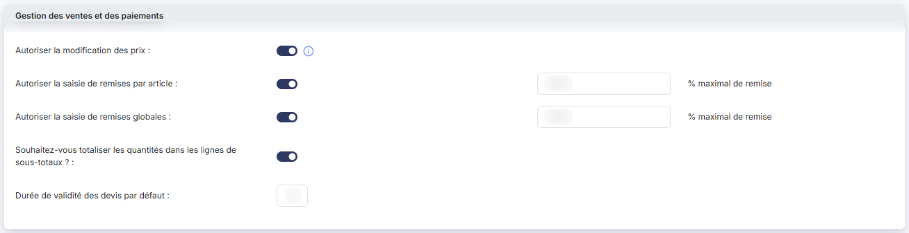
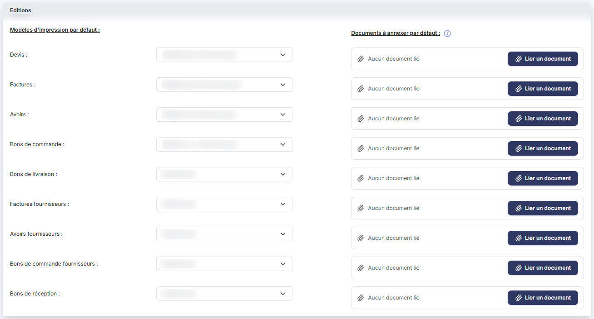
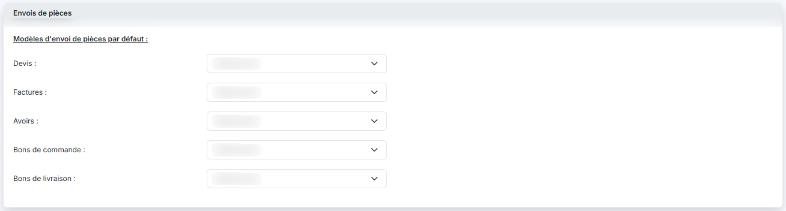

# Pièces commerciales


**Où le trouver :** Panneau **Paramètres** › **Facturation** › **Pièces commerciales**



**En bref** — Cet écran règle ce qui s'applique à toutes vos pièces commerciales : numérotation, nommage, droits de modification en saisie, modèles d'impression et d'envoi, archivage en GED.

* Pour modifier la numérotation d'un type de pièce : réglez ses éléments dans la rubrique « Numérotations », puis bouton \[Enregistrer].
* Pour joindre un document à un type de pièce : rubrique « Editions », bouton \[Lier un document] du type concerné, puis bouton \[Enregistrer].


Cet écran s'ouvre depuis le panneau « Paramètres » : « Paramètres > Facturation > Pièces commerciales ».

<figure><figcaption>
Écran « Pièces commerciales » de la nouvelle interface
</figcaption></figure>

Cette option rassemble les paramètres qui s'appliquent à toutes vos pièces commerciales : la façon dont elles sont numérotées et nommées, ce que vos utilisateurs sont autorisés à modifier lors de la saisie, les modèles d'impression et d'envoi proposés par défaut, et l'archivage en GED.

L'écran se présente en six rubriques, affichées dans cet ordre : « Numérotations », « Nommage des pièces commerciales », « Gestion des ventes et des paiements », « Editions », « Envois de pièces » et « Archivage des pièces ». Le bouton **\[Enregistrer]**, en bas à droite, valide l'ensemble : vos modifications ne sont acquises qu'après l'avoir actionné. La rubrique « Editions » porte en outre cinq bouton **\[Lier un document]**, un par type de pièce.

## Rubrique « Numérotations »

La rubrique présente un bloc de numérotation par type de pièce : **Factures**, **Avoirs**, **Devis**, **Bons de commande** et **Bons de livraison**. Chaque type se numérote donc indépendamment des autres.

Un numéro se compose de quatre éléments possibles, présentés en colonnes : **Elément fixe**, **Date**, **N° séquentiel** et **Code client**. Chaque élément se présente dans une petite carte : son en-tête, au-dessus du réglage, tient lieu de case à cocher (la case elle-même est masquée), et son propre réglage est au-dessous :

* **Elément fixe** : un texte de 14 caractères au maximum, que tous les numéros de ce type de pièce porteront à l'identique ;
* **Date** : la date de la pièce, ou une partie de celle-ci, selon le format choisi dans la liste **Format :** — seize formats sont proposés, de l'année seule (« AAAA ») au jour complet avec séparateurs (« JJ-MM-AAAA ») ;
* **N° séquentiel** : un nombre entier qui s'incrémente à chaque nouvelle pièce. La zone **Début :** est obligatoire et donne le point de départ, sur 6 chiffres au maximum ;
* **Code client** : les premiers caractères du code du client. La liste propose treize longueurs, de « 2 premiers car. » à « 14 premiers car. » ; elle n'offre pas de choix « Intégral », contrairement à celle de la rubrique « Nommage des pièces commerciales ».

Cliquez l'en-tête d'un élément pour l'incorporer au numéro : l'en-tête est rempli en bleu marine pour un élément incorporé, simplement cerclé pour un élément non incorporé. Un élément non incorporé ne disparaît pas de l'écran : son réglage s'affiche en grisé et n'est plus modifiable.

L'en-tête **N° séquentiel** est grisé sur tous les blocs : il reste coché et ne peut pas être décoché : tout numéro de pièce comporte obligatoirement un numéro séquentiel.

L'ordre des colonnes est l'ordre dans lequel les éléments composeront le numéro ; il n'est donc pas nécessairement le même d'un type de pièce à l'autre. Pour le changer, cliquez sur un libellé et déplacez-le à la souris. Tel qu'il vous est livré, cet ordre est **Elément fixe**, **Date**, **N° séquentiel**, **Code client** pour les factures, les avoirs et les devis, et **N° séquentiel**, **Date**, **Code client**, **Elément fixe** pour les bons de commande et les bons de livraison.

À droite de chaque bloc, trois réglages :

* **Numéro modifiable** : interrupteur sans texte (activé ou désactivé). Activé, la numérotation définie ici s'applique par défaut, mais reste modifiable dans la pièce ;
* **Caractère de séparation** : le caractère inséré entre les éléments du numéro. Sept choix sont proposés, dont « Aucun », « Tiret (-) » et « Souligné (\_) » ;
* **Prochain numéro** : zone affichée seule, que vous ne saisissez pas. Elle vous donne, au fur et à mesure de vos réglages, un aperçu du prochain numéro qui sera attribué.

Un pictogramme d'information, à droite du libellé **Factures**, rappelle deux points valables pour tous les blocs : la longueur totale d'un numéro de pièce ne peut pas dépasser 20 caractères, pour rester compatible avec la norme de la facture électronique.

## Rubrique « Nommage des pièces commerciales »

<figure><figcaption>
Rubrique « Nommage des pièces commerciales »
</figcaption></figure>

Cette rubrique commande le nom du fichier produit lorsqu'une pièce est éditée. Il se compose comme le numéro : un tableau de neuf éléments, chacun présenté dans une carte dont l'en-tête tient lieu de case à cocher (rempli en bleu marine : élément retenu ; simplement cerclé : élément non retenu), dans lequel vous retenez ceux que le nom doit porter.

Les neuf éléments sont, dans leur ordre d'affichage : **Numéro**, **Raison soc. émetteur (société gérée)**, **Date de la pièce**, **Texte libre fixe 1**, **Code tiers**, **Raison sociale tiers**, **Texte libre fixe 2**, **Code de l'émetteur (société gérée)** et **Total TTC**. Les deux textes libres acceptent 15 caractères au maximum et vous permettent d'intercaler vos propres mentions.

Selon l'élément, le réglage placé sous le libellé est un choix de longueur — **Intégral**, **5 caractères** ou **10 caractères** —, un format de date — la liste n'en propose ici que huit, là où la rubrique « Numérotations » en offre seize —, ou une zone de saisie. Deux éléments n'ont aucun réglage à saisir : **Code de l'émetteur (société gérée)** affiche le code de votre société, que vous ne modifiez pas ici, et **Total TTC** ne présente qu'une zone vide. Comme dans la rubrique précédente, un élément décoché reste affiché mais n'est plus modifiable.

À droite du tableau :

* **Caractère de séparation** : quatre choix seulement ici — « Aucun », « Espace », « Tiret (-) » et « Point » —, là où la rubrique « Numérotations » en propose sept ;
* **Exemple** : zone affichée seule, qui vous montre le nom de fichier obtenu avec vos réglages. Elle se recalcule immédiatement à chaque modification du tableau, avant tout enregistrement. Son pictogramme d'information précise que la nature de la pièce, présente dans le nom, prendra l'une des valeurs « Fact », « Avoir », « BL », « BR », « BDC » ou « Devis ».

## Rubrique « Gestion des ventes et des paiements »

<figure><figcaption>
Rubrique « Gestion des ventes et des paiements »
</figcaption></figure>

| Champ                                             | Ce qu'il faut savoir                                                                                                                                                                            |
| ------------------------------------------------- | ----------------------------------------------------------------------------------------------------------------------------------------------------------------------------------------------- |
| 1. **Autoriser la modification des prix**         | Interrupteur sans texte. Activé, le prix unitaire reste modifiable lors de la saisie d'articles dans une pièce commerciale.                                                                     |
| 2. **Autoriser la saisie de remises par article** | Interrupteur sans texte, suivi d'une zone **% maximal de remise**. Activé, vos utilisateurs peuvent affecter un taux de remise à chaque ligne d'article, dans la limite du pourcentage indiqué. |
| 3. **Autoriser la saisie de remises globales**    | Interrupteur sans texte, suivi d'une zone **% maximal de remise**. Activé, une remise peut être affectée à la pièce entière, dans la limite du pourcentage indiqué.                             |


Attention : désactiver l'un de ces deux interrupteurs vide immédiatement le pourcentage maximal qui lui est associé et rend cette zone inutilisable, sans afficher de message. Si vous enregistrez dans cet état puis le réactivez, le plafond devra être ressaisi.


| Champ                                                                          | Ce qu'il faut savoir                                                                                                                                                 |
| ------------------------------------------------------------------------------ | -------------------------------------------------------------------------------------------------------------------------------------------------------------------- |
| 4. **Souhaitez-vous totaliser les quantités dans les lignes de sous-totaux ?** | Interrupteur sans texte. Activé, les lignes de sous-total que vous placez dans une pièce totalisent aussi les quantités des articles, et non seulement les montants. |
| 5. **Durée de validité des devis par défaut**                                  | Zone de saisie, exprimée en jours.                                                                                                                                   |

## Rubrique « Editions »

<figure><figcaption>
Rubrique « Editions »
</figcaption></figure>

Cette rubrique évite d'avoir à choisir un modèle d'impression sur chaque pièce créée : vous désignez ici celui qui s'appliquera par défaut. Il reste modifiable dans chaque pièce commerciale.

La rubrique présente deux colonnes de réglages, **Modèles d'impression par défaut :** et **Documents à annexer par défaut :**, et cinq lignes : **Devis**, **Factures**, **Avoirs**, **Bons de commande** et **Bons de livraison**. Depuis la Facturation, seules ces cinq pièces de vente y sont proposées.

Sur chaque ligne, la liste déroulante propose les modèles d'impression du type de pièce concerné, et l'entrée « Sélectionnez » lorsque vous ne voulez pas en imposer. Si aucun modèle n'a été créé pour un type de pièce, la liste ne propose que cette entrée.

Le document à annexer, lui, est un fichier au format PDF, joint à la suite de la pièce lors de son édition : des conditions générales de vente, par exemple. Il peut être différent pour chaque type de pièce. À droite de chaque liste, une zone « document » affiche un trombone et « Aucun document lié » tant que rien n'est annexé, puis le nom du document retenu ; elle porte un bouton **\[Lier un document]** pour le désigner et un bouton à pictogramme dont l'infobulle est « Retirer ce document », qui n'apparaît que lorsqu'un document est annexé.

## Rubrique « Envois de pièces »

<figure><figcaption>
Rubrique « Envois de pièces »
</figcaption></figure>

Sous l'intitulé **Modèles d'envoi de pièces par défaut :**, cette rubrique désigne, pour les mêmes cinq types de pièce, le modèle d'e-mail proposé par défaut au moment de l'envoi.

Les cinq listes offrent le même jeu d'entrées : la totalité de vos modèles d'e-mails, sans distinction du type de pièce, plus l'entrée « Sélectionnez » lorsque vous ne voulez pas en imposer. Ces modèles se créent dans la rubrique « Modèles » du panneau « Paramètres », onglet « E-mails ».

## Rubrique « Archivage des pièces »

<figure><figcaption>
Rubrique « Archivage des pièces »
</figcaption></figure>

**Souhaitez-vous archiver dans la GED les factures validées ?** : interrupteur sans texte. Activé, chaque pièce validée est automatiquement classée dans la GED.

## Bouton \[Enregistrer]

Il enregistre l'ensemble des six rubriques. Cette option ne comporte pas de bouton de retour ; les seuls autres boutons de l'écran sont les cinq bouton **\[Lier un document]** de la rubrique « Editions ».
