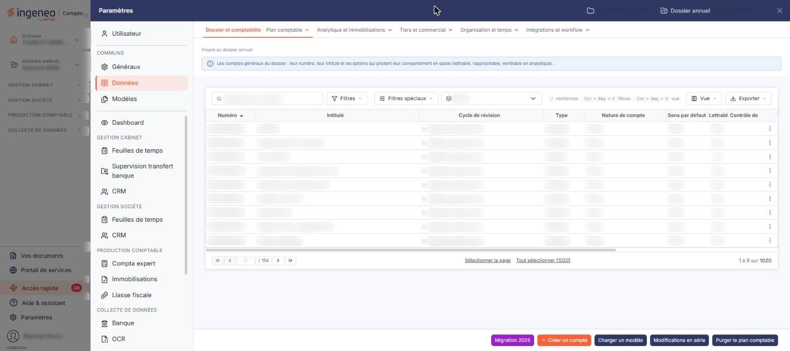

# Plan comptable


**Où le trouver :** Panneau **Paramètres** › **Données** › **Dossier et comptabilité** › **Plan comptable**



**En bref** — Cet écran administre les comptes généraux du plan comptable du dossier annuel ouvert, commun à plusieurs modules.

* Pour créer un compte : bouton \[Créer un compte], renseignez la fiche, puis bouton \[Enregistrer].
* Pour ne voir que les comptes utilisés : bouton \[Filtres spéciaux], puis « Mouvementés ».


Cette option permet d'administrer les comptes généraux du plan comptable du dossier annuel ouvert. Cet écran s'ouvre par le panneau « Paramètres » : rubrique « Données », puis onglet « Dossier et comptabilité » et, dans son menu déroulant, entrée « Plan comptable ». Un bandeau bleu en haut de l'écran, sous la mention « Propre au dossier annuel », rappelle qu'il s'agit des comptes généraux du dossier.

<figure><figcaption>
Écran « Plan comptable » de la nouvelle interface
</figcaption></figure>

Le plan comptable est commun à plusieurs modules, et la fiche d'un compte ne présente pas les mêmes rubriques partout : depuis la Facturation, quatre rubriques réservées à la saisie comptable (« Propriétés », « Accélérateur de saisie », « Gestion analytique » et « Échéances ») ne sont pas affichées. Les paramètres correspondants existent toujours, mais ils se règlent depuis les modules de comptabilité.

## La liste des comptes

Au-dessus de la liste, la barre « Rechercher un compte… » (qui remplace le champ **N° de compte**), les boutons \[Filtres] et \[Filtres spéciaux] et un sélecteur « Cycle » permettent de restreindre l'affichage. Le bouton \[Filtres spéciaux] ouvre un menu « Comptes » qui propose trois présentations : « Tous », retenue au chargement, « Mouvementés » ou « Non mouvementés ». Le sélecteur « Cycle » propose les cycles de révision ; son choix neutre porte le nom de la colonne, « Cycle ». Le bouton \[Filtres] ouvre un menu « Filtrer » : le lien « + Ajouter un critère sur… » permet de choisir une colonne, puis le bouton **\[Vider les filtres]** retire les critères et le bouton **\[Filtrer]** les applique. Tant que vous n'avez rien filtré, le compteur du pied de liste (« 1 à 9 sur 1020 » et « Tout sélectionner (1020) » sur ce dossier) porte sur l'ensemble des comptes généraux du dossier, tous cycles confondus, mouvementés ou non.

La liste présente quinze colonnes : le numéro et l'intitulé du compte, son cycle de révision, son type et sa nature, puis ses propriétés comptables et ses soldes des deux exercices précédents. Elle s'ouvre triée par numéro croissant, et toutes les colonnes sont triables sauf la dernière, **Ecart n-1 vs n-2**, qui est calculée. La grille est plus large que l'écran : utilisez le défilement horizontal pour atteindre les dernières colonnes.

Un clic sur une ligne la sélectionne ; sous la liste, les boutons \[Sélectionner la page] et \[Tout sélectionner (n)] sélectionnent les lignes. Au survol, le pictogramme « Autres actions » (trois points), en fin de ligne, ouvre un menu de trois entrées : « Modifier », « Dupliquer » et « Supprimer ». Dès qu'une ligne est sélectionnée, un bandeau de sélection (« 1 compte sélectionné », « Tout désélectionner ») remplace la barre du bas et porte les boutons \[Supprimer], \[Modifications en série], \[Réaffectation] et \[Auxiliariser]. Le bouton \[Vue] ouvre un menu « Mes vues » et « Colonnes affichées » (15 colonnes affichées sur 44), avec les boutons \[Rétablir les colonnes d'origine] et \[Appliquer] ; le bouton \[Exporter] ouvre le menu d'aperçu, d'impression et d'export de la liste.

Le menu \[Filtres] propose bien plus de critères que la liste n'a de colonnes : toutes les propriétés du compte y figurent, y compris celles que la fiche ne vous montre pas depuis la Facturation — code et taux de TVA, gestion des échéances, gestion des quantités, dates et auteurs de création et de modification, observations, etc. Vous pouvez donc rechercher un compte sur une information qui n'est affichée nulle part ailleurs dans cet écran.

bouton **\[Créer un compte]**

Placé en bas à droite de l'écran, hors de la liste, il ouvre une fiche vierge pour créer un compte général.

bouton **\[Supprimer]**

Il se trouve dans le bandeau de sélection et porte sur les comptes sélectionnés dans la liste.

**Les traitements du bas de la liste**

Six autres boutons complètent le bas de l’écran : le bouton **\[Migration 2025]**, le bouton **\[Charger un modèle]**, le bouton **\[Importer]**, le bouton **\[Exporter]** (à ne pas confondre avec le menu \[Exporter] de la barre d'outils de la liste), le bouton **\[Modifications en série]** et le bouton **\[Purger le plan comptable]**. Le bouton **\[Réaffectation]** et le bouton **\[Auxiliariser]** se trouvent, eux, dans le bandeau de sélection, avec \[Supprimer] et \[Modifications en série]. Ce sont des traitements de masse : ils portent sur l’ensemble du plan comptable du dossier, et non sur les seuls comptes cochés.

## La fiche d'un compte

La fiche se présente en cartes. Un bandeau en tête de fiche rappelle le numéro et l'intitulé du compte, puis son type, sa nature, son cycle de révision et la date et l'auteur de la création ou de la dernière modification (« créé le … par … », « modifié le … par … ») ; il porte à droite les pastilles « Compte utilisable » et « Solde », et affiche « Nouveau compte » en création. Deux boutons fléchés au-dessus de la fiche, « Compte précédent » (Ctrl + ↑) et « Compte suivant » (Ctrl + ↓), passent au compte voisin dans la liste. La fiche se termine par le bouton **\[Enregistrer]**. Pour revenir à la liste, utilisez le chevron « Retour » à gauche de la barre d'onglets du panneau ; si la fiche a été modifiée, une fenêtre « Modifications non enregistrées » propose les boutons \[Continuer sans enregistrer] et \[Enregistrer et quitter]. Les rubriques qu'elle présente dépendent du type du compte, et du fait que vous le créiez ou que vous le modifiiez :

* en **création**, la fiche présente trois rubriques : « Informations générales », « TVA » et « Options du compte », cette dernière limitée à la sous-rubrique « Quantités » ; la rubrique « Soldes » et les options de devises n'apparaissent qu'en modification ;
* en **modification**, sur un compte **standard**, la fiche présente quatre rubriques : « Informations générales », « TVA », « Options du compte » et « Soldes » ;
* sur un compte **collectif**, celui des comptes clients par exemple, la fiche se réduit à la seule rubrique « Informations générales » : ne cherchez donc ni les propriétés de TVA, ni les devises, ni les soldes sur la fiche d'un compte collectif, elles n'y sont pas affichées.

## Rubrique « Informations générales »

| Champ              | Ce qu'il faut savoir                                                                                                                                                                                                        |
| ------------------ | --------------------------------------------------------------------------------------------------------------------------------------------------------------------------------------------------------------------------- |
| **Numéro**         | Non modifiable après création du compte. Le pictogramme d'information rappelle les règles de saisie : les caractères autorisés sont les lettres majuscules et les chiffres, et le numéro doit commencer par trois chiffres. |
| **Intitulé**       | Il est modifiable à tout moment.                                                                                                                                                                                            |
| **Intitulé 2**     | —                                                                                                                                                                                                                           |
| **Type de compte** | Un compte est standard ou collectif. En modification, le type s'affiche en lecture seule.                                                                                                                                   |
| **Nature**         | Non modifiable. Le logiciel l'affiche pour contrôle.                                                                                                                                                                        |
| **Observations**   | Zone de texte libre.                                                                                                                                                                                                        |

La date et l'auteur de la création ou de la dernière modification ne sont plus des champs de la rubrique : ils figurent dans le bandeau d'en-tête (« créé le … par … » sur un compte jamais modifié, « modifié le … par … » sur un compte modifié). En création, le bandeau porte « Nouveau compte ». À la création, une loupe à droite du numéro (raccourci Ctrl + Alt + R) permet de rechercher le compte dans le référentiel comptable ; la zone grisée « Description du référentiel » figure alors sous « Nature ».

## Rubrique « TVA »

La rubrique ne présente d'abord que deux champs :

* **Régime de TVA** : non modifiable. Son pictogramme d'information vous indique où le changer : dans le menu « Paramètres », option « Paramètres généraux », rubrique « Régime de TVA ». C'est un paramètre du dossier, pas du compte.
* **Soumis à la TVA** : interrupteur, désactivé sur les comptes ouverts ; la carte porte en haut à droite une étiquette d'état (« Non soumis »).

## Rubrique « Options du compte »

Sur un compte enregistré, la rubrique réunit les devises et les quantités. Elle débute par l'interrupteur **Autoriser la saisie en devises**. Vient ensuite l'interrupteur **Gérer les quantités pour ce compte**, avec deux sélecteurs, **Unité 1** et **Unité 2**, pour les quantités saisissables par ligne d'écriture. À la création, la rubrique ne montre que la sous-rubrique « Quantités », avec ces deux sélecteurs.

## Rubrique « Soldes »

Cette rubrique est en lecture seule : elle se présente sous la forme d'un tableau d'une ligne par exercice (« Exercice en cours (N) », « Exercice N−1 » et « Exercice N−2 »), avec les colonnes **Exercice**, **Solde**, **Écart** et **Mouvementé**. Le solde de l'exercice en cours se lit aussi dans la pastille « Solde » du bandeau d'en-tête.
