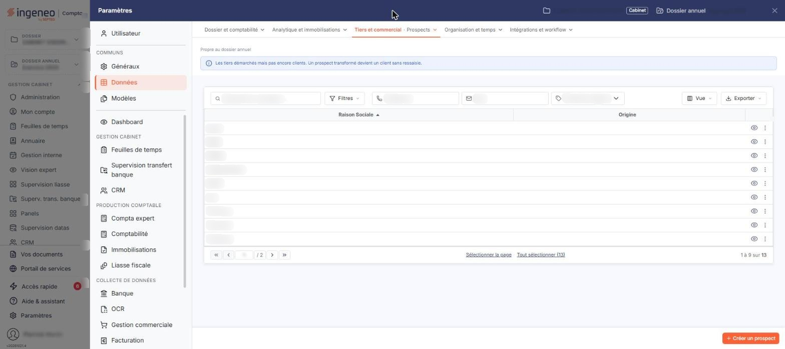
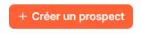
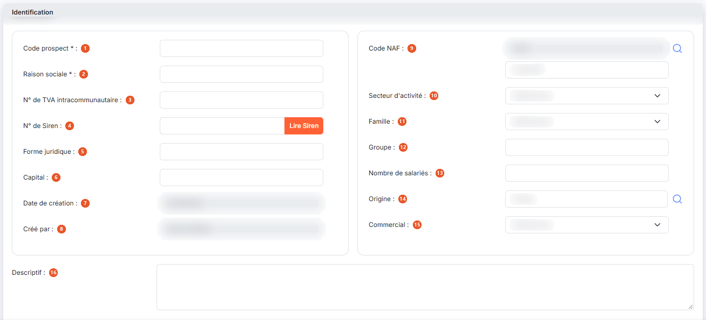
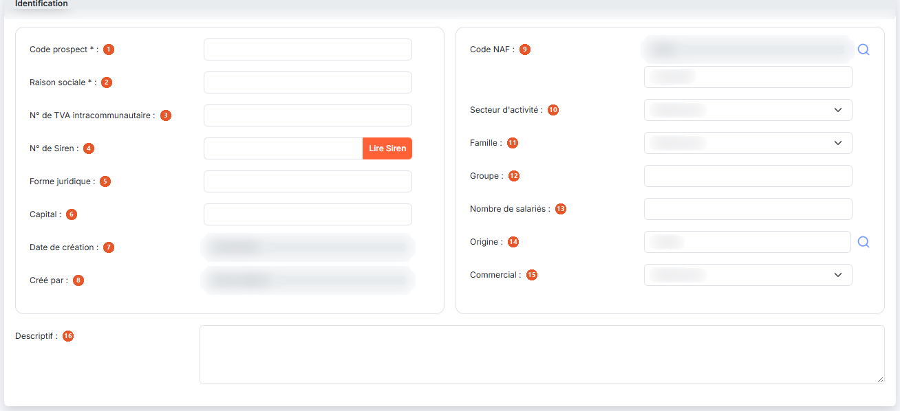
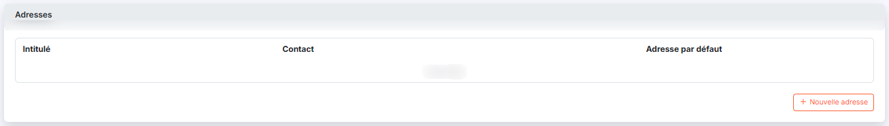
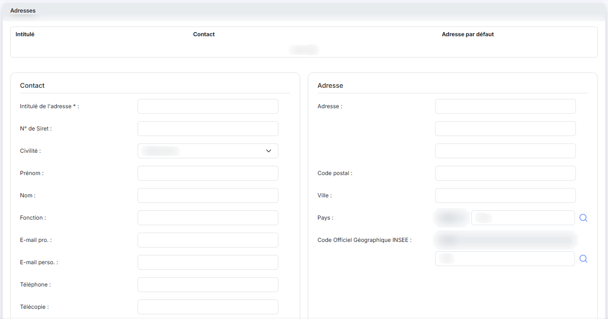
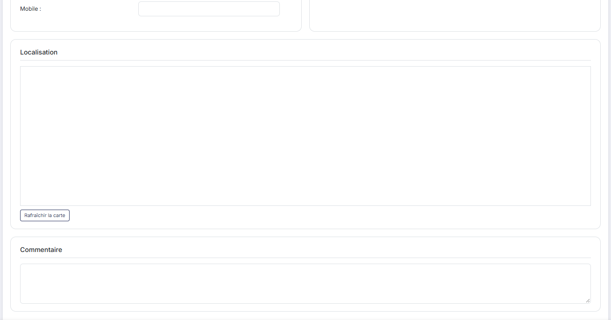
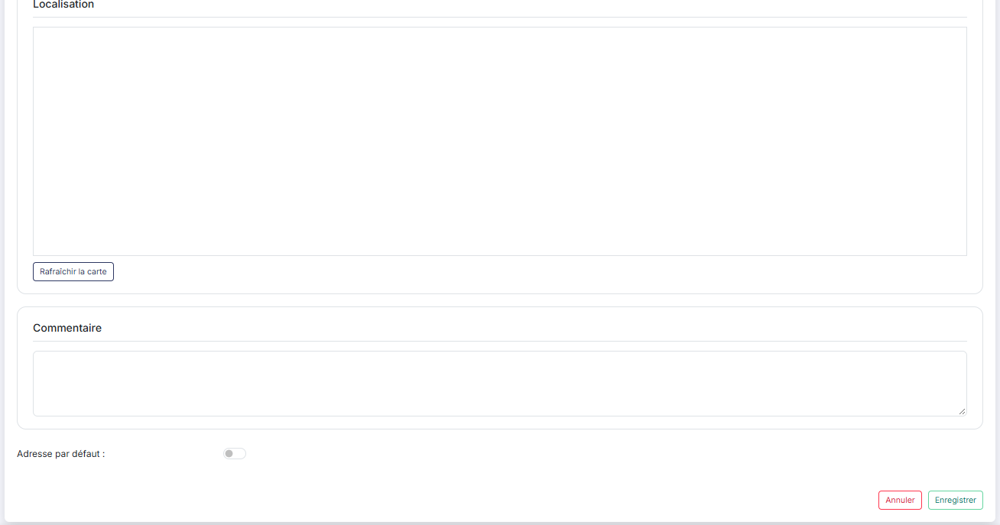
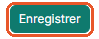

# Prospects


**Où le trouver :** Panneau **Paramètres** › **Données** › **Tiers et commercial** › **Prospects**



**En bref** — Cet écran tient le fichier des prospects, tiers auxquels vous n'avez encore rien facturé. Un prospect devient client lorsque son devis est transformé en facture.

* Pour créer un prospect : bouton \[Créer un prospect], renseignez sa fiche (bouton \[Lire Siren] pour reprendre ses informations légales), puis bouton \[Enregistrer].


Le fichier « Prospects » recense les tiers auxquels vous n'avez encore rien facturé. Il est commun à plusieurs modules d'Ingeneo Compta : où que vous ayez créé ou modifié un prospect, il sera visible de la même manière dans tous les modules.

<figure><figcaption>
Écran « Prospects » de la nouvelle interface
</figcaption></figure>

Dans le panneau Paramètres, cet écran se trouve dans la rubrique « Données », onglet « Tiers et commercial », entrée « Prospects ».

## La liste des prospects

La liste présente deux colonnes : **Raison Sociale** et **Origine**. Elle est triée par défaut sur la raison sociale, dans l'ordre croissant, et les deux colonnes peuvent servir de critère de tri. Il n'y a pas de colonne de statut.

Lorsqu'aucun prospect n'a encore été créé, le logiciel affiche le message « Aucun élément à afficher. » et le pied de la liste ne présente ni pagination ni compteur.

Un clic sur une ligne la sélectionne. Au survol, la ligne porte en fin de ligne un pictogramme « Autres actions » (trois points), qui ouvre un menu de deux entrées : « Modifier » ouvre la fiche du prospect en modification et « Supprimer » le supprime. Sous la liste, « Sélectionner la page » et « Tout sélectionner (N) » permettent d'étendre la sélection ; à droite au-dessus de la liste, le bouton \[Vue] ouvre le menu des vues et des colonnes affichées et le bouton \[Exporter] le menu d'édition de la liste.

## Les filtres de la liste

Quatre critères sont proposés au-dessus de la liste, sur une même ligne, avec le bouton \[Filtres] qui ouvre le volet de filtres :

| Champ                       | Ce qu'il faut savoir                                                                                                                                                                                                                                     |
| --------------------------- | -------------------------------------------------------------------------------------------------------------------------------------------------------------------------------------------------------------------------------------------------------- |
| **Rechercher un prospect…** | Barre de recherche, pour retrouver un prospect.                                                                                                                                                                                                          |
| **Téléphone**               | Zone de saisie.                                                                                                                                                                                                                                          |
| **Mail**                    | Zone de saisie.                                                                                                                                                                                                                                          |
| **Origine**                 | Liste déroulante alimentée par le panneau Paramètres, rubrique « Données », onglet « Tiers et commercial », entrée « Origines de prospects ». Elle est positionnée sur « Toutes les origines » au chargement de l'écran, ce qui n'exclut aucun prospect. |

Il n'y a plus de bouton \[Afficher] : la liste se recharge dès que vous modifiez un critère. Lorsqu'un critère est posé, le lien « Tout effacer » apparaît à côté de \[Filtres] et les remet à leur valeur d'origine.

## Bouton \[Créer un prospect]

<figure><figcaption>
Bouton [Créer un prospect]
</figcaption></figure>

Placé en bas à droite de l'écran, il ouvre une fiche vierge pour créer un nouveau prospect.

## Bouton \[Supprimer]

Dès qu'une ligne est sélectionnée, un bandeau de sélection (« 1 prospect sélectionné · toutes les pages », « Tout désélectionner ») remplace la barre du bas et porte le bouton \[Supprimer], qui supprime tous les prospects sélectionnés. Une ligne peut aussi être supprimée seule par l'entrée « Supprimer » du menu « Autres actions » de la ligne.

## Rubrique « Identification »

<figure><figcaption>
Rubrique « Identification »
</figcaption></figure>

<figure><figcaption>
Rubrique « Identification »
</figcaption></figure>

Les champs sont répartis sur deux colonnes ; ils sont présentés ci-dessous colonne par colonne, celle de gauche d'abord, puis celle de droite, le **Descriptif** occupant toute la largeur sous les deux colonnes.

| Champ                               | Ce qu'il faut savoir                                                                                                                                                                                                                                                                                       |
| ----------------------------------- | ---------------------------------------------------------------------------------------------------------------------------------------------------------------------------------------------------------------------------------------------------------------------------------------------------------- |
| 1. **Code prospect**                | —                                                                                                                                                                                                                                                                                                          |
| 2. **Raison sociale**               | —                                                                                                                                                                                                                                                                                                          |
| 3. **N° de TVA intracommunautaire** | —                                                                                                                                                                                                                                                                                                          |
| 4. **N° de Siren**                  | —                                                                                                                                                                                                                                                                                                          |
| 5. **Forme juridique**              | —                                                                                                                                                                                                                                                                                                          |
| 6. **Capital**                      | —                                                                                                                                                                                                                                                                                                          |
| 7. **Date de création**             | Renseignée automatiquement au jour de la création et non modifiable.                                                                                                                                                                                                                                       |
| 8. **Créé par**                     | Renseigné automatiquement avec le nom de l'utilisateur qui crée la fiche et non modifiable.                                                                                                                                                                                                                |
| 9. **Code NAF**                     | Ce champ est double : le code, qui n'est pas saisissable directement, et le libellé, accompagné d'une loupe de recherche.                                                                                                                                                                                  |
| 10. **Secteur d'activité**          | La liste est alimentée par le panneau Paramètres, rubrique « Données », onglet « Tiers et commercial », entrée « Secteurs d'activité ».                                                                                                                                                                    |
| 11. **Famille**                     | La liste est alimentée par le panneau Paramètres, rubrique « Données », onglet « Tiers et commercial », entrée « Familles de clients ».                                                                                                                                                                    |
| 12. **Groupe**                      | Zone de saisie libre.                                                                                                                                                                                                                                                                                      |
| 13. **Nombre de salariés**          | —                                                                                                                                                                                                                                                                                                          |
| 14. **Origine**                     | Zone de saisie accompagnée d'une loupe de recherche, qui vous propose les origines créées dans le panneau Paramètres, rubrique « Données », onglet « Tiers et commercial », entrée « Origines de prospects ». Notez que, dans les filtres de la liste, la même notion est servie par une liste déroulante. |
| 15. **Commercial**                  | La liste propose les intervenants du cabinet.                                                                                                                                                                                                                                                              |
| 16. **Descriptif**                  | Zone de texte.                                                                                                                                                                                                                                                                                             |
| **Bouton \[Lire Siren]**            | Il est accolé au champ du numéro de Siren.                                                                                                                                                                                                                                                                 |

Cette rubrique ne comporte aucune infobulle d'information.

## Rubrique « Adresses »

<figure><figcaption>
Rubrique « Adresses »
</figcaption></figure>

<figure><figcaption>
Rubrique « Adresses »
</figcaption></figure>

<figure><figcaption>
Rubrique « Adresses »
</figcaption></figure>

<figure><figcaption>
Rubrique « Adresses »
</figcaption></figure>

La rubrique présente une liste à trois colonnes — **Intitulé**, **Contact** et **Adresse par défaut** — et un bouton **\[Nouvelle adresse]** (son libellé est précédé d'un « + »). Tant qu'aucune adresse n'a été saisie, la liste affiche « Liste vide ».

Le bouton \[Nouvelle adresse] déplie la saisie d'une adresse **sous la liste** : ce n'est pas une fenêtre, et le bouton \[Nouvelle adresse] disparaît pendant la saisie. Seul l'**Intitulé de l'adresse** est obligatoire ; vous disposez ensuite d'un commentaire, du numéro de Siret, des coordonnées du contact (civilité, prénom, nom, fonction, adresses de messagerie professionnelle et personnelle, téléphone, télécopie, mobile), de l'adresse postale, du pays, du code officiel géographique de l'INSEE et du champ **Adresse par défaut**. Contrairement à la fiche d'un client, la saisie d'une adresse de prospect ne comporte pas de type d'adresse.

La saisie se termine par le bouton **\[Enregistrer]** ou par le bouton **\[Annuler]** ; le bouton **\[Rafraîchir la carte]** met à jour la carte affichée à partir de l'adresse saisie.

Lorsque vous indiquez qu'une adresse est l'adresse par défaut, c'est elle qui sera affectée lors de la création de tout nouveau devis.

## Bouton \[Enregistrer]

<figure><figcaption>
Bouton [Enregistrer]
</figcaption></figure>

Il enregistre la fiche du prospect.

## Retour à la liste

Le bouton \[Retour] n'est plus affiché dans la fiche : le chevron « Retour », à gauche de la barre d'onglets du panneau Paramètres, vous ramène à la liste des prospects sans enregistrer la fiche en cours.
