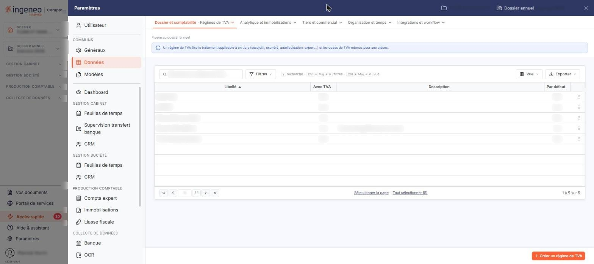

# Régimes de TVA


**Où le trouver :** Panneau **Paramètres** › **Données** › **Dossier et comptabilité** › **Régimes de TVA**



**En bref** — Cet écran tient les régimes de TVA, affectés aux clients et aux pièces, qui fixent le traitement de la TVA d'un tiers (assujetti, exonéré, autoliquidation, export…).

* Pour créer un régime : bouton \[Créer un régime de TVA], renseignez la fiche, puis bouton \[Enregistrer].
* Pour supprimer un régime inutilisé : sélectionnez sa ligne, puis bouton \[Supprimer].


Les régimes de TVA s'affectent aux clients et aux pièces commerciales et permettent de gérer les différents cas de facturation, en local comme à l'export.

<figure><figcaption>
Écran « Régimes de TVA » de la nouvelle interface
</figcaption></figure>

Cet écran s'ouvre par le panneau « Paramètres » : rubrique « Données », groupe « Dossier et comptabilité », entrée « Régimes de TVA ». Un bandeau d'information en haut de l'écran rappelle qu'un régime de TVA fixe le traitement applicable à un tiers (assujetti, exonéré, autoliquidation, export…) et les codes de TVA retenus pour ses pièces.

L'écran présente la liste des régimes de TVA du dossier, une ligne par régime. Les colonnes affichées sont, dans l'ordre : **Libellé**, **Avec TVA**, **Description** et **Par défaut** ; les colonnes « Avec TVA » et « Par défaut » affichent « Oui » ou « Non ». Les quatre colonnes sont triables ; la liste est triée par défaut sur le libellé, par ordre croissant.

Au-dessus de la liste, la barre « Rechercher un régime de TVA… » et les boutons \[Filtres], \[Vue] et \[Exporter] permettent de chercher un régime, de filtrer la liste, de personnaliser les colonnes et de l'imprimer ou de l'exporter.

Il n'y a pas de case à cocher : un clic sur une ligne la sélectionne, un second clic la désélectionne. Sous la liste, le lien « Sélectionner la page » sélectionne toutes les lignes affichées et le lien « Tout sélectionner (5) » étend la sélection à toutes les pages (le nombre entre parenthèses est celui des régimes de la liste). Tant qu'une ligne est sélectionnée, un bandeau « 1 régime de TVA sélectionnée » avec le lien « Tout désélectionner » et le bouton \[Supprimer] remplace le bouton de création. Au survol d'une ligne, le pictogramme « Autres actions » (trois points verticaux) apparaît à droite de la ligne. Il ouvre deux entrées : « Modifier » ouvre la fiche du régime et « Supprimer » le supprime ; il n'y a pas d'entrée « Dupliquer » sur cet écran.

bouton **\[Créer un régime de TVA]**

Il est en bas à droite de l'écran, hors de la liste, et ouvre une fiche vierge pour créer un nouveau régime de TVA.

bouton **\[Supprimer]**

Il se trouve dans le bandeau de sélection, qui apparaît dès qu'au moins un régime est sélectionné dans la liste.

## Rubrique « Informations générales »

| Champ                                    | Ce qu'il faut savoir                                                                                                                                                                                                                                                                                                                     |
| ---------------------------------------- | ---------------------------------------------------------------------------------------------------------------------------------------------------------------------------------------------------------------------------------------------------------------------------------------------------------------------------------------- |
| **Libellé**                              | Il est saisissable à la création, puis n'est plus modifiable ensuite. C'est ce libellé qui est utilisé dans les listes de choix, pour affecter un régime de TVA à un client ou à une pièce commerciale.                                                                                                                                  |
| **Description**                          | Facultative. Elle se saisit sur plusieurs lignes et se retrouve dans la colonne « Description » de la liste.                                                                                                                                                                                                                             |
| **Type de régime**                       | Deux boutons de choix vous sont proposés, « Avec TVA » et « Sans TVA » ; « Avec TVA » est retenu à la création. Sur la fiche d'un régime existant, les deux boutons sont grisés : le choix n'est plus modifiable. C'est lui qui commande, avec le champ suivant, l'affichage de la rubrique « Tableau de correspondance inter-régimes ». |
| **Est-ce le régime de TVA par défaut ?** | Interrupteur sans texte, désactivé à la création. Ce champ n'est marqué d'aucun astérisque, mais il commande lui aussi l'affichage de la rubrique suivante.                                                                                                                                                                              |

## Rubrique « Tableau de correspondance inter-régimes »

Cette rubrique n'est affichée que si le type de régime est « Avec TVA » **et** que le régime n'est pas le régime de TVA par défaut. Chacune de ces deux conditions suffit à la masquer, et l'affichage suit immédiatement le champ que vous modifiez, sans avoir à enregistrer. Sur la fiche du régime de TVA par défaut du dossier, cette rubrique n'apparaît donc jamais.

Le logiciel rappelle en tête de rubrique le principe : dans les fiches articles, les taux de TVA indiqués s'appliquent au régime par défaut ; pour vos clients qui sont soumis à un autre régime, vous définissez ici une table de correspondance, ce qui vous évite d'avoir à modifier les taux de TVA sur chaque ligne d'articles dans les pièces commerciales.

Le tableau porte une ligne par code TVA du dossier et quatre colonnes : **Code TVA originel** et **Taux originel** rappellent le libellé du code TVA et son taux, sans que vous puissiez les saisir ; **Code de remplacement** est une liste de choix, une par ligne, qui propose une valeur vide et l'ensemble des codes TVA du dossier, et qui vous présente d'emblée le code originel lui-même ; **Taux de remplacement** affiche le taux du code que vous avez retenu.

bouton **\[Enregistrer]**

Enregistre le régime de TVA.

**Retour à la liste**

Le bouton \[Retour] est masqué dans la fiche : le chevron « Retour », à gauche de la barre d'onglets du panneau, revient à la liste sans enregistrer les modifications en cours.
