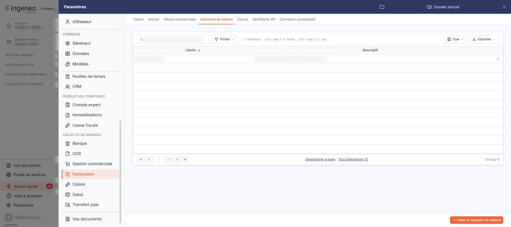

# Scénarios de relance


**Où le trouver :** Panneau **Paramètres** › **Facturation** › **Scénarios de relance**



**En bref** — Les scénarios de relance définissent jusqu'à cinq envois selon le retard d'une facture, avec pour chacun un modèle d'e-mail et une lettre de relance ; ils s'affectent ensuite aux clients.

* Pour créer un scénario : bouton \[Créer un scénario de relance], paramétrez ses envois, puis bouton \[Enregistrer].
* Pour l'appliquer : affectez-le au client dans le pavé « Relances » de sa fiche.


Les scénarios de relance permettent d'envoyer des e-mails de relance de manière automatique, ou déclenchés à la demande. Un scénario peut comporter jusqu'à cinq envois différents, selon le nombre de jours de retard d'une facture ; pour chaque envoi, vous choisissez le modèle d'e-mail qui sera adressé au client et le modèle de lettre de relance qui y sera joint.

<figure><figcaption>
Écran « Scénarios de relance » de la nouvelle interface
</figcaption></figure>

Vous pouvez créer plusieurs scénarios, par exemple selon le type de client. Un scénario doit ensuite être affecté à vos clients, dans le pavé « Relances » de la fiche client : c'est là que la relance automatique s'active, client par client.

Cet écran s'ouvre depuis le panneau « Paramètres » : « Paramètres > Facturation > Scénarios de relance ».

## La liste des scénarios

La liste présente deux colonnes, toutes deux triables : **Libellé** et **Descriptif**. Elle est triée par défaut sur le libellé, dans l'ordre croissant, et aucun critère n'est posé à l'ouverture.

Au-dessus de la liste, la barre « Rechercher un scénario de relance… » permet de retrouver un scénario par saisie, et le bouton \[Filtres] de poser des critères sur les colonnes ; à l'extrémité droite, le bouton \[Vue] permet de gérer vos vues et de choisir les colonnes affichées, et le bouton \[Exporter] ouvre le menu d'édition de la liste. Il n'y a pas de menu de filtres spéciaux.

Un clic sur une ligne la sélectionne ; un second clic la désélectionne. Sous la liste, « Sélectionner la page » et « Tout sélectionner (N) » sélectionnent d'un coup les scénarios de la page ou tous les scénarios. Dès qu'une ligne est sélectionnée, un bandeau apparaît au bas de l'écran : il indique le nombre de scénarios sélectionnés, remplace le bouton de création et porte le bouton \[Supprimer]. En dernière colonne de chaque ligne, un pictogramme « Autres actions » (trois points) ouvre un menu à trois entrées : « Modifier », qui ouvre la fiche du scénario, « Dupliquer » et « Supprimer ».

bouton **\[Créer un scénario de relance]**, en bas à droite de l'écran, ouvre une fiche vierge. bouton **\[Supprimer]**, dans le bandeau de sélection, porte sur les scénarios sélectionnés.

## Menu « Filtres »

Le bouton \[Filtres] ouvre un menu « Filtrer » : vous y ajoutez un critère par « + Ajouter un critère sur… », et la liste des colonnes proposées porte dix critères : **Libellé**, **Descriptif**, **Nombre d'étapes**, **Périodicité**, **Jour semaine**, **Jour 1**, **Jour 2**, **Jour**, **E-mail expédition** et **E-mails copie**.

Vous pouvez donc filtrer sur des données que la liste n'affiche pas : seuls les deux premiers critères correspondent à une colonne.

Le menu se termine par bouton **\[Filtrer]**, qui applique les critères, et bouton **\[Vider les filtres]**, qui les retire.

## Rubrique « Informations générales »

| Champ                                    | Ce qu'il faut savoir                                                                                                                                                                                                                                                                                                                                                                                                                                                                                                                                                                                                                                                                                                                                                                                                                                                                                                                                             |
| ---------------------------------------- | ---------------------------------------------------------------------------------------------------------------------------------------------------------------------------------------------------------------------------------------------------------------------------------------------------------------------------------------------------------------------------------------------------------------------------------------------------------------------------------------------------------------------------------------------------------------------------------------------------------------------------------------------------------------------------------------------------------------------------------------------------------------------------------------------------------------------------------------------------------------------------------------------------------------------------------------------------------------- |
| **Libellé**                              | 20 caractères au maximum. Il se saisit à la création du scénario, et il n'est plus modifiable ensuite : lorsque vous ouvrez un scénario existant, la zone est grisée, bien que le libellé porte l'astérisque des champs obligatoires. Un scénario ne se renomme donc pas. Deux scénarios ne peuvent pas porter le même libellé.                                                                                                                                                                                                                                                                                                                                                                                                                                                                                                                                                                                                                                  |
| **Descriptif**                           | 1 024 caractères au maximum. Zone de texte libre, reprise dans la colonne **Descriptif** de la liste.                                                                                                                                                                                                                                                                                                                                                                                                                                                                                                                                                                                                                                                                                                                                                                                                                                                            |
| **Nombre de modèles d'envoi**            | De 1 à 5, et 1 à la création d'un scénario. Il correspond aux étapes du scénario : le nombre d'envois que vous voulez enchaîner selon l'importance du retard.                                                                                                                                                                                                                                                                                                                                                                                                                                                                                                                                                                                                                                                                                                                                                                                                    |
| **Fréquence de vérification**            | 
Une barre de quatre boutons, dont un seul est retenu à la fois. Ils commandent la façon dont les factures de vos clients seront examinées, et le champ de planification affiché juste après. À la création d'un scénario, le logiciel retient « Hebdomadaire » : • <strong>Manuelle</strong> : aucun champ de planification n'est demandé. Le scénario ne sera utilisé que pour les relances déclenchées à la demande, depuis l'édition des relances clients du menu « Editions » ; • <strong>Hebdomadaire</strong> : les factures sont examinées une fois par semaine, et le logiciel vous demande le <strong>Jour de la semaine</strong> ; • <strong>Bimensuelle</strong> : deux fois par mois, et le logiciel vous demande <strong>Jour 1</strong> et <strong>Jour 2</strong>. Le second jour doit être postérieur au premier.. ; • <strong>Mensuelle</strong> : une fois par mois, et le logiciel vous demande le <strong>Jour</strong>..
 |
| **Adresse e-mail d'expédition**          | 50 caractères au maximum. C'est l'adresse qui figurera dans les e-mails de relance adressés à vos clients. À la création d'un scénario, le logiciel la prérenseigne avec l'adresse de l'utilisateur connecté : pensez à la remplacer si vos relances doivent partir d'une adresse de service.                                                                                                                                                                                                                                                                                                                                                                                                                                                                                                                                                                                                                                                                    |
| **Adresse(s) e-mail d'envoi des copies** | 1 024 caractères au maximum. Pour recevoir une copie des e-mails de relance envoyés, indiquez la ou les adresses dans cette zone, séparées par des points-virgules.                                                                                                                                                                                                                                                                                                                                                                                                                                                                                                                                                                                                                                                                                                                                                                                              |

## Rubrique « Modèles d'envoi »

Cette rubrique présente cinq onglets, « Modèle d'envoi 1 » à « Modèle d'envoi 5 », un par étape possible. Les onglets sont toujours affichés, mais seuls les premiers sont accessibles : leur nombre est celui que vous avez retenu dans **Nombre de modèles d'envoi**, les suivants restent grisés.

Chaque onglet porte les trois mêmes champs, tous obligatoires :

* **Nombre de jours de retard** : le nombre de jours de retard à partir duquel l'envoi de cette étape est déclenché. Le nombre de jours d'une étape doit toujours être supérieur à celui de l'étape précédente ;
* **Modèle d'e-mail** : le message qui sera envoyé. La liste ne propose que vos modèles d'e-mails de type « Relance », créés dans « Paramètres > Modèles > E-mails » ;
* **Modèle de lettre de relance** : la lettre jointe à l'e-mail. La liste ne propose que vos modèles d'impression de type « Lettre de relance », créés dans « Paramètres > Modèles > Documents > Pages de document ».

## Bouton \[Enregistrer]

Placé en bas à droite de la fiche, il enregistre le scénario et ses étapes.

## Retour à la liste

Le bouton \[Retour] n'est plus affiché dans la fiche : le chevron « Retour », à gauche de la barre d'onglets du panneau Paramètres, quitte la fiche sans enregistrer votre saisie et vous ramène à la liste des scénarios.
