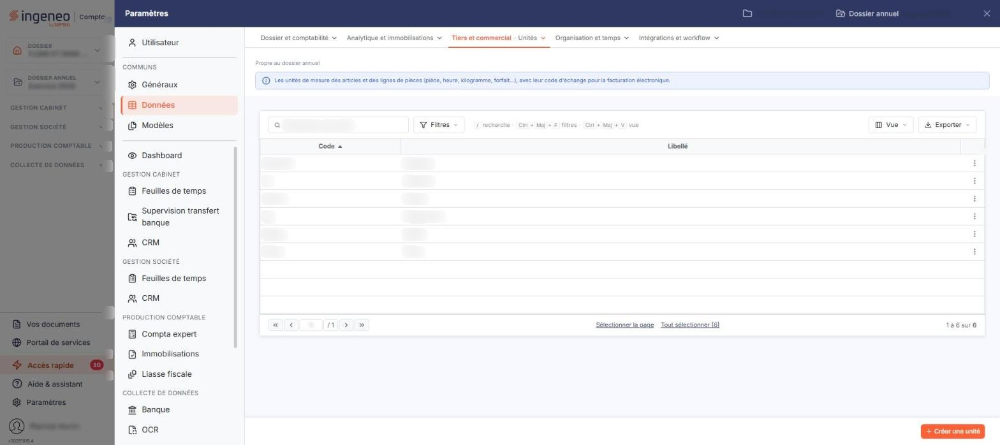

# Unités


**Où le trouver :** Panneau **Paramètres** › **Données** › **Tiers et commercial** › **Unités**



**En bref** — Cet écran gère les unités de mesure utilisées avec les quantités dans les articles et les comptes, et leur rattachement au fichier normé de la facture électronique.

* Pour créer une unité : bouton \[Créer une unité], saisissez son code et son libellé, puis bouton \[Enregistrer].


Cet écran s'ouvre depuis le panneau « Paramètres » : « Paramètres > Données > Tiers et commercial > Unités ».

<figure><figcaption>
Écran « Unités » de la nouvelle interface
</figcaption></figure>

Cette option vous permet de gérer les unités de mesure que vous utilisez avec les quantités : elles sont proposées dans les fiches articles ainsi que dans les comptes généraux et auxiliaires qui gèrent des quantités.

Une unité se compose d'un code, obligatoire, et d'un libellé, facultatif. Une rubrique complémentaire vous permet de mettre chaque unité en relation avec le fichier normé de la facture électronique.

## La liste des unités

La liste présente deux colonnes : **Code** et **Libellé**. Elle est triée par défaut sur le code, dans l'ordre croissant, et chacune des deux colonnes peut servir de critère de tri.

Au-dessus de la liste, la barre « Rechercher une unité… » et le bouton **\[Filtres]** permettent de restreindre l'affichage ; sans critère, la totalité des unités est affichée. La liste ne comporte pas de colonne de statut.

Les deux champs de la rubrique « Facture électronique » de la fiche ne figurent pas dans la liste : le rattachement d'une unité au fichier normé n'est donc pas visible depuis la liste, seulement depuis la fiche de l'unité.

Lorsqu'aucune unité n'a encore été créée, le logiciel affiche le message « Aucun élément à afficher. ». Le pied de la liste indique le nombre d'unités affichées (« 1 à 6 sur 6 »).

Un clic sur une ligne la sélectionne. Au survol d'une ligne, un pictogramme « Autres actions » (trois points) apparaît à son extrémité droite et ouvre un menu à trois entrées : « Modifier », « Dupliquer » et « Supprimer ». Au-dessus de la liste, le bouton **\[Vue]** permet de choisir les colonnes affichées et d'enregistrer des vues, et le bouton **\[Exporter]** donne accès à l'aperçu, à l'impression et aux exports de la liste. Sous la liste, bouton **\[Sélectionner la page]** et bouton **\[Tout sélectionner (n)]** étendent la sélection à la page affichée ou à toutes les unités.

## Bouton \[Créer une unité]

Situé dans la barre du bas, à droite, hors du tableau, il ouvre une fiche vierge pour créer une nouvelle unité.

## Bouton \[Supprimer]

Il apparaît dans le bandeau de sélection, qui s'affiche au bas de l'écran dès qu'une ligne est sélectionnée (avec le lien « Tout désélectionner ») et remplace alors la barre où figure \[Créer une unité] ; il porte sur les unités sélectionnées.

## Rubrique « Informations générales »

La fiche d'une unité s'ouvre sur cette rubrique, suivie de la rubrique « Facture électronique » ; les deux sont affichées simultanément.

| Champ       | Ce qu'il faut savoir      |
| ----------- | ------------------------- |
| **Code**    | 10 caractères au maximum. |
| **Libellé** | 50 caractères au maximum. |

## Rubrique « Facture électronique »

Le logiciel affiche en tête de cette rubrique le texte suivant : « Cette rubrique est présente pour une période de transition le temps de la généralisation de la facture électronique. La norme exige l'utilisation d'un fichier normé, il est donc nécessaire de mettre en relation les unités actuelles avec ce fichier. »

| Champ                                      | Ce qu'il faut savoir                                                                                                                                                                                                                      |
| ------------------------------------------ | ----------------------------------------------------------------------------------------------------------------------------------------------------------------------------------------------------------------------------------------- |
| **Code unité « Facture électronique »**    | Une loupe placée à droite du champ ouvre une fenêtre « Recherche » destinée à retrouver l'unité correspondante dans le fichier normé ; son infobulle vous rappelle que le raccourci clavier « Ctrl » + « Alt » + « R » l'ouvre également. |
| **Libellé unité « Facture électronique »** | Ce champ est grisé et ne se saisit pas. Il est destiné à être rempli par la sélection faite dans la loupe.                                                                                                                                |

La fenêtre « Recherche » comporte dans son en-tête une croix qui la ferme, puis un champ **Contenu recherché** précédé d'une loupe (il n'y a plus de bouton \[Rechercher]) ; un pictogramme d'information placé à sa droite rappelle les raccourcis clavier de la fenêtre, par exemple « Ctrl » + « Entrée » pour lancer la recherche.

À ce jour, le rattachement d'une unité au fichier normé ne peut pas être réalisé depuis cette fenêtre : la recherche n'aboutit pas. Le point est signalé. En attendant sa correction, renseignez directement la zone **Code unité « Facture électronique » :** si vous connaissez le code normé, celle-ci restant saisissable.

## Bouton \[Enregistrer]

Il enregistre l'unité.

## Retour à la liste

Le bouton \[Retour] n'est plus affiché dans la fiche : le chevron « Retour » de la barre d'onglets du panneau vous ramène à la liste des unités sans enregistrer votre saisie.
