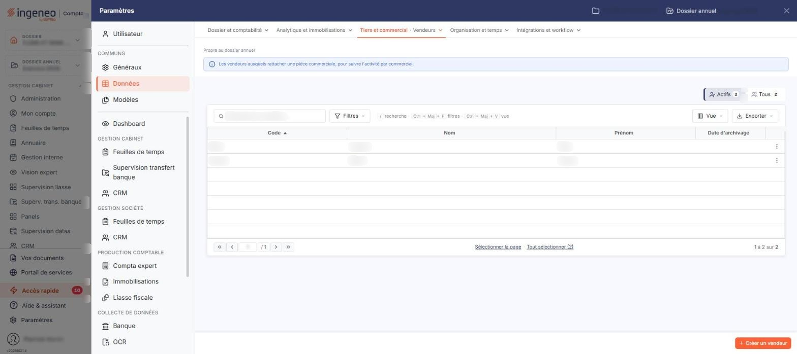

# Vendeurs


**Où le trouver :** Panneau **Paramètres** › **Données** › **Tiers et commercial** › **Vendeurs**



**En bref** — Ce fichier facultatif tient les vendeurs, dont le code s'affecte aux pièces commerciales pour trier et sélectionner ensuite selon le vendeur.

* Pour créer un vendeur : bouton \[Créer un vendeur], renseignez sa fiche, puis bouton \[Enregistrer].
* Pour voir aussi les vendeurs archivés : bouton \[Filtres spéciaux], puis activez l'interrupteur « Vendeurs archivés ».


La gestion du fichier des vendeurs est facultative. Elle permet d'affecter des codes vendeurs aux pièces commerciales afin, ultérieurement, d'effectuer des tris et des sélections selon ces codes.

<figure><figcaption>
Écran « Vendeurs » de la nouvelle interface
</figcaption></figure>

## La liste des vendeurs

Au-dessus de la liste, la barre « Rechercher un vendeur… » permet de retrouver un vendeur ; le bouton \[Filtres] ouvre le volet de filtres de la liste, et, au-dessus de la barre, deux segments comptés, « Actifs » et « Tous », choisissent d'inclure ou non les vendeurs archivés :

| Champ                                               | Ce qu'il faut savoir                                                                                                                                                                                                                                                                                                                                                                                                                                                                           |
| --------------------------------------------------- | ---------------------------------------------------------------------------------------------------------------------------------------------------------------------------------------------------------------------------------------------------------------------------------------------------------------------------------------------------------------------------------------------------------------------------------------------------------------------------------------------- |
| **Actifs / Tous :« Actifs » est retenu par défaut** | La liste ne présente donc que les vendeurs non archivés. Chaque segment affiche le nombre de vendeurs qu'il retient ; « Tous » donne le total, archivés compris. Une liste vide ne signifie donc pas nécessairement que le dossier ne contient aucun vendeur : elle peut aussi vouloir dire qu'il n'en contient aucun de non archivé. Choisissez « Tous » pour voir également les vendeurs archivés, et lever le doute : le nombre affiché sur ce segment le montre sans même ouvrir la liste. |
| **Recherche d'un vendeur**                          | Saisissez votre recherche dans la barre « Rechercher un vendeur… » ; elle remplace le champ Vendeur et sa loupe.                                                                                                                                                                                                                                                                                                                                                                               |

La liste présente quatre colonnes : **Code**, **Nom**, **Prénom** et **Date d'archivage**. Sous la liste, le pied indique la plage affichée (« 1 à 2 sur 2 ») et porte les boutons \[Sélectionner la page] et \[Tout sélectionner (n)] ; un clic sur une ligne la sélectionne. Lorsqu'aucun vendeur ne répond aux filtres, le logiciel affiche le message « Aucun élément à afficher. »

Au survol d'une ligne, le pictogramme « Autres actions » (trois points), en fin de ligne, ouvre un menu qui propose « Modifier », qui ouvre la fiche du vendeur, « Dupliquer » et « Supprimer ».

Le bouton \[Vue] ouvre un menu « Mes vues » (« Enregistrer la vue actuelle ») et « Colonnes affichées », où vous choisissez les colonnes visibles : outre les quatre colonnes ci-dessus, la liste peut présenter la colonne **Archivé par**, masquée par défaut (« 4 colonnes affichées sur 5 »). Ses boutons sont le bouton **\[Rétablir les colonnes d'origine]** et le bouton **\[Appliquer]**. Le volet \[Filtres] propose ces cinq mêmes colonnes comme critères (« + Ajouter un critère sur… ») ; ses boutons sont le bouton **\[Vider les filtres]** et le bouton **\[Filtrer]**, qui lance la recherche. Le bouton \[Exporter] ouvre le menu d'aperçu, d'impression et d'export de la liste (Excel, PDF, envoi de la liste par e-mail).

bouton **\[Créer un vendeur]**

Placé en bas à droite de l'écran, hors de la liste, il ouvre une fiche vierge pour créer un vendeur.

bouton **\[Supprimer]**

Dès qu'une ligne est sélectionnée, un bandeau de sélection remplace la barre du bas et porte le bouton \[Supprimer], qui supprime les vendeurs sélectionnés.

bouton **\[Archiver]**

Le bouton \[Archiver] figure dans le bandeau de sélection, à côté de \[Supprimer], et non plus au bas de la liste.

## La fiche d'un vendeur

La fiche comporte une seule rubrique, « Informations générales », et trois champs. La fiche se termine par le bouton **\[Enregistrer]**. Pour revenir à la liste, utilisez le chevron « Retour » à gauche de la barre d'onglets du panneau Paramètres.

| Champ      | Ce qu'il faut savoir      |
| ---------- | ------------------------- |
| **Code**   | 15 caractères au maximum. |
| **Nom**    | 30 caractères au maximum. |
| **Prénom** | 15 caractères au maximum. |
