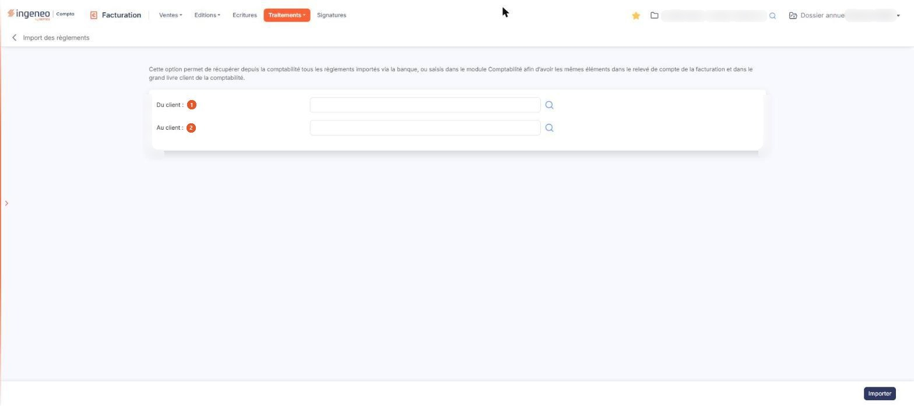

# Import des règlements


**Où le trouver :** Menu **Traitements › Import des règlements**



**En bref** — Cet écran reprend en facturation les règlements enregistrés en comptabilité, pour une fourchette de clients, afin que relevés de compte et grand livre client concordent.

* Pour importer les règlements : indiquez au besoin les clients de début et de fin, puis bouton \[Importer] et lisez le compte rendu.


Cette option reprend en facturation les règlements enregistrés en comptabilité, afin que le relevé de compte de la facturation et le grand livre client de la comptabilité portent les mêmes éléments. Sont concernés les règlements importés depuis la banque comme ceux saisis directement dans le module de comptabilité.

<figure><figcaption>
Écran « Import des règlements » de la nouvelle interface
</figcaption></figure>

Ne confondez pas cette option avec l'option « Import » du même menu « Traitements », qui reprend des données provenant d'un autre logiciel à partir d'un classeur que vous remplissez.

La même reprise se fait par ailleurs client par client, sans passer par cet écran : lorsque l'option « Importer les règlements de la comptabilité » est active dans le panneau « Paramètres », rubrique « Facturation », onglet « Connexion comptabilité », les écritures du compte d'un client sont relues à l'ouverture de sa fiche de pointage. L'écran décrit ici traite, lui, une fourchette de clients d'un seul coup.

L'écran est un formulaire de lancement : il ne comporte ni tableau, ni rubrique, ni onglet. Il vous rappelle en tête l'objet du traitement, dans les termes suivants :

« Cette option permet de récupérer depuis la comptabilité tous les règlements importés via la banque, ou saisis dans le module Comptabilité afin d’avoir les mêmes éléments dans le relevé de compte de la facturation et dans le grand livre client de la comptabilité. »

## Les deux bornes de clients

Deux champs seulement, présentés l'un sous l'autre, délimitent la fourchette de clients à traiter :

| Champ            | Ce qu'il faut savoir                |
| ---------------- | ----------------------------------- |
| 1. **Du client** | Le premier client de la fourchette. |
| 2. **Au client** | Le dernier client de la fourchette. |

Les deux champs sont vides à l'ouverture de l'écran, et ni l'un ni l'autre n'est signalé comme obligatoire. Vous les renseignez de deux façons : en saisissant directement le code du client — le logiciel vous propose alors, sous le champ, les clients dont le code correspond à votre saisie, chacun avec sa raison sociale —, ou en cliquant le pictogramme « Loupe » placé à droite du champ, qui ouvre une fenêtre de recherche.

## La fenêtre « Sélection d'un client »

Cette fenêtre présente un champ de recherche **Client**, précédé d'une loupe. Il n'y a pas de bouton \[Afficher] : la liste des clients s'affiche dès l'ouverture. Le tableau en dessous porte deux colonnes triables, **Code client** et **Raison sociale**, la liste étant présentée par ordre croissant de code client ; il est paginé, avec les boutons de changement de page et un compteur du type « 1 à 10 sur N » en bas à droite. La mention « Cliquez pour sélectionner » figure en bas de la fenêtre : il n'y a pas de case à cocher, vous retenez un client en cliquant sa ligne.

La fenêtre ne comporte ni bouton de fermeture, ni bouton d'annulation : la croix du bandeau de titre est la seule sortie.

## Bouton \[Importer]

C'est le seul bouton de l'écran, placé en bas à droite : il n'y a pas d'annulation, et l'on quitte l'écran par la flèche « Revenir en arrière », à gauche du fil d'Ariane. Il lance le traitement, qui crée dans la facturation les règlements trouvés en comptabilité pour la fourchette de clients indiquée. Ce traitement est commandé par l'option « Importer les règlements de la comptabilité » du panneau « Paramètres », rubrique « Facturation », onglet « Connexion comptabilité » : lorsqu'elle est inactive, aucun règlement n'est importé et le logiciel vous l'indique en vous invitant à l'activer.

Le traitement part **directement**, sans demande de confirmation : vous voyez le voile d'attente habituel du logiciel, et non une barre de progression. À la fin, une fenêtre « Import des règlements » vous donne le compte rendu — le nombre de règlements et de remboursements importés, ou la mention « Aucun nouveau règlement ou remboursement à importer depuis la comptabilité. » lorsque rien n'a été trouvé.

Laisser les deux bornes vides n'est pas refusé : **tous** les clients du dossier sont alors traités.
